# Alert: UI change report for Figma

Figma source: [https://www.figma.com/design/q84boKV4Bly9HKXzdtBj2K/New-Design-System---MyO?node-id=924-9912](https://www.figma.com/design/q84boKV4Bly9HKXzdtBj2K/New-Design-System---MyO?node-id=924-9912)  
Storybook: `V2/Components/Alert`  
Date: 2026-10-04

## Summary

The close button now has a 24px target around a 16px icon (it was a 20px box holding a 20px icon). A -2px margin keeps the old 20px layout footprint, so the alert height, the icon position and the row layout do not move; only the clickable area grows and the glyph is lighter. Hover colour is applied on hover-capable pointers only.

### Why (what the research found)

- WCAG 2.2 success criterion 2.5.8 (Target Size, Minimum) asks for pointer targets of at least 24 x 24 CSS px; a 20px close button misses it.
- Per the brief's research, a 16px glyph in a 24px target is the usual pairing in the compared systems (Untitled UI, shadcn/ui, HeroUI); it also keeps the X from looking heavy next to the 20px status icon.
- Hover is gated with `@media (hover: hover)` (the React Aria approach of ignoring touch-emulated hover) so a tap does not leave the X in its hover colour.
- Research references (HeroUI, Mantine, shadcn/ui, Untitled UI, React Aria) come from the task brief's research conclusions; they were not re-verified source by source while implementing.

### API / compatibility

No prop, callback, aria-label ("Close alert"), variant, colour or layout change. Alert box heights, paddings and radii are identical before and after in every captured scenario.

## Before and after

### All six variants, closable

| Before | After |
| --- | --- |
|  | 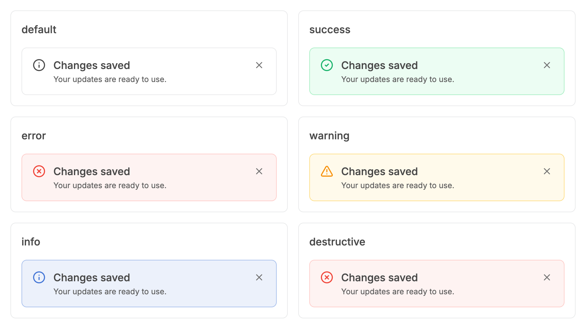 |

### Header presentation, closable

| Before | After |
| --- | --- |
| 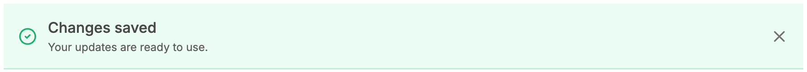 | 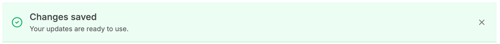 |

### Inline, closable

| Before | After |
| --- | --- |
|  | 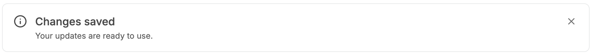 |

### Inline warning with actions, closable

| Before | After |
| --- | --- |
| 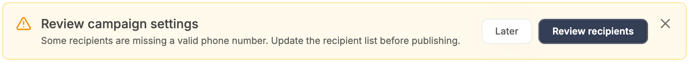 | 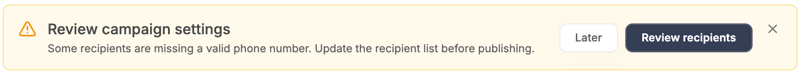 |

### Inline error, closable

| Before | After |
| --- | --- |
| 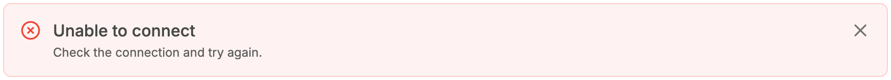 | 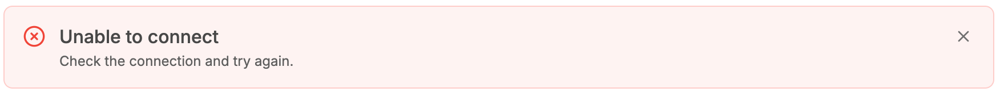 |

### Inline, keyboard focus on close

| Before | After |
| --- | --- |
| 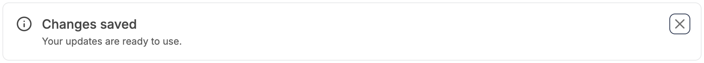 | 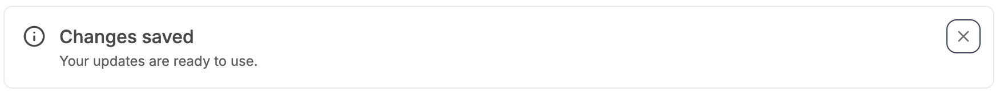 |

### Inline, hover on close

| Before | After |
| --- | --- |
| 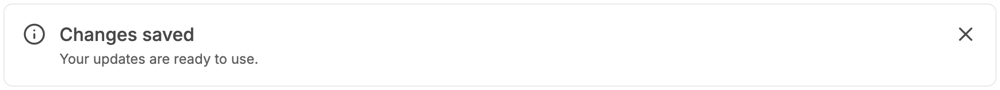 |  |

### Not closable (unchanged)

| Before | After |
| --- | --- |
| 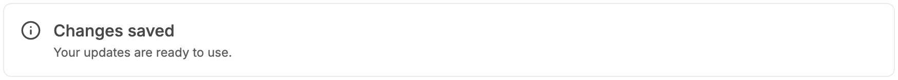 |  |

### Overlay presentation, closable (with actions)

| Before | After |
| --- | --- |
| 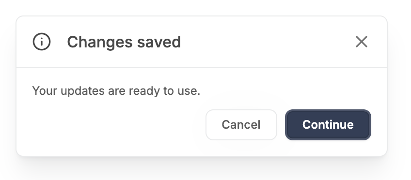 |  |

## Measured changes (copy these into Figma)

_Source: computed styles of the rendered component; px, hex colours, ms. Only properties that changed are listed._

### All six variants, closable

| Element | Property | Before | After |
| --- | --- | --- | --- |
| Close button | width | 20px | **24px** |
| Close button | height | 20px | **24px** |
| Close button | margin-top | 0px | **-2px** |
| Close button | margin-left | 0px | **-2px** |
| Close button | border-radius | 4px | **6px** |
| Close icon | width | 20px | **16px** |
| Close icon | height | 20px | **16px** |

### Header presentation, closable

| Element | Property | Before | After |
| --- | --- | --- | --- |
| Close button | width | 20px | **24px** |
| Close button | height | 20px | **24px** |
| Close button | margin-top | 0px | **-2px** |
| Close button | margin-left | 0px | **-2px** |
| Close button | border-radius | 4px | **6px** |
| Close icon | width | 20px | **16px** |
| Close icon | height | 20px | **16px** |

### Inline, closable

| Element | Property | Before | After |
| --- | --- | --- | --- |
| Close button | width | 20px | **24px** |
| Close button | height | 20px | **24px** |
| Close button | margin-top | 0px | **-2px** |
| Close button | margin-left | 0px | **-2px** |
| Close button | border-radius | 4px | **6px** |
| Close icon | width | 20px | **16px** |
| Close icon | height | 20px | **16px** |

### Inline warning with actions, closable

| Element | Property | Before | After |
| --- | --- | --- | --- |
| Close button | width | 20px | **24px** |
| Close button | height | 20px | **24px** |
| Close button | margin-top | 0px | **-2px** |
| Close button | margin-left | 0px | **-2px** |
| Close button | border-radius | 4px | **6px** |
| Close icon | width | 20px | **16px** |
| Close icon | height | 20px | **16px** |

### Inline error, closable

| Element | Property | Before | After |
| --- | --- | --- | --- |
| Close button | width | 20px | **24px** |
| Close button | height | 20px | **24px** |
| Close button | margin-top | 0px | **-2px** |
| Close button | margin-left | 0px | **-2px** |
| Close button | border-radius | 4px | **6px** |
| Close icon | width | 20px | **16px** |
| Close icon | height | 20px | **16px** |

### Inline, keyboard focus on close

| Element | Property | Before | After |
| --- | --- | --- | --- |
| Close button | width | 20px | **24px** |
| Close button | height | 20px | **24px** |
| Close button | margin-top | 0px | **-2px** |
| Close button | margin-left | 0px | **-2px** |
| Close button | border-radius | 4px | **6px** |
| Close icon | width | 20px | **16px** |
| Close icon | height | 20px | **16px** |

### Inline, hover on close

| Element | Property | Before | After |
| --- | --- | --- | --- |
| Close button | width | 20px | **24px** |
| Close button | height | 20px | **24px** |
| Close button | margin-top | 0px | **-2px** |
| Close button | margin-left | 0px | **-2px** |
| Close button | border-radius | 4px | **6px** |
| Close icon | width | 20px | **16px** |
| Close icon | height | 20px | **16px** |

### Overlay presentation, closable (with actions)

| Element | Property | Before | After |
| --- | --- | --- | --- |
| Close button | width | 20px | **24px** |
| Close button | height | 20px | **24px** |
| Close button | margin-top | 0px | **-2px** |
| Close button | margin-left | 0px | **-2px** |
| Close button | border-radius | 4px | **6px** |
| Close icon | width | 20px | **16px** |
| Close icon | height | 20px | **16px** |

## Motion

| What | Before | After |
| --- | --- | --- |
| Close icon colour on hover | 150ms colour fade, applied also after a tap | **150ms colour fade, only on hover-capable pointers** |

## States to update in Figma

- Alert / Close button (all presentations: Inline, Header, Overlay; all six colour variants): hit area 20x20 -> 24x24, icon 20 -> 16, corner radius 4 -> 6
- Alert / Close button / Hover: icon colour #707070 -> #484848 (unchanged values)
- Alert / Close button / Focus: 1px #343E55 outline, offset 2 (unchanged), now follows the 6px radius

## How to apply in Figma

1. In the Alert close button component, set the icon (X, Lucide "x") to 16 x 16 (was 20 x 20). Stroke colour stays #707070 (--v2-text-muted); Hover #484848 (--v2-text-primary).
2. Wrap the icon in a 24 x 24 frame (the hit area), icon centred (4px on every side), fill none, corner radius 6 (was 4). This frame is the interactive/focus target.
3. Keep the layout footprint at 20 x 20 so nothing around it moves: either keep the existing 20 x 20 slot and place the 24 x 24 frame inside it with "Ignore auto layout" at X -2, Y -2, or give the 24 x 24 frame margin -2 on all sides (code does this with -m-0.5). The icon centre must stay exactly where the old 20px icon centre was.
4. Focus state: outline 1px #343E55 (semantic-primary), offset 2, around the 24 x 24 frame, corner radius 6. No fill change on hover (there is no hover plate on the Alert close button).
5. Apply to Inline, Header and Overlay presentations. In Overlay the button sits in the header row (padding 16, gap 16) and in Header/Inline it is the trailing item; vertical alignment is unchanged (centre in Header and Overlay, top in Inline).
6. Nothing else in the Alert changes: padding 16, radius 8, status icon 20px, title 16/500, description 12/400, borders and fills stay as they are.

## Notes

- No hover plate was added: the brief asked for the target, the icon size and hover gating only. A neutral plate like the Tag's would be a one-class addition if wanted.
- Measured: close button 20x20 -> 24x24 with margin -2px, border radius 4px -> 6px, icon 20 -> 16; Alert height unchanged (73px in the default inline story).
- Replaying the v1 alert tests on v2 fails 9 tests; all are v1 utility-class assertions (variant colours, base classes, title/description weight), none involve the close button.
- Research references (HeroUI, Mantine, shadcn/ui, Untitled UI, React Aria) come from the task brief's research conclusions; they were not re-verified source by source while implementing.
