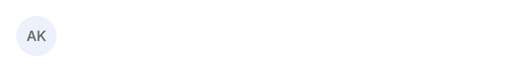
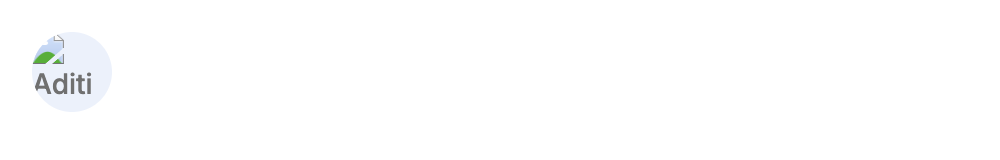
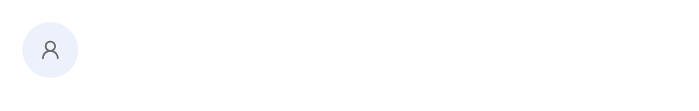
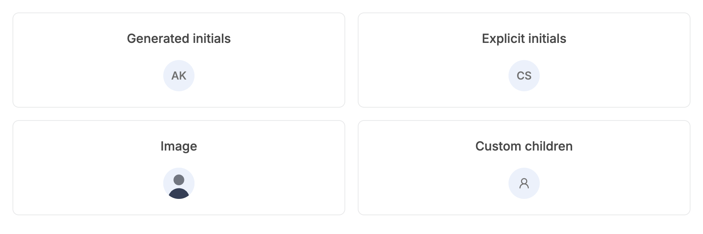
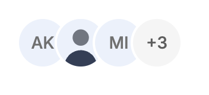
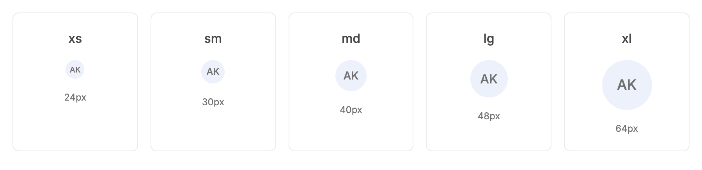
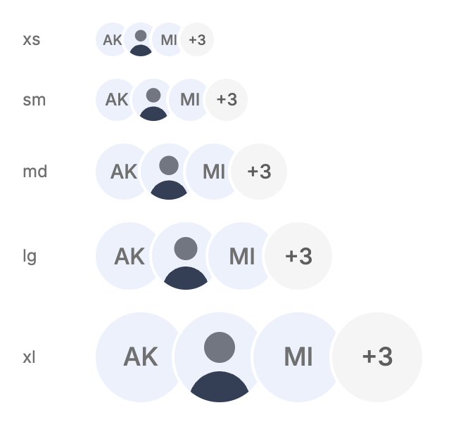
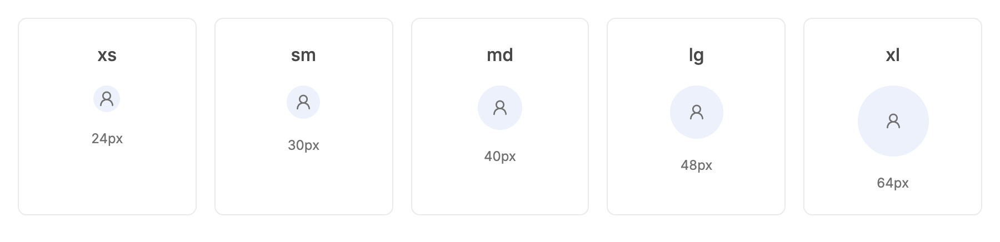
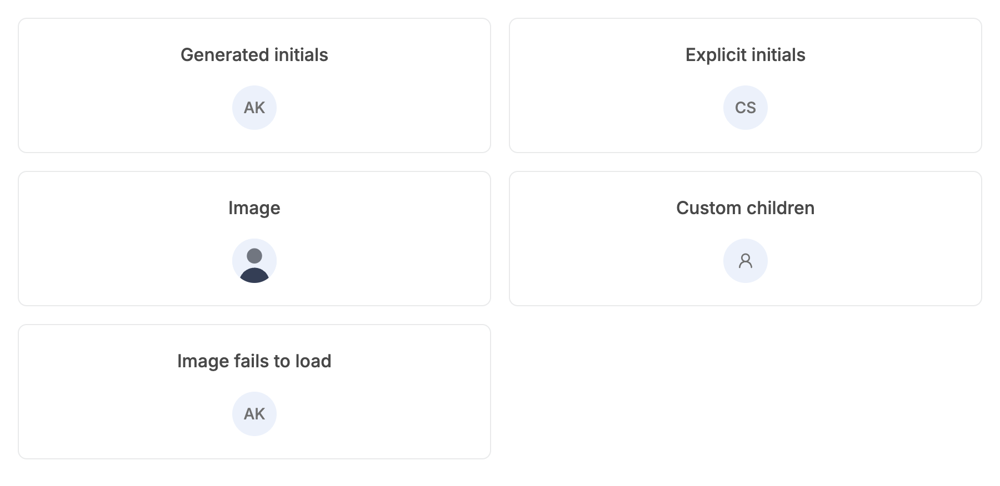
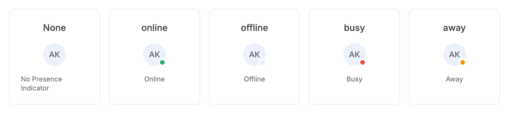

# Avatar: UI change report for Figma

Figma source: [https://www.figma.com/design/q84boKV4Bly9HKXzdtBj2K/New-Design-System---MyO?node-id=924-9983](https://www.figma.com/design/q84boKV4Bly9HKXzdtBj2K/New-Design-System---MyO?node-id=924-9983)  
Storybook: `V2/Components/Avatar`  
Date: 2026-10-04

## Summary

Two additive changes. A failing image URL now falls back to the custom content or initials, exactly like an avatar with no src (before, the browser's broken-image glyph and alt text showed inside the circle); nothing changes while the image loads. A new AvatarGroup export stacks avatars with an 8px overlap (4px at xs and sm, where 8px would hide the initials) and a 2px surface-coloured ring, and max collapses the rest into a same-size "+N" tile.

### Why (what the research found)

- A dead image URL (deleted photo, expired signed URL, offline) leaves a broken-image icon in the circle in every browser; HeroUI and Mantine avatars both fall back to initials or a placeholder on image error.
- Overlapping stacks with a ring in the surface colour and a "+N" overflow tile are the standard group pattern in Untitled UI, HeroUI AvatarGroup and Mantine Avatar.Group; the ring keeps adjacent avatars readable on any fill.
- One-accent rule: no per-user hashed background colours; the tile and fallbacks stay neutral.
- Research references (HeroUI, Mantine, shadcn/ui, Untitled UI, React Aria) come from the task brief's research conclusions; they were not re-verified source by source while implementing.

### API / compatibility

Avatar props and exports are unchanged. New: `AvatarGroup` export (props: max, size, plus div attributes; role="group"). No hash-coloured fallbacks and no fade-in: avatars stay static per design/V2-MOTION.md.

## Before and after

### Image that fails to load, name given: before = broken-image glyph and alt text, after = initials

| Before | After |
| --- | --- |
|  |  |

### Image fails to load with icon children: before = broken image, after = the icon

| Before | After |
| --- | --- |
|  |  |

### NEW AvatarGroup, md, max 3 (before = the closest existing story, individual avatars without overlap)

| Before | After |
| --- | --- |
|  |  |

### NEW AvatarGroup at all five sizes (before = the sizes story, single avatars)

| Before | After |
| --- | --- |
|  |  |

### All five sizes, icon children (unchanged)

| Before | After |
| --- | --- |
|  |  |

### All five sizes, initials (unchanged)

| Before | After |
| --- | --- |
|  |  |

### Generated initials, explicit initials, image, custom children (the failing-image card is new)

| Before | After |
| --- | --- |
|  |  |

### Presence dots (unchanged)

| Before | After |
| --- | --- |
|  |  |

### Working image (unchanged)

| Before | After |
| --- | --- |
|  |  |

## Measured changes (copy these into Figma)

_Source: computed styles of the rendered component; px, hex colours, ms. Only properties that changed are listed._

### Image that fails to load, name given: before = broken-image glyph and alt text, after = initials

| Element | Property | Before | After |
| --- | --- | --- | --- |
| Image | _(removed)_ | present | — |

### Image fails to load with icon children: before = broken image, after = the icon

| Element | Property | Before | After |
| --- | --- | --- | --- |
| Image | _(removed)_ | present | — |

### NEW AvatarGroup, md, max 3 (before = the closest existing story, individual avatars without overlap)

| Element | Property | Before | After |
| --- | --- | --- | --- |
| Group | _(new element)_ | — | present |
| Avatar (second) | _(new element)_ | — | present |
| Overflow tile | _(new element)_ | — | present |

## Motion

| What | Before | After |
| --- | --- | --- |
| Image fallback and group | n/a | **None by design: avatars are deliberately static (no fade-in, no hover motion)** |

## States to update in Figma

- Avatar / Image: add a documentation note that a failed image shows the same visual as the matching Initials (or Icon) variant; no new Figma variant is needed
- AvatarGroup (NEW component): Size = xs | sm | md | lg | xl, Overflow = off | on ("+N" tile)
- AvatarGroup / Overflow tile (NEW): same size as its neighbours, neutral fill, "+N" label

## How to apply in Figma

1. Image avatars: no visual change when the photo loads. For prototypes of the failure case, duplicate the Initials (or Icon) variant and label it "Image failed to load"; it must look identical to the Initials variant (soft: fill #ECF1FB, text #707070, Inter 500).
2. Create component AvatarGroup: auto layout horizontal, item spacing -8 (negative), align items center, hug contents, canvas stacking = Last on top (later avatars sit over earlier ones).
3. Group item: any Avatar instance (24 / 30 / 40 / 48 / 64 px by size) with an OUTSIDE stroke 2px #FFFFFF (semantic-bg-primary); the ring is drawn outside the circle, so the circle diameter does not change. On a tinted surface use that surface colour for the ring.
4. Overflow tile (new variant of Avatar, same size as its neighbours): corner radius 9999, fill #F5F5F5 (semantic-bg-ui), same 2px #FFFFFF outside stroke, centred label "+N" (N = hidden count) in Inter 500, colour #5E5E5E (--v2-text-secondary), font size by size: xs 10, sm 12, md 14, lg 16, xl 18. The tile counts as an extra item after the max avatars (max 3 of 6 shows 3 avatars + "+3").
5. Measured overlap is exactly 8px at every size (xs 24, sm 30, md 40, lg 48, xl 64). Group widths for 4 items (3 avatars + tile): xs 72, sm 96, md 136, lg 168, xl 232 (n x size - (n-1) x 8, excluding the ring).
6. Provide the Size property on the group; the group size applies to avatars that do not set their own. Accessible text (docs): group label via aria-label, tile label "N more".

## Notes

- DECIDED: overlap is 8px from md up and 4px at xs (24px) and sm (30px), because 8px clips the covered initials at those sizes. Group widths for 4 items (3 avatars + tile), excluding the ring: xs 84, sm 108, md 136, lg 168, xl 232.
- The ring colour is the surface colour --semantic-bg-primary (white). On a grey card pass className="[&>*]:ring-semantic-bg-ui".
- Pre-existing, not changed here: the soft variant's initials (#707070 on #ECF1FB) fail axe colour contrast in the story sweep.
- max counts avatars shown before the tile (the tile is extra). max=0 shows only "+N"; non-finite max shows all.
- A failed image is detected via the img onError event. An image that already failed before React attached the handler (server-rendered markup) is not re-checked; this app is client rendered.
- Research references (HeroUI, Mantine, shadcn/ui, Untitled UI, React Aria) come from the task brief's research conclusions; they were not re-verified source by source while implementing.
