# Badge: UI change report for Figma

Figma source: [https://www.figma.com/design/q84boKV4Bly9HKXzdtBj2K/New-Design-System---MyO?node-id=924-6748](https://www.figma.com/design/q84boKV4Bly9HKXzdtBj2K/New-Design-System---MyO?node-id=924-6748)  
Storybook: `V2/Components/Badge`  
Date: 2026-10-04

## Summary

New optional `dot` prop: a 7px status dot before the label in the badge's own text colour, so the dot always matches the variant. Without `dot` the badge renders exactly as before (width, height, colours, markup). The badge grows by 15px (7px dot + 8px gap) when the dot is on.

### Why (what the research found)

- A leading dot is the common status-badge treatment in Untitled UI, HeroUI Chip and Mantine Badge (leftSection); it lets a status read at a glance in dense tables without relying on the fill colour alone.
- Using currentColor makes the dot follow the variant's text colour (and the disabled/outline greys) without per-variant dot tokens; contrast and the status word stay the primary signal, the dot is decorative.
- Research references (HeroUI, Mantine, shadcn/ui, Untitled UI, React Aria) come from the task brief's research conclusions; they were not re-verified source by source while implementing.

### API / compatibility

Additive only: `dot?: boolean` (default false). The dot is an aria-hidden span (no text, no role) and is not rendered with asChild. v1 markup parity test still passes for every variant (no dot by default).

## Before and after

### Active with the dot

| Before | After |
| --- | --- |
| 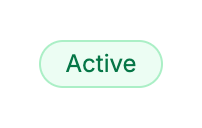 | 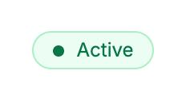 |

### Small / default / large with the dot

| Before | After |
| --- | --- |
| 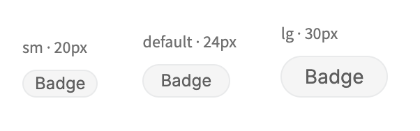 | 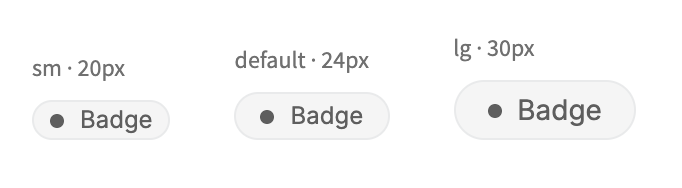 |

### All variants (unchanged)

| Before | After |
| --- | --- |
| 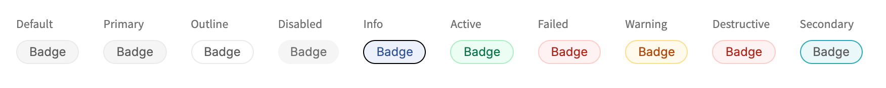 |  |

### All variants with the dot (before = no dot, the arg did not exist)

| Before | After |
| --- | --- |
|  | 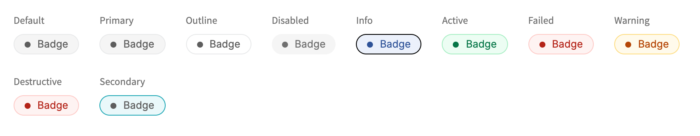 |

### Dot together with a left icon

| Before | After |
| --- | --- |
| 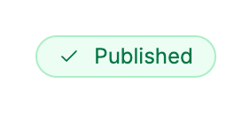 | 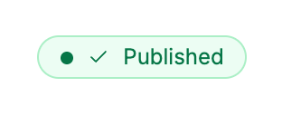 |

### Failed with the dot

| Before | After |
| --- | --- |
| 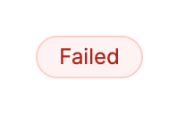 | 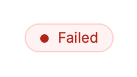 |

### Usage example (unchanged)

| Before | After |
| --- | --- |
| 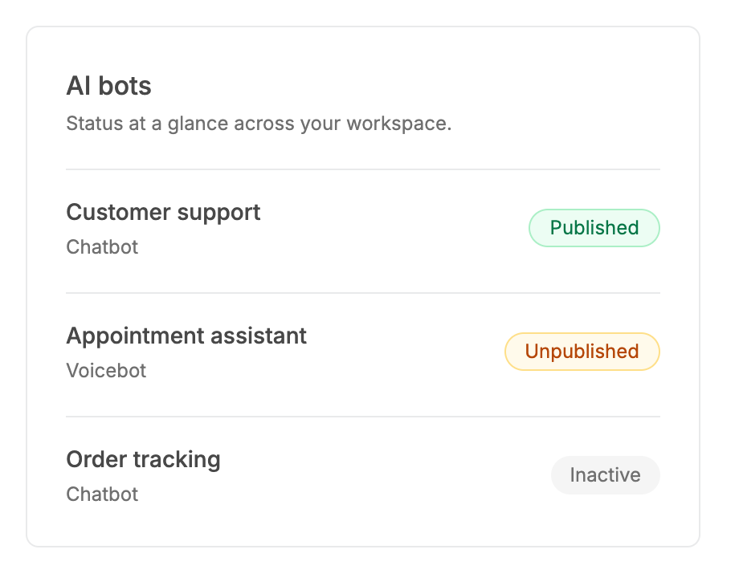 |  |

## Measured changes (copy these into Figma)

_Source: computed styles of the rendered component; px, hex colours, ms. Only properties that changed are listed._

### Active with the dot

| Element | Property | Before | After |
| --- | --- | --- | --- |
| Badge | width | 61.48 | **76.48** |
| Dot | _(new element)_ | — | present |

### Small / default / large with the dot

| Element | Property | Before | After |
| --- | --- | --- | --- |
| Badge | width | 54.3 | **69.3** |
| Dot | _(new element)_ | — | present |

### All variants with the dot (before = no dot, the arg did not exist)

| Element | Property | Before | After |
| --- | --- | --- | --- |
| Badge | width | 62.3 | **77.3** |
| Dot | _(new element)_ | — | present |

### Dot together with a left icon

| Element | Property | Before | After |
| --- | --- | --- | --- |
| Badge | width | 101.7 | **116.7** |
| Dot | _(new element)_ | — | present |

### Failed with the dot

| Element | Property | Before | After |
| --- | --- | --- | --- |
| Badge | width | 59.69 | **74.69** |
| Dot | _(new element)_ | — | present |

## Motion

| What | Before | After |
| --- | --- | --- |
| Dot | n/a | **None (static, like the rest of the badge)** |

## States to update in Figma

- Badge: add boolean property Dot (default off) to every Variant x Size combination that is used (Default, Primary, Outline, Disabled, Info, Active, Failed, Warning, Destructive, Secondary x sm/default/lg)
- Badge / Dot = on: leading ellipse 7 x 7, fill = that variant's text colour

## How to apply in Figma

1. Add a boolean property Dot to the Badge component set (default false). Existing variants are unchanged.
2. When Dot = true add an Ellipse layer named "Dot" as the FIRST child of the badge's auto layout, before the left icon and label: width 7, height 7 (fixed, do not resize with the badge), corner radius 9999 (circle), no stroke.
3. Dot fill = the badge's text colour for that variant: Default, Primary, Outline, Secondary #5E5E5E (--v2-text-secondary); Disabled #707070 (--v2-text-muted); Info #2F5398 (semantic-info-text); Active #067647 (semantic-success-text); Failed and Destructive #B42318 (semantic-error-text); Warning #B54708 (semantic-warning-text). Bind the fill to the label's colour style so they cannot drift apart.
4. Keep the existing badge auto layout: item spacing 8 between the dot, icon and label; padding sm 8/2, default 12/4, lg 16/6; heights 20 / 24 / 30; radius 25. The dot is vertically centred. The default Active badge goes from 61.48 to 76.48 wide (+15 = 7 + 8).
5. The dot is decorative: do not add it to the accessible label; the status word remains the primary signal.

## Notes

- The dot is the same 7px at all three badge sizes, as briefed; at sm (20px high) it looks slightly heavy next to 12px text but stays legible. A 6px dot at sm is a possible refinement.
- The dot uses the badge's own item gap (8px). A tighter 6px dot-to-label gap would need a -2px margin on the dot; not applied.
- With asChild the badge cannot add elements to the slotted child, so dot is ignored there (documented in the prop).
- Replaying the v1 badge tests on v2 fails 10 tests, all v1 utility-class assertions.
- Measured: Badge width grows by exactly 15px with the dot (Active 61.48 -> 76.48, Failed 59.69 -> 74.69, sm default 54.3 -> 69.3); height, padding, gap, radius and colours are unchanged, so no other rows appear. Dot: 7 x 7, radius 9999px, background = the badge's text colour (rgb(6,118,71) on Active, rgb(180,35,24) on Failed, rgb(94,94,94) on Default).
- Research references (HeroUI, Mantine, shadcn/ui, Untitled UI, React Aria) come from the task brief's research conclusions; they were not re-verified source by source while implementing.
