# Checkbox: UI change report for Figma

Figma source: [https://www.figma.com/design/q84boKV4Bly9HKXzdtBj2K/New-Design-System---MyO?node-id=2650-18296](https://www.figma.com/design/q84boKV4Bly9HKXzdtBj2K/New-Design-System---MyO?node-id=2650-18296)  
Storybook: `V2/Components/Checkbox`  
Date: 2026-10-04

## Summary

Checking a box now feels physical: the tick is drawn in, the box pops from 70% to full size, and pressing squeezes it to 96%. The pointer target grows by 4px on every side (28 x 28 for the default 20px box) without moving anything, hover only applies on devices that can hover, and an optional description line can sit under the label.

### Why (what the research found)

- Untitled UI and HeroUI draw the tick with a stroke animation and scale the filled box in; our tick only faded.
- Material and Apple HIG minimum targets are 44-48px; 20px boxes are far below WCAG 2.5.8's 24px minimum. Radix Themes and Mantine extend the clickable area with the label; here a 4px invisible ring is added around the box itself.
- HeroUI and Untitled UI support a supporting-text line under the label; Radio in this system already had one.

### API / compatibility

No prop, callback, aria-label or DOM-contract changes. v2 remains a drop-in for v1 (`npm run verify:v1-v2-compat` passes).

## Before and after

### Checked / default

| Before | After |
| --- | --- |
| 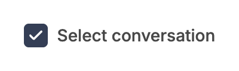 |  |

### Checked / focus-visible

| Before | After |
| --- | --- |
| 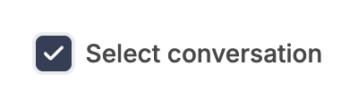 |  |

### Checked / hover

| Before | After |
| --- | --- |
|  |  |

### Disabled / checked

| Before | After |
| --- | --- |
| 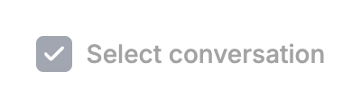 |  |

### Disabled / unchecked

| Before | After |
| --- | --- |
|  | 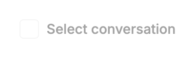 |

### All states and sizes (unchanged at rest)

| Before | After |
| --- | --- |
| 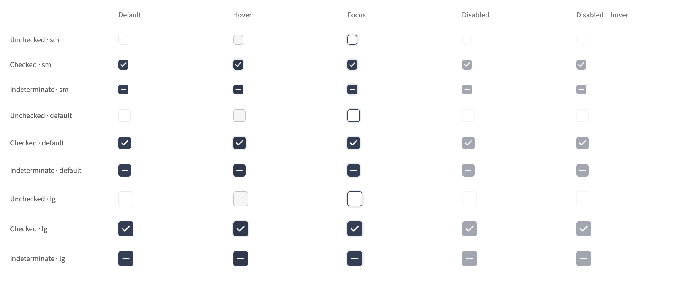 |  |

### Indeterminate

| Before | After |
| --- | --- |
|  | 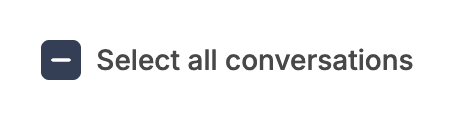 |

### Narrow width, long label

| Before | After |
| --- | --- |
|  | 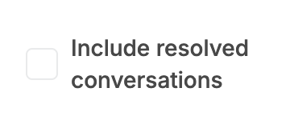 |

### Pressed / checked

| Before | After |
| --- | --- |
| 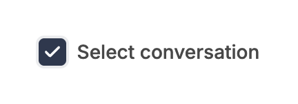 | 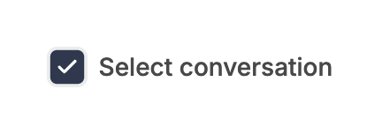 |

### Pressed / unchecked (mouse down held)

| Before | After |
| --- | --- |
| 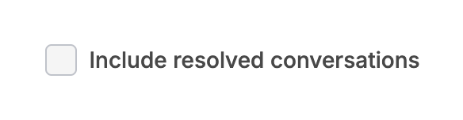 |  |

### Checking (frame samples: stroke offset 26px to 0, box scale .7 to 1)

| Before | After |
| --- | --- |
| 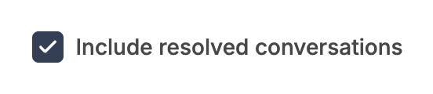 |  |

### Unchecked / default

| Before | After |
| --- | --- |
|  | 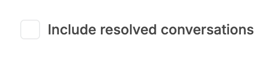 |

### Unchecked / focus-visible

| Before | After |
| --- | --- |
| 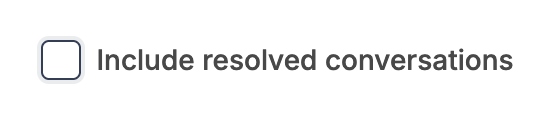 |  |

### Unchecked / hover

| Before | After |
| --- | --- |
|  | 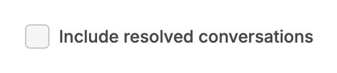 |

### New: description under the label

| Before | After |
| --- | --- |
|  | 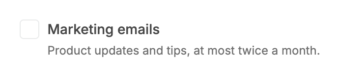 |

### New: description at 220px wide

| Before | After |
| --- | --- |
| 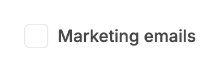 |  |

## Measured changes (copy these into Figma)

_Source: computed styles of the rendered component; px, hex colours, ms. Only properties that changed are listed._

### Checked / default

| Element | Property | Before | After |
| --- | --- | --- | --- |
| Box | transition-property | background-color, border-color, box-shadow | **background-color, border-color, box-shadow, transform** |
| Box | transition-duration | 0.15s | **0.15s, 0.15s, 0.15s, 0.2s** |
| Box | transition-timing-function | cubic-bezier(0, 0, 0.2, 1) | **ease-out, ease-out, ease-out, linear(0 0%, 0.06174 5%, 0.19179 10%, 0.33839 15%, 0.47651 20%, 0.59579 25%, 0.69365 30%, 0.77125 35%, 0.83131 40%, 0.87696 45%, 0** |
| Hit area (::before) | position | static | **absolute** |
| Hit area (::before) | top | auto | **-5px** |
| Hit area (::before) | right | auto | **-5px** |
| Hit area (::before) | bottom | auto | **-5px** |
| Hit area (::before) | left | auto | **-5px** |
| Hit area (::before) | width | auto | **28px** |
| Hit area (::before) | height | auto | **28px** |
| Hit area (::before) | content | none | **""** |
| Tick wrapper | animation-name | enter | **none** |
| Tick wrapper | animation-duration | 0.18s | **0s** |
| Tick path | stroke-dasharray | none | **24px, 30px** |
| Tick path | transition-property | all | **stroke-dashoffset** |
| Tick path | transition-duration | 0s | **0.15s** |

### Checked / focus-visible

| Element | Property | Before | After |
| --- | --- | --- | --- |
| Box | transition-property | background-color, border-color, box-shadow | **background-color, border-color, box-shadow, transform** |
| Box | transition-duration | 0.15s | **0.15s, 0.15s, 0.15s, 0.2s** |
| Box | transition-timing-function | cubic-bezier(0, 0, 0.2, 1) | **ease-out, ease-out, ease-out, linear(0 0%, 0.06174 5%, 0.19179 10%, 0.33839 15%, 0.47651 20%, 0.59579 25%, 0.69365 30%, 0.77125 35%, 0.83131 40%, 0.87696 45%, 0** |
| Hit area (::before) | position | static | **absolute** |
| Hit area (::before) | top | auto | **-5px** |
| Hit area (::before) | right | auto | **-5px** |
| Hit area (::before) | bottom | auto | **-5px** |
| Hit area (::before) | left | auto | **-5px** |
| Hit area (::before) | width | auto | **28px** |
| Hit area (::before) | height | auto | **28px** |
| Hit area (::before) | content | none | **""** |
| Tick wrapper | animation-name | enter | **none** |
| Tick wrapper | animation-duration | 0.18s | **0s** |
| Tick path | stroke-dasharray | none | **24px, 30px** |
| Tick path | transition-property | all | **stroke-dashoffset** |
| Tick path | transition-duration | 0s | **0.15s** |

### Checked / hover

| Element | Property | Before | After |
| --- | --- | --- | --- |
| Box | transition-property | background-color, border-color, box-shadow | **background-color, border-color, box-shadow, transform** |
| Box | transition-duration | 0.15s | **0.15s, 0.15s, 0.15s, 0.2s** |
| Box | transition-timing-function | cubic-bezier(0, 0, 0.2, 1) | **ease-out, ease-out, ease-out, linear(0 0%, 0.06174 5%, 0.19179 10%, 0.33839 15%, 0.47651 20%, 0.59579 25%, 0.69365 30%, 0.77125 35%, 0.83131 40%, 0.87696 45%, 0** |
| Hit area (::before) | position | static | **absolute** |
| Hit area (::before) | top | auto | **-5px** |
| Hit area (::before) | right | auto | **-5px** |
| Hit area (::before) | bottom | auto | **-5px** |
| Hit area (::before) | left | auto | **-5px** |
| Hit area (::before) | width | auto | **28px** |
| Hit area (::before) | height | auto | **28px** |
| Hit area (::before) | content | none | **""** |
| Tick wrapper | animation-name | enter | **none** |
| Tick wrapper | animation-duration | 0.18s | **0s** |
| Tick path | stroke-dasharray | none | **24px, 30px** |
| Tick path | transition-property | all | **stroke-dashoffset** |
| Tick path | transition-duration | 0s | **0.15s** |

### Disabled / checked

| Element | Property | Before | After |
| --- | --- | --- | --- |
| Box | transition-property | background-color, border-color, box-shadow | **background-color, border-color, box-shadow, transform** |
| Box | transition-duration | 0.15s | **0.15s, 0.15s, 0.15s, 0.2s** |
| Box | transition-timing-function | cubic-bezier(0, 0, 0.2, 1) | **ease-out, ease-out, ease-out, linear(0 0%, 0.06174 5%, 0.19179 10%, 0.33839 15%, 0.47651 20%, 0.59579 25%, 0.69365 30%, 0.77125 35%, 0.83131 40%, 0.87696 45%, 0** |
| Hit area (::before) | position | static | **absolute** |
| Hit area (::before) | top | auto | **-5px** |
| Hit area (::before) | right | auto | **-5px** |
| Hit area (::before) | bottom | auto | **-5px** |
| Hit area (::before) | left | auto | **-5px** |
| Hit area (::before) | width | auto | **28px** |
| Hit area (::before) | height | auto | **28px** |
| Hit area (::before) | content | none | **""** |
| Tick wrapper | animation-name | enter | **none** |
| Tick wrapper | animation-duration | 0.18s | **0s** |
| Tick path | stroke-dasharray | none | **24px, 30px** |
| Tick path | transition-property | all | **stroke-dashoffset** |
| Tick path | transition-duration | 0s | **0.15s** |

### Disabled / unchecked

| Element | Property | Before | After |
| --- | --- | --- | --- |
| Box | transition-property | background-color, border-color, box-shadow | **background-color, border-color, box-shadow, transform** |
| Box | transition-duration | 0.15s | **0.15s, 0.15s, 0.15s, 0.2s** |
| Box | transition-timing-function | cubic-bezier(0, 0, 0.2, 1) | **ease-out, ease-out, ease-out, linear(0 0%, 0.06174 5%, 0.19179 10%, 0.33839 15%, 0.47651 20%, 0.59579 25%, 0.69365 30%, 0.77125 35%, 0.83131 40%, 0.87696 45%, 0** |
| Hit area (::before) | position | static | **absolute** |
| Hit area (::before) | top | auto | **-5px** |
| Hit area (::before) | right | auto | **-5px** |
| Hit area (::before) | bottom | auto | **-5px** |
| Hit area (::before) | left | auto | **-5px** |
| Hit area (::before) | width | auto | **28px** |
| Hit area (::before) | height | auto | **28px** |
| Hit area (::before) | content | none | **""** |

### Indeterminate

| Element | Property | Before | After |
| --- | --- | --- | --- |
| Box | transition-property | background-color, border-color, box-shadow | **background-color, border-color, box-shadow, transform** |
| Box | transition-duration | 0.15s | **0.15s, 0.15s, 0.15s, 0.2s** |
| Box | transition-timing-function | cubic-bezier(0, 0, 0.2, 1) | **ease-out, ease-out, ease-out, linear(0 0%, 0.06174 5%, 0.19179 10%, 0.33839 15%, 0.47651 20%, 0.59579 25%, 0.69365 30%, 0.77125 35%, 0.83131 40%, 0.87696 45%, 0** |
| Hit area (::before) | position | static | **absolute** |
| Hit area (::before) | top | auto | **-5px** |
| Hit area (::before) | right | auto | **-5px** |
| Hit area (::before) | bottom | auto | **-5px** |
| Hit area (::before) | left | auto | **-5px** |
| Hit area (::before) | width | auto | **28px** |
| Hit area (::before) | height | auto | **28px** |
| Hit area (::before) | content | none | **""** |
| Tick wrapper | animation-name | enter | **none** |
| Tick wrapper | animation-duration | 0.18s | **0s** |
| Tick path | stroke-dasharray | none | **15px, 20px** |
| Tick path | transition-property | all | **stroke-dashoffset** |
| Tick path | transition-duration | 0s | **0.15s** |

### Narrow width, long label

| Element | Property | Before | After |
| --- | --- | --- | --- |
| Box | transition-property | background-color, border-color, box-shadow | **background-color, border-color, box-shadow, transform** |
| Box | transition-duration | 0.15s | **0.15s, 0.15s, 0.15s, 0.2s** |
| Box | transition-timing-function | cubic-bezier(0, 0, 0.2, 1) | **ease-out, ease-out, ease-out, linear(0 0%, 0.06174 5%, 0.19179 10%, 0.33839 15%, 0.47651 20%, 0.59579 25%, 0.69365 30%, 0.77125 35%, 0.83131 40%, 0.87696 45%, 0** |
| Hit area (::before) | position | static | **absolute** |
| Hit area (::before) | top | auto | **-5px** |
| Hit area (::before) | right | auto | **-5px** |
| Hit area (::before) | bottom | auto | **-5px** |
| Hit area (::before) | left | auto | **-5px** |
| Hit area (::before) | width | auto | **28px** |
| Hit area (::before) | height | auto | **28px** |
| Hit area (::before) | content | none | **""** |

### Pressed / checked

| Element | Property | Before | After |
| --- | --- | --- | --- |
| Box (pressed) | width | 20 | **19.2** |
| Box (pressed) | height | 20 | **19.2** |
| Box (pressed) | transform | none | **matrix(0.96, 0, 0, 0.96, 0, 0)** |
| Box (pressed) | transition-duration | 0.15s | **0.15s, 0.15s, 0.15s, 0.08s** |

### Pressed / unchecked (mouse down held)

| Element | Property | Before | After |
| --- | --- | --- | --- |
| Box (pressed) | width | 20 | **19.2** |
| Box (pressed) | height | 20 | **19.2** |
| Box (pressed) | transform | none | **matrix(0.96, 0, 0, 0.96, 0, 0)** |
| Box (pressed) | transition-duration | 0.15s | **0.15s, 0.15s, 0.15s, 0.08s** |

### Checking (frame samples: stroke offset 26px to 0, box scale .7 to 1)

| Element | Property | Before | After |
| --- | --- | --- | --- |
| Box | transition-property | background-color, border-color, box-shadow | **background-color, border-color, box-shadow, transform** |
| Box | transition-duration | 0.15s | **0.15s, 0.15s, 0.15s, 0.2s** |
| Box | transition-timing-function | cubic-bezier(0, 0, 0.2, 1) | **ease-out, ease-out, ease-out, linear(0 0%, 0.06174 5%, 0.19179 10%, 0.33839 15%, 0.47651 20%, 0.59579 25%, 0.69365 30%, 0.77125 35%, 0.83131 40%, 0.87696 45%, 0** |
| Hit area (::before) | position | static | **absolute** |
| Hit area (::before) | top | auto | **-5px** |
| Hit area (::before) | right | auto | **-5px** |
| Hit area (::before) | bottom | auto | **-5px** |
| Hit area (::before) | left | auto | **-5px** |
| Hit area (::before) | width | auto | **28px** |
| Hit area (::before) | height | auto | **28px** |
| Hit area (::before) | content | none | **""** |
| Tick wrapper | animation-name | enter | **none** |
| Tick wrapper | animation-duration | 0.18s | **0s** |
| Tick path | stroke-dasharray | none | **24px, 30px** |
| Tick path | transition-property | all | **stroke-dashoffset** |
| Tick path | transition-duration | 0s | **0.15s** |

### Unchecked / default

| Element | Property | Before | After |
| --- | --- | --- | --- |
| Box | transition-property | background-color, border-color, box-shadow | **background-color, border-color, box-shadow, transform** |
| Box | transition-duration | 0.15s | **0.15s, 0.15s, 0.15s, 0.2s** |
| Box | transition-timing-function | cubic-bezier(0, 0, 0.2, 1) | **ease-out, ease-out, ease-out, linear(0 0%, 0.06174 5%, 0.19179 10%, 0.33839 15%, 0.47651 20%, 0.59579 25%, 0.69365 30%, 0.77125 35%, 0.83131 40%, 0.87696 45%, 0** |
| Hit area (::before) | position | static | **absolute** |
| Hit area (::before) | top | auto | **-5px** |
| Hit area (::before) | right | auto | **-5px** |
| Hit area (::before) | bottom | auto | **-5px** |
| Hit area (::before) | left | auto | **-5px** |
| Hit area (::before) | width | auto | **28px** |
| Hit area (::before) | height | auto | **28px** |
| Hit area (::before) | content | none | **""** |

### Unchecked / focus-visible

| Element | Property | Before | After |
| --- | --- | --- | --- |
| Box | transition-property | background-color, border-color, box-shadow | **background-color, border-color, box-shadow, transform** |
| Box | transition-duration | 0.15s | **0.15s, 0.15s, 0.15s, 0.2s** |
| Box | transition-timing-function | cubic-bezier(0, 0, 0.2, 1) | **ease-out, ease-out, ease-out, linear(0 0%, 0.06174 5%, 0.19179 10%, 0.33839 15%, 0.47651 20%, 0.59579 25%, 0.69365 30%, 0.77125 35%, 0.83131 40%, 0.87696 45%, 0** |
| Hit area (::before) | position | static | **absolute** |
| Hit area (::before) | top | auto | **-5px** |
| Hit area (::before) | right | auto | **-5px** |
| Hit area (::before) | bottom | auto | **-5px** |
| Hit area (::before) | left | auto | **-5px** |
| Hit area (::before) | width | auto | **28px** |
| Hit area (::before) | height | auto | **28px** |
| Hit area (::before) | content | none | **""** |

### Unchecked / hover

| Element | Property | Before | After |
| --- | --- | --- | --- |
| Box | transition-property | background-color, border-color, box-shadow | **background-color, border-color, box-shadow, transform** |
| Box | transition-duration | 0.15s | **0.15s, 0.15s, 0.15s, 0.2s** |
| Box | transition-timing-function | cubic-bezier(0, 0, 0.2, 1) | **ease-out, ease-out, ease-out, linear(0 0%, 0.06174 5%, 0.19179 10%, 0.33839 15%, 0.47651 20%, 0.59579 25%, 0.69365 30%, 0.77125 35%, 0.83131 40%, 0.87696 45%, 0** |
| Hit area (::before) | position | static | **absolute** |
| Hit area (::before) | top | auto | **-5px** |
| Hit area (::before) | right | auto | **-5px** |
| Hit area (::before) | bottom | auto | **-5px** |
| Hit area (::before) | left | auto | **-5px** |
| Hit area (::before) | width | auto | **28px** |
| Hit area (::before) | height | auto | **28px** |
| Hit area (::before) | content | none | **""** |

### New: description under the label

| Element | Property | Before | After |
| --- | --- | --- | --- |
| Control | transition-property | background-color, border-color, box-shadow | **background-color, border-color, box-shadow, transform** |
| Control | transition-duration | 0.15s | **0.15s, 0.15s, 0.15s, 0.2s** |
| Control | transition-timing-function | cubic-bezier(0, 0, 0.2, 1) | **ease-out, ease-out, ease-out, linear(0 0%, 0.06174 5%, 0.19179 10%, 0.33839 15%, 0.47651 20%, 0.59579 25%, 0.69365 30%, 0.77125 35%, 0.83131 40%, 0.87696 45%, 0** |
| Hit area (::before) | position | static | **absolute** |
| Hit area (::before) | top | auto | **-5px** |
| Hit area (::before) | right | auto | **-5px** |
| Hit area (::before) | bottom | auto | **-5px** |
| Hit area (::before) | left | auto | **-5px** |
| Hit area (::before) | width | auto | **28px** |
| Hit area (::before) | height | auto | **28px** |
| Hit area (::before) | content | none | **""** |
| Label | width | 142.41 | **277.55** |
| Label | font-size | 16px | **14px** |
| Label | line-height | 24px | **20px** |
| Label | color | #5E5E5E | **#484848** |
| Label | font-weight | 400 | **500** |
| Description | _(new element)_ | — | present |
| Row (wrapper) | width | 142.41 | **305.55** |
| Row (wrapper) | height | 20 | **40** |
| Row (wrapper) | align-items | center | **flex-start** |

### New: description at 220px wide

| Element | Property | Before | After |
| --- | --- | --- | --- |
| Control | transition-property | background-color, border-color, box-shadow | **background-color, border-color, box-shadow, transform** |
| Control | transition-duration | 0.15s | **0.15s, 0.15s, 0.15s, 0.2s** |
| Control | transition-timing-function | cubic-bezier(0, 0, 0.2, 1) | **ease-out, ease-out, ease-out, linear(0 0%, 0.06174 5%, 0.19179 10%, 0.33839 15%, 0.47651 20%, 0.59579 25%, 0.69365 30%, 0.77125 35%, 0.83131 40%, 0.87696 45%, 0** |
| Hit area (::before) | position | static | **absolute** |
| Hit area (::before) | top | auto | **-5px** |
| Hit area (::before) | right | auto | **-5px** |
| Hit area (::before) | bottom | auto | **-5px** |
| Hit area (::before) | left | auto | **-5px** |
| Hit area (::before) | width | auto | **28px** |
| Hit area (::before) | height | auto | **28px** |
| Hit area (::before) | content | none | **""** |
| Label | width | 142.41 | **160** |
| Label | font-size | 16px | **14px** |
| Label | line-height | 24px | **20px** |
| Label | color | #5E5E5E | **#484848** |
| Label | font-weight | 400 | **500** |
| Description | _(new element)_ | — | present |
| Row (wrapper) | width | 142.41 | **188** |
| Row (wrapper) | height | 20 | **56** |
| Row (wrapper) | align-items | center | **flex-start** |

## Motion

| What | Before | After |
| --- | --- | --- |
| Tick draws in | Fade/zoom keyframe that never ran (values reset, see notes): the tick appeared instantly | **Stroke draws from the start of the path: stroke-dashoffset 26 to 0, 150ms linear, 15ms delay (check: dash 24 gap 30; minus: dash 15 gap 20, offset 17 to 0). Stroke width stays 3.** |
| Box pops on check / indeterminate | none | **Scale .7 to 1 over 200ms, --v2-ease-spring (a sampled critically damped spring; in Figma use a custom spring or Smart Animate 'Gentle' / bezier 0.22, 1, 0.36, 1) (fill and border are one solid shape so the whole box scales)** |
| Press | none | **Scale 1 to .96 in 80ms; back in 200ms, spring. Disabled boxes do not press** |
| Tick leaves (uncheck) | 120ms fade/zoom (values reset, so no visible effect) | **120ms fade and shrink to 85% (now actually runs)** |
| Reduced motion | none | **No pop, no scale, no stroke draw: the tick fades in over 150ms; colours still transition 150ms** |

## States to update in Figma

- Checkbox / every size (sm 16, default 20, lg 24) x unchecked / checked / indeterminate x default / hover / focus / disabled: unchanged at rest
- Checkbox / pressed: scale 96% (new)
- Checkbox / hit area: 4px invisible padding on each side (new annotation, not visible)
- Checkbox with description (new variant)

## How to apply in Figma

1. On every Checkbox size, wrap the box in a transparent frame 4px larger on each side: sm 24 x 24, default 28 x 28, lg 32 x 32 (box centred, no fill, no stroke). The frame is the clickable area; component width in layouts stays the box width (use negative margin -4px or 'ignore auto layout').
2. Add a 'Pressed' variant to every checked state: box scale 96%. Prototype default to pressed with Smart Animate 80ms ease-out, pressed to default 200ms Gentle spring.
3. Add the check animation as an interaction: unchecked to checked, Smart Animate 200ms Gentle spring, box scale 70% to 100%. Inside, the tick path: stroke dash offset (set the stroke 'dash' to 24 / gap 30 and animate the offset 26 to 0, or reveal the path with a 150ms linear wipe from the first point), delay 15ms. Same for indeterminate, dash 15 / gap 20.
4. Add an optional 'Description' text layer to the labelled Checkbox: Inter 12px / 16px regular, colour --v2-text-muted #707070, 4px below the label (same offset as Radio), left-aligned with the label. Auto layout: horizontal, gap 8px, align top; the label row is as tall as the box (sm 16, default 20, lg 24) so the box lines up with the first line of the label. Left-label placement mirrors it. Disabled: whole text block at 50% opacity.
5. Hover fills stay as they are (unchecked hover --semantic-bg-ui #F5F5F5 with border --color-primary-100 #C0C3CA; checked hover --semantic-primary-hover #2F384D). Note in the component description that hover only applies on pointer devices.

## Notes

- The brief expected a keyframe on mount for the tick; keyframes cannot be added from this file, so the tick uses a stroke-dashoffset transition with `@starting-style` supplying the 'from' value when the Radix indicator mounts already checked. Browsers without @starting-style (Chrome < 117, Safari < 17.5, Firefox < 129) show the tick instantly; everything else still works.
- Pre-checked boxes also animate once when they first mount (the tick draws and the box pops), the same as the previous tick pop did on mount. A page full of pre-checked boxes will animate at load; say if this should be suppressed (needs an 'interacted' flag).
- FOUND: the previous tick pop (`motion-safe:animate-in fade-in-0 zoom-in-[0.85]`) was a silent no-op: tailwindcss-animate's `.animate-in` resets the enter variables and its motion-safe copy is emitted after the plain zoom/fade utilities. The new box pop and exit use `motion-safe:zoom-in-[0.7]`, `motion-safe:fade-out-0` etc. so they actually run (verified: scale 0.7 at the first frame).
- Description spacing is 4px (Radio's actual `mt-1`), not the 2px quoted in the task; one class (`mt-1` to `mt-0.5`) changes both if 2px is wanted.
- Selectable-card variant for Checkbox was not added (Radio only): the checkbox label markup (wrapping label / separateLabel) does not fit a whole-card target without duplicating it.
- The 4px hit ring can overlap an adjacent control that sits closer than 4px; none of the stories do.
- Hit area implementation: `before:-inset-[5px]`, not `-inset-1`. An absolutely positioned pseudo-element is offset from the padding box, which excludes the 1px border, so -4px would only reach 3px past the visible edge (26 x 26). Measured with elementFromPoint in Chrome: the target is 24 / 28 / 32px for sm / default / lg, a point 3.9px outside the box hits the checkbox and a point 5px outside does not.
