# CreatableMultiSelect: UI change report for Figma

Figma source: [https://www.figma.com/design/q84boKV4Bly9HKXzdtBj2K/New-Design-System---MyO?node-id=2118-22190](https://www.figma.com/design/q84boKV4Bly9HKXzdtBj2K/New-Design-System---MyO?node-id=2118-22190)  
Storybook: `V2/Components/CreatableMultiSelect`  
Date: 2026-10-04

## Summary

The open field keeps its teal focused look while the panel is open. The chip remove button now shows a visible neutral hover plate (it was #F5F5F5 on a #F5F5F5 chip, so nothing showed) with a 24px hit area. The panel now fades and slides in.

### Why (what the research found)

- Task brief research summary (HeroUI, Mantine, shadcn/ui, Untitled UI, React Aria, Fluent): 'modern' here comes from connectedness and polish, not flashy motion. (Not re-researched in this pass.)
- Connectedness: the trigger should read as part of its open panel. Measured before: while the list was open the Select trigger border was #E9EAEB with no glow, because Radix moves focus into the list and the focused look is keyed to `focus:`.
- WCAG 2.2 SC 2.5.8 (Target Size, Minimum) asks for a 24 x 24 CSS px target; the chip x was 12 x 12 and Clear all 20 x 20. The glyph stays small, only the hit area grows.
- Measured before: the chip remove hover fill was #F5F5F5 on a #F5F5F5 chip, so it was invisible.

### API / compatibility

No prop, callback, aria-label or DOM-contract changes. v2 remains a drop-in for v1 (`npm run verify:v1-v2-compat` passes).

## Before and after

### Closed with chips

| Before | After |
| --- | --- |
|  | 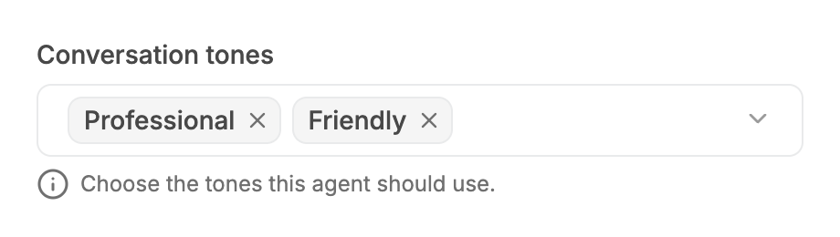 |

### Open

| Before | After |
| --- | --- |
| 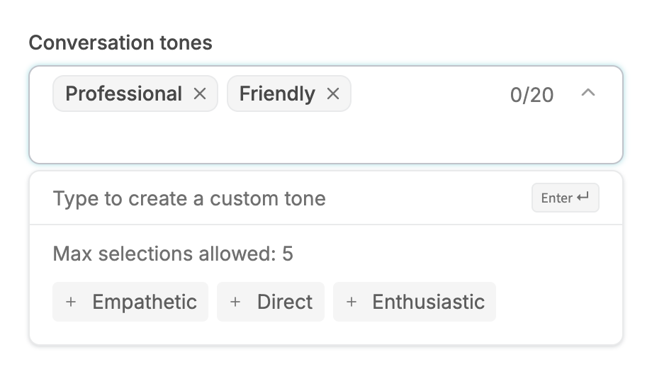 | 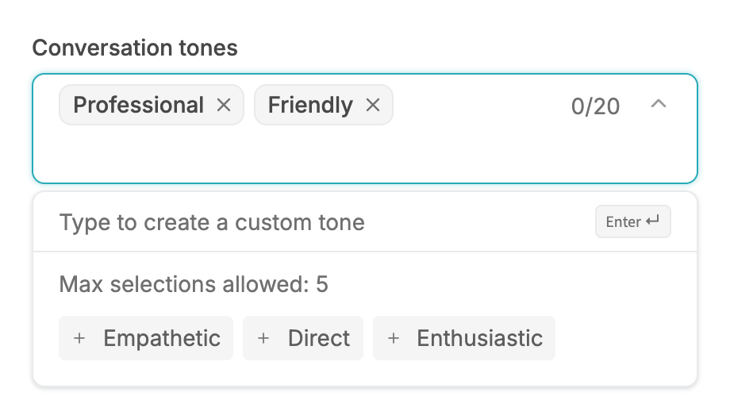 |

### Hover on a chip's remove x

| Before | After |
| --- | --- |
|  |  |

### Five chips

| Before | After |
| --- | --- |
|  | 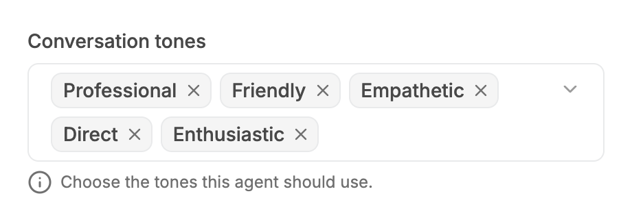 |

### Five chips, 280px field

| Before | After |
| --- | --- |
| 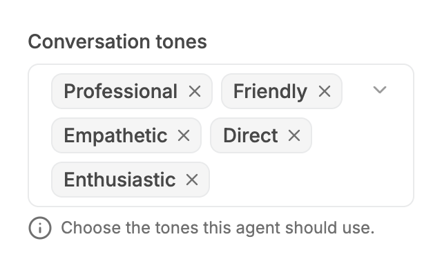 |  |

### Open, hover on a preset

| Before | After |
| --- | --- |
|  | 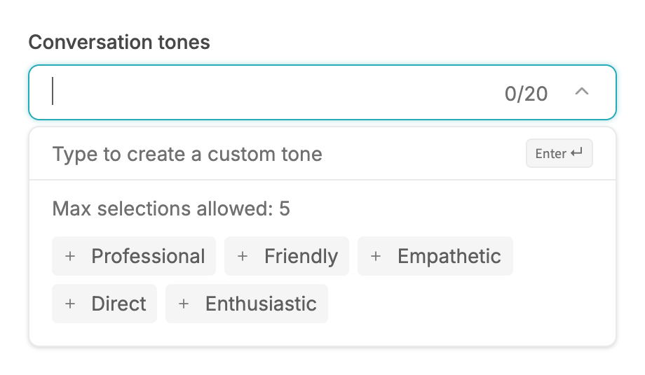 |

### Open, typed text: Create row

| Before | After |
| --- | --- |
|  | 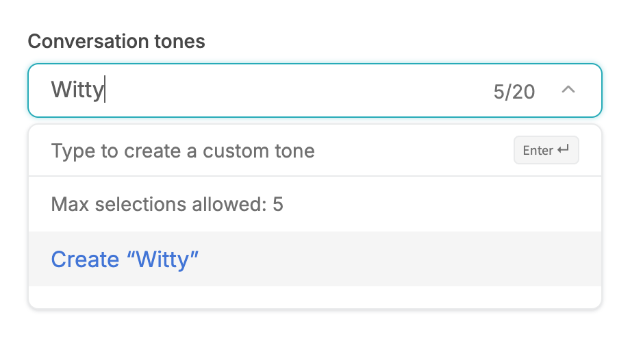 |

### Error, closed

| Before | After |
| --- | --- |
|  | 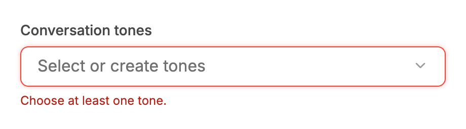 |

### Error, open (stays red)

| Before | After |
| --- | --- |
|  | 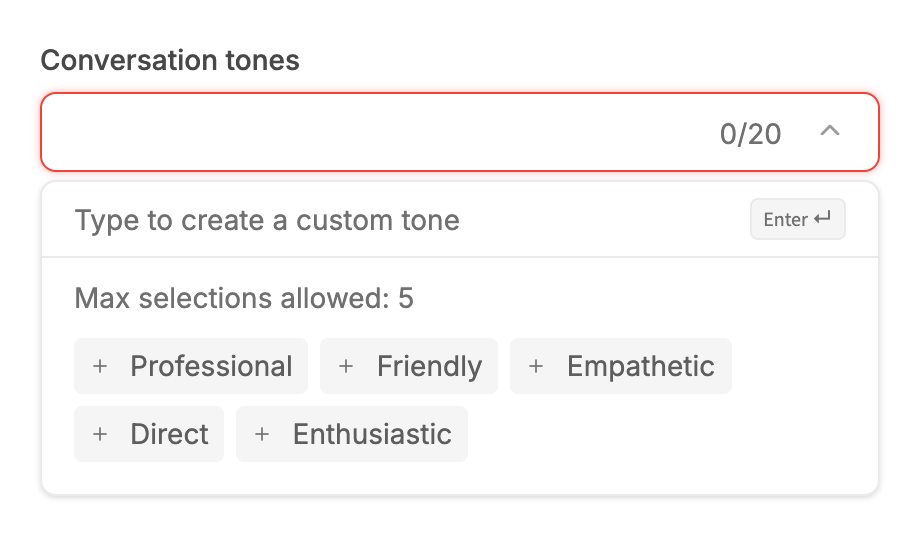 |

### Disabled

| Before | After |
| --- | --- |
|  |  |

### Open, no presets

| Before | After |
| --- | --- |
| 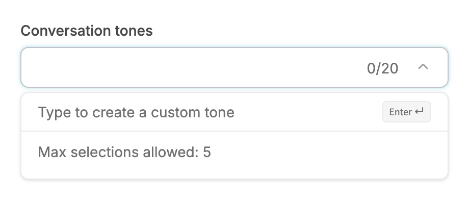 | 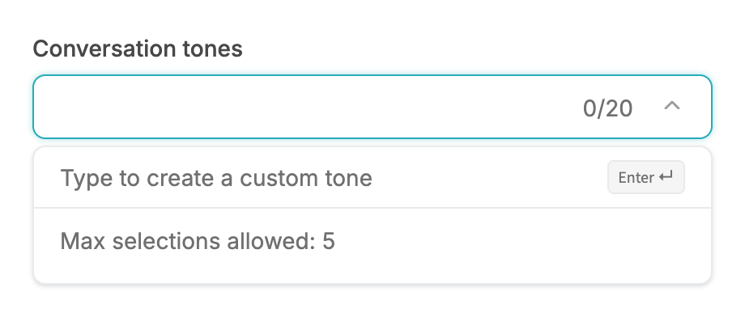 |

### Open, no match

| Before | After |
| --- | --- |
| 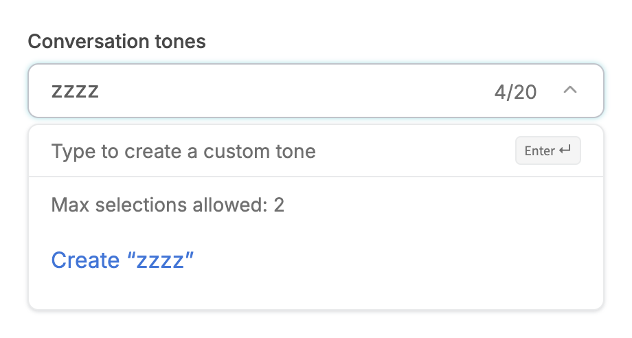 | 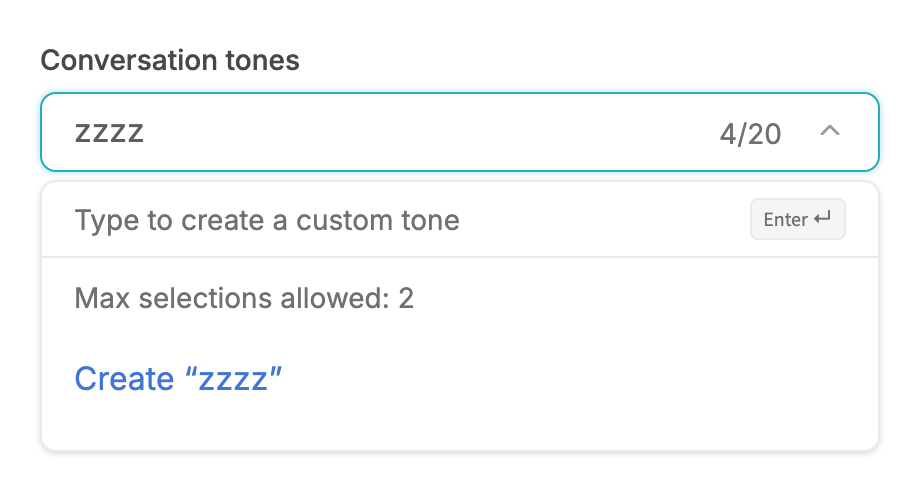 |

### Summary trigger

| Before | After |
| --- | --- |
| 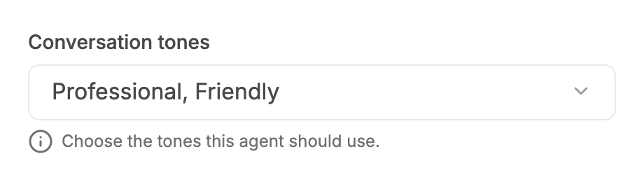 |  |

### Open, 340px viewport

| Before | After |
| --- | --- |
| 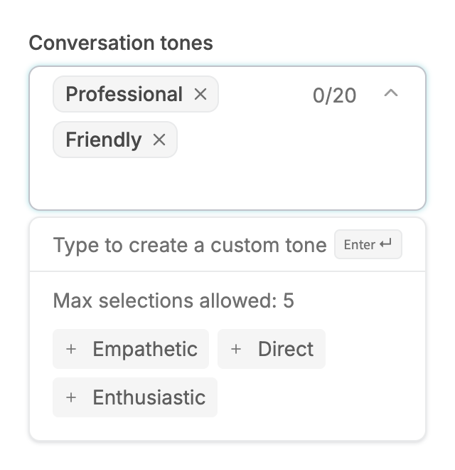 | 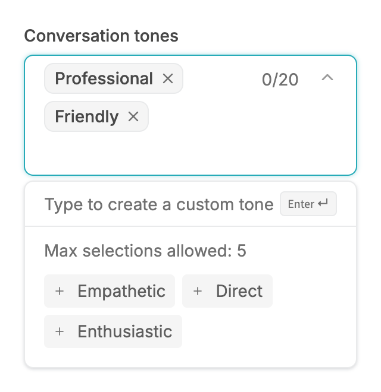 |

## Measured changes (copy these into Figma)

_Source: computed styles of the rendered component; px, hex colours, ms. Only properties that changed are listed._

### Open

| Element | Property | Before | After |
| --- | --- | --- | --- |
| Trigger (open) | border-top-color | #C0C3CA | **#27ABB8** |

### Hover on a chip's remove x

| Element | Property | Before | After |
| --- | --- | --- | --- |
| Chip remove (first) | background-color | #F5F5F5 | **#E9EAEB** |

### Open, no presets

| Element | Property | Before | After |
| --- | --- | --- | --- |
| Trigger (open) | border-top-color | #C0C3CA | **#27ABB8** |

### Open, no match

| Element | Property | Before | After |
| --- | --- | --- | --- |
| Trigger (open) | border-top-color | #C0C3CA | **#27ABB8** |

### Open, 340px viewport

| Element | Property | Before | After |
| --- | --- | --- | --- |
| Trigger (open) | border-top-color | #C0C3CA | **#27ABB8** |

## Motion

| What | Before | After |
| --- | --- | --- |
| Chip remove hover | colour only; plate #F5F5F5 on a #F5F5F5 chip (invisible) | **150ms colour fade; plate #E9EAEB, icon #484848; hover gated to devices that can hover** |
| Panel enter | no visible motion (fade/zoom/slide cancelled by a utility-order bug) | **200ms: opacity 0 to 100%, scale 98% to 100%, 4px slide down, origin top left, spring ease (--v2-ease-spring; sampled critically damped curve, fallback cubic-bezier(0.22, 1, 0.36, 1))** |
| Chevron | spins in to 180deg on open | **unchanged** |

## States to update in Figma

- Field / open: focused look held (also under hover)
- Field / error / open: unchanged, red
- Chip / remove x / hover: NEW visible plate
- Chip / remove x / disabled: no plate
- Panel: motion only

## How to apply in Figma

1. Field State=Open: fill #FFFFFF, border 1px #27ABB8 (--color-secondary-600) + drop shadow x0 y0 blur 4 spread 0 #27ABB8 @ 40%, radius 8, min-height 40, padding 6 / 16, gap 8. Same as Focus; stays teal under hover. Error + Open: #F04438 + 0 0 4 0 #F04438 @ 40%. Disabled unchanged.
2. Chip (unchanged): fill #F5F5F5, border 0.4px #E9EAEB, radius 8, padding 2 left 8 / right 2, label 14/500 #484848. Remove button: 20 x 20, radius 4, icon 14px (stroke 2) #707070. Hover: fill #E9EAEB (was #F5F5F5, invisible) and icon #484848. The hit area is 24 x 24 (2px beyond the 20px button, invisible). Disabled: no hover.
3. Panel: unchanged (radius 8, border 1px #E9EAEB, shadow 0 4 8 -2 rgba(16,24,40,0.10) + 0 2 4 -2 rgba(16,24,40,0.06), 4px gap below the field; hint row, max-selections text, preset pills radius 4 fill #F5F5F5, Create row full-bleed).
4. Prototype: panel 200ms Smart animate from opacity 0%, scale 98%, y -4, origin top-left.

## Notes

- Chip enter animation was NOT added here: the closed and open fields render their chips in two separate trees, so every open/close would remount and replay every chip. (MultiSelect has one tree and does animate new chips.)
- Origin-aware panel: NOT applicable (CSS-anchored panel, no flip). It always opens bottom-start, so top-left is already correct.
- Preset pills and the Create row are not inset list rows (pills are 4px; Create is full-bleed), so the concentric-radius rule needed no change.
- The chip plate colour is #E9EAEB (semantic-bg-grey), not the brief's bg-semantic-bg-ui: that token is the chip's own fill.
- Found while verifying motion: `motion-safe:animate-in` is emitted after bare `fade-in-0`/`zoom-in-*` classes and resets --tw-enter-opacity/--tw-enter-scale to initial, so the panel fade and 98% zoom documented in V2-MOTION.md never ran in normal-motion mode (measured at t=0: opacity 1, no scale). Fixed here by prefixing those classes with `motion-safe:` (as Checkbox/TextField already do). The same bare pattern remains in dialog.tsx, toast.tsx, tabs.tsx, date-range-picker.tsx and date-time-picker.tsx (not in this task's files, not individually verified).
