# CreatableSelect: UI change report for Figma

Figma source: [https://www.figma.com/design/q84boKV4Bly9HKXzdtBj2K/New-Design-System---MyO?node-id=2118-22190](https://www.figma.com/design/q84boKV4Bly9HKXzdtBj2K/New-Design-System---MyO?node-id=2118-22190)  
Storybook: `V2/Components/CreatableSelect`  
Date: 2026-10-04

## Summary

The open field keeps its teal focused look even while the pointer is over the list or focus leaves the input. Rows are 4px-radius (were 6px), the arrow-key highlight gets a teal ring (mouse hover does not), the selected check pops in, and the panel fades and slides in.

### Why (what the research found)

- Task brief research summary (HeroUI, Mantine, shadcn/ui, Untitled UI, React Aria, Fluent): 'modern' here comes from connectedness and polish, not flashy motion. (Not re-researched in this pass.)
- Connectedness: the trigger should read as part of its open panel. Measured before: while the list was open the Select trigger border was #E9EAEB with no glow, because Radix moves focus into the list and the focused look is keyed to `focus:`.
- Concentric radii (inner radius = outer radius - padding): the panel is 8px with 4px padding, so rows should be 4px. Measured before: Select and Creatable rows 6px, Dropdown and SearchFilter rows 0px.
- Selection feedback should be acknowledged briefly: the same fade + 85% to 100% scale as the v2 Checkbox tick, 180ms.

### API / compatibility

No prop, callback, aria-label or DOM-contract changes. v2 remains a drop-in for v1 (`npm run verify:v1-v2-compat` passes).

## Before and after

### Closed

| Before | After |
| --- | --- |
| 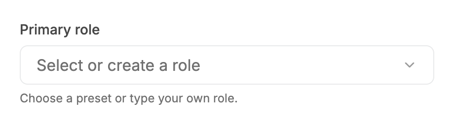 |  |

### Open

| Before | After |
| --- | --- |
| 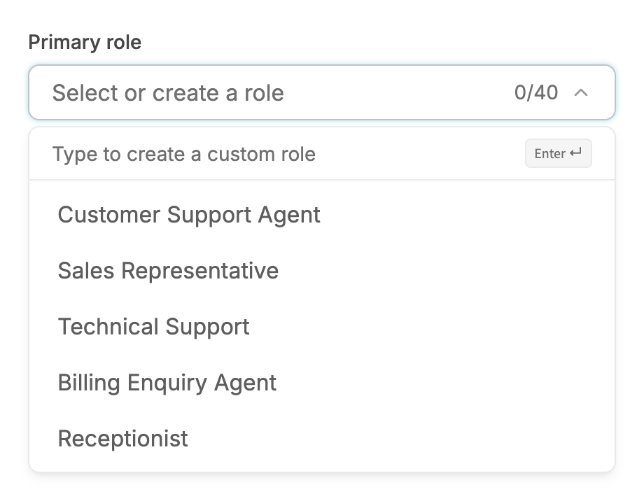 | 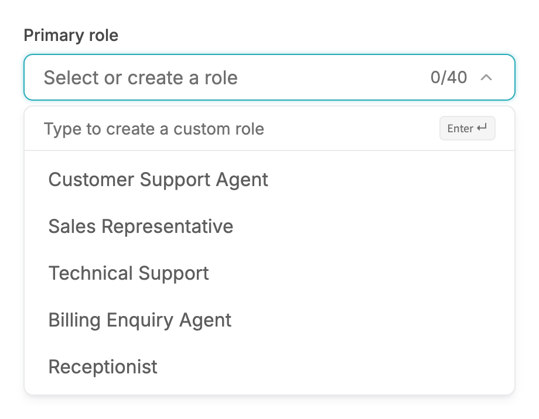 |

### Open, mouse hover on a row

| Before | After |
| --- | --- |
|  | 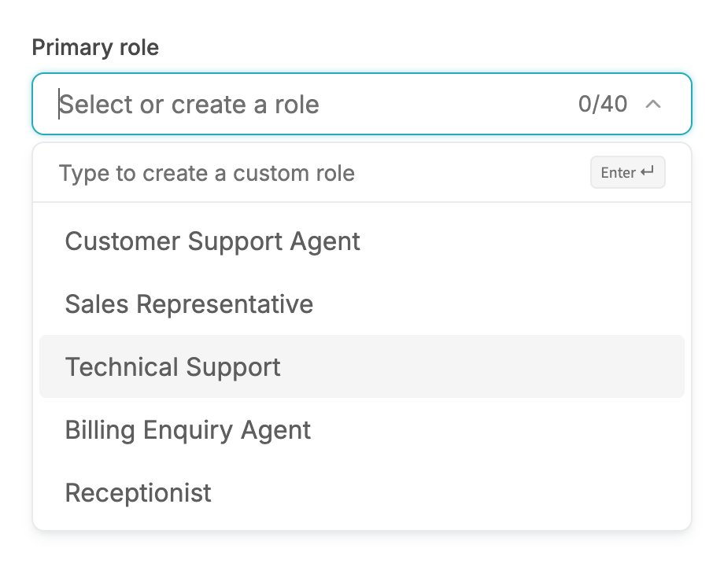 |

### ArrowDown x2 (keyboard highlight)

| Before | After |
| --- | --- |
| 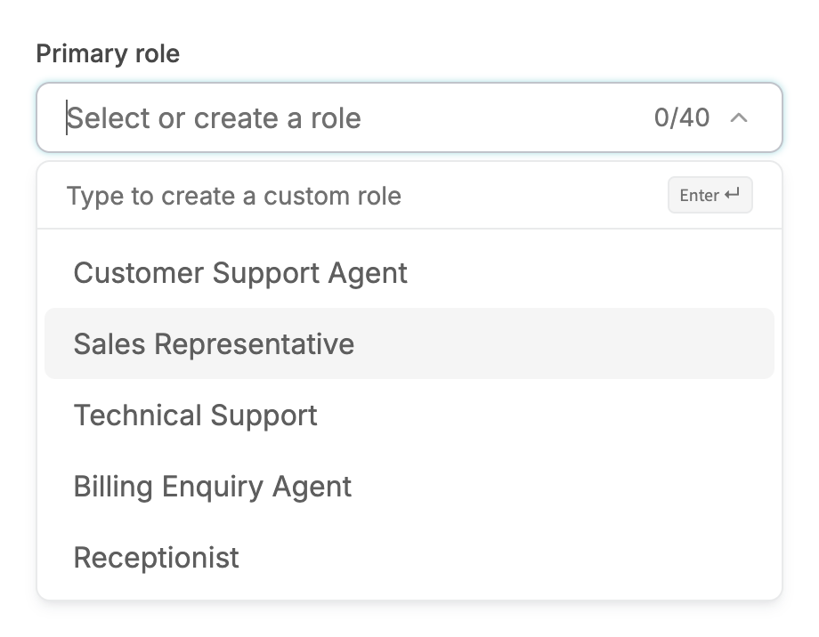 | 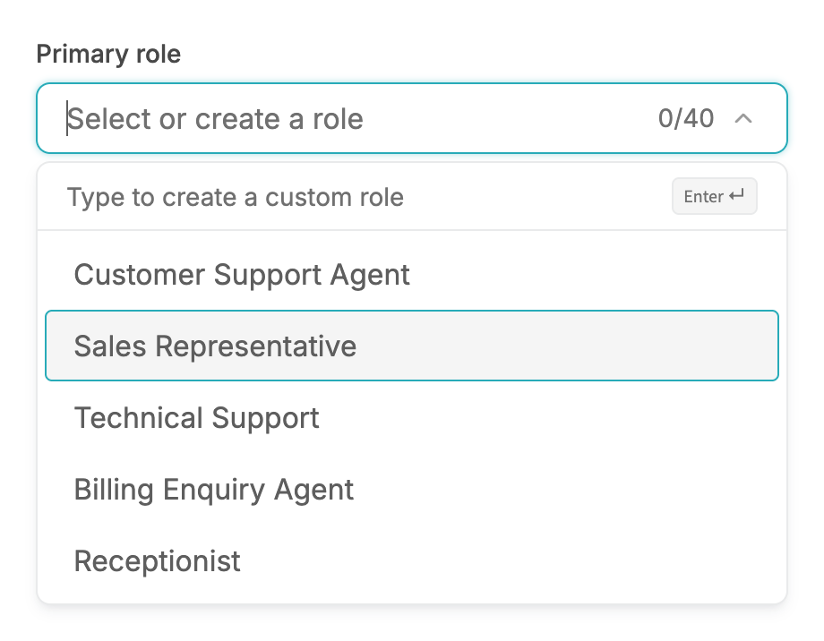 |

### Open with a selected value

| Before | After |
| --- | --- |
| 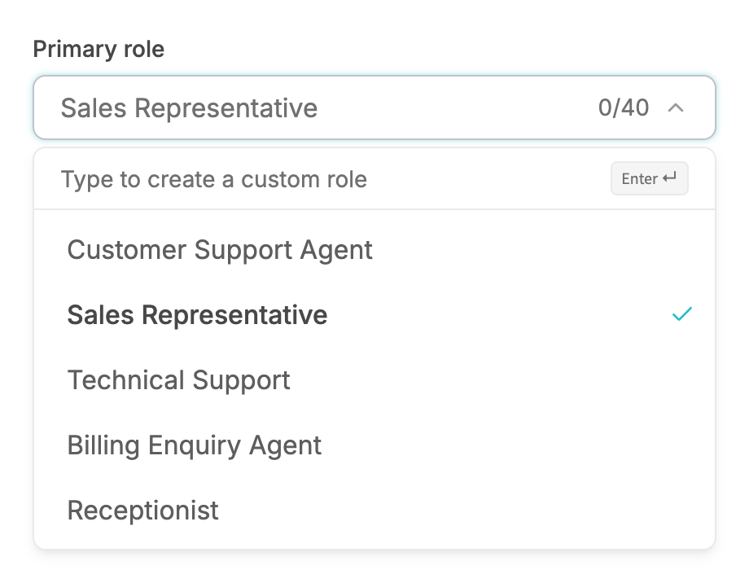 | 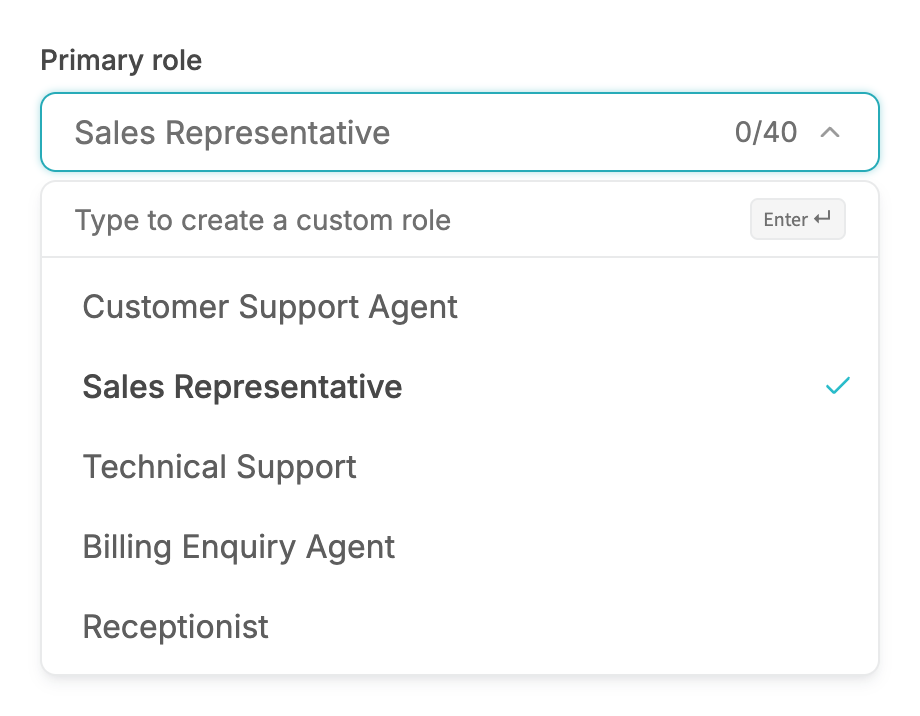 |

### Typed a new value: Create row highlighted

| Before | After |
| --- | --- |
| 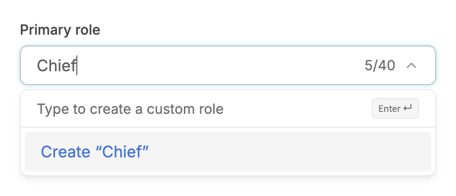 | 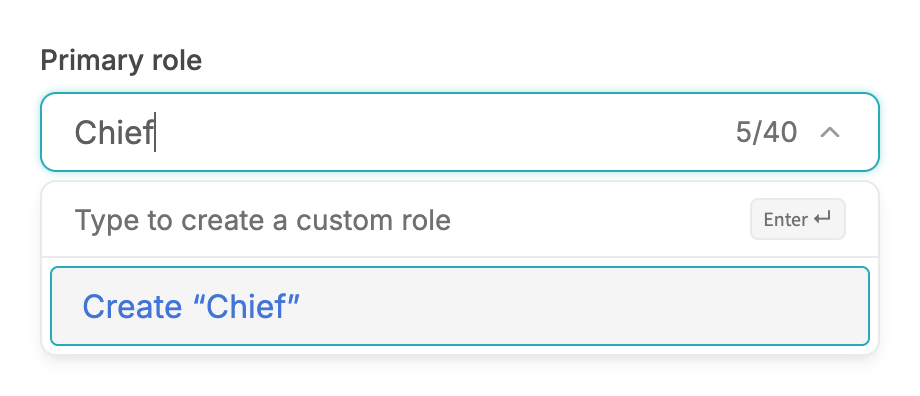 |

### Error, closed

| Before | After |
| --- | --- |
| 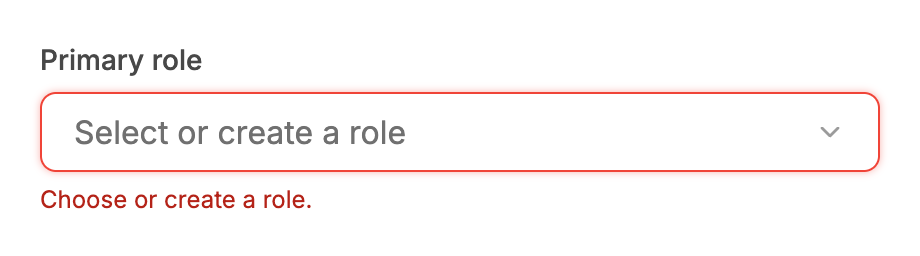 |  |

### Error, open (stays red)

| Before | After |
| --- | --- |
|  | 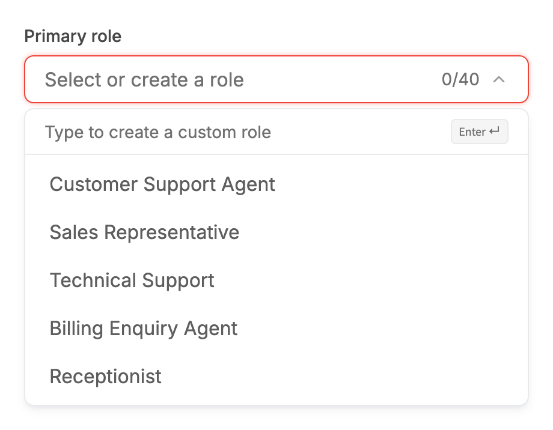 |

### Disabled

| Before | After |
| --- | --- |
|  | 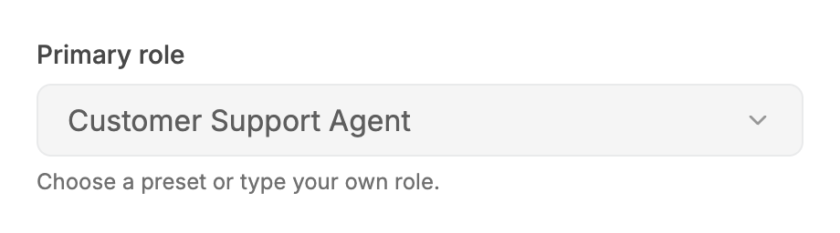 |

### Open, disabled option

| Before | After |
| --- | --- |
| 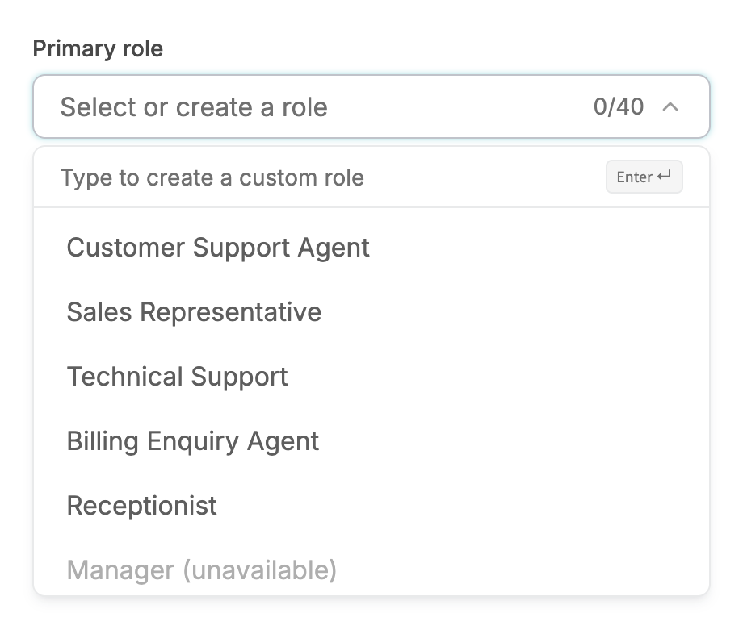 | 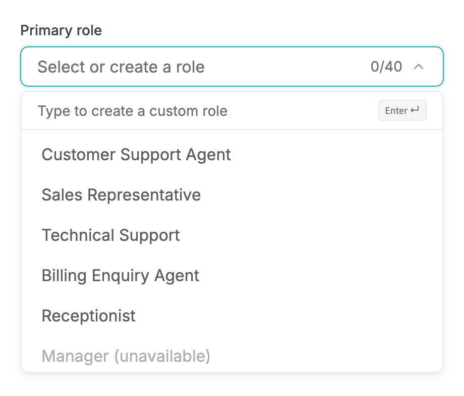 |

### Open, no options

| Before | After |
| --- | --- |
| 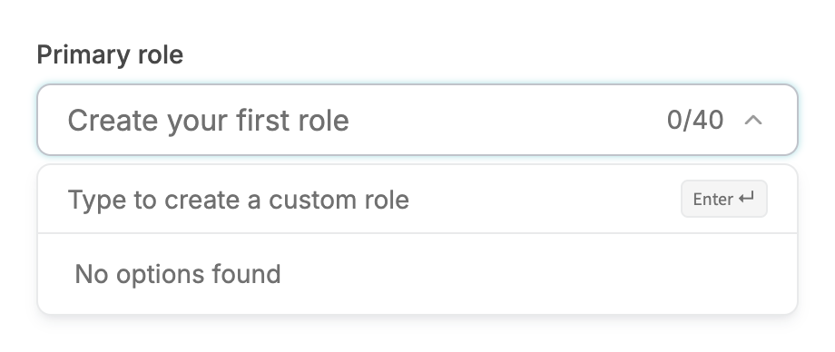 | 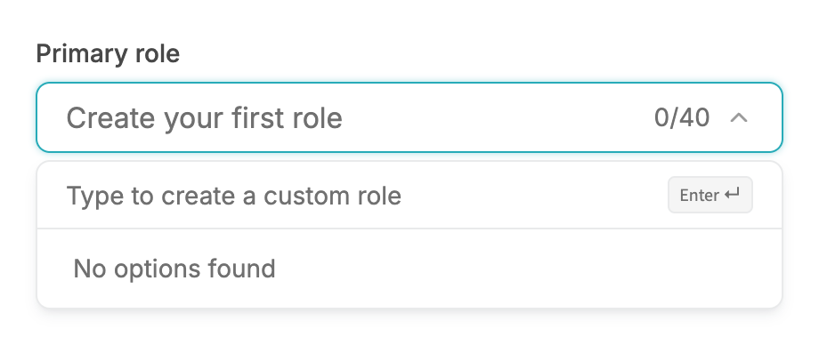 |

### Typed text with no match

| Before | After |
| --- | --- |
| 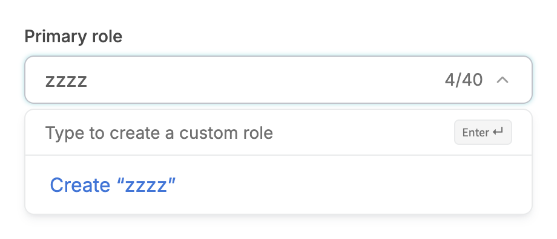 | 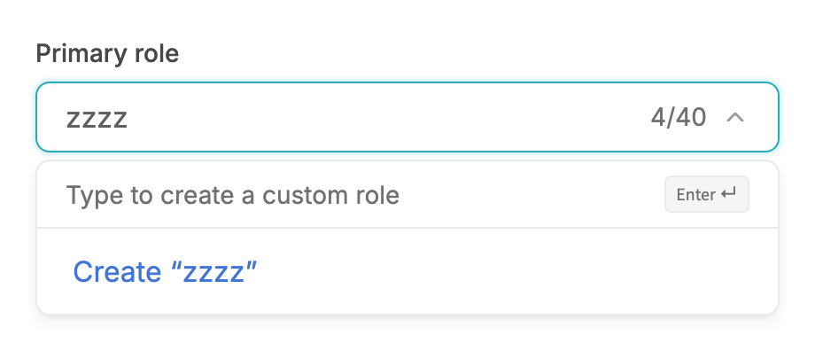 |

### Open, 340px viewport

| Before | After |
| --- | --- |
| 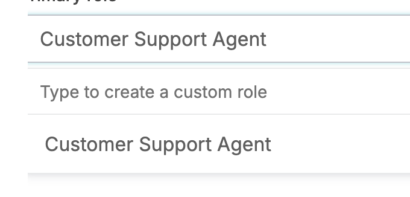 | 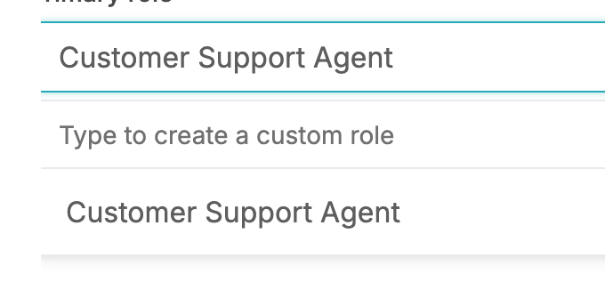 |

## Measured changes (copy these into Figma)

_Source: computed styles of the rendered component; px, hex colours, ms. Only properties that changed are listed._

### Open

| Element | Property | Before | After |
| --- | --- | --- | --- |
| Trigger (open) | border-top-color | #C0C3CA | **#27ABB8** |
| Row (first) | border-radius | 6px | **4px** |
| Row (second) | border-radius | 6px | **4px** |
| Create row | border-radius | 6px | **4px** |

### Open, mouse hover on a row

| Element | Property | Before | After |
| --- | --- | --- | --- |
| Row (first) | border-radius | 6px | **4px** |
| Row (second) | border-radius | 6px | **4px** |
| Create row | border-radius | 6px | **4px** |

### ArrowDown x2 (keyboard highlight)

| Element | Property | Before | After |
| --- | --- | --- | --- |
| Trigger (open) | border-top-color | #C0C3CA | **#27ABB8** |
| Row (first) | border-radius | 6px | **4px** |
| Row (second) | border-radius | 6px | **4px** |
| Row (second) | box-shadow | none | **#FFFFFF 0 inset, #27ABB8 0px 0px 0px 1px inset, transparent 0** |
| Create row | border-radius | 6px | **4px** |

### Open with a selected value

| Element | Property | Before | After |
| --- | --- | --- | --- |
| Trigger (open) | border-top-color | #C0C3CA | **#27ABB8** |
| Row (first) | border-radius | 6px | **4px** |
| Row (second) | border-radius | 6px | **4px** |
| Row (selected) | border-radius | 6px | **4px** |
| Check icon (selected row) | animation-name | none | **enter** |
| Check icon (selected row) | animation-duration | 0s | **0.18s** |
| Check icon (selected row) | animation-timing-function | ease | **linear(0 0%, 0.06174 5%, 0.19179 10%, 0.33839 15%, 0.47651 20%, 0.59579 25%, 0.69365 30%, 0.77125 35%, 0.83131 40%, 0.87696 45%, 0.91117 50%, 0.93653 55%, 0.955** |
| Create row | border-radius | 6px | **4px** |

### Typed a new value: Create row highlighted

| Element | Property | Before | After |
| --- | --- | --- | --- |
| Trigger (open) | border-top-color | #C0C3CA | **#27ABB8** |
| Row (first) | box-shadow | none | **#FFFFFF 0 inset, #27ABB8 0px 0px 0px 1px inset, transparent 0** |
| Create row | box-shadow | none | **#FFFFFF 0 inset, #27ABB8 0px 0px 0px 1px inset, transparent 0** |

### Error, open (stays red)

| Element | Property | Before | After |
| --- | --- | --- | --- |
| Row (first) | border-radius | 6px | **4px** |
| Row (second) | border-radius | 6px | **4px** |
| Create row | border-radius | 6px | **4px** |

### Open, disabled option

| Element | Property | Before | After |
| --- | --- | --- | --- |
| Trigger (open) | border-top-color | #C0C3CA | **#27ABB8** |
| Row (first) | border-radius | 6px | **4px** |
| Row (second) | border-radius | 6px | **4px** |
| Create row | border-radius | 6px | **4px** |

### Open, no options

| Element | Property | Before | After |
| --- | --- | --- | --- |
| Trigger (open) | border-top-color | #C0C3CA | **#27ABB8** |

### Typed text with no match

| Element | Property | Before | After |
| --- | --- | --- | --- |
| Trigger (open) | border-top-color | #C0C3CA | **#27ABB8** |

### Open, 340px viewport

| Element | Property | Before | After |
| --- | --- | --- | --- |
| Trigger (open) | border-top-color | #C0C3CA | **#27ABB8** |
| Row (first) | border-radius | 6px | **4px** |
| Create row | border-radius | 6px | **4px** |

## Motion

| What | Before | After |
| --- | --- | --- |
| Chevron | spins in to 180deg on open (200ms, spring) | **unchanged (it is a new element each time the field opens, so closing snaps back)** |
| Selected check | appears instantly | **180ms opacity 0 to 100% + scale 85% to 100%, spring ease (--v2-ease-spring; sampled critically damped curve, fallback cubic-bezier(0.22, 1, 0.36, 1))** |
| Panel enter | no visible motion (fade/zoom/slide cancelled by a utility-order bug) | **200ms: opacity 0 to 100%, scale 98% to 100%, 4px slide down, origin top left, spring ease (--v2-ease-spring; sampled critically damped curve, fallback cubic-bezier(0.22, 1, 0.36, 1))** |

## States to update in Figma

- Field / open: focused look held (also under hover)
- Field / error / open: unchanged, red
- Option row: radius 6 -> 4
- Option row / arrow-key highlighted: fill #F5F5F5 + inside stroke 1px #27ABB8
- Option row / mouse hover: fill only
- Create row / arrow-key highlighted: same ring
- Option row / selected: check enters with scale/fade

## How to apply in Figma

1. Field State=Open: fill #FFFFFF, border 1px #27ABB8 (--color-secondary-600) + drop shadow x0 y0 blur 4 spread 0 #27ABB8 @ 40%, radius 8, height 40, padding 8 / 16. Same as Focus. Open + hover keeps #27ABB8. Error + Open: #F04438 + 0 0 4 0 #F04438 @ 40%. Disabled unchanged.
2. Panel: unchanged (radius 8, border 1px #E9EAEB, shadow 0 4 8 -2 rgba(16,24,40,0.10) + 0 2 4 -2 rgba(16,24,40,0.06), 4px gap below the field, list padding 4, max-height 240px; hint row above with 1px bottom border).
3. Option row: corner radius 4 (was 6), padding 8 top/bottom, 16 left, 32 right, 16/400 #5E5E5E, hover and highlight fill #F5F5F5. Add variant Keyboard highlight: fill #F5F5F5 + inside stroke 1px #27ABB8 (radius 4). Mouse hover stays fill-only.
4. Create row: radius 4, 16/400 link colour, same highlight fill; keyboard highlight adds the same stroke.
5. Selected row: label 16/500 #484848, check icon 16px #2BBCCA 8px from the right; prototype entrance 180ms, opacity 0 to 100% + scale 85% to 100%.
6. Panel prototype: 200ms Smart animate from opacity 0%, scale 98%, y -4 to the resting state, origin top-left.

## Notes

- Origin-aware panel: NOT applicable. This panel is CSS-anchored (absolute, top-full, no floating-ui) and cannot flip, so it always opens bottom-start and the fixed top-left origin is already correct. A flip would need a floating-ui conversion (strategy absolute + flip), which changes positioning; proposed, not done.
- The arrow-key ring is driven by component state (who last moved the highlight), not focus-visible, because focus stays in the input. Verified in browser: hover shows fill only; ArrowDown shows fill + ring; the mouse taking over removes the ring.
- Closing does not rotate the chevron back: the closed and open fields are different elements, so there is nothing to transition. Making them one element is a larger refactor.
- The input has no aria-activedescendant for the highlighted row (pre-existing accessibility gap).
- Observation, not changed: the selected check uses four different colours today: Select/CreatableSelect #2BBCCA (semantic-brand), Dropdown/SearchFilter #27ABB8 (semantic-border-accent), MultiSelect #343E55 (semantic-primary). Worth unifying in Figma.
- Found while verifying motion: `motion-safe:animate-in` is emitted after bare `fade-in-0`/`zoom-in-*` classes and resets --tw-enter-opacity/--tw-enter-scale to initial, so the panel fade and 98% zoom documented in V2-MOTION.md never ran in normal-motion mode (measured at t=0: opacity 1, no scale). Fixed here by prefixing those classes with `motion-safe:` (as Checkbox/TextField already do). The same bare pattern remains in dialog.tsx, toast.tsx, tabs.tsx, date-range-picker.tsx and date-time-picker.tsx (not in this task's files, not individually verified).
