# DropdownMenu: UI change report for Figma

Figma source: [https://www.figma.com/design/q84boKV4Bly9HKXzdtBj2K/New-Design-System---MyO?node-id=924-7148](https://www.figma.com/design/q84boKV4Bly9HKXzdtBj2K/New-Design-System---MyO?node-id=924-7148)  
Storybook: `V2/Components/Dropdown Menu`  
Date: 2026-10-04

## Summary

Menu rows are now 4px-radius pills concentric with the 8px menu (they were square). Items can be marked destructive: red label with a faint red tint on highlight. Checked rows pop their check in, and the menu now really fades, zooms and slides in as documented.

### Why (what the research found)

- Task brief research summary (HeroUI, Mantine, shadcn/ui, Untitled UI, React Aria, Fluent): 'modern' here comes from connectedness and polish, not flashy motion. (Not re-researched in this pass.)
- Concentric radii (inner radius = outer radius - padding): the panel is 8px with 4px padding, so rows should be 4px. Measured before: Select and Creatable rows 6px, Dropdown and SearchFilter rows 0px.
- Selection feedback should be acknowledged briefly: the same fade + 85% to 100% scale as the v2 Checkbox tick, 180ms.
- Task brief item 7: a destructive action should be distinguishable on highlight, not only by label colour.

### API / compatibility

No prop, callback, aria-label or DOM-contract changes. v2 remains a drop-in for v1 (`npm run verify:v1-v2-compat` passes).

## Before and after

### Closed

| Before | After |
| --- | --- |
| 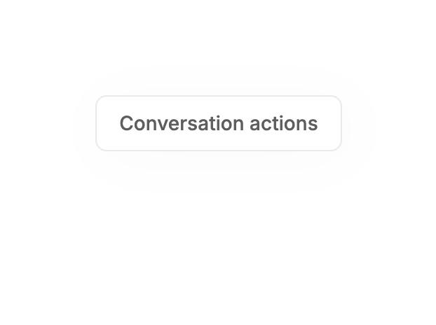 |  |

### Open

| Before | After |
| --- | --- |
|  | 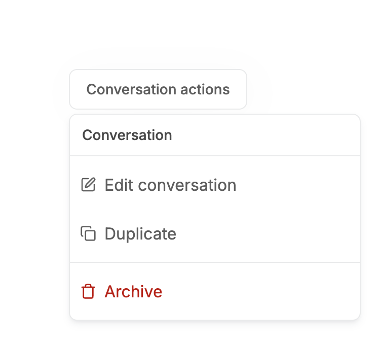 |

### Open, mouse hover on a row

| Before | After |
| --- | --- |
|  |  |

### Open by keyboard, ArrowDown

| Before | After |
| --- | --- |
| 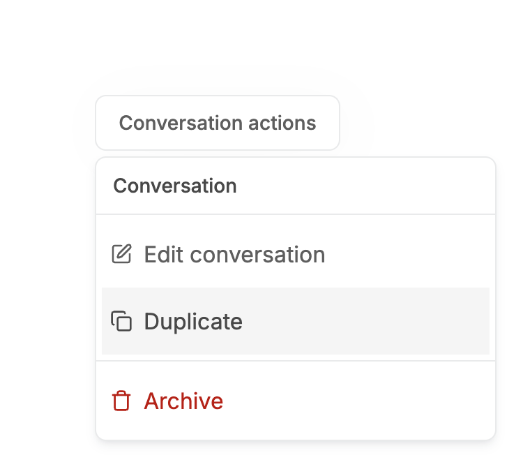 |  |

### Keyboard open, then hover

| Before | After |
| --- | --- |
|  |  |

### Destructive item highlighted (Archive)

| Before | After |
| --- | --- |
| 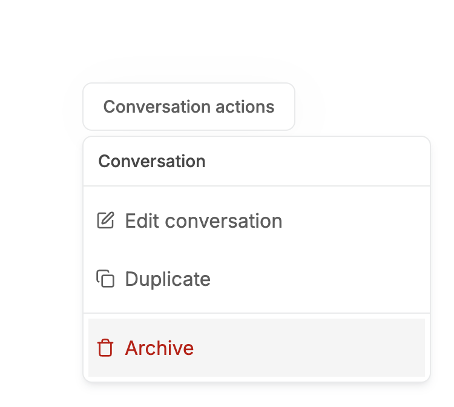 | 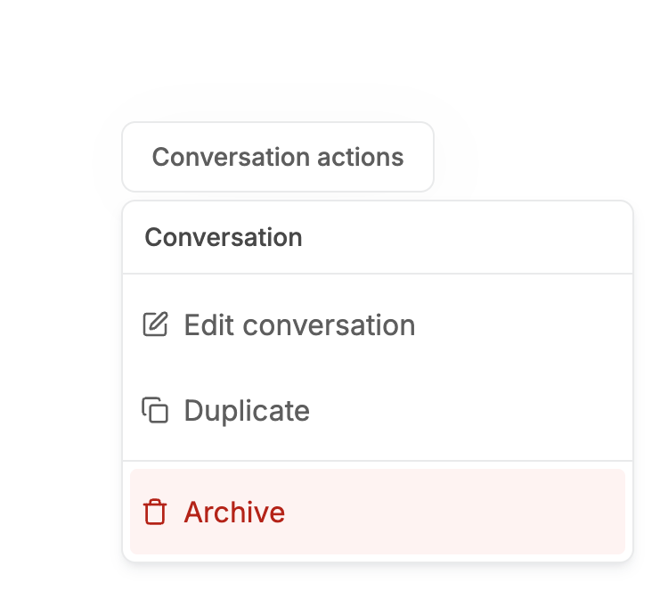 |

### Destructive story, open

| Before | After |
| --- | --- |
| 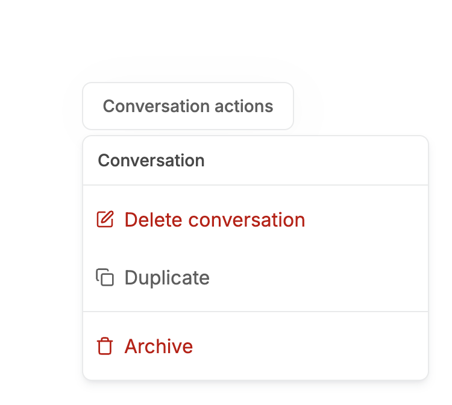 |  |

### Destructive, keyboard highlight

| Before | After |
| --- | --- |
| 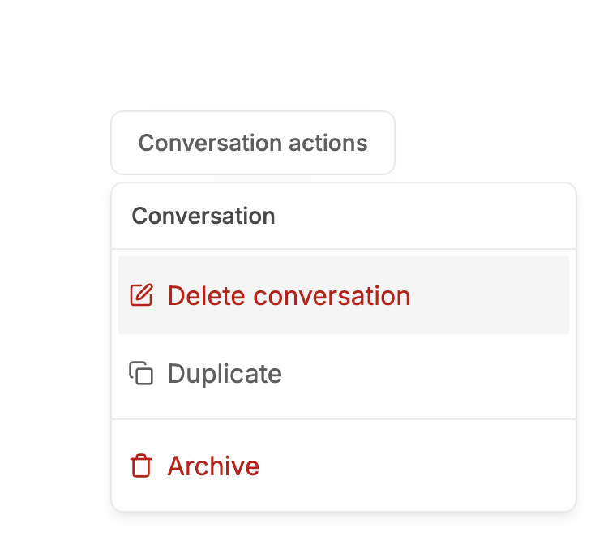 | 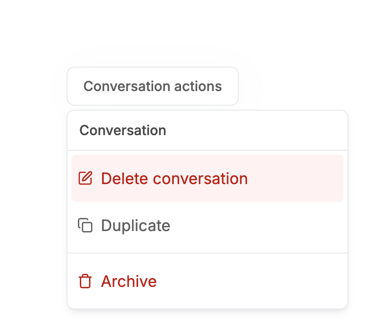 |

### Disabled items

| Before | After |
| --- | --- |
| 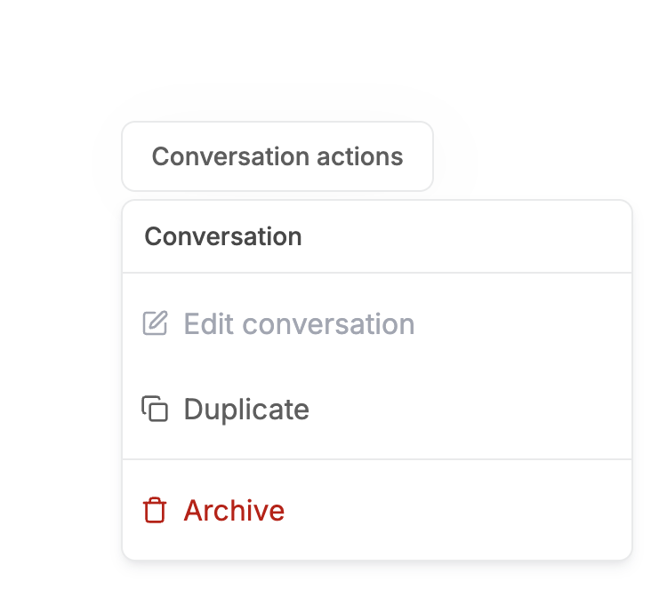 |  |

### Checkbox item, checked

| Before | After |
| --- | --- |
|  | 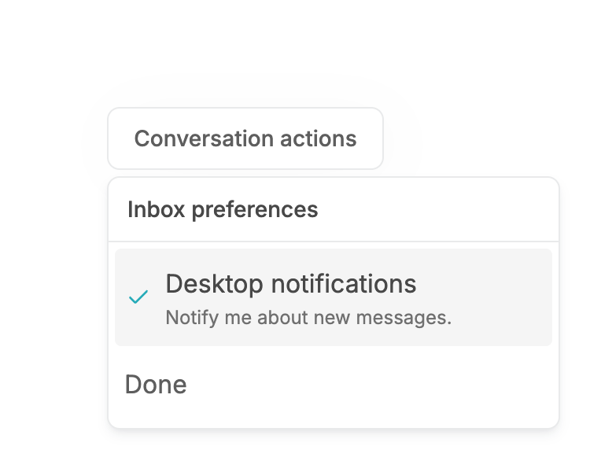 |

### Radio group

| Before | After |
| --- | --- |
| 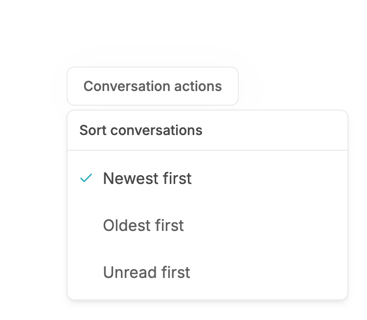 |  |

### Submenu open

| Before | After |
| --- | --- |
| 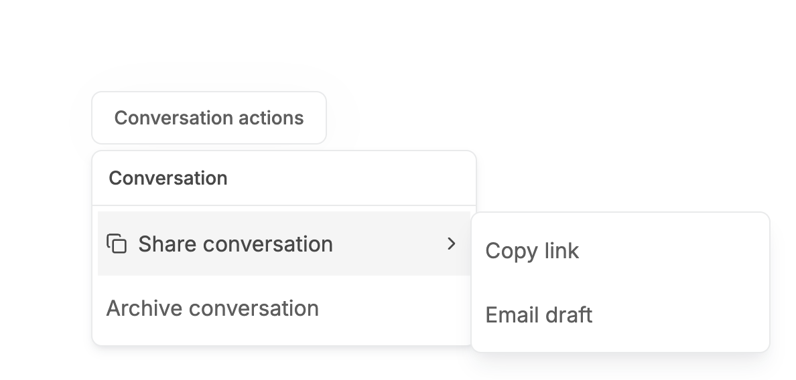 |  |

### Row with description and suffix

| Before | After |
| --- | --- |
| 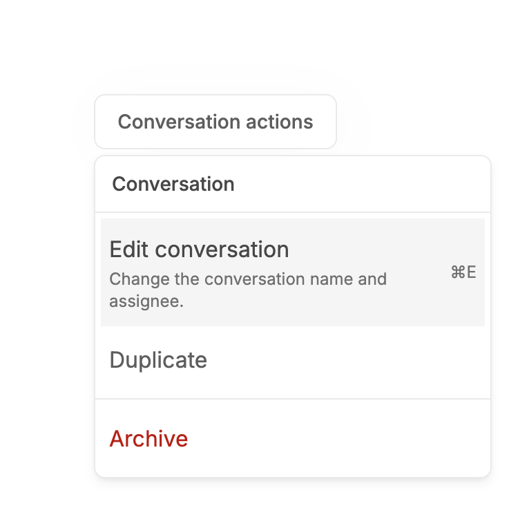 |  |

### Open, 340px viewport

| Before | After |
| --- | --- |
|  | 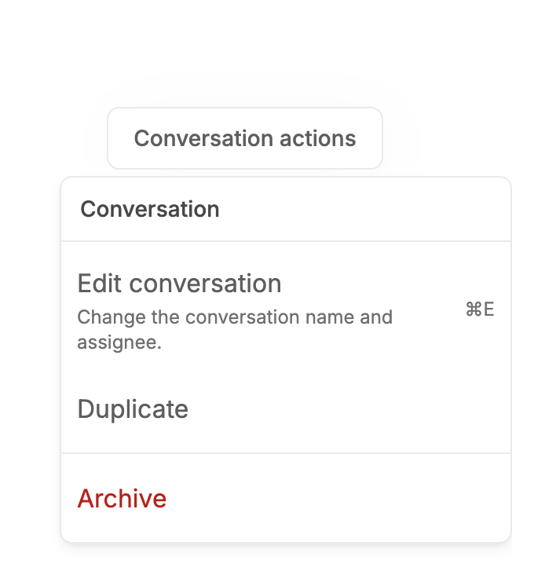 |

## Measured changes (copy these into Figma)

_Source: computed styles of the rendered component; px, hex colours, ms. Only properties that changed are listed._

### Open

| Element | Property | Before | After |
| --- | --- | --- | --- |
| Row (first) | border-radius | 0px | **4px** |
| Row (destructive) | border-radius | 0px | **4px** |

### Open, mouse hover on a row

| Element | Property | Before | After |
| --- | --- | --- | --- |
| Row (first) | border-radius | 0px | **4px** |
| Row (highlighted) | border-radius | 0px | **4px** |
| Row (destructive) | border-radius | 0px | **4px** |

### Open by keyboard, ArrowDown

| Element | Property | Before | After |
| --- | --- | --- | --- |
| Row (first) | border-radius | 0px | **4px** |
| Row (highlighted) | border-radius | 0px | **4px** |
| Row (destructive) | border-radius | 0px | **4px** |

### Keyboard open, then hover

| Element | Property | Before | After |
| --- | --- | --- | --- |
| Row (first) | border-radius | 0px | **4px** |
| Row (highlighted) | background-color | #F5F5F5 | **#FEF3F2** |
| Row (highlighted) | border-radius | 0px | **4px** |
| Row (destructive) | background-color | #F5F5F5 | **#FEF3F2** |
| Row (destructive) | border-radius | 0px | **4px** |

### Destructive item highlighted (Archive)

| Element | Property | Before | After |
| --- | --- | --- | --- |
| Row (first) | border-radius | 0px | **4px** |
| Row (highlighted) | background-color | #F5F5F5 | **#FEF3F2** |
| Row (highlighted) | border-radius | 0px | **4px** |
| Row (destructive) | background-color | #F5F5F5 | **#FEF3F2** |
| Row (destructive) | border-radius | 0px | **4px** |

### Destructive story, open

| Element | Property | Before | After |
| --- | --- | --- | --- |
| Row (first) | border-radius | 0px | **4px** |
| Row (destructive) | border-radius | 0px | **4px** |

### Destructive, keyboard highlight

| Element | Property | Before | After |
| --- | --- | --- | --- |
| Row (first) | background-color | #F5F5F5 | **#FEF3F2** |
| Row (first) | border-radius | 0px | **4px** |
| Row (highlighted) | background-color | #F5F5F5 | **#FEF3F2** |
| Row (highlighted) | border-radius | 0px | **4px** |
| Row (destructive) | background-color | #F5F5F5 | **#FEF3F2** |
| Row (destructive) | border-radius | 0px | **4px** |

### Disabled items

| Element | Property | Before | After |
| --- | --- | --- | --- |
| Row (first) | border-radius | 0px | **4px** |
| Row (destructive) | border-radius | 0px | **4px** |

### Checkbox item, checked

| Element | Property | Before | After |
| --- | --- | --- | --- |
| Row (first) | border-radius | 0px | **4px** |
| Row (highlighted) | border-radius | 0px | **4px** |
| Row (checkbox) | border-radius | 0px | **4px** |
| Check icon (checkbox) | animation-name | none | **enter** |
| Check icon (checkbox) | animation-duration | 0s | **0.18s** |
| Check icon (checkbox) | animation-timing-function | ease | **linear(0 0%, 0.06174 5%, 0.19179 10%, 0.33839 15%, 0.47651 20%, 0.59579 25%, 0.69365 30%, 0.77125 35%, 0.83131 40%, 0.87696 45%, 0.91117 50%, 0.93653 55%, 0.955** |

### Radio group

| Element | Property | Before | After |
| --- | --- | --- | --- |
| Row (radio, checked) | border-radius | 0px | **4px** |
| Check icon (radio) | animation-name | none | **enter** |
| Check icon (radio) | animation-duration | 0s | **0.18s** |
| Check icon (radio) | animation-timing-function | ease | **linear(0 0%, 0.06174 5%, 0.19179 10%, 0.33839 15%, 0.47651 20%, 0.59579 25%, 0.69365 30%, 0.77125 35%, 0.83131 40%, 0.87696 45%, 0.91117 50%, 0.93653 55%, 0.955** |

### Submenu open

| Element | Property | Before | After |
| --- | --- | --- | --- |
| Row (first) | border-radius | 0px | **4px** |
| Row (highlighted) | border-radius | 0px | **4px** |

### Row with description and suffix

| Element | Property | Before | After |
| --- | --- | --- | --- |
| Row (first) | border-radius | 0px | **4px** |
| Row (highlighted) | border-radius | 0px | **4px** |
| Row (destructive) | border-radius | 0px | **4px** |

### Open, 340px viewport

| Element | Property | Before | After |
| --- | --- | --- | --- |
| Row (first) | border-radius | 0px | **4px** |
| Row (destructive) | border-radius | 0px | **4px** |

## Motion

| What | Before | After |
| --- | --- | --- |
| Menu enter | opacity stayed 100%, no scale, no slide (utility-order bug) | **200ms: opacity 0 to 100%, scale 98% to 100%, 4px slide from the trigger side, origin from Radix, spring ease (--v2-ease-spring; sampled critically damped curve, fallback cubic-bezier(0.22, 1, 0.36, 1)). Exit 120ms (fade + scale 98%)** |
| Checked checkbox / radio check | appears instantly | **180ms opacity 0 to 100% + scale 85% to 100%, spring ease (--v2-ease-spring; sampled critically damped curve, fallback cubic-bezier(0.22, 1, 0.36, 1))** |
| Row highlight | instant | **instant (deliberately not animated, keyboard navigation must not lag)** |
| Reduced motion | 120ms fade in / 100ms out | **unchanged** |

## States to update in Figma

- Menu item / default, highlighted, checked, radio, submenu trigger: corner radius 0 -> 4
- Menu item / destructive / default: label #B42318
- Menu item / destructive / highlighted: fill #FEF3F2 + label #B42318 (was #F5F5F5)
- Menu item / destructive / disabled: label #A2A6B1 (disabled wins)
- Checkbox and radio item / checked: check enters with scale/fade
- Group label: unchanged

## How to apply in Figma

1. Menu (unchanged): fill #FFFFFF, border 1px #E9EAEB, corner radius 8, auto-layout padding 4, shadow 0 4 8 -2 rgba(16,24,40,0.10) + 0 2 4 -2 rgba(16,24,40,0.06), min width 128, max width 320.
2. Menu item, every type (item, checkbox, radio, submenu trigger): corner radius 4 (was 0). Geometry unchanged: min-height 48, padding 10 top/bottom and 6 left/right (32 left for checkbox/radio), gap 8, label 16/400 #5E5E5E, highlight fill #F5F5F5 with label #484848.
3. Add a boolean property Destructive on the item component. Destructive default: label #B42318 (error-700). Destructive highlighted: fill #FEF3F2 (error-50), label #B42318. Destructive disabled: label #A2A6B1 on no fill.
4. Checkbox/radio selected check: 16px #27ABB8, 8px from the left. Prototype: enters with opacity 0 to 100% + scale 85% to 100%, 180ms, ease cubic-bezier(0.22, 1, 0.36, 1).
5. Group label (DropdownMenuLabel): UNCHANGED: 14/500 #484848, padding 6 / 8. See notes for why it is not 12px muted.
6. Menu prototype: open 200ms Smart animate from opacity 0%, scale 98%, 4px offset toward the trigger, origin at the corner nearest the trigger; close 120ms opacity to 0% and scale 98%.

## Notes

- Group label NOT unified with SelectLabel (12px / 500 / muted). design/V2-TEXT-HIERARCHY-OVERLAYS-REVIEW.md records the Dropdown section label as an 'Ordinary title / section heading' at #484848 / 500 (and rows as #5E5E5E), the user's own hierarchy decision; v2-figma-specs.md records no group-label style. Changing it to 12px muted would contradict that, so it is left as is.
- Keyboard-only ring NOT added: Radix highlights by focusing the row on pointer move too, so the focus-visible pseudo-class is also true under a mouse hover (verified in Chrome: pointer-opened menu + hover still matched, and keyboard open + hover too). A reliable version needs an input-modality flag; not done.
- The destructive highlight uses #FEF3F2 (semantic-error-surface, error-50). The tighter error-25 (#FFFBFA) was tried first and is nearly invisible on white. Destructive text is semantic-error-text #B42318, as the existing review records.
- Row height and density are unchanged (48px).
- The additive prop is destructive?: boolean on DropdownMenuItem (default false); also sets data-destructive on the item. Stories now use it instead of hand-written classes. date-range-picker's month/year menus consume DropdownMenu and are unaffected API-wise (every export and prop is unchanged).
- Found while verifying motion: `motion-safe:animate-in` is emitted after bare `fade-in-0`/`zoom-in-*` classes and resets --tw-enter-opacity/--tw-enter-scale to initial, so the panel fade and 98% zoom documented in V2-MOTION.md never ran in normal-motion mode (measured at t=0: opacity 1, no scale). Fixed here by prefixing those classes with `motion-safe:` (as Checkbox/TextField already do). The same bare pattern remains in dialog.tsx, toast.tsx, tabs.tsx, date-range-picker.tsx and date-time-picker.tsx (not in this task's files, not individually verified).
