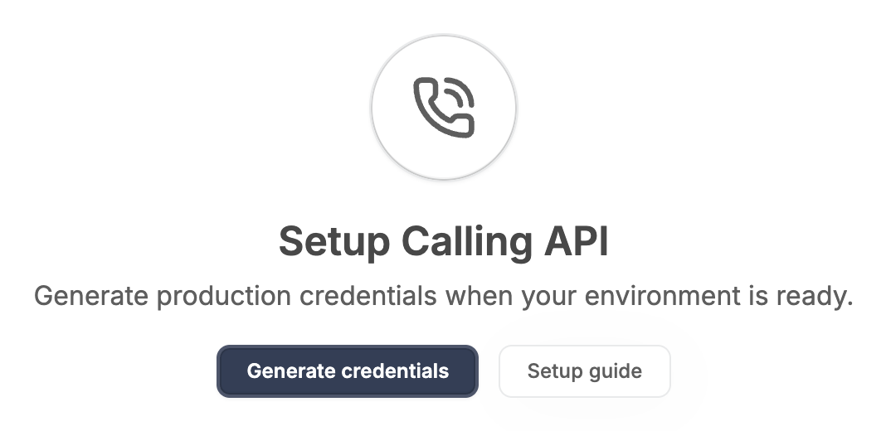
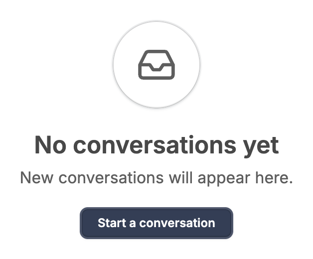
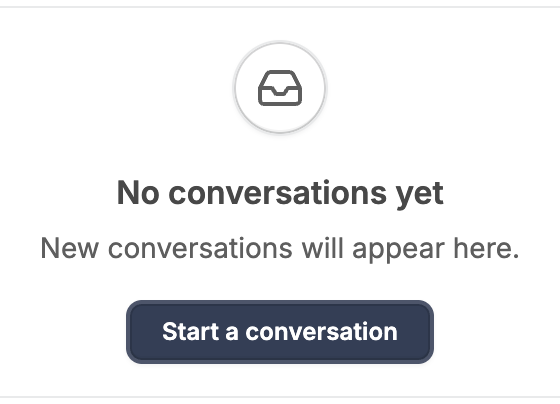
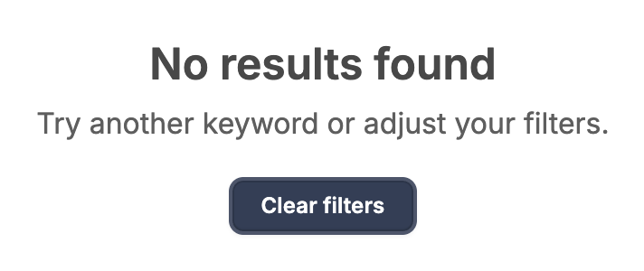
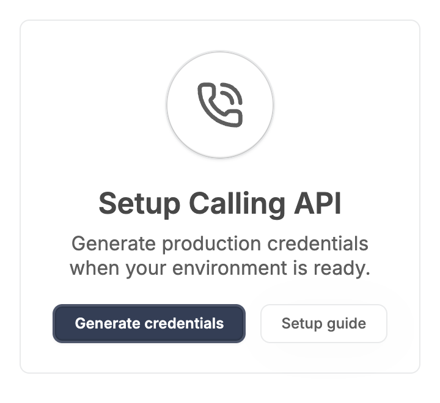
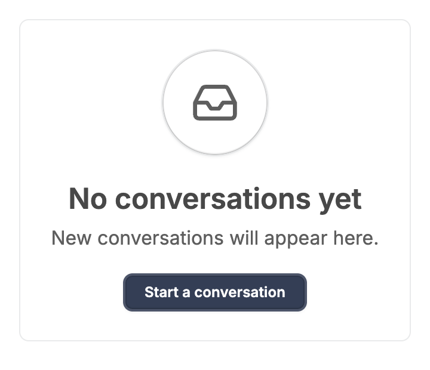
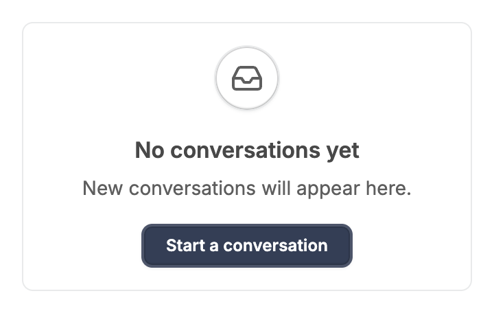

# EmptyState: UI change report for Figma

Figma source: [https://www.figma.com/design/q84boKV4Bly9HKXzdtBj2K/New-Design-System---MyO?node-id=924-7344](https://www.figma.com/design/q84boKV4Bly9HKXzdtBj2K/New-Design-System---MyO?node-id=924-7344)  
Storybook: `V2/Components/EmptyState`  
Date: 2026-10-04

## Summary

EmptyState gains an optional size='sm' for cards, side panels and table bodies: 48px icon tile, 16px title, 14px description and 16px padding. The default is byte-for-byte unchanged.

### Why (what the research found)

- Untitled UI, Mantine and HeroUI offer a compact empty state because the full 90px-icon / 24px-title view overwhelms a table body, a small card or a panel.
- A small variant keeps product teams from overriding sizes with className hacks.

### API / compatibility

No prop, callback, aria-label or DOM-contract changes. v2 remains a drop-in for v1 (`npm run verify:v1-v2-compat` passes).

## Before and after

### Default (unchanged)

| Before | After |
| --- | --- |
|  |  |

### Small

| Before | After |
| --- | --- |
|  |  |

### Default without icon (unchanged)

| Before | After |
| --- | --- |
|  |  |

### Default at 360px (unchanged)

| Before | After |
| --- | --- |
|  |  |

### Small at 360px

| Before | After |
| --- | --- |
|  |  |

## Measured changes (copy these into Figma)

_Source: computed styles of the rendered component; px, hex colours, ms. Only properties that changed are listed._

### Small

| Element | Property | Before | After |
| --- | --- | --- | --- |
| Root | height | 268px | **194px** |
| Root | padding-top | 24px | **16px** |
| Root | padding-left | 24px | **16px** |
| Root | row-gap | 20px | **16px** |
| Icon tile | width | 90px | **48px** |
| Icon tile | height | 90px | **48px** |
| Icon | width | 40px | **24px** |
| Icon | height | 40px | **24px** |
| Title | width | 245.73 | **163.83** |
| Title | height | 32 | **24** |
| Title | font-size | 24px | **16px** |
| Title | line-height | 32px | **24px** |
| Description | width | 274.48 | **240.17** |
| Description | font-size | 16px | **14px** |
| Description | line-height | normal | **20px** |
| Text group | width | 274.48 | **240.17** |
| Text group | height | 58 | **50** |

### Small at 360px

| Element | Property | Before | After |
| --- | --- | --- | --- |
| Root | height | 268px | **194px** |
| Root | padding-top | 24px | **16px** |
| Root | padding-left | 24px | **16px** |
| Root | row-gap | 20px | **16px** |
| Icon tile | width | 90px | **48px** |
| Icon tile | height | 90px | **48px** |
| Icon | width | 40px | **24px** |
| Icon | height | 40px | **24px** |
| Title | width | 245.73 | **163.83** |
| Title | height | 32 | **24** |
| Title | font-size | 24px | **16px** |
| Title | line-height | 32px | **24px** |
| Description | width | 274.48 | **240.17** |
| Description | font-size | 16px | **14px** |
| Description | line-height | normal | **20px** |
| Text group | width | 274.48 | **240.17** |
| Text group | height | 58 | **50** |

## Motion

| What | Before | After |
| --- | --- | --- |
| Any | none | **none (static component)** |

## States to update in Figma

- Empty state / default: padding 24, gap 20, icon tile 90x90, title 24/32 semibold, description 16.
- Empty state / small: NEW. padding 16, gap 16, icon tile 48x48, icon 24x24, title 16/24 semibold, description 14/20 regular.

## How to apply in Figma

1. Add a 'size' property to EmptyState: default | sm. Default is unchanged.
2. Small: auto-layout vertical, centred, padding 16 on all sides, gap 16. Icon tile: 48x48 circle (radius 60), fill #FFFFFF, 1px stroke #E9EAEB, same inner shadow as default (0 1 2 rgba(12,15,18,0.05), inset 0 0 0 1 rgba(10,13,18,0.18), inset 0 -2 0 rgba(12,15,18,0.05)). Icon inside: 24x24, colour #5E5E5E (default size uses 40x40 in the 90px tile).
3. Small text group: gap 6; title Inter 16 / line height 24, weight 600, #484848; description Inter 14 / line height 20, regular, #5E5E5E. Action row: gap 12 (unchanged).
4. Default stays: padding 24, gap 20, tile 90x90, title 24/32 600, description 16 normal line height.

## Notes

- In size='sm' the icon inside the tile is sized to 24px by the component ([&>svg]:size-6), so an icon passed with its own 40px class still fits the 48px tile. Description size 14px and gap 16px were my choice (the brief gave tile, title and padding only): please confirm with design.
- Default output was verified identical: the default root/tile/title/description class strings are literals, and a test asserts omitted size and size='default' render the same HTML.
- Research conclusions in 'why' come from the task brief; I did not re-verify them against each library.
