# FileUpload: UI change report for Figma

Figma source: [https://www.figma.com/design/q84boKV4Bly9HKXzdtBj2K/New-Design-System---MyO?node-id=924-7516](https://www.figma.com/design/q84boKV4Bly9HKXzdtBj2K/New-Design-System---MyO?node-id=924-7516)  
Storybook: `V2/Components/FileUpload`  
Date: 2026-10-04

## Summary

Dragging a file over the drop zone no longer flickers when the pointer crosses the icon and text, and when the browser can tell the dragged type will not be accepted (MIME-only accept such as image/* or application/pdf) the zone turns red instead of inviting the drop. The error message and added-file rows now actually fade in.

### Why (what the research found)

- Dropzone libraries (react-dropzone, Mantine Dropzone, Untitled UI) track drag enter/leave with a counter because dragleave fires for every child element; a bare onDragLeave made the highlight blink.
- react-dropzone and Mantine Dropzone expose accept / reject states during drag using the item MIME types; rejecting before the drop is the less frustrating UX.

### API / compatibility

No prop, callback, aria-label or DOM-contract changes. v2 remains a drop-in for v1 (`npm run verify:v1-v2-compat` passes).

## Before and after

### Default (unchanged)

| Before | After |
| --- | --- |
|  |  |

### Disabled (unchanged)

| Before | After |
| --- | --- |
| 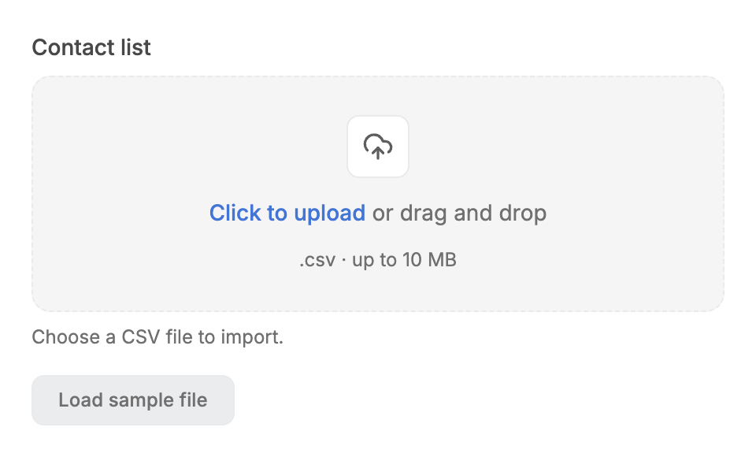 |  |

### Images-only zone, png dragged: neutral highlight

| Before | After |
| --- | --- |
| 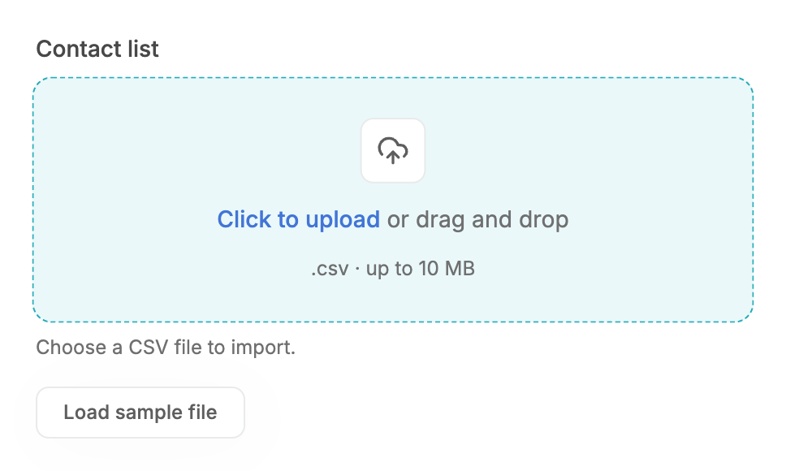 | 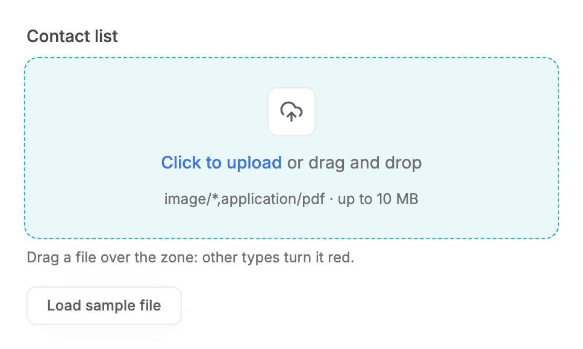 |

### Pointer crossing children (frame list in the JSON: before it dropped the highlight on each crossing)

| Before | After |
| --- | --- |
| 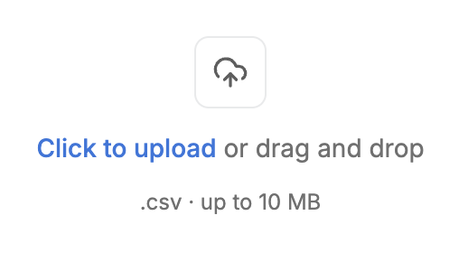 | 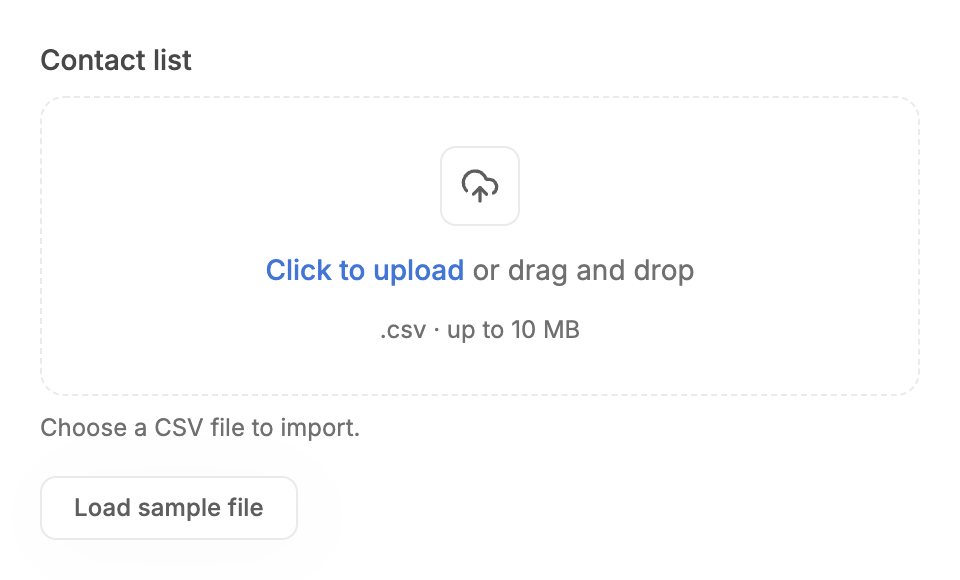 |

### Dragging a csv over a .csv zone: neutral highlight (unchanged)

| Before | After |
| --- | --- |
|  |  |

### Images-only zone, csv dragged: red tint (before image: old build, always neutral)

| Before | After |
| --- | --- |
|  | 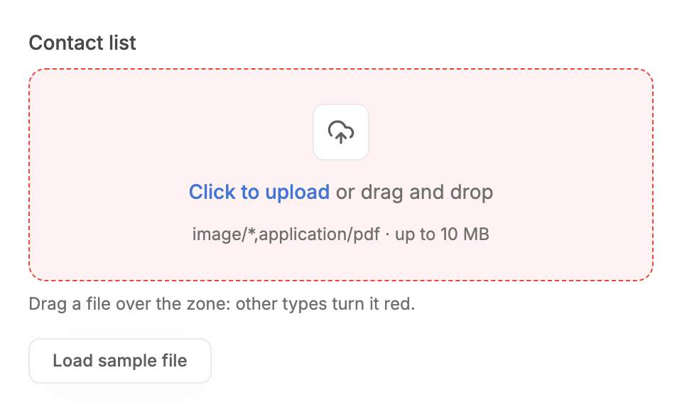 |

### Error message (now fades in)

| Before | After |
| --- | --- |
| 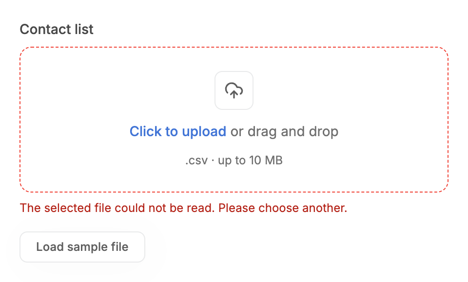 |  |

### Focus-visible (unchanged)

| Before | After |
| --- | --- |
|  | 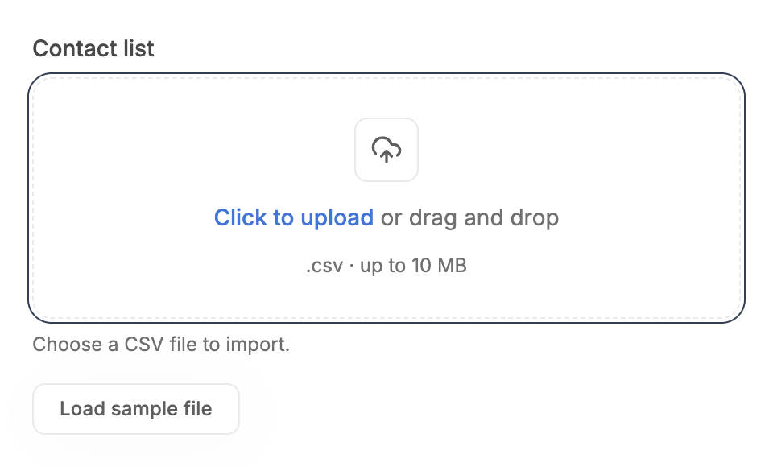 |

### Hover (unchanged)

| Before | After |
| --- | --- |
|  | 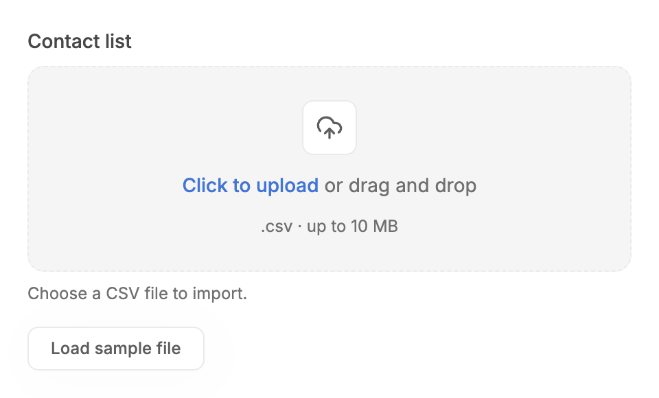 |

### Narrow width (unchanged)

| Before | After |
| --- | --- |
|  | 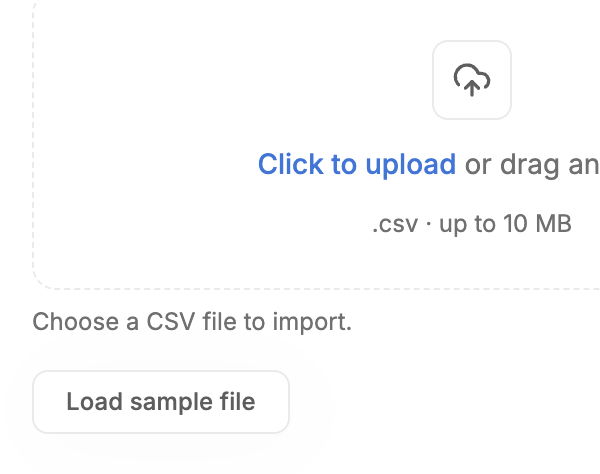 |

### With a file (rows now fade/slide in)

| Before | After |
| --- | --- |
| 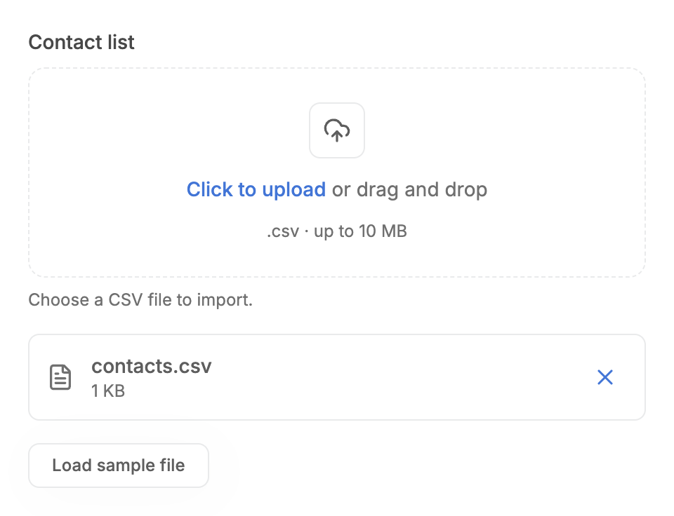 |  |

## Measured changes (copy these into Figma)

_Source: computed styles of the rendered component; px, hex colours, ms. Only properties that changed are listed._

### Pointer crossing children (frame list in the JSON: before it dropped the highlight on each crossing)

| Element | Property | Before | After |
| --- | --- | --- | --- |
| Drop zone | width | 968px | **440px** |
| Message | width | 968 | **440** |

### Images-only zone, csv dragged: red tint (before image: old build, always neutral)

| Element | Property | Before | After |
| --- | --- | --- | --- |
| Drop zone | background-color | #EAF8FA | **#FEF3F2** |
| Drop zone | border-top-color | #27ABB8 | **#F04438** |
| Drop zone | transform | matrix(1.01, 0, 0, 1.01, 0, 0) | **none** |

## Motion

| What | Before | After |
| --- | --- | --- |
| Drag highlight | Dropped on every dragleave from a child: flickers while moving over the icon or text | **Highlight stays until the pointer really leaves (enter/leave counter, reset on drop)** |
| Reject tint | none | **Border and background colour change with the existing 180ms spring transition; the 1.01 scale is not applied while rejecting** |
| Error message and added-file rows | Fade classes present but never ran (values reset) | **Message fades in; rows fade in with a 2px slide, 180ms spring (reduced motion: no animation)** |

## States to update in Figma

- Drop zone / dragging, accepted or undetectable type: border --semantic-border-accent #27ABB8, fill --semantic-brand-surface, scale 1.01 (unchanged)
- Drop zone / dragging, rejected type (new): border --semantic-error-primary #F04438 (dashed, 1px), fill --semantic-error-surface-subtle, no scale

## How to apply in Figma

1. Add a 'Drag over / reject' variant of the drop zone: dashed 1px border --semantic-error-primary #F04438, fill --semantic-error-surface-subtle (#FEF3F2-tone token), no scale change (the accepted drag variant keeps scale 101%).
2. Annotate the rule: red only when the accept list is MIME types only (image/*, application/pdf) and a dragged item's type matches none of them; with extension rules (.csv) the zone stays in the neutral drag state because the browser hides file names during a drag.
3. Annotate: the drag highlight remains while the pointer moves over the icon tile and text (no flicker).

## Notes

- Not done this pass, proposed follow-up: per-file progress rows (progress bar and cancel while uploading). The component only holds files locally today, so progress needs an upload callback in the API.
- Browsers expose only the MIME type (not the name or size) while dragging, and Safari/Firefox may report an empty type for some files; an empty type never triggers the red state.
- The before images for the two reject scenarios were taken on the old build, which had no type detection: any dragged file showed the neutral highlight.
- The drag-flicker scenario reads the highlight after synthetic dragenter/dragleave events in the order Chrome fires them when the pointer crosses between children; evals hold the per-step border colours.
- The drag-flicker before sequence was recorded from a temporary copy of the previous component (read from classes after each event group, 40ms apart): the highlight dropped to false on `zone -> icon` and `icon -> text` crossings and returned on the next dragover; after, it stays true until the real leave.
