# NumberStepField: UI change report for Figma

Figma source: [https://www.figma.com/design/q84boKV4Bly9HKXzdtBj2K/New-Design-System---MyO?node-id=2185-15837](https://www.figma.com/design/q84boKV4Bly9HKXzdtBj2K/New-Design-System---MyO?node-id=2185-15837)  
Storybook: `V2/Components/NumberStepField`  
Date: 2026-10-04

## Summary

The two stepper chevrons were 12 x 12px targets. Each is now a half-height tile, 24 x 19px, with a neutral grey hover fill, so it is easy to hit and shows what will be pressed; at rest it still looks like two bare chevrons. Holding a tile repeats the step (first repeat after 400ms, then every 60ms) and stops on release, on leaving the tile, or at the minimum / maximum.

### Why (what the research found)

- Mantine NumberInput and HeroUI NumberInput both repeat the step while the button is held (Mantine: 500ms then ~50ms); stepping 0 to 30 minutes with 30 clicks of a 12px target is the pain this removes.
- 12px targets are half the 24px WCAG 2.5.8 minimum; stacking two controls in a 38px field allows at most 19px tall tiles.

### API / compatibility

No prop, callback, aria-label or DOM-contract changes. v2 remains a drop-in for v1 (`npm run verify:v1-v2-compat` passes).

## Before and after

### At maximum: increase disabled

| Before | After |
| --- | --- |
| 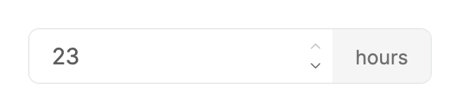 | 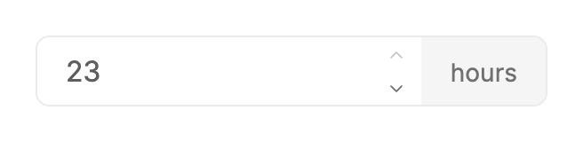 |

### At minimum: decrease disabled

| Before | After |
| --- | --- |
|  | 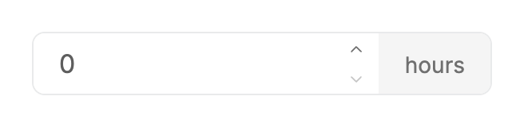 |

### After one click on increase (value 1 to 2)

| Before | After |
| --- | --- |
| 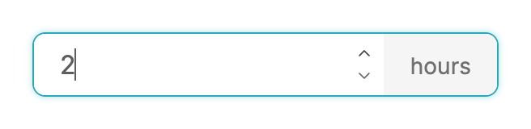 | 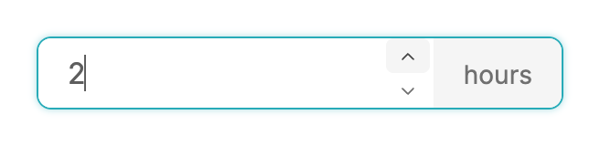 |

### Default

| Before | After |
| --- | --- |
|  | 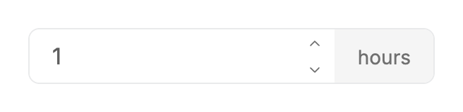 |

### Disabled

| Before | After |
| --- | --- |
|  | 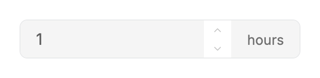 |

### Input focused

| Before | After |
| --- | --- |
|  | 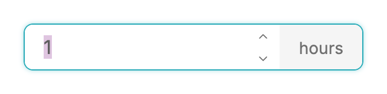 |

### Hover on the decrease tile

| Before | After |
| --- | --- |
| 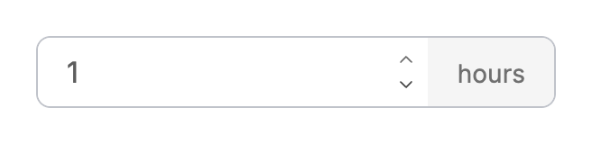 | 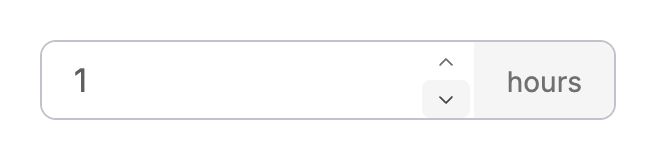 |

### Hover on the increase tile

| Before | After |
| --- | --- |
| 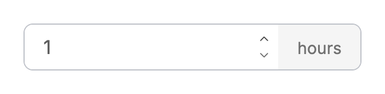 | 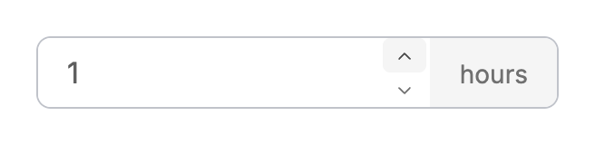 |

### Narrow width

| Before | After |
| --- | --- |
| 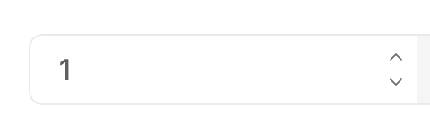 | 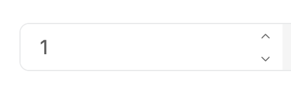 |

### Increase tile pressed

| Before | After |
| --- | --- |
| 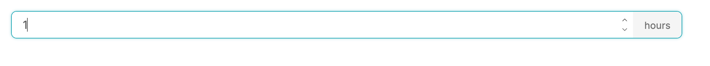 | 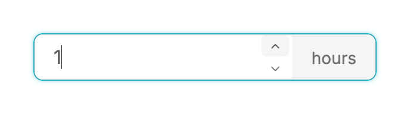 |

## Measured changes (copy these into Figma)

_Source: computed styles of the rendered component; px, hex colours, ms. Only properties that changed are listed._

### At maximum: increase disabled

| Element | Property | Before | After |
| --- | --- | --- | --- |
| Increase button | width | 12px | **24px** |
| Increase button | height | 12px | **19px** |
| Increase button | border-radius | 0px | **4px** |
| Increase button | transition-property | color, transform | **color, background-color, transform** |
| Increase button | transition-duration | 0.18s | **0.18s, 0.15s, 0.18s** |
| Decrease button | width | 12px | **24px** |
| Decrease button | height | 12px | **19px** |
| Decrease button | border-radius | 0px | **4px** |
| Decrease button | transition-property | color, transform | **color, background-color, transform** |
| Decrease button | transition-duration | 0.18s | **0.18s, 0.15s, 0.18s** |
| Stepper column | width | 20px | **28px** |
| Stepper column | gap | 2px | **normal** |
| Stepper column | padding | 0px 6px 0px 2px | **0px 2px** |
| Input | width | 196.37px | **188.37px** |

### At minimum: decrease disabled

| Element | Property | Before | After |
| --- | --- | --- | --- |
| Increase button | width | 12px | **24px** |
| Increase button | height | 12px | **19px** |
| Increase button | border-radius | 0px | **4px** |
| Increase button | transition-property | color, transform | **color, background-color, transform** |
| Increase button | transition-duration | 0.18s | **0.18s, 0.15s, 0.18s** |
| Decrease button | width | 12px | **24px** |
| Decrease button | height | 12px | **19px** |
| Decrease button | border-radius | 0px | **4px** |
| Decrease button | transition-property | color, transform | **color, background-color, transform** |
| Decrease button | transition-duration | 0.18s | **0.18s, 0.15s, 0.18s** |
| Stepper column | width | 20px | **28px** |
| Stepper column | gap | 2px | **normal** |
| Stepper column | padding | 0px 6px 0px 2px | **0px 2px** |
| Input | width | 196.37px | **188.37px** |

### After one click on increase (value 1 to 2)

| Element | Property | Before | After |
| --- | --- | --- | --- |
| Increase button | width | 12px | **24px** |
| Increase button | height | 12px | **19px** |
| Increase button | background-color | transparent | **#F5F5F5** |
| Increase button | border-radius | 0px | **4px** |
| Increase button | transition-property | color, transform | **color, background-color, transform** |
| Increase button | transition-duration | 0.18s | **0.18s, 0.15s, 0.18s** |
| Decrease button | width | 12px | **24px** |
| Decrease button | height | 12px | **19px** |
| Decrease button | border-radius | 0px | **4px** |
| Decrease button | transition-property | color, transform | **color, background-color, transform** |
| Decrease button | transition-duration | 0.18s | **0.18s, 0.15s, 0.18s** |
| Stepper column | width | 20px | **28px** |
| Stepper column | gap | 2px | **normal** |
| Stepper column | padding | 0px 6px 0px 2px | **0px 2px** |
| Input | width | 196.37px | **188.37px** |

### Default

| Element | Property | Before | After |
| --- | --- | --- | --- |
| Increase button | width | 12px | **24px** |
| Increase button | height | 12px | **19px** |
| Increase button | border-radius | 0px | **4px** |
| Increase button | transition-property | color, transform | **color, background-color, transform** |
| Increase button | transition-duration | 0.18s | **0.18s, 0.15s, 0.18s** |
| Decrease button | width | 12px | **24px** |
| Decrease button | height | 12px | **19px** |
| Decrease button | border-radius | 0px | **4px** |
| Decrease button | transition-property | color, transform | **color, background-color, transform** |
| Decrease button | transition-duration | 0.18s | **0.18s, 0.15s, 0.18s** |
| Stepper column | width | 20px | **28px** |
| Stepper column | gap | 2px | **normal** |
| Stepper column | padding | 0px 6px 0px 2px | **0px 2px** |
| Input | width | 196.37px | **188.37px** |

### Disabled

| Element | Property | Before | After |
| --- | --- | --- | --- |
| Increase button | width | 12px | **24px** |
| Increase button | height | 12px | **19px** |
| Increase button | border-radius | 0px | **4px** |
| Increase button | transition-property | color, transform | **color, background-color, transform** |
| Increase button | transition-duration | 0.18s | **0.18s, 0.15s, 0.18s** |
| Decrease button | width | 12px | **24px** |
| Decrease button | height | 12px | **19px** |
| Decrease button | border-radius | 0px | **4px** |
| Decrease button | transition-property | color, transform | **color, background-color, transform** |
| Decrease button | transition-duration | 0.18s | **0.18s, 0.15s, 0.18s** |
| Stepper column | width | 20px | **28px** |
| Stepper column | gap | 2px | **normal** |
| Stepper column | padding | 0px 6px 0px 2px | **0px 2px** |
| Input | width | 196.37px | **188.37px** |

### Input focused

| Element | Property | Before | After |
| --- | --- | --- | --- |
| Increase button | width | 12px | **24px** |
| Increase button | height | 12px | **19px** |
| Increase button | border-radius | 0px | **4px** |
| Increase button | transition-property | color, transform | **color, background-color, transform** |
| Increase button | transition-duration | 0.18s | **0.18s, 0.15s, 0.18s** |
| Decrease button | width | 12px | **24px** |
| Decrease button | height | 12px | **19px** |
| Decrease button | border-radius | 0px | **4px** |
| Decrease button | transition-property | color, transform | **color, background-color, transform** |
| Decrease button | transition-duration | 0.18s | **0.18s, 0.15s, 0.18s** |
| Stepper column | width | 20px | **28px** |
| Stepper column | gap | 2px | **normal** |
| Stepper column | padding | 0px 6px 0px 2px | **0px 2px** |
| Input | width | 196.37px | **188.37px** |

### Hover on the decrease tile

| Element | Property | Before | After |
| --- | --- | --- | --- |
| Increase button | width | 12px | **24px** |
| Increase button | height | 12px | **19px** |
| Increase button | border-radius | 0px | **4px** |
| Increase button | transition-property | color, transform | **color, background-color, transform** |
| Increase button | transition-duration | 0.18s | **0.18s, 0.15s, 0.18s** |
| Decrease button | width | 12px | **24px** |
| Decrease button | height | 12px | **19px** |
| Decrease button | background-color | transparent | **#F5F5F5** |
| Decrease button | border-radius | 0px | **4px** |
| Decrease button | transition-property | color, transform | **color, background-color, transform** |
| Decrease button | transition-duration | 0.18s | **0.18s, 0.15s, 0.18s** |
| Stepper column | width | 20px | **28px** |
| Stepper column | gap | 2px | **normal** |
| Stepper column | padding | 0px 6px 0px 2px | **0px 2px** |
| Input | width | 196.37px | **188.37px** |

### Hover on the increase tile

| Element | Property | Before | After |
| --- | --- | --- | --- |
| Increase button | width | 12px | **24px** |
| Increase button | height | 12px | **19px** |
| Increase button | background-color | transparent | **#F5F5F5** |
| Increase button | border-radius | 0px | **4px** |
| Increase button | transition-property | color, transform | **color, background-color, transform** |
| Increase button | transition-duration | 0.18s | **0.18s, 0.15s, 0.18s** |
| Decrease button | width | 12px | **24px** |
| Decrease button | height | 12px | **19px** |
| Decrease button | border-radius | 0px | **4px** |
| Decrease button | transition-property | color, transform | **color, background-color, transform** |
| Decrease button | transition-duration | 0.18s | **0.18s, 0.15s, 0.18s** |
| Stepper column | width | 20px | **28px** |
| Stepper column | gap | 2px | **normal** |
| Stepper column | padding | 0px 6px 0px 2px | **0px 2px** |
| Input | width | 196.37px | **188.37px** |

### Narrow width

| Element | Property | Before | After |
| --- | --- | --- | --- |
| Increase button | width | 12px | **24px** |
| Increase button | height | 12px | **19px** |
| Increase button | border-radius | 0px | **4px** |
| Increase button | transition-property | color, transform | **color, background-color, transform** |
| Increase button | transition-duration | 0.18s | **0.18s, 0.15s, 0.18s** |
| Decrease button | width | 12px | **24px** |
| Decrease button | height | 12px | **19px** |
| Decrease button | border-radius | 0px | **4px** |
| Decrease button | transition-property | color, transform | **color, background-color, transform** |
| Decrease button | transition-duration | 0.18s | **0.18s, 0.15s, 0.18s** |
| Stepper column | width | 20px | **28px** |
| Stepper column | gap | 2px | **normal** |
| Stepper column | padding | 0px 6px 0px 2px | **0px 2px** |
| Input | width | 196.37px | **188.37px** |

### Increase tile pressed

| Element | Property | Before | After |
| --- | --- | --- | --- |
| Increase button (pressed) | width | 12px | **24px** |
| Increase button (pressed) | height | 12px | **19px** |
| Increase button (pressed) | background-color | transparent | **#F5F5F5** |
| Input | width | 876.38 | **188.38** |

## Motion

| What | Before | After |
| --- | --- | --- |
| Hover fill | Chevron colour only (muted to primary), 180ms | **Tile background transparent to --semantic-bg-ui #F5F5F5 in 150ms ease-out, chevron colour as before; hover only on devices that can hover** |
| Press | Chevron scale .96 (80ms down, 180ms back) | **The whole tile scales .96 (80ms down, 180ms back, spring)** |
| Hold to repeat | none (one step per click) | **First repeat 400ms after pointer down, then every 60ms; stops on pointer up, leave, cancel, or when the value reaches min/max. Measured in Chrome: 1 to 16 over about 1.5s, then 16 right after release and 16 300ms later (no extra step from the click)** |

## States to update in Figma

- Stepper tile / default: transparent, chevron 12px muted #707070
- Stepper tile / hover: fill --semantic-bg-ui #F5F5F5, radius 4px, chevron --v2-text-primary #484848
- Stepper tile / pressed: scale 96%
- Stepper tile / disabled (disabled field or at a bound): chevron opacity 40%, no hover fill (unchanged)

## How to apply in Figma

1. Stepper column: width 28px (was 20px), full field inner height 38px, horizontal padding 2px, vertical auto layout, no gap, fill --semantic-bg-primary #FFFFFF.
2. Each stepper becomes a tile: 24 x 19px (fill the column width and half the height), radius 4px, centred 12px chevron (ChevronUp on top, ChevronDown below), fill transparent. The chevrons therefore sit 2.5px further from the field's vertical centre line and 2px further from the unit label than before; everything else in the field is unchanged.
3. Hover variant of a tile: fill --semantic-bg-ui #F5F5F5, chevron --v2-text-primary #484848. Smart Animate 150ms ease out.
4. Pressed variant: tile scale 96%, 80ms ease-out in, 180ms Gentle spring back.
5. Annotate the interaction: holding a tile steps repeatedly (400ms delay, then 60ms interval) and stops at min/max or on release; a quick click is one step.
6. The numeric input is 8px narrower (column went from 20px to 28px); the unit label ('hour') block is unchanged.

## Notes

- Clamping, keyboard behaviour, Tab order (both buttons stay tabbable) and the pointer-down focus handling are unchanged. The click path is untouched; a click that follows a held press is ignored for 600ms so a hold never double-steps.
- Rest appearance differs by a few pixels: the column is 8px wider and the two chevrons are 5px further apart (tile centres 19px apart instead of 14px). Keeping them exactly where they were would put the chevron off-centre inside its tile.
- Repeat timing uses setTimeout/setInterval (no animation library). A controlled parent that updates `value` on each change gets 1 step per tick; a parent that ignores updates still receives the intended next values up to the bound.
- The hold scenarios have no before image: the previous behaviour was a single step per click (see click-up-once).
- The 'pressed' before image was recorded from a temporary copy of the previous component, so its page layout is not centred like the after image.
