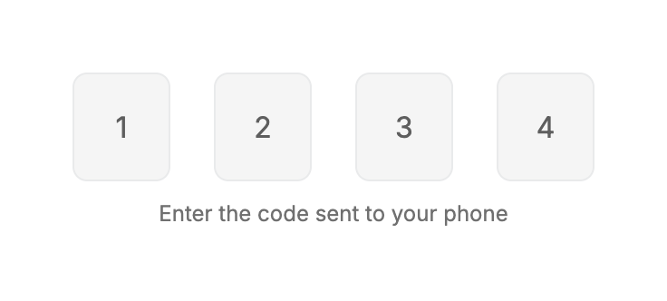
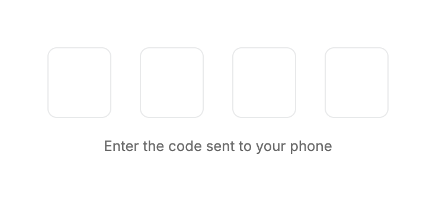
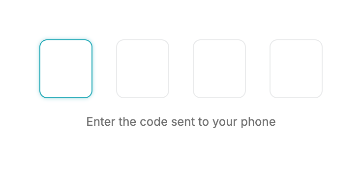
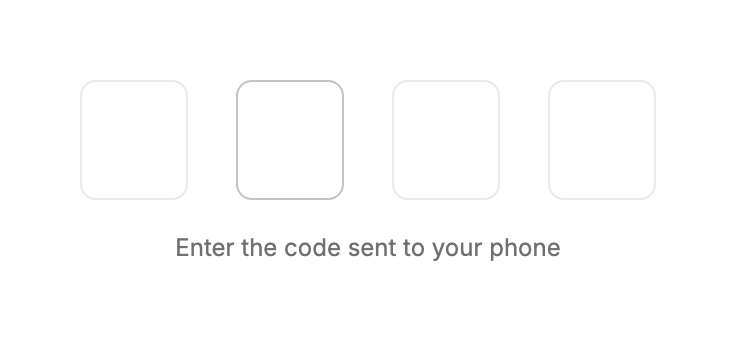
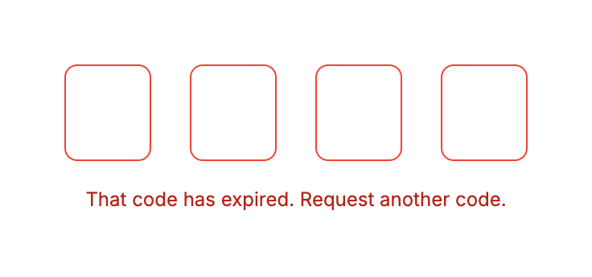
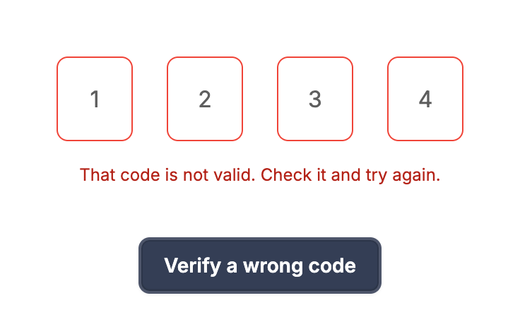
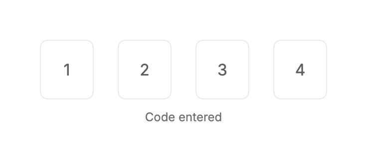
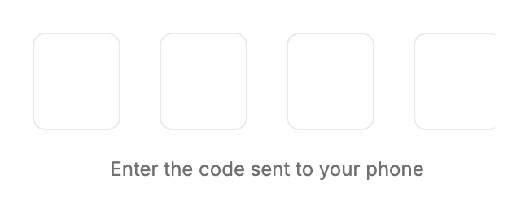
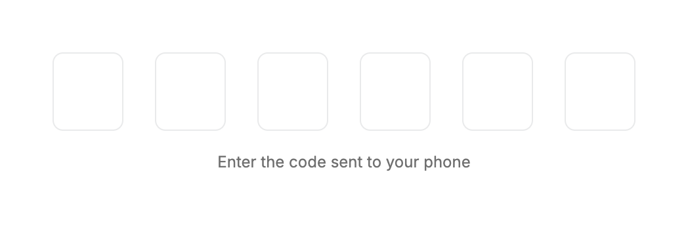
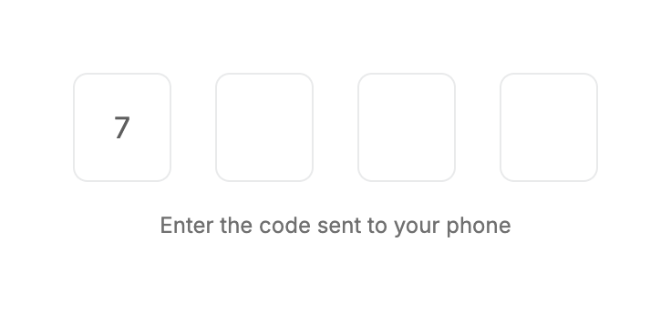

# OtpInput: UI change report for Figma

Figma source: [https://www.figma.com/design/q84boKV4Bly9HKXzdtBj2K/New-Design-System---MyO?node-id=2000-11973](https://www.figma.com/design/q84boKV4Bly9HKXzdtBj2K/New-Design-System---MyO?node-id=2000-11973)  
Storybook: `V2/Components/OtpInput`  
Date: 2026-10-04

## Summary

Typing a digit now fades and grows it into its slot (180ms) instead of appearing, and when a code is rejected the slots turn red and shake sideways once (4px, 3 cycles, 300ms). Reduced motion keeps the red border and skips the shake and the grow. Slot size (54 x 60), the 24px gap and all keyboard behaviour are unchanged.

### Why (what the research found)

- Apple's one-time-code fields and shadcn/input-otp (via Vercel's examples) shake the row on a wrong code, the clearest non-colour error cue; the red border alone is easy to miss.
- A digit that eases in confirms each keypress without adding a cursor animation.

### API / compatibility

No prop, callback, aria-label or DOM-contract changes. v2 remains a drop-in for v1 (`npm run verify:v1-v2-compat` passes).

## Before and after

### Disabled

| Before | After |
| --- | --- |
|  |  |

### Empty

| Before | After |
| --- | --- |
|  |  |

### First slot focused

| Before | After |
| --- | --- |
|  |  |

### Hover on a slot

| Before | After |
| --- | --- |
|  |  |

### Error state at rest

| Before | After |
| --- | --- |
|  |  |

### New story: verify a wrong code (frame samples: row x offset)

| Before | After |
| --- | --- |
|  |  |

### Filled

| Before | After |
| --- | --- |
|  |  |

### Narrow width

| Before | After |
| --- | --- |
|  |  |

### Six digits

| Before | After |
| --- | --- |
|  |  |

### Typing 7 (frame samples: colour alpha 0 to 1, font size 14.4 to 16px)

| Before | After |
| --- | --- |
|  |  |

## Measured changes (copy these into Figma)

_Source: computed styles of the rendered component; px, hex colours, ms. Only properties that changed are listed._

### Disabled

| Element | Property | Before | After |
| --- | --- | --- | --- |
| Slot 1 | transition-property | border-color, box-shadow, background-color, color | **border-color, box-shadow, background-color, color, font-size** |
| Slot 1 | transition-duration | 0.15s | **0.15s, 0.15s, 0.15s, 0.18s, 0.18s** |
| Slot 1 | transition-timing-function | cubic-bezier(0, 0, 0.2, 1) | **ease-out, ease-out, ease-out, linear(0 0%, 0.06174 5%, 0.19179 10%, 0.33839 15%, 0.47651 20%, 0.59579 25%, 0.69365 30%, 0.77125 35%, 0.83131 40%, 0.87696 45%, 0** |
| Slot 1 | animation-duration | 0.15s | **0s** |
| Slot 4 | transition-property | border-color, box-shadow, background-color, color | **border-color, box-shadow, background-color, color, font-size** |
| Slot 4 | transition-duration | 0.15s | **0.15s, 0.15s, 0.15s, 0.18s, 0.18s** |
| Slot 4 | transition-timing-function | cubic-bezier(0, 0, 0.2, 1) | **ease-out, ease-out, ease-out, linear(0 0%, 0.06174 5%, 0.19179 10%, 0.33839 15%, 0.47651 20%, 0.59579 25%, 0.69365 30%, 0.77125 35%, 0.83131 40%, 0.87696 45%, 0** |
| Slot 4 | animation-duration | 0.15s | **0s** |

### Empty

| Element | Property | Before | After |
| --- | --- | --- | --- |
| Slot 1 | color | #5E5E5E | **transparent** |
| Slot 1 | font-size | 16px | **14.4px** |
| Slot 1 | transition-property | border-color, box-shadow, background-color, color | **border-color, box-shadow, background-color, color, font-size** |
| Slot 1 | transition-duration | 0.15s | **0.15s, 0.15s, 0.15s, 0.18s, 0.18s** |
| Slot 1 | transition-timing-function | cubic-bezier(0, 0, 0.2, 1) | **ease-out, ease-out, ease-out, linear(0 0%, 0.06174 5%, 0.19179 10%, 0.33839 15%, 0.47651 20%, 0.59579 25%, 0.69365 30%, 0.77125 35%, 0.83131 40%, 0.87696 45%, 0** |
| Slot 1 | animation-duration | 0.15s | **0s** |
| Slot 4 | color | #5E5E5E | **transparent** |
| Slot 4 | font-size | 16px | **14.4px** |
| Slot 4 | transition-property | border-color, box-shadow, background-color, color | **border-color, box-shadow, background-color, color, font-size** |
| Slot 4 | transition-duration | 0.15s | **0.15s, 0.15s, 0.15s, 0.18s, 0.18s** |
| Slot 4 | transition-timing-function | cubic-bezier(0, 0, 0.2, 1) | **ease-out, ease-out, ease-out, linear(0 0%, 0.06174 5%, 0.19179 10%, 0.33839 15%, 0.47651 20%, 0.59579 25%, 0.69365 30%, 0.77125 35%, 0.83131 40%, 0.87696 45%, 0** |
| Slot 4 | animation-duration | 0.15s | **0s** |

### First slot focused

| Element | Property | Before | After |
| --- | --- | --- | --- |
| Slot 1 | color | #5E5E5E | **transparent** |
| Slot 1 | font-size | 16px | **14.4px** |
| Slot 1 | transition-property | border-color, box-shadow, background-color, color | **border-color, box-shadow, background-color, color, font-size** |
| Slot 1 | transition-duration | 0.15s | **0.15s, 0.15s, 0.15s, 0.18s, 0.18s** |
| Slot 1 | transition-timing-function | cubic-bezier(0, 0, 0.2, 1) | **ease-out, ease-out, ease-out, linear(0 0%, 0.06174 5%, 0.19179 10%, 0.33839 15%, 0.47651 20%, 0.59579 25%, 0.69365 30%, 0.77125 35%, 0.83131 40%, 0.87696 45%, 0** |
| Slot 1 | animation-duration | 0.15s | **0s** |
| Slot 4 | color | #5E5E5E | **transparent** |
| Slot 4 | font-size | 16px | **14.4px** |
| Slot 4 | transition-property | border-color, box-shadow, background-color, color | **border-color, box-shadow, background-color, color, font-size** |
| Slot 4 | transition-duration | 0.15s | **0.15s, 0.15s, 0.15s, 0.18s, 0.18s** |
| Slot 4 | transition-timing-function | cubic-bezier(0, 0, 0.2, 1) | **ease-out, ease-out, ease-out, linear(0 0%, 0.06174 5%, 0.19179 10%, 0.33839 15%, 0.47651 20%, 0.59579 25%, 0.69365 30%, 0.77125 35%, 0.83131 40%, 0.87696 45%, 0** |
| Slot 4 | animation-duration | 0.15s | **0s** |

### Hover on a slot

| Element | Property | Before | After |
| --- | --- | --- | --- |
| Slot 1 | color | #5E5E5E | **transparent** |
| Slot 1 | font-size | 16px | **14.4px** |
| Slot 1 | transition-property | border-color, box-shadow, background-color, color | **border-color, box-shadow, background-color, color, font-size** |
| Slot 1 | transition-duration | 0.15s | **0.15s, 0.15s, 0.15s, 0.18s, 0.18s** |
| Slot 1 | transition-timing-function | cubic-bezier(0, 0, 0.2, 1) | **ease-out, ease-out, ease-out, linear(0 0%, 0.06174 5%, 0.19179 10%, 0.33839 15%, 0.47651 20%, 0.59579 25%, 0.69365 30%, 0.77125 35%, 0.83131 40%, 0.87696 45%, 0** |
| Slot 1 | animation-duration | 0.15s | **0s** |
| Slot 4 | color | #5E5E5E | **transparent** |
| Slot 4 | font-size | 16px | **14.4px** |
| Slot 4 | transition-property | border-color, box-shadow, background-color, color | **border-color, box-shadow, background-color, color, font-size** |
| Slot 4 | transition-duration | 0.15s | **0.15s, 0.15s, 0.15s, 0.18s, 0.18s** |
| Slot 4 | transition-timing-function | cubic-bezier(0, 0, 0.2, 1) | **ease-out, ease-out, ease-out, linear(0 0%, 0.06174 5%, 0.19179 10%, 0.33839 15%, 0.47651 20%, 0.59579 25%, 0.69365 30%, 0.77125 35%, 0.83131 40%, 0.87696 45%, 0** |
| Slot 4 | animation-duration | 0.15s | **0s** |

### Error state at rest

| Element | Property | Before | After |
| --- | --- | --- | --- |
| Slot 1 | color | #5E5E5E | **transparent** |
| Slot 1 | font-size | 16px | **14.4px** |
| Slot 1 | transition-property | border-color, box-shadow, background-color, color | **border-color, box-shadow, background-color, color, font-size** |
| Slot 1 | transition-duration | 0.15s | **0.15s, 0.15s, 0.15s, 0.18s, 0.18s** |
| Slot 1 | transition-timing-function | cubic-bezier(0, 0, 0.2, 1) | **ease-out, ease-out, ease-out, linear(0 0%, 0.06174 5%, 0.19179 10%, 0.33839 15%, 0.47651 20%, 0.59579 25%, 0.69365 30%, 0.77125 35%, 0.83131 40%, 0.87696 45%, 0** |
| Slot 1 | animation-duration | 0.15s | **0s** |
| Slot 4 | color | #5E5E5E | **transparent** |
| Slot 4 | font-size | 16px | **14.4px** |
| Slot 4 | transition-property | border-color, box-shadow, background-color, color | **border-color, box-shadow, background-color, color, font-size** |
| Slot 4 | transition-duration | 0.15s | **0.15s, 0.15s, 0.15s, 0.18s, 0.18s** |
| Slot 4 | transition-timing-function | cubic-bezier(0, 0, 0.2, 1) | **ease-out, ease-out, ease-out, linear(0 0%, 0.06174 5%, 0.19179 10%, 0.33839 15%, 0.47651 20%, 0.59579 25%, 0.69365 30%, 0.77125 35%, 0.83131 40%, 0.87696 45%, 0** |
| Slot 4 | animation-duration | 0.15s | **0s** |

### New story: verify a wrong code (frame samples: row x offset)

| Element | Property | Before | After |
| --- | --- | --- | --- |
| Slot 1 | transition-property | border-color, box-shadow, background-color, color | **border-color, box-shadow, background-color, color, font-size** |
| Slot 1 | transition-duration | 0.15s | **0.15s, 0.15s, 0.15s, 0.18s, 0.18s** |
| Slot 1 | transition-timing-function | cubic-bezier(0, 0, 0.2, 1) | **ease-out, ease-out, ease-out, linear(0 0%, 0.06174 5%, 0.19179 10%, 0.33839 15%, 0.47651 20%, 0.59579 25%, 0.69365 30%, 0.77125 35%, 0.83131 40%, 0.87696 45%, 0** |
| Slot 1 | animation-duration | 0.15s | **0s** |
| Slot 4 | transition-property | border-color, box-shadow, background-color, color | **border-color, box-shadow, background-color, color, font-size** |
| Slot 4 | transition-duration | 0.15s | **0.15s, 0.15s, 0.15s, 0.18s, 0.18s** |
| Slot 4 | transition-timing-function | cubic-bezier(0, 0, 0.2, 1) | **ease-out, ease-out, ease-out, linear(0 0%, 0.06174 5%, 0.19179 10%, 0.33839 15%, 0.47651 20%, 0.59579 25%, 0.69365 30%, 0.77125 35%, 0.83131 40%, 0.87696 45%, 0** |
| Slot 4 | animation-duration | 0.15s | **0s** |
| Slot row | animation-name | none | **v2-otp-shake** |
| Slot row | animation-duration | 0s | **0.3s** |

### Filled

| Element | Property | Before | After |
| --- | --- | --- | --- |
| Slot 1 | transition-property | border-color, box-shadow, background-color, color | **border-color, box-shadow, background-color, color, font-size** |
| Slot 1 | transition-duration | 0.15s | **0.15s, 0.15s, 0.15s, 0.18s, 0.18s** |
| Slot 1 | transition-timing-function | cubic-bezier(0, 0, 0.2, 1) | **ease-out, ease-out, ease-out, linear(0 0%, 0.06174 5%, 0.19179 10%, 0.33839 15%, 0.47651 20%, 0.59579 25%, 0.69365 30%, 0.77125 35%, 0.83131 40%, 0.87696 45%, 0** |
| Slot 1 | animation-duration | 0.15s | **0s** |
| Slot 4 | transition-property | border-color, box-shadow, background-color, color | **border-color, box-shadow, background-color, color, font-size** |
| Slot 4 | transition-duration | 0.15s | **0.15s, 0.15s, 0.15s, 0.18s, 0.18s** |
| Slot 4 | transition-timing-function | cubic-bezier(0, 0, 0.2, 1) | **ease-out, ease-out, ease-out, linear(0 0%, 0.06174 5%, 0.19179 10%, 0.33839 15%, 0.47651 20%, 0.59579 25%, 0.69365 30%, 0.77125 35%, 0.83131 40%, 0.87696 45%, 0** |
| Slot 4 | animation-duration | 0.15s | **0s** |

### Narrow width

| Element | Property | Before | After |
| --- | --- | --- | --- |
| Slot 1 | color | #5E5E5E | **transparent** |
| Slot 1 | font-size | 16px | **14.4px** |
| Slot 1 | transition-property | border-color, box-shadow, background-color, color | **border-color, box-shadow, background-color, color, font-size** |
| Slot 1 | transition-duration | 0.15s | **0.15s, 0.15s, 0.15s, 0.18s, 0.18s** |
| Slot 1 | transition-timing-function | cubic-bezier(0, 0, 0.2, 1) | **ease-out, ease-out, ease-out, linear(0 0%, 0.06174 5%, 0.19179 10%, 0.33839 15%, 0.47651 20%, 0.59579 25%, 0.69365 30%, 0.77125 35%, 0.83131 40%, 0.87696 45%, 0** |
| Slot 1 | animation-duration | 0.15s | **0s** |
| Slot 4 | color | #5E5E5E | **transparent** |
| Slot 4 | font-size | 16px | **14.4px** |
| Slot 4 | transition-property | border-color, box-shadow, background-color, color | **border-color, box-shadow, background-color, color, font-size** |
| Slot 4 | transition-duration | 0.15s | **0.15s, 0.15s, 0.15s, 0.18s, 0.18s** |
| Slot 4 | transition-timing-function | cubic-bezier(0, 0, 0.2, 1) | **ease-out, ease-out, ease-out, linear(0 0%, 0.06174 5%, 0.19179 10%, 0.33839 15%, 0.47651 20%, 0.59579 25%, 0.69365 30%, 0.77125 35%, 0.83131 40%, 0.87696 45%, 0** |
| Slot 4 | animation-duration | 0.15s | **0s** |

### Six digits

| Element | Property | Before | After |
| --- | --- | --- | --- |
| Slot 1 | color | #5E5E5E | **transparent** |
| Slot 1 | font-size | 16px | **14.4px** |
| Slot 1 | transition-property | border-color, box-shadow, background-color, color | **border-color, box-shadow, background-color, color, font-size** |
| Slot 1 | transition-duration | 0.15s | **0.15s, 0.15s, 0.15s, 0.18s, 0.18s** |
| Slot 1 | transition-timing-function | cubic-bezier(0, 0, 0.2, 1) | **ease-out, ease-out, ease-out, linear(0 0%, 0.06174 5%, 0.19179 10%, 0.33839 15%, 0.47651 20%, 0.59579 25%, 0.69365 30%, 0.77125 35%, 0.83131 40%, 0.87696 45%, 0** |
| Slot 1 | animation-duration | 0.15s | **0s** |

### Typing 7 (frame samples: colour alpha 0 to 1, font size 14.4 to 16px)

| Element | Property | Before | After |
| --- | --- | --- | --- |
| Slot 1 | transition-property | border-color, box-shadow, background-color, color | **border-color, box-shadow, background-color, color, font-size** |
| Slot 1 | transition-duration | 0.15s | **0.15s, 0.15s, 0.15s, 0.18s, 0.18s** |
| Slot 1 | transition-timing-function | cubic-bezier(0, 0, 0.2, 1) | **ease-out, ease-out, ease-out, linear(0 0%, 0.06174 5%, 0.19179 10%, 0.33839 15%, 0.47651 20%, 0.59579 25%, 0.69365 30%, 0.77125 35%, 0.83131 40%, 0.87696 45%, 0** |
| Slot 1 | animation-duration | 0.15s | **0s** |
| Slot 4 | color | #5E5E5E | **transparent** |
| Slot 4 | font-size | 16px | **14.4px** |
| Slot 4 | transition-property | border-color, box-shadow, background-color, color | **border-color, box-shadow, background-color, color, font-size** |
| Slot 4 | transition-duration | 0.15s | **0.15s, 0.15s, 0.15s, 0.18s, 0.18s** |
| Slot 4 | transition-timing-function | cubic-bezier(0, 0, 0.2, 1) | **ease-out, ease-out, ease-out, linear(0 0%, 0.06174 5%, 0.19179 10%, 0.33839 15%, 0.47651 20%, 0.59579 25%, 0.69365 30%, 0.77125 35%, 0.83131 40%, 0.87696 45%, 0** |
| Slot 4 | animation-duration | 0.15s | **0s** |

## Motion

| What | Before | After |
| --- | --- | --- |
| Digit enters a slot | Appears instantly | **Digit colour alpha 0 to 1 and size 14.4 to 16px over 180ms, --v2-ease-spring (sampled critically damped spring; Figma: Gentle spring or bezier 0.22, 1, 0.36, 1). The digit is the input's own text, so 'scale .9 to 1' is a font-size change; slot size is untouched** |
| Error turns on | Border turns red (150ms) | **Red border (150ms, unchanged) plus the slot row shakes: translateX 0, -4, +4, -4, +4, -4, +4, 0 px at equal steps over 300ms ease-in-out (3 full cycles), measured -3.95 to +3.95px, back to 0** |
| Reduced motion | n/a | **No shake, no size change; the digit still fades in (180ms); border colour unchanged** |

## States to update in Figma

- Slot / empty: text colour transparent, caret --v2-text-secondary #5E5E5E (visible)
- Slot / filled: digit --v2-text-secondary #5E5E5E, 16px
- Row / error: slots border --semantic-error-primary #F04438; row translateX keyframes (animation only)

## How to apply in Figma

1. Slot: 54 x 60, radius 8px, gap between slots 24px, digit Inter 16px #5E5E5E (unchanged).
2. Add the digit enter as an interaction: empty slot variant (no digit) to filled variant, Smart Animate 180ms Gentle spring; digit layer opacity 0% to 100% and scale 90% to 100%.
3. Add an 'Error / shake' prototype on the slot row frame: five Smart Animate steps x offset 0, -4, +4, -4, +4, -4, +4, 0 px, total 300ms, ease in-out. Border --semantic-error-primary #F04438 on all slots.
4. Annotate reduced motion: no shake, no scale; digits fade only.

## Notes

- NEEDS ORCHESTRATOR: the shake class is `motion-safe:animate-[v2-otp-shake_300ms_ease-in-out]` but the keyframes cannot be defined from this task's files (src/index.css and the CLI theme are out of scope). Until they are added the shake does nothing (the red border still shows). Add next to v2-fade-in in src/index.css and in the CLI init theme (packages/cli/src/commands/init.ts):
@keyframes v2-otp-shake { 0%, 100% { transform: translateX(0); } 14.28% { transform: translateX(-4px); } 28.57% { transform: translateX(4px); } 42.86% { transform: translateX(-4px); } 57.14% { transform: translateX(4px); } 71.43% { transform: translateX(-4px); } 85.71% { transform: translateX(4px); } }
The `error-feedback` after-capture injects exactly these keyframes into the page before clicking, so the recorded 300ms / +-4px shake is what the real component produces once they exist. (A Web Animations API call was rejected because the brief says CSS only.)
- The shake runs when `error` turns on after the first render; an error that is already showing on load does not shake, and a second wrong attempt only shakes again if the app turns error off and on.
- The empty slot's text is transparent with an explicit caret colour so the caret stays visible; digits keep selecting on focus as before.
- A new story 'Error feedback' (Verify a wrong code) demonstrates the shake; OtpInput has no v1 so there is no contract to compare.
