# Pagination: UI change report for Figma

Figma source: [https://www.figma.com/design/q84boKV4Bly9HKXzdtBj2K/New-Design-System---MyO?node-id=924-11830](https://www.figma.com/design/q84boKV4Bly9HKXzdtBj2K/New-Design-System---MyO?node-id=924-11830)  
Storybook: `V2/Components/Pagination`  
Date: 2026-10-04

## Summary

Page links now keep digits the same width while paging, every link presses to 97% and returns in 180ms (Previous/Next used 98% and 200ms), and the hover fill no longer sticks after a tap on touch screens. Layout and sizes are unchanged.

### Why (what the research found)

- Untitled UI and Mantine use tabular numerals for page numbers so the row does not jiggle when going from 9 to 10.
- HeroUI presses interactive items to 0.97; Previous/Next were at 0.98 while page numbers were 0.97.
- Hover fills should only appear on hover-capable pointers (shadcn, Radix Themes); otherwise a tapped page keeps a grey tile.

### API / compatibility

No prop, callback, aria-label or DOM-contract changes. v2 remains a drop-in for v1 (`npm run verify:v1-v2-compat` passes).

## Before and after

### Middle page

| Before | After |
| --- | --- |
| 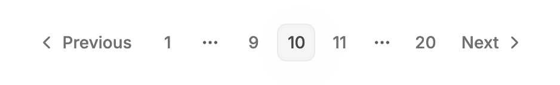 | 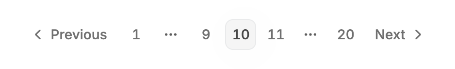 |

### First page (Previous disabled)

| Before | After |
| --- | --- |
| 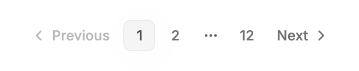 | 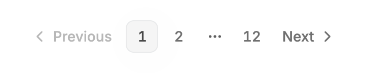 |

### Last page (Next disabled)

| Before | After |
| --- | --- |
| 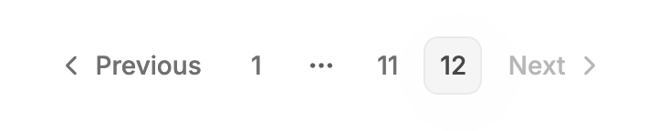 | 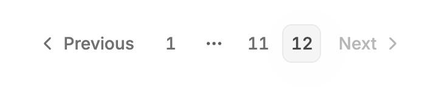 |

### Hover on an inactive page

| Before | After |
| --- | --- |
| 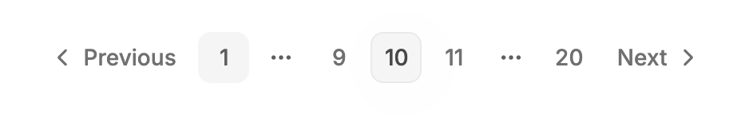 |  |

### Hover on the active page

| Before | After |
| --- | --- |
| 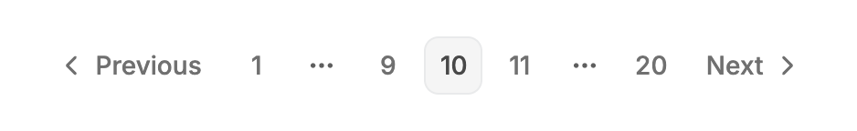 | 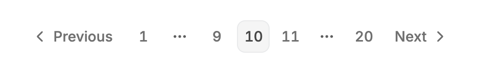 |

### Keyboard focus (Previous)

| Before | After |
| --- | --- |
| 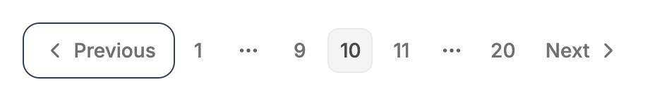 | 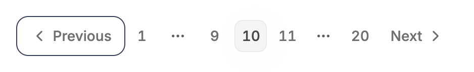 |

### Widget with 'Showing x-y of z'

| Before | After |
| --- | --- |
| 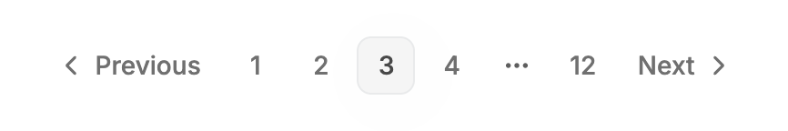 | 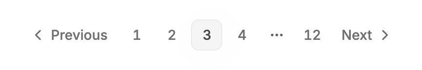 |

### Widget at 360px

| Before | After |
| --- | --- |
| 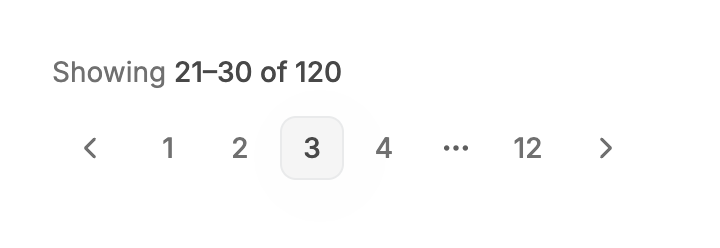 | 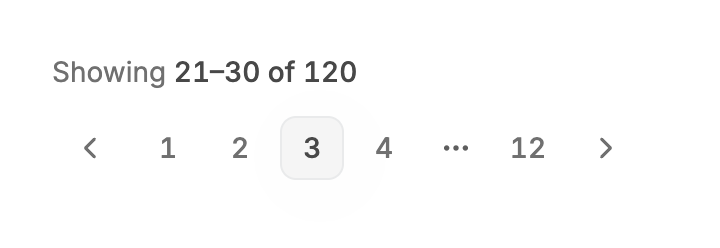 |

### Pagination at 360px

| Before | After |
| --- | --- |
| 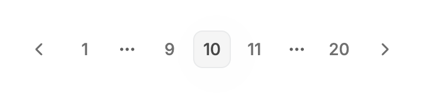 | 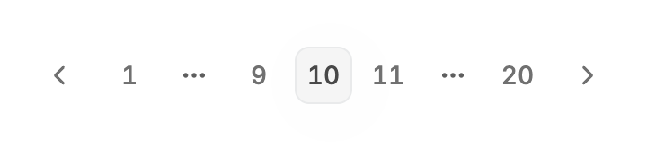 |

### Pressed page link (mouse down held)

| Before | After |
| --- | --- |
|  |  |

### Pressed Next link (mouse down held)

| Before | After |
| --- | --- |
|  |  |

## Measured changes (copy these into Figma)

_Source: computed styles of the rendered component; px, hex colours, ms. Only properties that changed are listed._

### Middle page

| Element | Property | Before | After |
| --- | --- | --- | --- |
| Active page link | font-variant-numeric | normal | **tabular-nums** |
| Active page link | transition-duration | 0.2s | **0.18s** |
| Inactive page link | font-variant-numeric | normal | **tabular-nums** |
| Inactive page link | transition-duration | 0.2s | **0.18s** |
| Previous link | font-variant-numeric | normal | **tabular-nums** |
| Previous link | transition-duration | 0.2s | **0.18s** |
| Next link | font-variant-numeric | normal | **tabular-nums** |
| Next link | transition-duration | 0.2s | **0.18s** |

### First page (Previous disabled)

| Element | Property | Before | After |
| --- | --- | --- | --- |
| Active page link | font-variant-numeric | normal | **tabular-nums** |
| Active page link | transition-duration | 0.2s | **0.18s** |
| Inactive page link | font-variant-numeric | normal | **tabular-nums** |
| Inactive page link | transition-duration | 0.2s | **0.18s** |
| Previous link | font-variant-numeric | normal | **tabular-nums** |
| Previous link | transition-duration | 0.2s | **0.18s** |
| Next link | font-variant-numeric | normal | **tabular-nums** |
| Next link | transition-duration | 0.2s | **0.18s** |

### Last page (Next disabled)

| Element | Property | Before | After |
| --- | --- | --- | --- |
| Active page link | font-variant-numeric | normal | **tabular-nums** |
| Active page link | transition-duration | 0.2s | **0.18s** |
| Inactive page link | font-variant-numeric | normal | **tabular-nums** |
| Inactive page link | transition-duration | 0.2s | **0.18s** |
| Previous link | font-variant-numeric | normal | **tabular-nums** |
| Previous link | transition-duration | 0.2s | **0.18s** |
| Next link | font-variant-numeric | normal | **tabular-nums** |
| Next link | transition-duration | 0.2s | **0.18s** |

### Hover on an inactive page

| Element | Property | Before | After |
| --- | --- | --- | --- |
| Active page link | font-variant-numeric | normal | **tabular-nums** |
| Active page link | transition-duration | 0.2s | **0.18s** |
| Inactive page link | font-variant-numeric | normal | **tabular-nums** |
| Inactive page link | transition-duration | 0.2s | **0.18s** |
| Previous link | font-variant-numeric | normal | **tabular-nums** |
| Previous link | transition-duration | 0.2s | **0.18s** |
| Next link | font-variant-numeric | normal | **tabular-nums** |
| Next link | transition-duration | 0.2s | **0.18s** |

### Hover on the active page

| Element | Property | Before | After |
| --- | --- | --- | --- |
| Active page link | font-variant-numeric | normal | **tabular-nums** |
| Active page link | transition-duration | 0.2s | **0.18s** |
| Inactive page link | font-variant-numeric | normal | **tabular-nums** |
| Inactive page link | transition-duration | 0.2s | **0.18s** |
| Previous link | font-variant-numeric | normal | **tabular-nums** |
| Previous link | transition-duration | 0.2s | **0.18s** |
| Next link | font-variant-numeric | normal | **tabular-nums** |
| Next link | transition-duration | 0.2s | **0.18s** |

### Keyboard focus (Previous)

| Element | Property | Before | After |
| --- | --- | --- | --- |
| Active page link | font-variant-numeric | normal | **tabular-nums** |
| Active page link | transition-duration | 0.2s | **0.18s** |
| Inactive page link | font-variant-numeric | normal | **tabular-nums** |
| Inactive page link | transition-duration | 0.2s | **0.18s** |
| Previous link | font-variant-numeric | normal | **tabular-nums** |
| Previous link | transition-duration | 0.2s | **0.18s** |
| Next link | font-variant-numeric | normal | **tabular-nums** |
| Next link | transition-duration | 0.2s | **0.18s** |

### Widget with 'Showing x-y of z'

| Element | Property | Before | After |
| --- | --- | --- | --- |
| Active page link | font-variant-numeric | normal | **tabular-nums** |
| Active page link | transition-duration | 0.2s | **0.18s** |
| Inactive page link | font-variant-numeric | normal | **tabular-nums** |
| Inactive page link | transition-duration | 0.2s | **0.18s** |
| Previous link | font-variant-numeric | normal | **tabular-nums** |
| Previous link | transition-duration | 0.2s | **0.18s** |
| Next link | font-variant-numeric | normal | **tabular-nums** |
| Next link | transition-duration | 0.2s | **0.18s** |

### Widget at 360px

| Element | Property | Before | After |
| --- | --- | --- | --- |
| Active page link | font-variant-numeric | normal | **tabular-nums** |
| Active page link | transition-duration | 0.2s | **0.18s** |
| Inactive page link | font-variant-numeric | normal | **tabular-nums** |
| Inactive page link | transition-duration | 0.2s | **0.18s** |
| Previous link | font-variant-numeric | normal | **tabular-nums** |
| Previous link | transition-duration | 0.2s | **0.18s** |
| Next link | font-variant-numeric | normal | **tabular-nums** |
| Next link | transition-duration | 0.2s | **0.18s** |

### Pagination at 360px

| Element | Property | Before | After |
| --- | --- | --- | --- |
| Active page link | font-variant-numeric | normal | **tabular-nums** |
| Active page link | transition-duration | 0.2s | **0.18s** |
| Inactive page link | font-variant-numeric | normal | **tabular-nums** |
| Inactive page link | transition-duration | 0.2s | **0.18s** |
| Previous link | font-variant-numeric | normal | **tabular-nums** |
| Previous link | transition-duration | 0.2s | **0.18s** |
| Next link | font-variant-numeric | normal | **tabular-nums** |
| Next link | transition-duration | 0.2s | **0.18s** |

### Pressed page link (mouse down held)

| Element | Property | Before | After |
| --- | --- | --- | --- |
| Inactive page link (pressed) | font-variant-numeric | normal | **tabular-nums** |

### Pressed Next link (mouse down held)

| Element | Property | Before | After |
| --- | --- | --- | --- |
| Next link (pressed) | width | 71.92 | **71.19** |
| Next link (pressed) | height | 31.36 | **31.04** |
| Next link (pressed) | transform | matrix(0.98, 0, 0, 0.98, 0, 0) | **matrix(0.97, 0, 0, 0.97, 0, 0)** |

## Motion

| What | Before | After |
| --- | --- | --- |
| Press, page number link | scale 0.97, 80ms down / 200ms back | **scale 0.97, 80ms down / 180ms back** |
| Press, Previous / Next | scale 0.98, 80ms down / 200ms back | **scale 0.97, 80ms down / 180ms back** |
| Reduced motion | no scale | **unchanged: no scale (colour changes stay)** |

## States to update in Figma

- Page link / default: 32x32, radius 8, no fill, text #707070 14/500, tabular numerals.
- Page link / hover (mouse only): fill #F5F5F5, text #5E5E5E.
- Page link / pressed: scale 97%.
- Page link / active (current page): fill #F5F5F5, 1px border #E9EAEB, text #484848.
- Previous / Next / pressed: scale 97% (was 98%).
- Focus-visible: 1px outline #343E55, offset 3px (unchanged).
- Summary 'Showing 21-30 of 120': tabular numerals.

## How to apply in Figma

1. Page number text: turn on Inter 'tabular figures' (tnum) for the page link and the summary text. Size, weight and colours do not change.
2. Hover variant (mouse only): fill #F5F5F5, text #5E5E5E on inactive page links and on Previous/Next. Do not design a touch hover.
3. Pressed variant: scale 97% for page links AND Previous/Next (use 0.97 for all). Prototype: 80ms in, 180ms out, spring-like ease out (cubic-bezier 0.22, 1, 0.36, 1).
4. Nothing else changes: link 32x32 (Previous/Next 32 high, 10px side padding), gap 4px, radius 8, active page fill #F5F5F5 with a 1px #E9EAEB border.

## Notes

- Not implemented: collapsing to 'Page X of Y' on mobile. A real text node would duplicate visible text in jsdom tests; a CSS-only version (pseudo-element) is possible but would hide the direct page-number links below 640px, which is a product decision. It is also not needed: the widest default state (Previous, 1 ... 5 6 7 ... 12, Next) is about 320px by my estimate (9 controls x 32px + gaps) and fits at 360px; scenarios 08 and 09 show the 7-control default at 360px.
- Press feedback already came from Button (v2); this change only unifies the scale and the return time. Hold-state captures use design/figma-reports/press-capture.mjs (mouse button held).
- Hover gating re-declares the ghost-variant fill as 'hover:bg-transparent' plus a gated hover fill. It could not be done in button.tsx (not in scope), so the same fill is declared once in Pagination. Verified: the desktop hover fill still applies (#F5F5F5). Touch behaviour was reasoned from the CSS, not tested on a device.
- Focus rings were already visible via Button (1px, offset 3px); no change needed.
- Research conclusions in 'why' come from the task brief; I did not re-verify them against each library.
