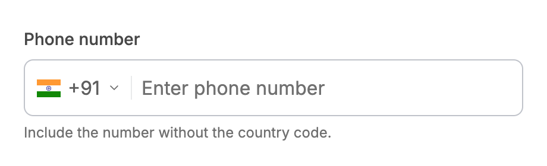
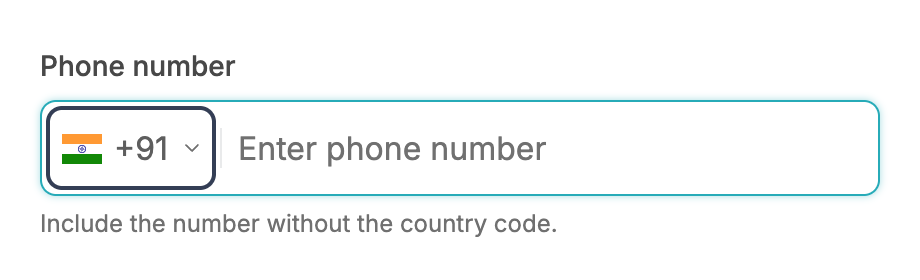
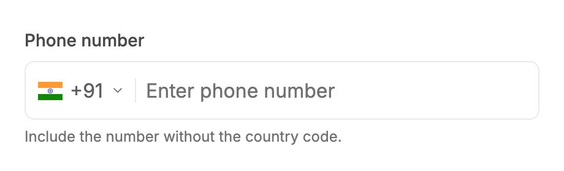
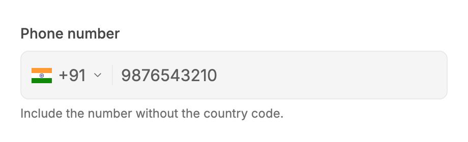
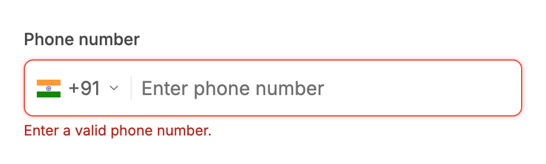
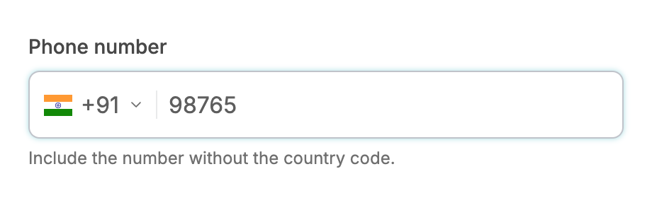
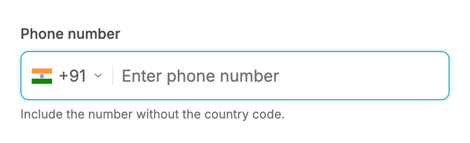
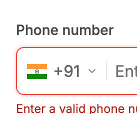
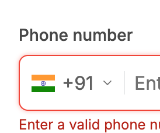

# PhoneInput: UI change report for Figma

Figma source: [https://www.figma.com/design/q84boKV4Bly9HKXzdtBj2K/New-Design-System---MyO?node-id=2190-7669](https://www.figma.com/design/q84boKV4Bly9HKXzdtBj2K/New-Design-System---MyO?node-id=2190-7669)  
Storybook: `V2/Components/PhoneInput`  
Date: 2026-10-04

## Summary

The country button now shows a visible keyboard focus ring (it had none: the whole field only glowed teal). The validation message reveal is the shared change documented in the TextField report (glide instead of pop, 4px gap instead of 6px, polite live region). Heights, formatting and the digits-only behaviour are unchanged.

### Why (what the research found)

- The country button had outline-none and no replacement, so keyboard users could not tell the button from the input (WCAG 2.4.7 Focus Visible). Untitled UI and React Aria both give the country selector its own ring.
- See the TextField report for the message reveal research.

### API / compatibility

No prop, callback, aria-label or DOM-contract changes. v2 remains a drop-in for v1 (`npm run verify:v1-v2-compat` passes).

## Before and after

### Country button focused by mouse (no ring)

| Before | After |
| --- | --- |
|  |  |

### Country button focused with Tab (new ring)

| Before | After |
| --- | --- |
|  |  |

### Hover on the country button

| Before | After |
| --- | --- |
|  |  |

### Default

| Before | After |
| --- | --- |
|  |  |

### Disabled

| Before | After |
| --- | --- |
|  |  |

### Error with message (gap 6 to 4px)

| Before | After |
| --- | --- |
|  |  |

### Filled

| Before | After |
| --- | --- |
|  |  |

### Number input focused

| Before | After |
| --- | --- |
|  |  |

### Narrow width with error

| Before | After |
| --- | --- |
|  |  |

### No country handler: plain area, no ring

| Before | After |
| --- | --- |
| .before.png) | .after.png) |

## Measured changes (copy these into Figma)

_Source: computed styles of the rendered component; px, hex colours, ms. Only properties that changed are listed._

### Country button focused by mouse (no ring)

| Element | Property | Before | After |
| --- | --- | --- | --- |
| Country button | border-radius | 0px | **10px** |

### Country button focused with Tab (new ring)

| Element | Property | Before | After |
| --- | --- | --- | --- |
| Country button | border-radius | 0px | **10px** |
| Country button | outline-offset | 2px | **-4px** |
| Country button | outline-color | transparent | **#343E55** |

### Hover on the country button

| Element | Property | Before | After |
| --- | --- | --- | --- |
| Country button | border-radius | 0px | **10px** |

### Default

| Element | Property | Before | After |
| --- | --- | --- | --- |
| Country button | border-radius | 0px | **10px** |

### Disabled

| Element | Property | Before | After |
| --- | --- | --- | --- |
| Country button | border-radius | 0px | **10px** |

### Error with message (gap 6 to 4px)

| Element | Property | Before | After |
| --- | --- | --- | --- |
| Country button | border-radius | 0px | **10px** |
| Message wrapper | height | 70 | **68** |
| Message wrapper | gap | 6px | **4px** |
| Message wrapper | row-gap | 6px | **4px** |

### Filled

| Element | Property | Before | After |
| --- | --- | --- | --- |
| Country button | border-radius | 0px | **10px** |

### Number input focused

| Element | Property | Before | After |
| --- | --- | --- | --- |
| Country button | border-radius | 0px | **10px** |

### Narrow width with error

| Element | Property | Before | After |
| --- | --- | --- | --- |
| Country button | border-radius | 0px | **10px** |
| Message wrapper | height | 70 | **68** |
| Message wrapper | gap | 6px | **4px** |
| Message wrapper | row-gap | 6px | **4px** |

### No country handler: plain area, no ring

| Element | Property | Before | After |
| --- | --- | --- | --- |
| Country button | border-radius | 0px | **10px** |

## Motion

| What | Before | After |
| --- | --- | --- |
| Validation message appears | Pop, content below jumps 22px | **Glides over 240ms spring (see TextField report); gap 4px so the total is 20px** |

## States to update in Figma

- Country button / focus-visible (keyboard): 2px inset ring --semantic-primary #343E55 (new)
- Country button / focus by mouse: no ring (focus-visible only); the field's teal focus glow still shows
- Validation message: 12px / 16px --semantic-error-text, 4px below the field (was 6px)

## How to apply in Figma

1. Country selector button (46px tall, the full height of the 48px field minus the border): add a Focus-visible variant with an inner stroke 2px, colour --semantic-primary #343E55, positioned 4px inside the button bounds (inside stroke offset 4px), corner radius of the ring 6px (button radius 10px minus the 4px inset). Keep the field's existing teal focus border and glow (--semantic-border-accent #27ABB8, 0 0 4px rgba(39,171,184,0.4)).
2. Error variant: change the auto layout gap between the field and the message from 6px to 4px. Message 12px / 16px Inter, --semantic-error-text.
3. Prototype the message reveal as in the TextField report (Smart Animate 240ms Gentle spring; text opacity 150ms ease out, y -2px to 0).

## Notes

- The ring only appears for keyboard focus (focus-visible); a mouse click that focuses the button shows no ring.
- Observed, not changed: PhoneInput recreates its controls when a validation message first appears (different root element), which can drop focus or an uncontrolled value; see the TextField report. The message wrapper is keyed so the reveal still plays.
- Not changed as instructed: heights (48px), value formatting, digits-only contract.
