# ProgressIndicator: UI change report for Figma

Figma source: [https://www.figma.com/design/q84boKV4Bly9HKXzdtBj2K/New-Design-System---MyO?node-id=2284-50240](https://www.figma.com/design/q84boKV4Bly9HKXzdtBj2K/New-Design-System---MyO?node-id=2284-50240)  
Storybook: `V2/Components/ProgressIndicator`  
Date: 2026-10-04

## Summary

The indeterminate linear bar now slides: a 30%-wide bar travels across the track in 1.5s on an ease-in-out curve, instead of a stationary 30% bar that pulsed (which read as "30% done"). With reduced motion it holds a static 30% fill with no movement. Percentage labels use tabular figures so digits do not jitter while the value counts up.

### Why (what the research found)

- The previous indeterminate bar was a fixed 30% fill with an opacity pulse, which users can read as a real 30% value. A bar travelling across the track says "working, unknown duration" without implying a value; this is the pattern named in the brief's research.
- Tabular figures (font-variant-numeric: tabular-nums) are standard for live numeric labels so the label width and neighbouring layout stay steady as digits change.
- Reduced motion removes the spatial movement (design/V2-MOTION.md); the static partial fill is what the old reduced-motion state already showed.
- Research references (HeroUI, Mantine, shadcn/ui, Untitled UI, React Aria) come from the task brief's research conclusions; they were not re-verified source by source while implementing.

### API / compatibility

No prop, aria or DOM-contract change for the determinate bar: role=progressbar, aria-valuemin/max/now and aria-label are as before; the indeterminate bar still omits aria-valuenow and still has the track > fill structure (30% width inline style). The indeterminate bar additionally contains a <style> element with the keyframes (after the fill, display:none), the same self-contained approach BouncingLoader uses; no theme change and no tailwindcss-animate needed.

## Before and after

### Determinate 100%

| Before | After |
| --- | --- |
| 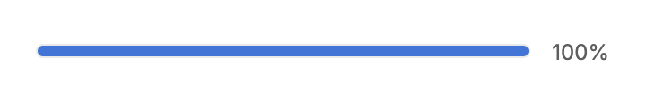 | 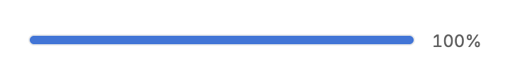 |

### Determinate 30%, label right

| Before | After |
| --- | --- |
|  | 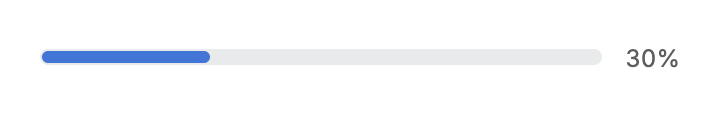 |

### Determinate, label at the bottom

| Before | After |
| --- | --- |
|  | 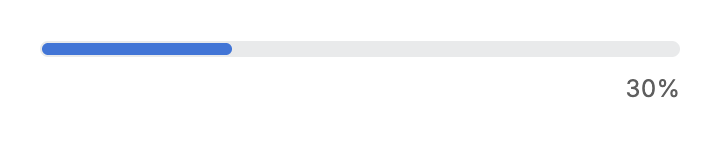 |

### Indeterminate at about 1.0s

| Before | After |
| --- | --- |
|  | 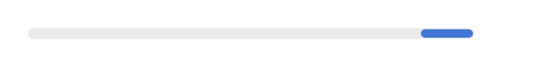 |

### Indeterminate at about 0.6s

| Before | After |
| --- | --- |
|  | 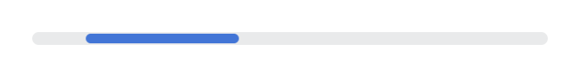 |

### Indeterminate at t = 0 (before: pulsing static bar)

| Before | After |
| --- | --- |
| 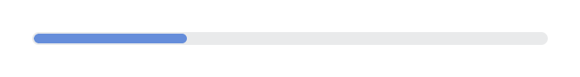 | 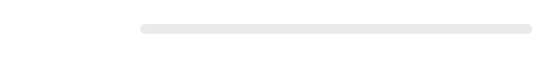 |

### Circle 30% label

| Before | After |
| --- | --- |
|  | 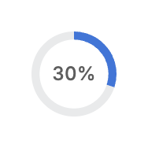 |

### Circle indeterminate (unchanged spinner)

| Before | After |
| --- | --- |
| 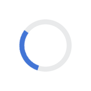 | 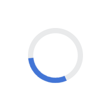 |

### Semi circle 30% label

| Before | After |
| --- | --- |
| 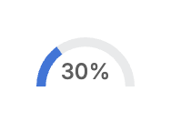 |  |

### States gallery (0%, 30%, 100%, indeterminate)

| Before | After |
| --- | --- |
| 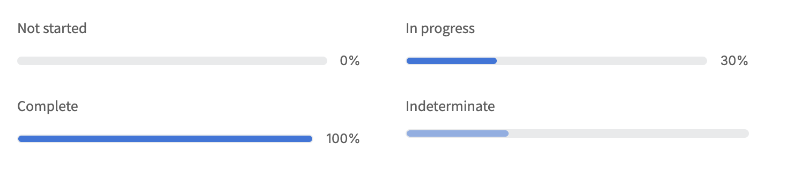 | 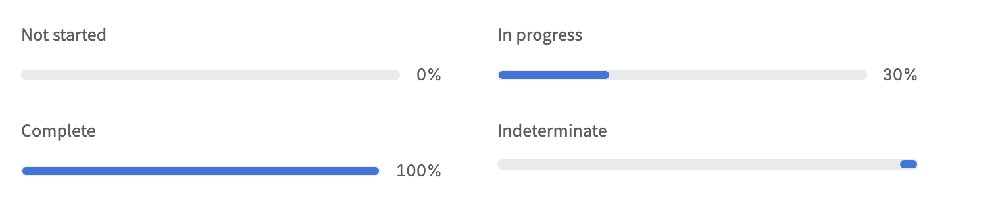 |

## Measured changes (copy these into Figma)

_Source: computed styles of the rendered component; px, hex colours, ms. Only properties that changed are listed._

### Determinate 100%

| Element | Property | Before | After |
| --- | --- | --- | --- |
| Progress track | width | 276.17px | **272.85px** |
| Progress fill | width | 274.17px | **270.85px** |
| Percentage | width | 31.83 | **35.14** |
| Percentage | font-variant-numeric | normal | **tabular-nums** |

### Determinate 30%, label right

| Element | Property | Before | After |
| --- | --- | --- | --- |
| Progress track | width | 281.21px | **280.64px** |
| Progress fill | width | 83.76px | **83.57px** |
| Percentage | width | 26.78 | **27.36** |
| Percentage | font-variant-numeric | normal | **tabular-nums** |

### Determinate, label at the bottom

| Element | Property | Before | After |
| --- | --- | --- | --- |
| Percentage | width | 26.78 | **27.36** |
| Percentage | font-variant-numeric | normal | **tabular-nums** |

### Indeterminate at about 1.0s

| Element | Property | Before | After |
| --- | --- | --- | --- |
| Progress fill | opacity | 0.763917 | **1** |
| Progress fill | transform | none | **matrix(1, 0, 0, 1, 280.725, 0)** |
| Progress fill | animation-name | pulse | **myoperator-v2-progress-slide** |
| Progress fill | animation-duration | 2s | **1.5s** |
| Progress fill | animation-timing-function | cubic-bezier(0.4, 0, 0.6, 1) | **cubic-bezier(0.65, 0, 0.35, 1)** |

### Indeterminate at about 0.6s

| Element | Property | Before | After |
| --- | --- | --- | --- |
| Progress fill | opacity | 0.995277 | **1** |
| Progress fill | transform | none | **matrix(1, 0, 0, 1, 32.2449, 0)** |
| Progress fill | animation-name | pulse | **myoperator-v2-progress-slide** |
| Progress fill | animation-duration | 2s | **1.5s** |
| Progress fill | animation-timing-function | cubic-bezier(0.4, 0, 0.6, 1) | **cubic-bezier(0.65, 0, 0.35, 1)** |

### Indeterminate at t = 0 (before: pulsing static bar)

| Element | Property | Before | After |
| --- | --- | --- | --- |
| Progress fill | opacity | 0.980884 | **1** |
| Progress fill | transform | none | **matrix(1, 0, 0, 1, -95.0006, 0)** |
| Progress fill | animation-name | pulse | **myoperator-v2-progress-slide** |
| Progress fill | animation-duration | 2s | **1.5s** |
| Progress fill | animation-timing-function | cubic-bezier(0.4, 0, 0.6, 1) | **cubic-bezier(0.65, 0, 0.35, 1)** |

### Circle 30% label

| Element | Property | Before | After |
| --- | --- | --- | --- |
| Percentage | width | 27.38 | **27.66** |
| Percentage | font-variant-numeric | normal | **tabular-nums** |

### Semi circle 30% label

| Element | Property | Before | After |
| --- | --- | --- | --- |
| Percentage | width | 27.38 | **27.66** |
| Percentage | font-variant-numeric | normal | **tabular-nums** |

### States gallery (0%, 30%, 100%, indeterminate)

| Element | Property | Before | After |
| --- | --- | --- | --- |
| Progress track | width | 288.62px | **288.42px** |
| Percentage | width | 19.38 | **19.58** |
| Percentage | font-variant-numeric | normal | **tabular-nums** |

## Motion

| What | Before | After |
| --- | --- | --- |
| Indeterminate bar | Static 30% bar, opacity pulse 2s (animate-pulse) | **30% bar translates from -100% to 350% of its own width, 1.5s, cubic-bezier(0.65, 0, 0.35, 1), infinite; clipped by the track. Reduced motion: no animation, static 30% fill at the left.** |
| Determinate bar width / circle stroke | 240ms settle | **Unchanged** |
| Circular indeterminate | Spinning ring (1s linear; 2s under reduced motion) | **Unchanged** |

## States to update in Figma

- ProgressIndicator / Bar / Indeterminate: a new animated prototype (frame 1 and frame 2 below); the static design frame stays 30% fill at the left
- ProgressIndicator / Bar / Percentage label, Circle / label, Semi circle / label: Inter with tabular numbers

## How to apply in Figma

1. Bar track and fill geometry are unchanged: track 8px high, radius 8, fill #E9EAEB (semantic-border-layout) with a 0.2px #E9EAEB stroke, fill bar #4275D6 (semantic-info-primary), radius 8. Clip content on the track so a bar leaving the track is cut off.
2. Indeterminate bar: fill width = 30% of the track (95.39px in the 320px track). Frame A (start): bar X = -100% of its own width (-95px, fully outside the left edge). Frame B (end): bar X = +350% of its own width (+334px for a 320px track, fully outside the right edge). Distance travelled = 4.5 bar widths.
3. Prototype: After delay, Smart animate A -> B, duration 1500ms, custom cubic-bezier 0.65, 0, 0.35, 1 (ease in-out cubic), then loop B -> A with no animation (instant) to restart. Do not show the label in this state (it was never shown for indeterminate).
4. Reduced-motion note for the design spec: static state is the bar at X 0 (30% fill from the left), no movement, no pulse.
5. Percentage text (bar right/bottom label, circle label, semi circle label): turn on Inter OpenType feature Tabular numbers (tnum) on the text layer. Sizes are unchanged: bar label 12/15 regular, circle and semi circle labels 12/16 weight 500, letter spacing 0.06px. Label width grows by about 0.5px (for example "30%" 26.78 -> 27.36), no other layout change.
6. Remove the old Pulse prototype (opacity 100% <-> 98% loop) from the indeterminate frame.

## Notes

- The keyframes live in a <style> child of the track, not in index.css or the consumer theme (outside this task's file scope). Consequence: a strict Content-Security-Policy without style-src 'unsafe-inline' would block the animation (the bar then shows the static 30% fill); BouncingLoader and ShimmeringText already rely on the same technique.
- Alternative considered: tailwindcss-animate's `enter` keyframe with an implicit end frame. Rejected: the component would newly depend on the plugin (packages/cli/components.yaml needs a v2-progress-indicator change) and consumers without it would see an invisible bar parked off the track.
- Verified with an emulated prefers-reduced-motion: reduce in headless Chrome: no running animation, transform none, fill width 95.39px; with no preference the transform advances between samples (-70px then 119px).
- The circular indeterminate spinner is unchanged; semi-circle has no indeterminate mode.
- Tabular figures widen the label slightly because digits become equal width (Inter's 1 is wider in tnum): "30%" 26.78 -> 27.36px, "100%" 31.83 -> 35.14px at 12px. The track is flex-1, so it narrows by the same amount; nothing else moves. Set the Figma text layers to Tabular numbers and let auto layout hug them.
- Research references (HeroUI, Mantine, shadcn/ui, Untitled UI, React Aria) come from the task brief's research conclusions; they were not re-verified source by source while implementing.
