# Radio: UI change report for Figma

Figma source: [https://www.figma.com/design/q84boKV4Bly9HKXzdtBj2K/New-Design-System---MyO?node-id=2650-18296](https://www.figma.com/design/q84boKV4Bly9HKXzdtBj2K/New-Design-System---MyO?node-id=2650-18296)  
Storybook: `V2/Components/Radio`  
Date: 2026-10-04

## Summary

The radio gets the same tactile treatment as the checkbox: the dot grows from the centre (6px, or 8px while pressed), the circle squeezes to 96% on press, and the pointer target is 24 x 24. A new optional `variant="card"` turns each option into a bordered, fully clickable card with a hover border and a tinted selected state.

### Why (what the research found)

- Selectable option cards (HeroUI RadioGroup custom cards, Untitled UI 'radio card', Mantine Radio.Card) are the most requested radio pattern for plan and channel pickers: the whole card is the target.
- A 16px circle is below the 24px minimum pointer target in WCAG 2.5.8; a 4px invisible ring brings it to 24px without changing layout.

### API / compatibility

No prop, callback, aria-label or DOM-contract changes. v2 remains a drop-in for v1 (`npm run verify:v1-v2-compat` passes).

## Before and after

### New: card variant, Team selected, Enterprise disabled

| Before | After |
| --- | --- |
|  | 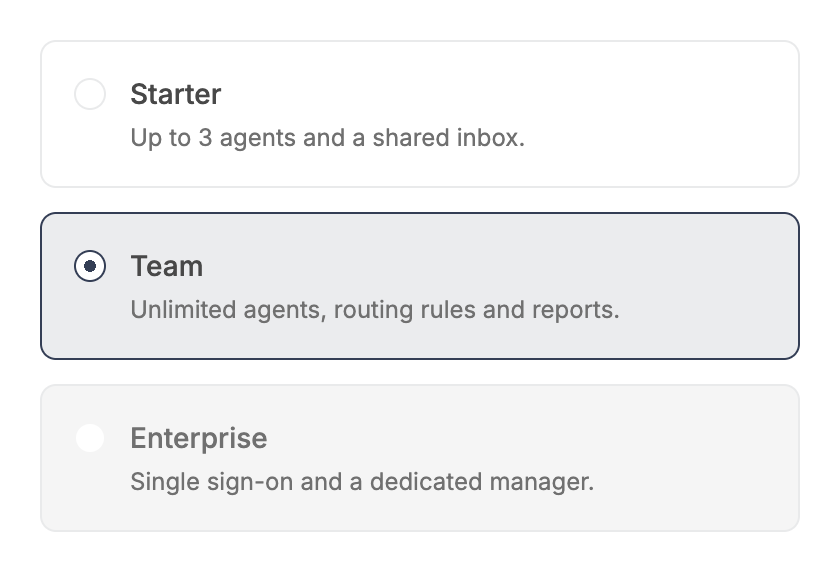 |

### Card / disabled

| Before | After |
| --- | --- |
|  |  |

### Card / keyboard focus

| Before | After |
| --- | --- |
| 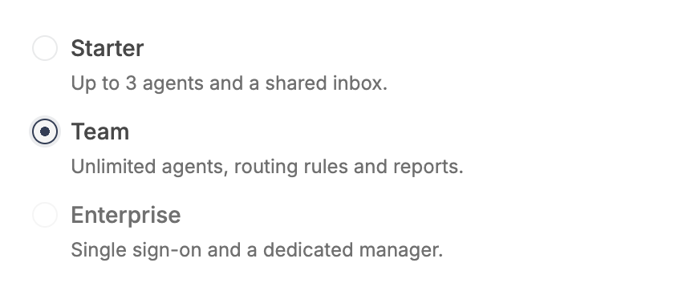 |  |

### Card / hover on an unselected card

| Before | After |
| --- | --- |
| 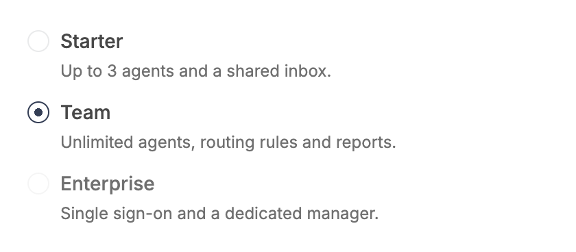 | 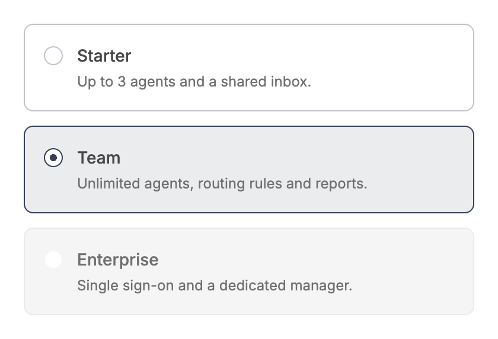 |

### Card / 260px wide

| Before | After |
| --- | --- |
| 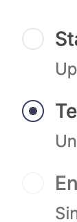 | 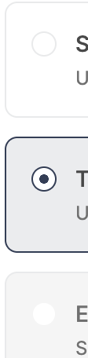 |

### Card / after selecting Starter

| Before | After |
| --- | --- |
|  | 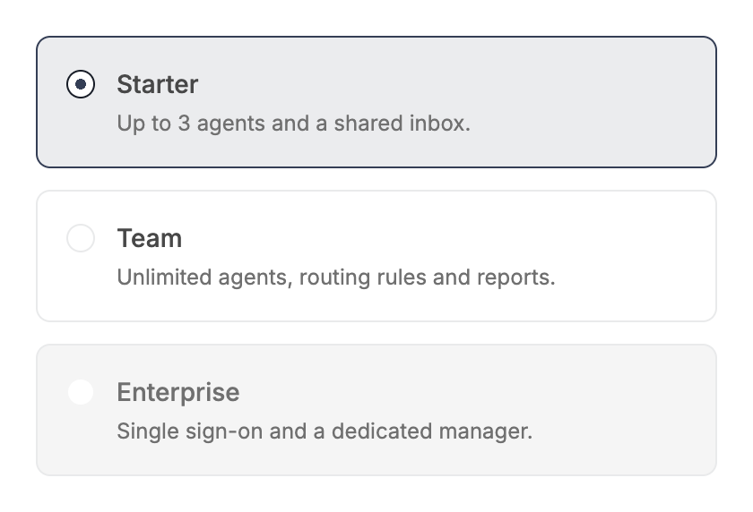 |

### Disabled

| Before | After |
| --- | --- |
|  | 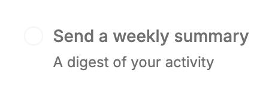 |

### All states (unchanged at rest)

| Before | After |
| --- | --- |
|  | 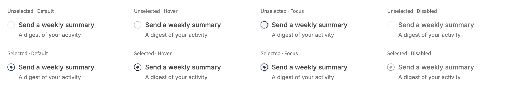 |

### Narrow width (unchanged)

| Before | After |
| --- | --- |
|  | 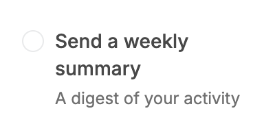 |

### Pressed / selected (dot 8px)

| Before | After |
| --- | --- |
|  | 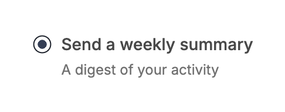 |

### Pressed / unselected

| Before | After |
| --- | --- |
|  | 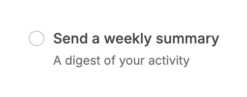 |

### Selecting (frame samples: dot size)

| Before | After |
| --- | --- |
|  | 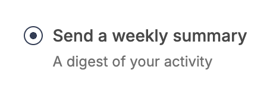 |

### Selected / default

| Before | After |
| --- | --- |
|  |  |

### Selected / focus-visible

| Before | After |
| --- | --- |
| 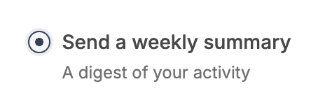 |  |

### Selected / hover

| Before | After |
| --- | --- |
| 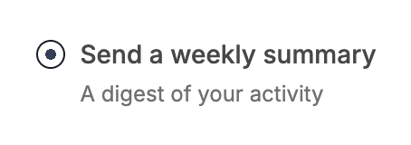 |  |

### Unselected / default

| Before | After |
| --- | --- |
| 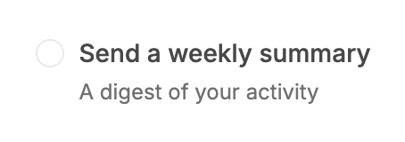 |  |

### Unselected / focus-visible

| Before | After |
| --- | --- |
|  | 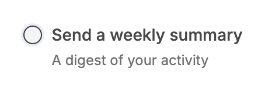 |

### Unselected / hover

| Before | After |
| --- | --- |
|  | 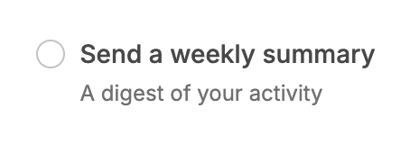 |

## Measured changes (copy these into Figma)

_Source: computed styles of the rendered component; px, hex colours, ms. Only properties that changed are listed._

### New: card variant, Team selected, Enterprise disabled

| Element | Property | Before | After |
| --- | --- | --- | --- |
| Option wrapper (card) | height | 40 | **74** |
| Option wrapper (card) | padding | 0px | **16px** |
| Option wrapper (card) | gap | 8px | **12px** |
| Option wrapper (card) | border-top-width | 0px | **1px** |
| Option wrapper (card) | border-top-color | #E5E7EB | **#343E55** |
| Option wrapper (card) | border-radius | 0px | **8px** |
| Option wrapper (card) | background-color | transparent | **#EBECEE** |
| Option wrapper (card) | cursor | auto | **pointer** |
| Option wrapper (card) | transition-property | all | **border-color, background-color** |
| Option wrapper (card) | transition-duration | 0s | **0.15s** |
| Radio | background-size | 100% 100% | **6px 6px** |
| Label text | width | 356 | **318** |
| Description | width | 356 | **318** |

### Card / disabled

| Element | Property | Before | After |
| --- | --- | --- | --- |
| Disabled card (Enterprise) | height | 40 | **74** |
| Disabled card (Enterprise) | background-color | transparent | **#F5F5F5** |
| Disabled card (Enterprise) | border-top-color | #E5E7EB | **#E9EAEB** |
| Disabled card (Enterprise) | cursor | auto | **not-allowed** |

### Card / keyboard focus

| Element | Property | Before | After |
| --- | --- | --- | --- |
| Option wrapper (card) | height | 40 | **74** |
| Option wrapper (card) | padding | 0px | **16px** |
| Option wrapper (card) | gap | 8px | **12px** |
| Option wrapper (card) | border-top-width | 0px | **1px** |
| Option wrapper (card) | border-top-color | #E5E7EB | **#343E55** |
| Option wrapper (card) | border-radius | 0px | **8px** |
| Option wrapper (card) | background-color | transparent | **#EBECEE** |
| Option wrapper (card) | cursor | auto | **pointer** |
| Option wrapper (card) | transition-property | all | **border-color, background-color** |
| Option wrapper (card) | transition-duration | 0s | **0.15s** |
| Radio | background-size | 100% 100% | **6px 6px** |
| Label text | width | 356 | **318** |
| Description | width | 356 | **318** |

### Card / hover on an unselected card

| Element | Property | Before | After |
| --- | --- | --- | --- |
| Hovered card (Starter) | height | 40 | **74** |
| Hovered card (Starter) | border-top-color | #E5E7EB | **#C0C3CA** |
| Hovered card (Starter) | background-color | transparent | **#FFFFFF** |
| Selected card (Team) | height | 40 | **74** |
| Selected card (Team) | border-top-color | #E5E7EB | **#343E55** |
| Selected card (Team) | background-color | transparent | **#EBECEE** |

### Card / 260px wide

| Element | Property | Before | After |
| --- | --- | --- | --- |
| Option wrapper (card) | height | 40 | **74** |
| Option wrapper (card) | padding | 0px | **16px** |
| Option wrapper (card) | gap | 8px | **12px** |
| Option wrapper (card) | border-top-width | 0px | **1px** |
| Option wrapper (card) | border-top-color | #E5E7EB | **#343E55** |
| Option wrapper (card) | border-radius | 0px | **8px** |
| Option wrapper (card) | background-color | transparent | **#EBECEE** |
| Option wrapper (card) | cursor | auto | **pointer** |
| Option wrapper (card) | transition-property | all | **border-color, background-color** |
| Option wrapper (card) | transition-duration | 0s | **0.15s** |
| Radio | background-size | 100% 100% | **6px 6px** |
| Label text | width | 356 | **318** |
| Description | width | 356 | **318** |

### Card / after selecting Starter

| Element | Property | Before | After |
| --- | --- | --- | --- |
| Starter card (now selected) | height | 40 | **74** |
| Starter card (now selected) | border-top-color | #E5E7EB | **#343E55** |
| Starter card (now selected) | background-color | transparent | **#EBECEE** |
| Team card (deselected) | height | 40 | **74** |
| Team card (deselected) | border-top-color | #E5E7EB | **#E9EAEB** |
| Team card (deselected) | background-color | transparent | **#FFFFFF** |

### Disabled

| Element | Property | Before | After |
| --- | --- | --- | --- |
| Radio | background-image | none | **radial-gradient(circle closest-side, #A2A6B1 100%, transparent 100%)** |
| Radio | background-size | 0% 0% | **0px 0px** |
| Radio | position | static | **relative** |
| Radio | transition-property | background-color, background-size, border-color, box-shadow | **background-color, background-size, border-color, box-shadow, transform** |
| Radio | transition-duration | 0.24s | **0.24s, 0.24s, 0.24s, 0.24s, 0.2s** |
| Hit area (::before) | position | static | **absolute** |
| Hit area (::before) | top | auto | **-5px** |
| Hit area (::before) | right | auto | **-5px** |
| Hit area (::before) | bottom | auto | **-5px** |
| Hit area (::before) | left | auto | **-5px** |
| Hit area (::before) | width | auto | **24px** |
| Hit area (::before) | height | auto | **24px** |
| Hit area (::before) | content | none | **""** |

### Narrow width (unchanged)

| Element | Property | Before | After |
| --- | --- | --- | --- |
| Radio | background-image | none | **radial-gradient(circle closest-side, #343E55 100%, transparent 100%)** |
| Radio | background-size | 0% 0% | **0px 0px** |
| Radio | position | static | **relative** |
| Radio | transition-property | background-color, background-size, border-color, box-shadow | **background-color, background-size, border-color, box-shadow, transform** |
| Radio | transition-duration | 0.24s | **0.24s, 0.24s, 0.24s, 0.24s, 0.2s** |
| Hit area (::before) | position | static | **absolute** |
| Hit area (::before) | top | auto | **-5px** |
| Hit area (::before) | right | auto | **-5px** |
| Hit area (::before) | bottom | auto | **-5px** |
| Hit area (::before) | left | auto | **-5px** |
| Hit area (::before) | width | auto | **24px** |
| Hit area (::before) | height | auto | **24px** |
| Hit area (::before) | content | none | **""** |

### Pressed / selected (dot 8px)

| Element | Property | Before | After |
| --- | --- | --- | --- |
| Radio (pressed) | width | 16 | **15.36** |
| Radio (pressed) | height | 16 | **15.36** |
| Radio (pressed) | transform | none | **matrix(0.96, 0, 0, 0.96, 0, 0)** |
| Radio (pressed) | background-size | 100% 100% | **8px 8px** |
| Radio (pressed) | background-image | radial-gradient(circle, #343E55 0px, #343E55 3px, transparent 3px) | **radial-gradient(circle closest-side, #343E55 100%, transparent 100%)** |
| Radio (pressed) | transition-duration | 0.24s | **0.24s, 0.1s, 0.24s, 0.24s, 0.08s** |

### Pressed / unselected

| Element | Property | Before | After |
| --- | --- | --- | --- |
| Radio (pressed) | width | 16 | **15.36** |
| Radio (pressed) | height | 16 | **15.36** |
| Radio (pressed) | transform | none | **matrix(0.96, 0, 0, 0.96, 0, 0)** |
| Radio (pressed) | background-size | 0% 0% | **0px 0px** |
| Radio (pressed) | transition-duration | 0.24s | **0.24s, 0.1s, 0.24s, 0.24s, 0.08s** |

### Selecting (frame samples: dot size)

| Element | Property | Before | After |
| --- | --- | --- | --- |
| Radio | background-image | radial-gradient(circle, #343E55 0px, #343E55 3px, transparent 3px) | **radial-gradient(circle closest-side, #343E55 100%, transparent 100%)** |
| Radio | background-size | 100% 100% | **6px 6px** |
| Radio | position | static | **relative** |
| Radio | transition-property | background-color, background-size, border-color, box-shadow | **background-color, background-size, border-color, box-shadow, transform** |
| Radio | transition-duration | 0.24s | **0.24s, 0.24s, 0.24s, 0.24s, 0.2s** |
| Hit area (::before) | position | static | **absolute** |
| Hit area (::before) | top | auto | **-5px** |
| Hit area (::before) | right | auto | **-5px** |
| Hit area (::before) | bottom | auto | **-5px** |
| Hit area (::before) | left | auto | **-5px** |
| Hit area (::before) | width | auto | **24px** |
| Hit area (::before) | height | auto | **24px** |
| Hit area (::before) | content | none | **""** |

### Selected / default

| Element | Property | Before | After |
| --- | --- | --- | --- |
| Radio | background-image | radial-gradient(circle, #343E55 0px, #343E55 3px, transparent 3px) | **radial-gradient(circle closest-side, #343E55 100%, transparent 100%)** |
| Radio | background-size | 100% 100% | **6px 6px** |
| Radio | position | static | **relative** |
| Radio | transition-property | background-color, background-size, border-color, box-shadow | **background-color, background-size, border-color, box-shadow, transform** |
| Radio | transition-duration | 0.24s | **0.24s, 0.24s, 0.24s, 0.24s, 0.2s** |
| Hit area (::before) | position | static | **absolute** |
| Hit area (::before) | top | auto | **-5px** |
| Hit area (::before) | right | auto | **-5px** |
| Hit area (::before) | bottom | auto | **-5px** |
| Hit area (::before) | left | auto | **-5px** |
| Hit area (::before) | width | auto | **24px** |
| Hit area (::before) | height | auto | **24px** |
| Hit area (::before) | content | none | **""** |

### Selected / focus-visible

| Element | Property | Before | After |
| --- | --- | --- | --- |
| Radio | background-image | radial-gradient(circle, #343E55 0px, #343E55 3px, transparent 3px) | **radial-gradient(circle closest-side, #343E55 100%, transparent 100%)** |
| Radio | background-size | 100% 100% | **6px 6px** |
| Radio | position | static | **relative** |
| Radio | transition-property | background-color, background-size, border-color, box-shadow | **background-color, background-size, border-color, box-shadow, transform** |
| Radio | transition-duration | 0.24s | **0.24s, 0.24s, 0.24s, 0.24s, 0.2s** |
| Hit area (::before) | position | static | **absolute** |
| Hit area (::before) | top | auto | **-5px** |
| Hit area (::before) | right | auto | **-5px** |
| Hit area (::before) | bottom | auto | **-5px** |
| Hit area (::before) | left | auto | **-5px** |
| Hit area (::before) | width | auto | **24px** |
| Hit area (::before) | height | auto | **24px** |
| Hit area (::before) | content | none | **""** |

### Selected / hover

| Element | Property | Before | After |
| --- | --- | --- | --- |
| Radio | background-image | radial-gradient(circle, #343E55 0px, #343E55 3px, transparent 3px) | **radial-gradient(circle closest-side, #343E55 100%, transparent 100%)** |
| Radio | background-size | 100% 100% | **6px 6px** |
| Radio | position | static | **relative** |
| Radio | transition-property | background-color, background-size, border-color, box-shadow | **background-color, background-size, border-color, box-shadow, transform** |
| Radio | transition-duration | 0.24s | **0.24s, 0.24s, 0.24s, 0.24s, 0.2s** |
| Hit area (::before) | position | static | **absolute** |
| Hit area (::before) | top | auto | **-5px** |
| Hit area (::before) | right | auto | **-5px** |
| Hit area (::before) | bottom | auto | **-5px** |
| Hit area (::before) | left | auto | **-5px** |
| Hit area (::before) | width | auto | **24px** |
| Hit area (::before) | height | auto | **24px** |
| Hit area (::before) | content | none | **""** |

### Unselected / default

| Element | Property | Before | After |
| --- | --- | --- | --- |
| Radio | background-image | none | **radial-gradient(circle closest-side, #343E55 100%, transparent 100%)** |
| Radio | background-size | 0% 0% | **0px 0px** |
| Radio | position | static | **relative** |
| Radio | transition-property | background-color, background-size, border-color, box-shadow | **background-color, background-size, border-color, box-shadow, transform** |
| Radio | transition-duration | 0.24s | **0.24s, 0.24s, 0.24s, 0.24s, 0.2s** |
| Hit area (::before) | position | static | **absolute** |
| Hit area (::before) | top | auto | **-5px** |
| Hit area (::before) | right | auto | **-5px** |
| Hit area (::before) | bottom | auto | **-5px** |
| Hit area (::before) | left | auto | **-5px** |
| Hit area (::before) | width | auto | **24px** |
| Hit area (::before) | height | auto | **24px** |
| Hit area (::before) | content | none | **""** |

### Unselected / focus-visible

| Element | Property | Before | After |
| --- | --- | --- | --- |
| Radio | background-image | none | **radial-gradient(circle closest-side, #343E55 100%, transparent 100%)** |
| Radio | background-size | 0% 0% | **0px 0px** |
| Radio | position | static | **relative** |
| Radio | transition-property | background-color, background-size, border-color, box-shadow | **background-color, background-size, border-color, box-shadow, transform** |
| Radio | transition-duration | 0.24s | **0.24s, 0.24s, 0.24s, 0.24s, 0.2s** |
| Hit area (::before) | position | static | **absolute** |
| Hit area (::before) | top | auto | **-5px** |
| Hit area (::before) | right | auto | **-5px** |
| Hit area (::before) | bottom | auto | **-5px** |
| Hit area (::before) | left | auto | **-5px** |
| Hit area (::before) | width | auto | **24px** |
| Hit area (::before) | height | auto | **24px** |
| Hit area (::before) | content | none | **""** |

### Unselected / hover

| Element | Property | Before | After |
| --- | --- | --- | --- |
| Radio | background-image | none | **radial-gradient(circle closest-side, #343E55 100%, transparent 100%)** |
| Radio | background-size | 0% 0% | **0px 0px** |
| Radio | position | static | **relative** |
| Radio | transition-property | background-color, background-size, border-color, box-shadow | **background-color, background-size, border-color, box-shadow, transform** |
| Radio | transition-duration | 0.24s | **0.24s, 0.24s, 0.24s, 0.24s, 0.2s** |
| Hit area (::before) | position | static | **absolute** |
| Hit area (::before) | top | auto | **-5px** |
| Hit area (::before) | right | auto | **-5px** |
| Hit area (::before) | bottom | auto | **-5px** |
| Hit area (::before) | left | auto | **-5px** |
| Hit area (::before) | width | auto | **24px** |
| Hit area (::before) | height | auto | **24px** |
| Hit area (::before) | content | none | **""** |

## Motion

| What | Before | After |
| --- | --- | --- |
| Selected dot | Grows from the centre 0 to 6px (background-size 0 to 100%, 240ms spring) | **Same visual: 0 to 6px, 240ms spring (now sized in px so a pressed dot can be 8px)** |
| Press on a selected radio | none | **Dot 6px to 8px in 100ms; back with the 240ms spring** |
| Press (any radio) | none | **Circle scale .96: 80ms down, 200ms back (spring); disabled does not press** |
| Card variant colours | n/a | **border-color and background-color 150ms ease-out** |
| Reduced motion | Dot grew without movement | **No dot growth, no press scale; colour changes still fade** |

## States to update in Figma

- Radio / pressed (selected): dot 8px; (unselected): scale 96%
- Radio / hit area 24 x 24 (annotation)
- Radio card (new variant) / default, hover, selected, selected + hover, focus-visible, disabled, disabled + selected

## How to apply in Figma

1. Radio circle stays 16 x 16, border 1.2px --semantic-border-layout #E9EAEB, selected border --semantic-primary #343E55, dot 6px --semantic-primary (disabled: --semantic-disabled-primary #A2A6B1). Wrap it in a transparent 24 x 24 frame (4px each side) as the pointer target.
2. Add 'Pressed' variants: unselected circle at scale 96%; selected circle at scale 96% with the dot 8px. Prototype default to pressed Smart Animate 80ms ease-out, back 200ms Gentle spring (dot 100ms down).
3. Create the new component variant 'Radio card': auto layout horizontal, padding 16px all sides, gap 12px, align top; corner radius 8px; fill --semantic-bg-primary #FFFFFF; stroke 1px inside --semantic-border-layout #E9EAEB. Contents: the 16px radio (2px top margin) and a text column (fill width): label Inter 14px / 20px medium --v2-text-primary #484848, then description Inter 12px muted #707070 with 4px between.
4. Card states: Hover = stroke --color-primary-100 #C0C3CA. Selected = stroke 1px --semantic-primary #343E55, fill --semantic-primary-surface #EBECEE. Selected + hover keeps the selected stroke. Focus-visible = stroke --semantic-primary plus the radio's focus ring (2px --semantic-primary-surface). Disabled = fill --semantic-bg-ui #F5F5F5, label colour muted #707070, radio disabled style; no hover.
5. Prototype card border and fill changes as Smart Animate 150ms ease out.
6. Radio group of cards: vertical auto layout, gap 12px (the existing RadioGroup gap), cards fill the group width.

## Notes

- Default markup is unchanged when `variant` is omitted or `"default"` (unit test compares the HTML), apart from the new control classes listed above.
- Card variant accessibility: the whole card is the <label>; the radio takes its name from the label text through aria-labelledby so the description is not read as part of the name, and the description stays linked with aria-describedby.
- Card hover is skipped for selected and disabled cards by a :not(:has(:checked, :disabled)) condition; browsers without :has() support (very old) lose that exclusion only.
- Card variant for Checkbox was not added; see the Checkbox report.
- Radio has no v1 component, so there is no v1 contract to compare against; the existing tests still pass unchanged.
- Pressing an unselected radio shows no dot preview (the dot appears on release, 0 to 6px); only an already selected radio shows the 8px pressed dot.
- Hit area implementation: `before:-inset-[5px]` (the 1.2px border is drawn as 1px, so the padding box is 14px and the ring reaches 24 x 24). Measured with elementFromPoint in Chrome: 3.9px outside the circle hits the radio, 5px outside does not.
- The 'pressed' before images were recorded from a temporary copy of the previous component (the capture crop of the shared tool returned nothing for these controls), so their page layout is not centred like the after images.
