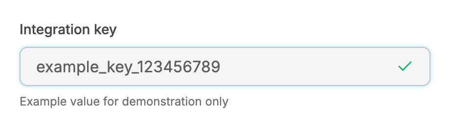
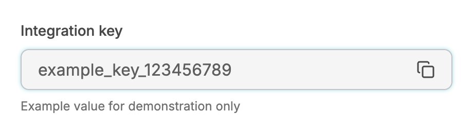
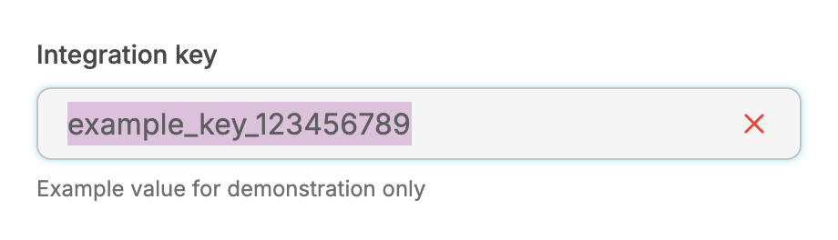
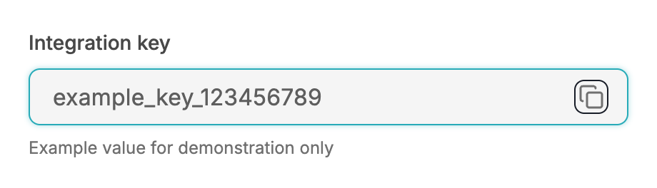
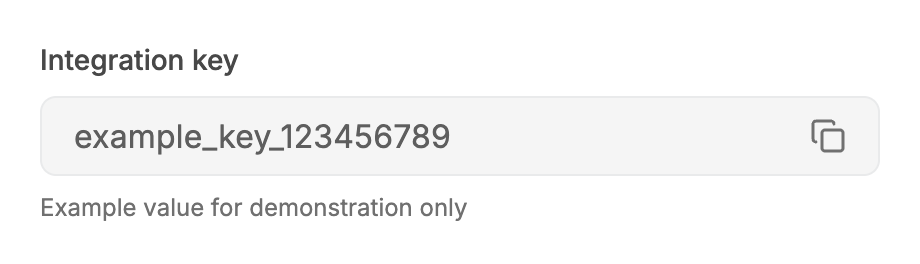
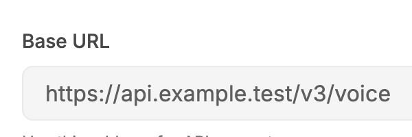
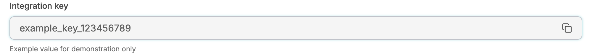
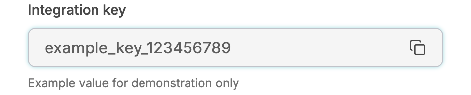
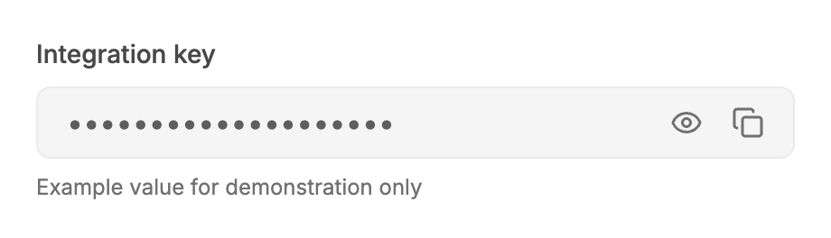

# ReadableField: UI change report for Figma

Figma source: [https://www.figma.com/design/q84boKV4Bly9HKXzdtBj2K/New-Design-System---MyO?node-id=924-12122](https://www.figma.com/design/q84boKV4Bly9HKXzdtBj2K/New-Design-System---MyO?node-id=924-12122)  
Storybook: `V2/Components/ReadableField`  
Date: 2026-10-04

## Summary

Copying now has real feedback: the Copy icon cross-fades into a green check (180ms), the change is announced to screen readers, and if the browser refuses the copy the icon turns into a red cross for 2 seconds and the value is selected so Cmd/Ctrl+C works. The whole value is selected with one click. The button keeps its 18 x 18 size throughout.

### Why (what the research found)

- GitHub, Linear and Stripe swap the copy icon for a check with a cross-fade and keep the button size fixed; swapping mounted/unmounted icons caused the old pop.
- WAI-ARIA practice (and React Aria's copy examples) announce 'Copied' through a status region because label changes on a focused button are not reliably spoken.
- A silent catch hid clipboard failures (insecure contexts, denied permission); showing the failure and selecting the text gives the user a way forward.

### API / compatibility

No prop, callback, aria-label or DOM-contract changes. v2 remains a drop-in for v1 (`npm run verify:v1-v2-compat` passes).

## Before and after

### Copied state

| Before | After |
| --- | --- |
|  |  |

### Copy failed: red cross, value selected

| Before | After |
| --- | --- |
|  |  |

### Copy button focus-visible

| Before | After |
| --- | --- |
|  |  |

### Copying (frame samples: icon opacity and scale)

| Before | After |
| --- | --- |
|  |  |

### Copy button hover

| Before | After |
| --- | --- |
|  |  |

### Default

| Before | After |
| --- | --- |
|  |  |

### Narrow width, long value

| Before | After |
| --- | --- |
|  |  |

### Copy button pressed

| Before | After |
| --- | --- |
|  |  |

### Secret (masked)

| Before | After |
| --- | --- |
|  |  |

## Measured changes (copy these into Figma)

_Source: computed styles of the rendered component; px, hex colours, ms. Only properties that changed are listed._

### Copied state

| Element | Property | Before | After |
| --- | --- | --- | --- |
| Value | user-select | auto | **all** |
| Value | -webkit-user-select | auto | **all** |
| Copy button | position | static | **relative** |
| Status (sr-only) | _(new element)_ | — | present |
| Check icon (always mounted after) | _(new element)_ | — | present |
| Failure X icon (always mounted after) | _(new element)_ | — | present |

### Copy failed: red cross, value selected

| Element | Property | Before | After |
| --- | --- | --- | --- |
| Value | user-select | auto | **all** |
| Value | -webkit-user-select | auto | **all** |
| Copy button | color | #484848 | **#F04438** |
| Copy button | outline-color | #484848 | **#F04438** |
| Copy button | position | static | **relative** |
| Copy icon box | opacity | 1 | **0** |
| Copy icon box | transform | none | **matrix(0.8, 0, 0, 0.8, 0, 0)** |
| Copy icon box | color | #484848 | **#F04438** |
| Copy icon box | transition-property | color, transform | **opacity, transform** |
| Status (sr-only) | _(new element)_ | — | present |
| Check icon (always mounted after) | _(new element)_ | — | present |
| Failure X icon (always mounted after) | _(new element)_ | — | present |

### Copy button focus-visible

| Element | Property | Before | After |
| --- | --- | --- | --- |
| Value | user-select | auto | **all** |
| Value | -webkit-user-select | auto | **all** |
| Copy button | position | static | **relative** |
| Status (sr-only) | _(new element)_ | — | present |
| Check icon (always mounted after) | _(new element)_ | — | present |
| Failure X icon (always mounted after) | _(new element)_ | — | present |

### Copying (frame samples: icon opacity and scale)

| Element | Property | Before | After |
| --- | --- | --- | --- |
| Value | user-select | auto | **all** |
| Value | -webkit-user-select | auto | **all** |
| Copy button | position | static | **relative** |
| Status (sr-only) | _(new element)_ | — | present |
| Check icon (always mounted after) | _(new element)_ | — | present |
| Failure X icon (always mounted after) | _(new element)_ | — | present |

### Copy button hover

| Element | Property | Before | After |
| --- | --- | --- | --- |
| Value | user-select | auto | **all** |
| Value | -webkit-user-select | auto | **all** |
| Copy button | position | static | **relative** |
| Status (sr-only) | _(new element)_ | — | present |
| Check icon (always mounted after) | _(new element)_ | — | present |
| Failure X icon (always mounted after) | _(new element)_ | — | present |

### Default

| Element | Property | Before | After |
| --- | --- | --- | --- |
| Value | user-select | auto | **all** |
| Value | -webkit-user-select | auto | **all** |
| Copy button | position | static | **relative** |
| Status (sr-only) | _(new element)_ | — | present |
| Check icon (always mounted after) | _(new element)_ | — | present |
| Failure X icon (always mounted after) | _(new element)_ | — | present |

### Narrow width, long value

| Element | Property | Before | After |
| --- | --- | --- | --- |
| Value | user-select | auto | **all** |
| Value | -webkit-user-select | auto | **all** |
| Copy button | position | static | **relative** |
| Status (sr-only) | _(new element)_ | — | present |
| Check icon (always mounted after) | _(new element)_ | — | present |
| Failure X icon (always mounted after) | _(new element)_ | — | present |

### Secret (masked)

| Element | Property | Before | After |
| --- | --- | --- | --- |
| Copy button | position | static | **relative** |
| Status (sr-only) | _(new element)_ | — | present |
| Check icon (always mounted after) | _(new element)_ | — | present |
| Failure X icon (always mounted after) | _(new element)_ | — | present |

## Motion

| What | Before | After |
| --- | --- | --- |
| Copy to Check | Copy unmounted, Check mounted with a fade/zoom keyframe that never ran (values reset): instant swap | **Both icons always rendered in one 18 x 18 box; Copy goes opacity 1 to 0 and scale 1 to .8 while Check goes 0 to 1 and .8 to 1, 180ms, --v2-ease-spring (a sampled critically damped spring; in Figma use a custom spring or Smart Animate 'Gentle' / bezier 0.22, 1, 0.36, 1)** |
| Hold | 2000ms then back to Copy (instant) | **2000ms (unchanged), then cross-fades back** |
| Copy failure | Nothing (error swallowed) | **Cross-fade to a red X (same 180ms), value text selected, held 2000ms, then back to Copy** |
| Reduced motion | n/a | **Opacity cross-fade only, no scale** |

## States to update in Figma

- Copy button / default (Copy icon, muted #707070), hover (--v2-text-primary #484848), pressed (scale 96%)
- Copy button / copied: Check icon, --semantic-success-primary (unchanged colour), aria-label 'Copied'
- Copy button / failed (new): X icon, --semantic-error-primary, aria-label 'Copy failed'

## How to apply in Figma

1. Copy button: fix the button frame at 18 x 18 and stack three 18px icons in it (Copy, Check, X), all centred. Only one is visible per state.
2. States: default = Copy (opacity 100%, scale 100%), others 0% and 80%. Copied = Check 100% / 100% in --semantic-success-primary, others 0% / 80%. Failed (new) = X 100% / 100% in --semantic-error-primary (use the error/primary token), others 0% / 80%.
3. Prototype each change as Smart Animate 180ms, Gentle spring (bezier 0.22, 1, 0.36, 1). Copied and Failed return to default after 2000ms (After delay).
4. Failed variant of the whole field: the value text shows a selection highlight (select-all). In Figma add a text selection fill on the value layer for this variant.
5. Value text: add the annotation 'user-select: all (one click selects the whole value)'. Pressed state: button scale 96%, 80ms down / 180ms back (unchanged).
6. Accessibility annotation: a visually hidden status 'Copied' / 'Copy failed' is announced politely; the button's label changes to 'Copied' / 'Copy failed'.

## Notes

- A masked secret is not selected on failure (it would select the dots); the failed icon still shows. Revealing the value on failure was considered and not done because it changes what is on screen.
- A Clipboard fallback (document.execCommand('copy') after selecting) would make copying work in insecure contexts; not added because it changes behaviour. Proposed follow-up.
- onValueCopy is now called outside the failure path, and a throwing callback no longer flips a successful copy into a failed state (before it was silently swallowed with the copied state already set; the copied state is still kept).
- The status region is always rendered (sr-only) but is empty until a copy happens, so no visible or queried text is duplicated: getByText for the value and label still finds one element.
- The 'pressed' before image was recorded from a temporary copy of the previous component, so its page layout is not centred like the after image.
