# SelectField: UI change report for Figma

Figma source: [https://www.figma.com/design/q84boKV4Bly9HKXzdtBj2K/New-Design-System---MyO?node-id=2118-22190](https://www.figma.com/design/q84boKV4Bly9HKXzdtBj2K/New-Design-System---MyO?node-id=2118-22190)  
Storybook: `V2/Components/SelectField`  
Date: 2026-10-04

## Summary

SelectField inherits the Select refresh: the field keeps its teal focused look while the list is open, rows are 4px-radius, and the selected check pops in. Its validation message now really fades in (150ms, 2px slide), matching TextField.

### Why (what the research found)

- Task brief research summary (HeroUI, Mantine, shadcn/ui, Untitled UI, React Aria, Fluent): 'modern' here comes from connectedness and polish, not flashy motion. (Not re-researched in this pass.)
- Connectedness: the trigger should read as part of its open panel. Measured before: while the list was open the Select trigger border was #E9EAEB with no glow, because Radix moves focus into the list and the focused look is keyed to `focus:`.
- Concentric radii (inner radius = outer radius - padding): the panel is 8px with 4px padding, so rows should be 4px. Measured before: Select and Creatable rows 6px, Dropdown and SearchFilter rows 0px.
- Selection feedback should be acknowledged briefly: the same fade + 85% to 100% scale as the v2 Checkbox tick, 180ms.

### API / compatibility

No prop, callback, aria-label or DOM-contract changes. v2 remains a drop-in for v1 (`npm run verify:v1-v2-compat` passes).

## Before and after

### Closed

| Before | After |
| --- | --- |
|  | 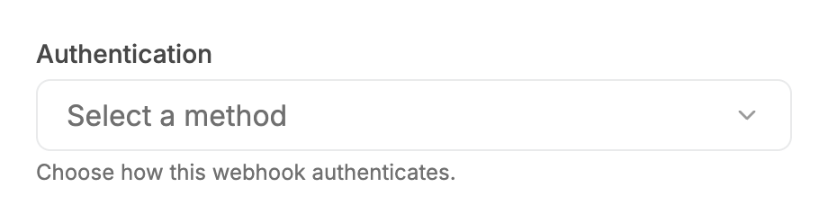 |

### Open

| Before | After |
| --- | --- |
| 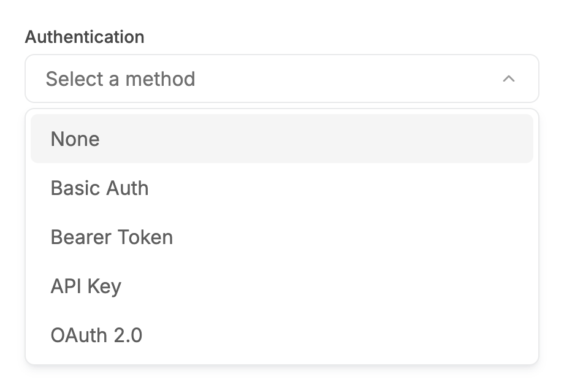 | 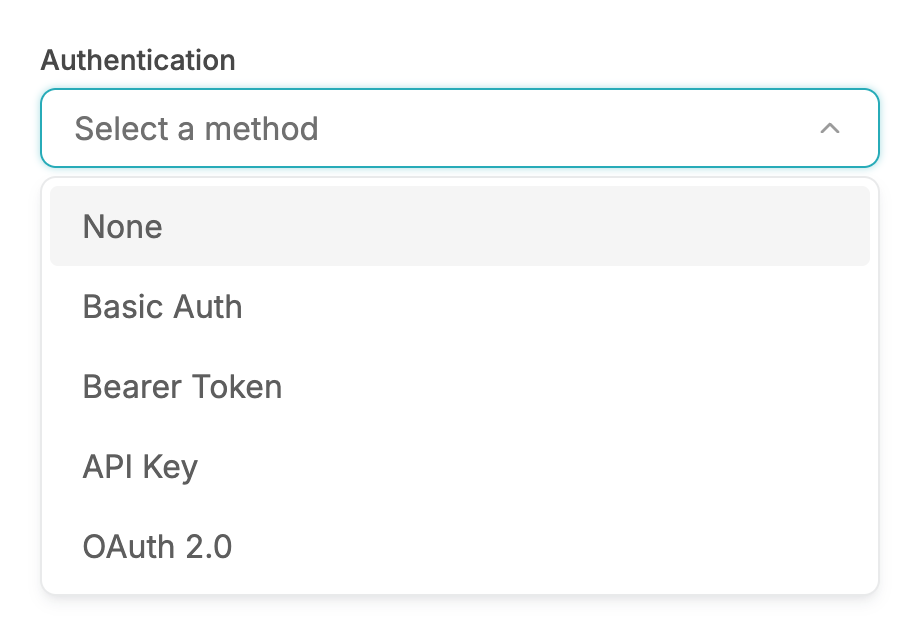 |

### Open, mouse hover on a row

| Before | After |
| --- | --- |
| 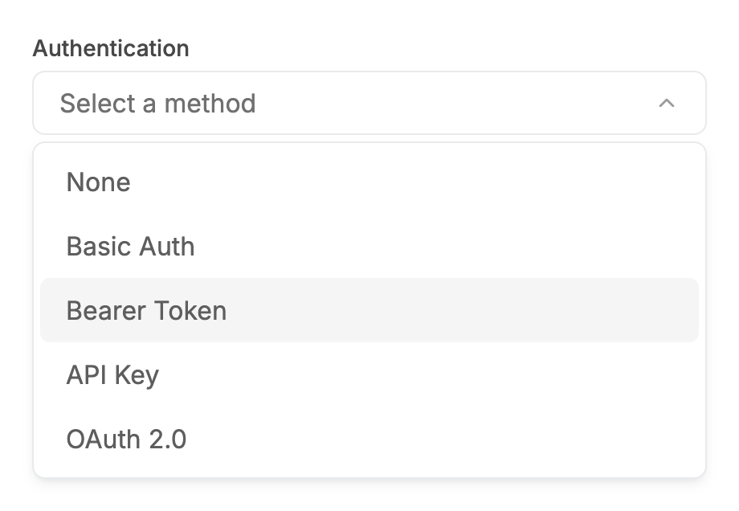 | 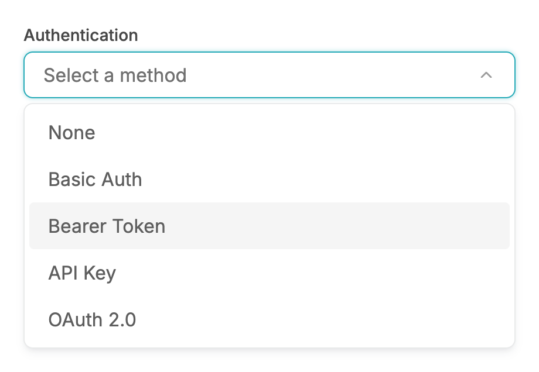 |

### Open by keyboard, ArrowDown

| Before | After |
| --- | --- |
| 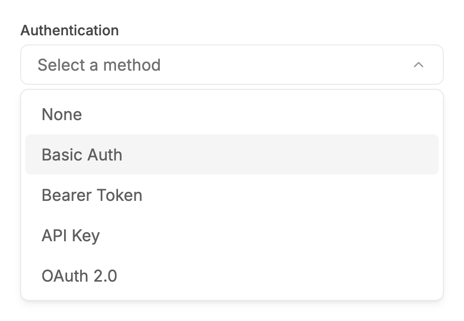 | 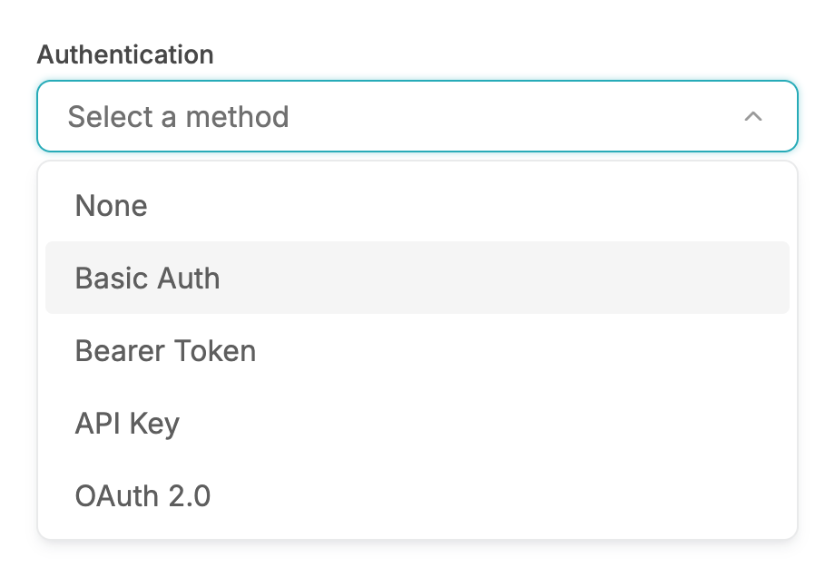 |

### Open with a selected value

| Before | After |
| --- | --- |
| 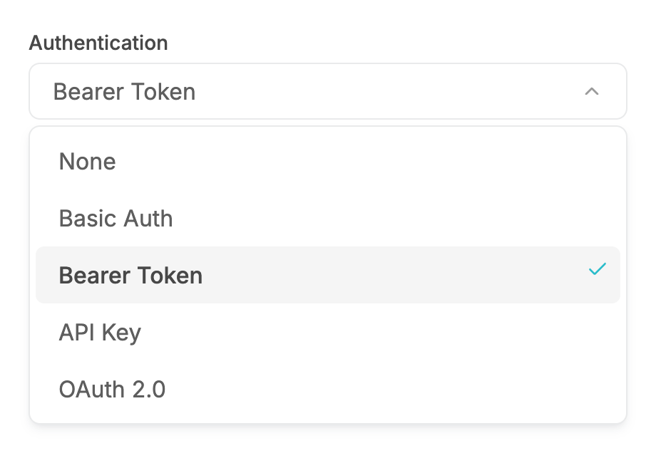 | 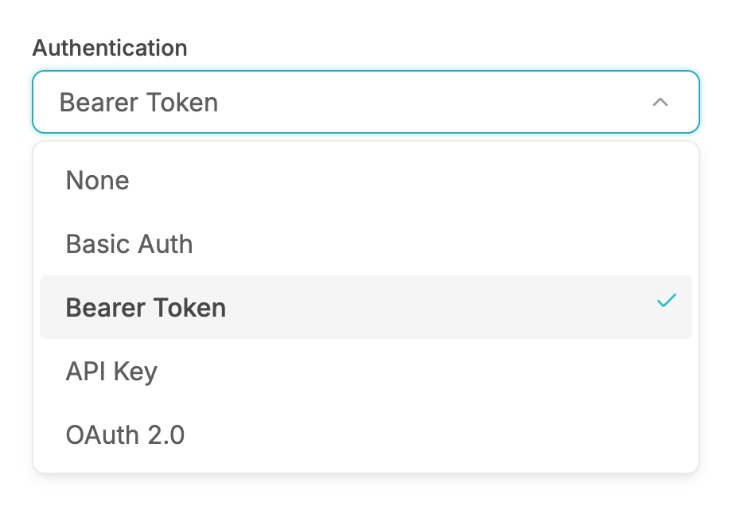 |

### Error, closed

| Before | After |
| --- | --- |
|  | 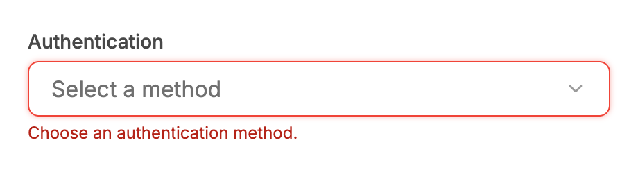 |

### Error, open (stays red)

| Before | After |
| --- | --- |
|  | 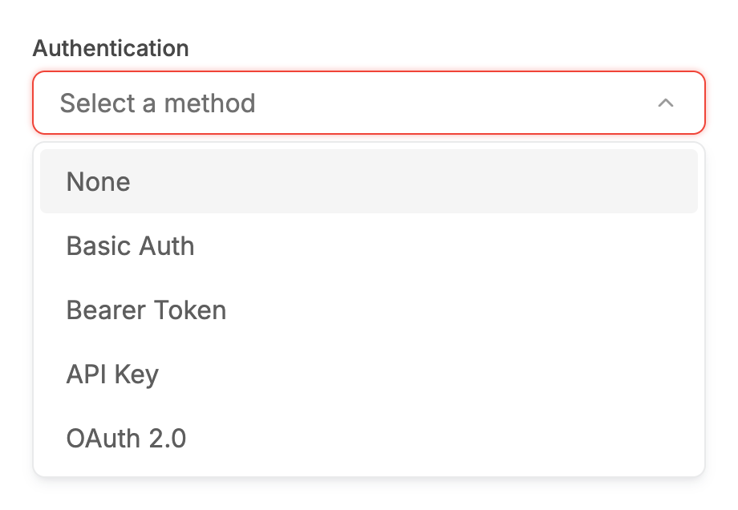 |

### Disabled

| Before | After |
| --- | --- |
| 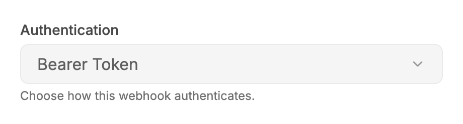 |  |

### Searchable, open

| Before | After |
| --- | --- |
| 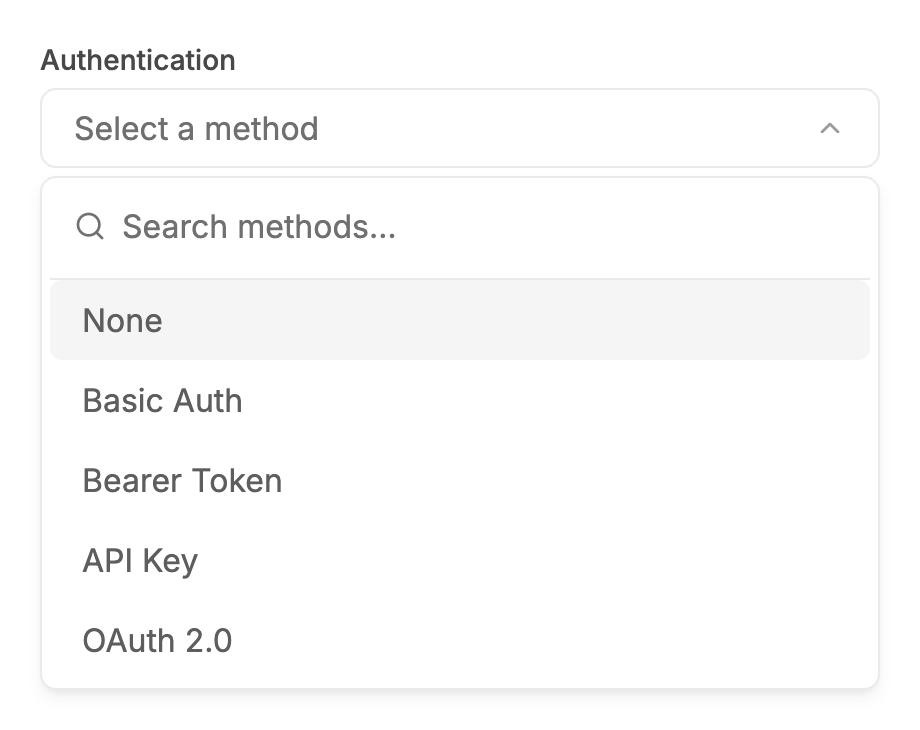 | 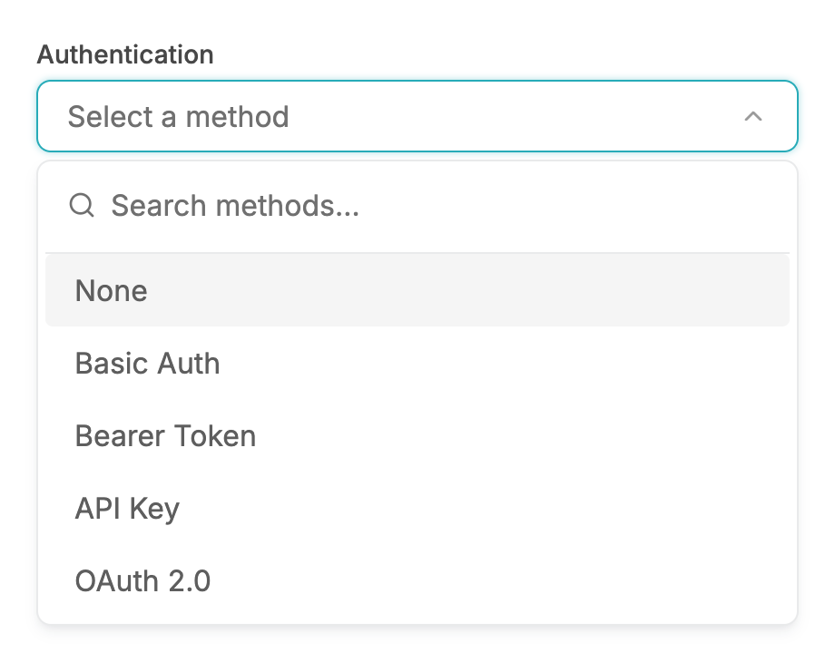 |

### Searchable, no results

| Before | After |
| --- | --- |
| 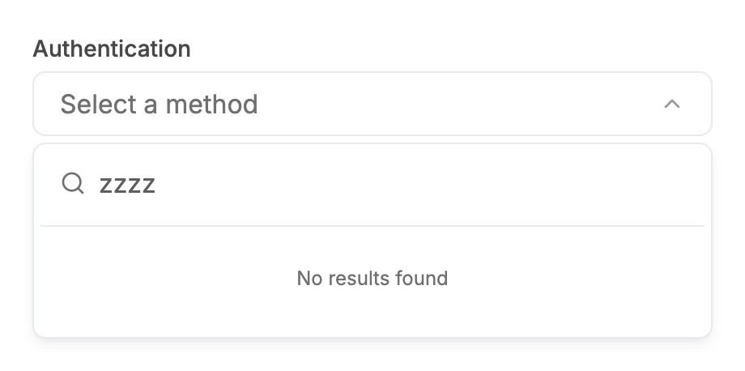 | 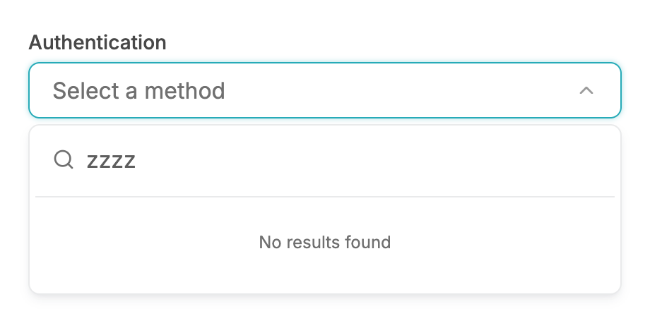 |

### Open, long option labels

| Before | After |
| --- | --- |
|  |  |

### Open, no options

| Before | After |
| --- | --- |
| 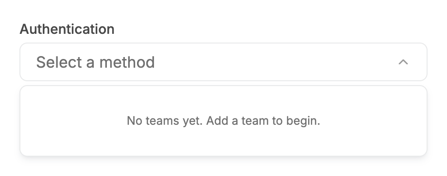 | 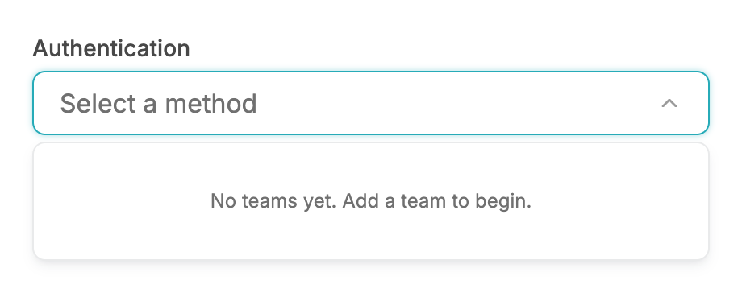 |

### Open, grouped options

| Before | After |
| --- | --- |
| 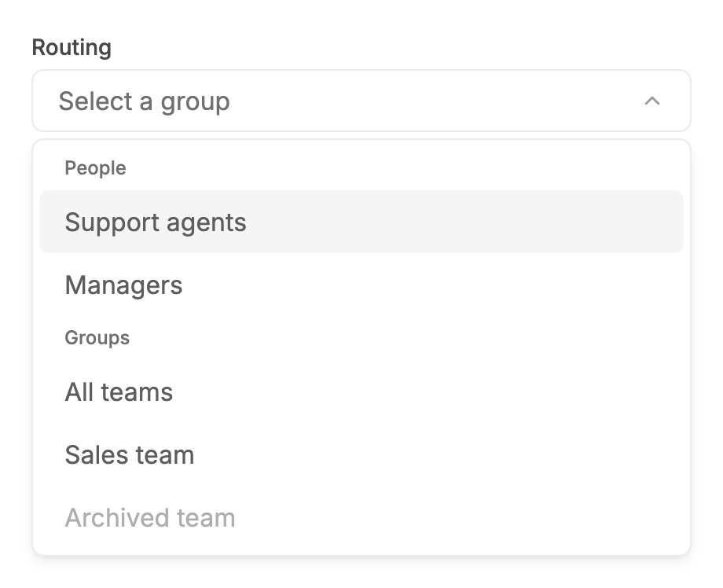 | 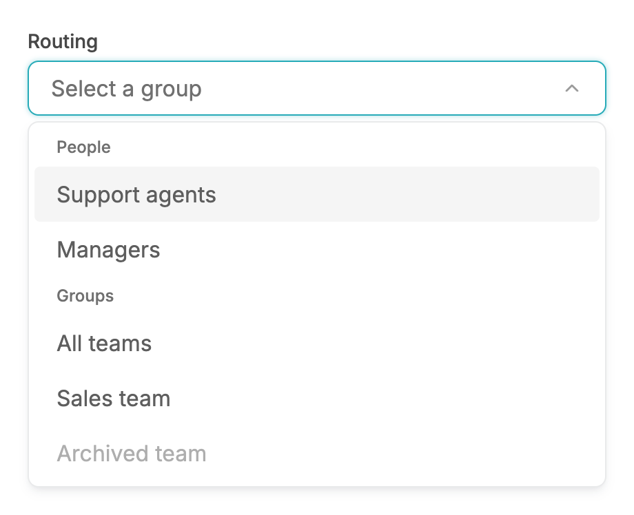 |

### Open, 340px viewport

| Before | After |
| --- | --- |
|  |  |

## Measured changes (copy these into Figma)

_Source: computed styles of the rendered component; px, hex colours, ms. Only properties that changed are listed._

### Open

| Element | Property | Before | After |
| --- | --- | --- | --- |
| Trigger | border-top-color | #E9EAEB | **#27ABB8** |
| Trigger | box-shadow | none | **transparent 0, transparent 0, #27ABB8 @ 40% 0px 0px 4px 0px** |
| Row (first) | border-radius | 6px | **4px** |
| Row (highlighted) | border-radius | 6px | **4px** |

### Open, mouse hover on a row

| Element | Property | Before | After |
| --- | --- | --- | --- |
| Trigger | border-top-color | #E9EAEB | **#27ABB8** |
| Trigger | box-shadow | none | **transparent 0, transparent 0, #27ABB8 @ 40% 0px 0px 4px 0px** |
| Row (first) | border-radius | 6px | **4px** |
| Row (highlighted) | border-radius | 6px | **4px** |

### Open by keyboard, ArrowDown

| Element | Property | Before | After |
| --- | --- | --- | --- |
| Trigger | border-top-color | #E9EAEB | **#27ABB8** |
| Trigger | box-shadow | none | **transparent 0, transparent 0, #27ABB8 @ 40% 0px 0px 4px 0px** |
| Row (first) | border-radius | 6px | **4px** |
| Row (highlighted) | border-radius | 6px | **4px** |

### Open with a selected value

| Element | Property | Before | After |
| --- | --- | --- | --- |
| Trigger | border-top-color | #E9EAEB | **#27ABB8** |
| Trigger | box-shadow | none | **transparent 0, transparent 0, #27ABB8 @ 40% 0px 0px 4px 0px** |
| Row (first) | border-radius | 6px | **4px** |
| Row (highlighted) | border-radius | 6px | **4px** |
| Row (selected) | border-radius | 6px | **4px** |
| Check icon (selected row) | animation-name | none | **enter** |
| Check icon (selected row) | animation-duration | 0s | **0.18s** |
| Check icon (selected row) | animation-timing-function | ease | **linear(0 0%, 0.06174 5%, 0.19179 10%, 0.33839 15%, 0.47651 20%, 0.59579 25%, 0.69365 30%, 0.77125 35%, 0.83131 40%, 0.87696 45%, 0.91117 50%, 0.93653 55%, 0.955** |

### Error, open (stays red)

| Element | Property | Before | After |
| --- | --- | --- | --- |
| Row (first) | border-radius | 6px | **4px** |
| Row (highlighted) | border-radius | 6px | **4px** |

### Searchable, open

| Element | Property | Before | After |
| --- | --- | --- | --- |
| Trigger | border-top-color | #E9EAEB | **#27ABB8** |
| Trigger | box-shadow | none | **transparent 0, transparent 0, #27ABB8 @ 40% 0px 0px 4px 0px** |
| Row (first) | border-radius | 6px | **4px** |
| Row (highlighted) | border-radius | 6px | **4px** |

### Searchable, no results

| Element | Property | Before | After |
| --- | --- | --- | --- |
| Trigger | border-top-color | #E9EAEB | **#27ABB8** |
| Trigger | box-shadow | none | **transparent 0, transparent 0, #27ABB8 @ 40% 0px 0px 4px 0px** |

### Open, long option labels

| Element | Property | Before | After |
| --- | --- | --- | --- |
| Trigger | border-top-color | #E9EAEB | **#27ABB8** |
| Trigger | box-shadow | none | **transparent 0, transparent 0, #27ABB8 @ 40% 0px 0px 4px 0px** |
| Row (first) | border-radius | 6px | **4px** |
| Row (highlighted) | border-radius | 6px | **4px** |

### Open, no options

| Element | Property | Before | After |
| --- | --- | --- | --- |
| Trigger | border-top-color | #E9EAEB | **#27ABB8** |
| Trigger | box-shadow | none | **transparent 0, transparent 0, #27ABB8 @ 40% 0px 0px 4px 0px** |

### Open, grouped options

| Element | Property | Before | After |
| --- | --- | --- | --- |
| Trigger | border-top-color | #E9EAEB | **#27ABB8** |
| Trigger | box-shadow | none | **transparent 0, transparent 0, #27ABB8 @ 40% 0px 0px 4px 0px** |
| Row (first) | border-radius | 6px | **4px** |
| Row (highlighted) | border-radius | 6px | **4px** |

### Open, 340px viewport

| Element | Property | Before | After |
| --- | --- | --- | --- |
| Trigger | border-top-color | #E9EAEB | **#27ABB8** |
| Trigger | box-shadow | none | **transparent 0, transparent 0, #27ABB8 @ 40% 0px 0px 4px 0px** |
| Row (first) | border-radius | 6px | **4px** |
| Row (highlighted) | border-radius | 6px | **4px** |

## Motion

| What | Before | After |
| --- | --- | --- |
| Trigger border/shadow when opening | snaps back to grey as focus leaves the trigger | **stays #27ABB8 + glow (150ms existing transition)** |
| Selected check | appears instantly | **180ms, opacity 0 to 100% + scale 85% to 100%, spring ease (--v2-ease-spring; sampled critically damped curve, fallback cubic-bezier(0.22, 1, 0.36, 1))** |
| Panel enter | opacity stayed 100% (fade cancelled by a utility-order bug) | **200ms fade 0 to 100%, spring ease (--v2-ease-spring; sampled critically damped curve, fallback cubic-bezier(0.22, 1, 0.36, 1))** |
| Validation message | appeared instantly (fade/slide classes were cancelled by the same bug) | **150ms fade 0 to 100% + 2px slide down, ease-out; reduced motion: 150ms fade only** |

## States to update in Figma

- Field / default / open: focused look while the list is open (also under hover)
- Field / error / open: unchanged, stays red
- Field / disabled: unchanged
- Option row: corner radius 6 -> 4
- Option row / selected: check enters with scale/fade
- Validation text: enters with a 150ms fade

## How to apply in Figma

1. Apply every Select step to the SelectField trigger and panel: State=Open = fill #FFFFFF, border 1px #27ABB8 (--color-secondary-600) + drop shadow x0 y0 blur 4 spread 0 #27ABB8 @ 40%, radius 8, height 40; Open + Error stays #F04438 + 0 0 4 0 #F04438 @ 40%; Disabled unchanged (#F5F5F5 fill, #E9EAEB border).
2. Option rows: corner radius 4, height 40, hover/highlight fill #F5F5F5, selected label 16/500 #484848 with a 16px #2BBCCA check 8px from the right (prototype: 180ms scale 85% + opacity 0% to 100%).
3. Search row (searchable): unchanged: search icon 16px #707070, input 16/400, 12px side padding, bottom border 1px #E9EAEB.
4. Validation message: unchanged geometry (12px #B42318, 4px below the field); prototype entrance: opacity 0 to 100% and y -2 to 0, 150ms ease-out.

## Notes

- No source change in select-field.tsx itself: every visible change comes from select.tsx (SelectTrigger/SelectItem/SelectContent), except the validation-message motion which is one class change in select-field.tsx.
- Panel scale/slide on the Radix Select panel: see the Select report notes (static translate-y-1 offset).
- Found while verifying motion: `motion-safe:animate-in` is emitted after bare `fade-in-0`/`zoom-in-*` classes and resets --tw-enter-opacity/--tw-enter-scale to initial, so the panel fade and 98% zoom documented in V2-MOTION.md never ran in normal-motion mode (measured at t=0: opacity 1, no scale). Fixed here by prefixing those classes with `motion-safe:` (as Checkbox/TextField already do). The same bare pattern remains in dialog.tsx, toast.tsx, tabs.tsx, date-range-picker.tsx and date-time-picker.tsx (not in this task's files, not individually verified).
