# Select: UI change report for Figma

Figma source: [https://www.figma.com/design/q84boKV4Bly9HKXzdtBj2K/New-Design-System---MyO?node-id=2118-22190](https://www.figma.com/design/q84boKV4Bly9HKXzdtBj2K/New-Design-System---MyO?node-id=2118-22190)  
Storybook: `V2/Components/Select`  
Date: 2026-10-04

## Summary

The trigger keeps its teal focused look for as long as the list is open (before it fell back to grey the moment focus moved into the list). List rows are now 4px-radius, concentric with the 8px panel (were 6px). The selected check pops in, and the panel now actually fades in over 200ms.

### Why (what the research found)

- Task brief research summary (HeroUI, Mantine, shadcn/ui, Untitled UI, React Aria, Fluent): 'modern' here comes from connectedness and polish, not flashy motion. (Not re-researched in this pass.)
- Connectedness: the trigger should read as part of its open panel. Measured before: while the list was open the Select trigger border was #E9EAEB with no glow, because Radix moves focus into the list and the focused look is keyed to `focus:`.
- Concentric radii (inner radius = outer radius - padding): the panel is 8px with 4px padding, so rows should be 4px. Measured before: Select and Creatable rows 6px, Dropdown and SearchFilter rows 0px.
- Selection feedback should be acknowledged briefly: the same fade + 85% to 100% scale as the v2 Checkbox tick, 180ms.

### API / compatibility

No prop, callback, aria-label or DOM-contract changes. v2 remains a drop-in for v1 (`npm run verify:v1-v2-compat` passes).

## Before and after

### Closed

| Before | After |
| --- | --- |
|  | 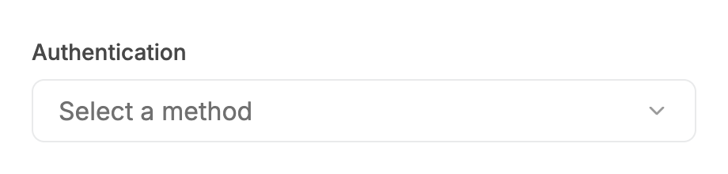 |

### Open (trigger holds the focused look)

| Before | After |
| --- | --- |
| 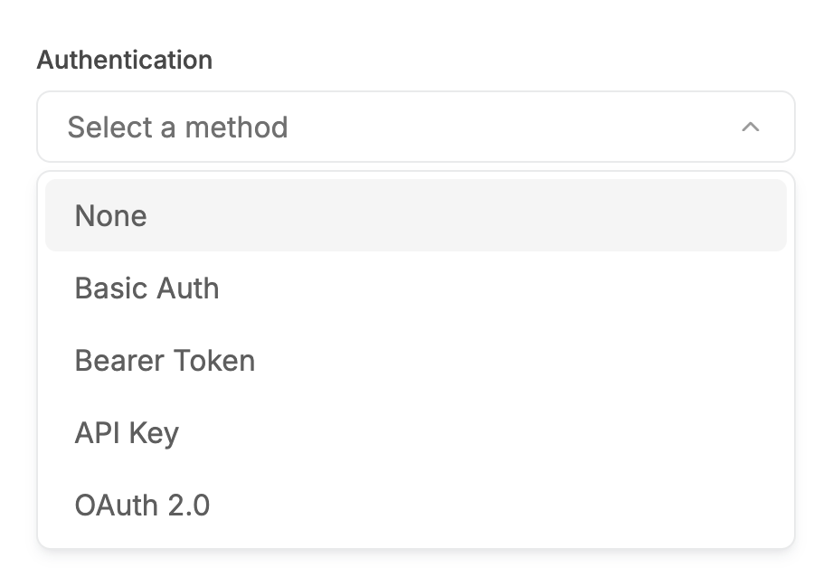 | 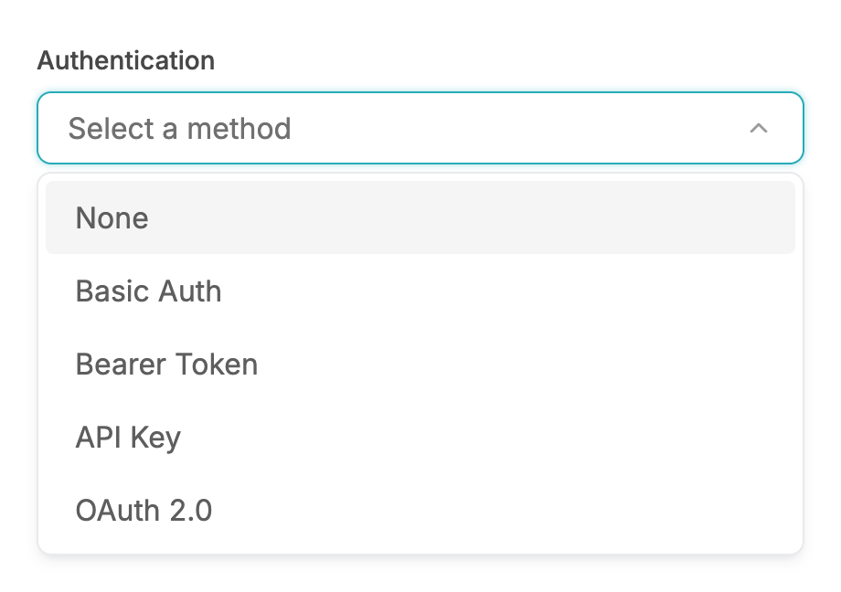 |

### Open, mouse hover on a row

| Before | After |
| --- | --- |
| 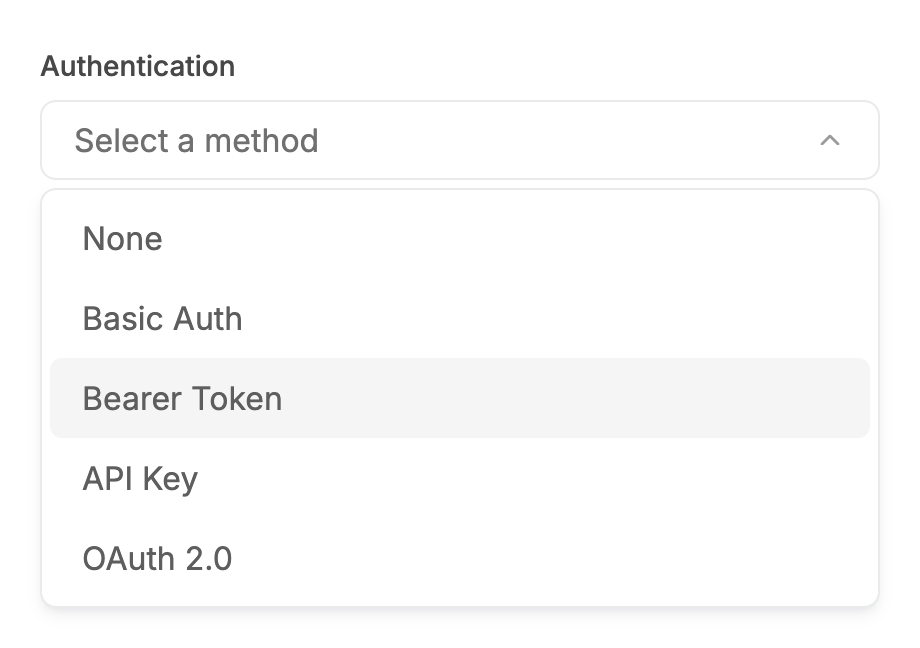 | 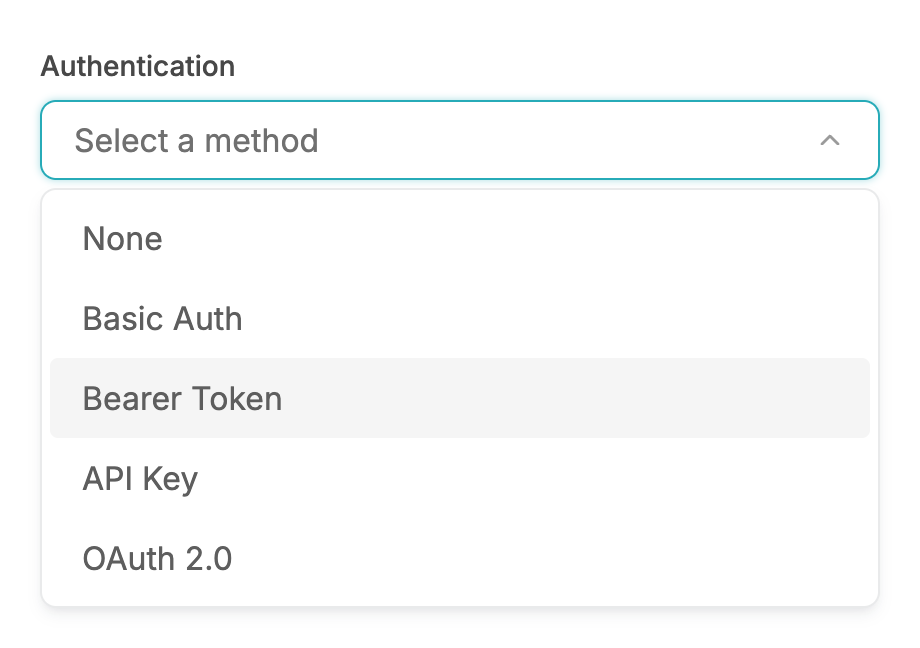 |

### Open by keyboard, row highlighted with ArrowDown

| Before | After |
| --- | --- |
| 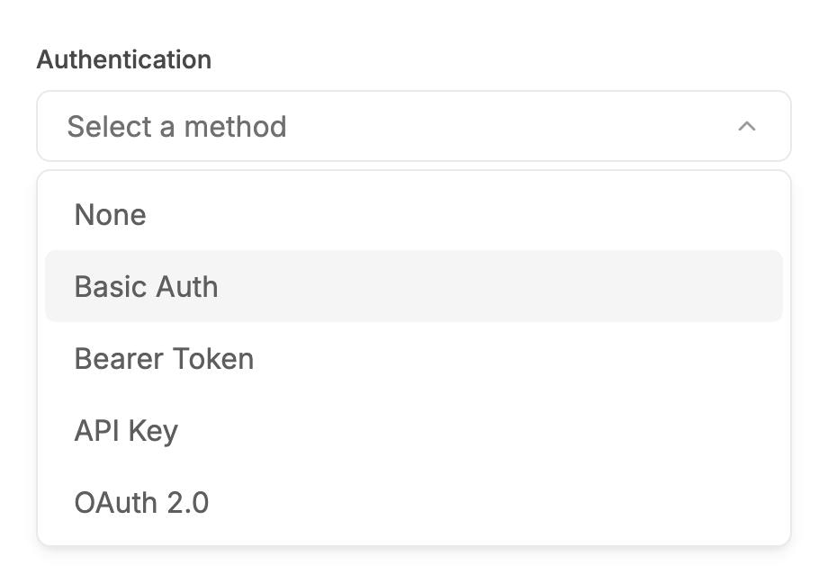 | 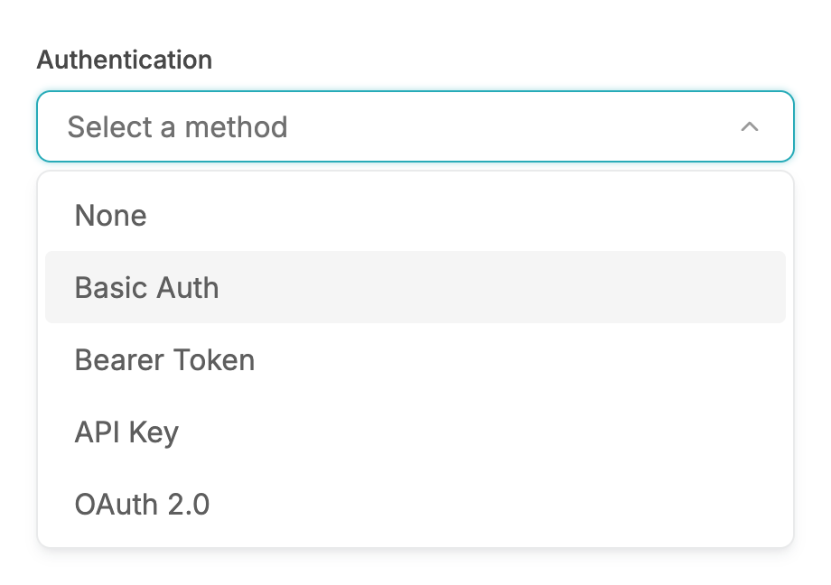 |

### Keyboard open, then mouse hover

| Before | After |
| --- | --- |
| 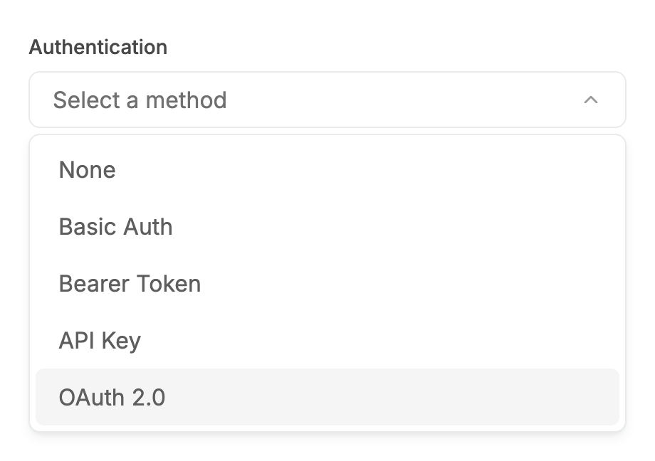 | 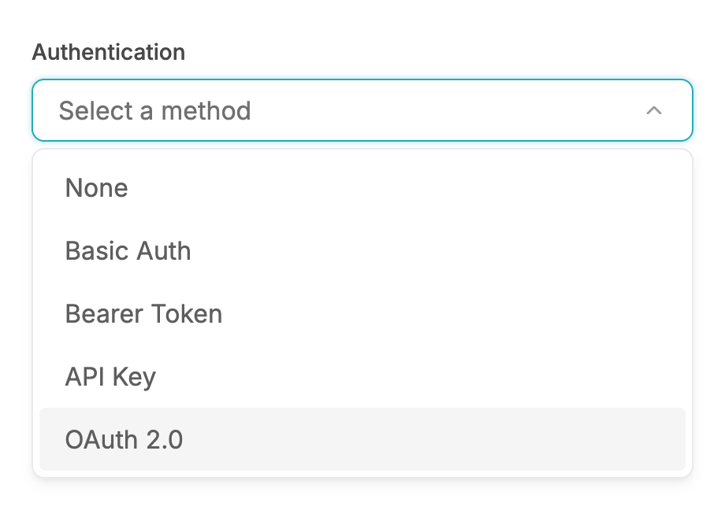 |

### Open with a selected value (check)

| Before | After |
| --- | --- |
| 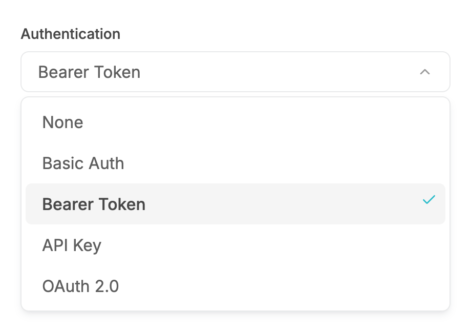 | 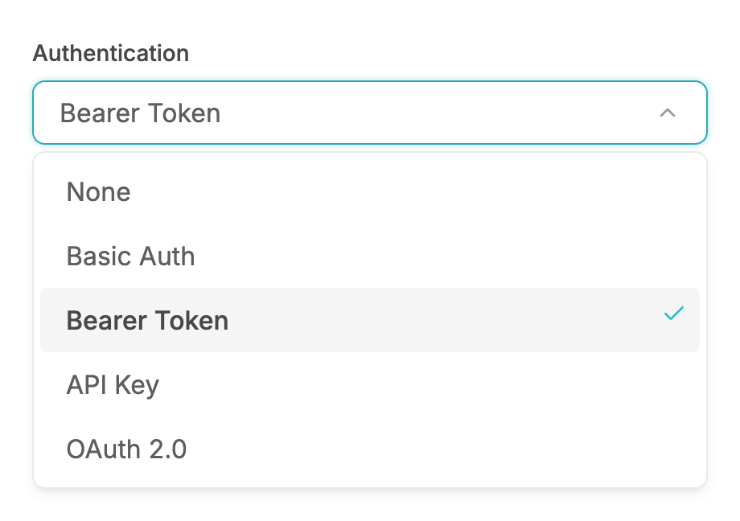 |

### Error, closed

| Before | After |
| --- | --- |
|  | 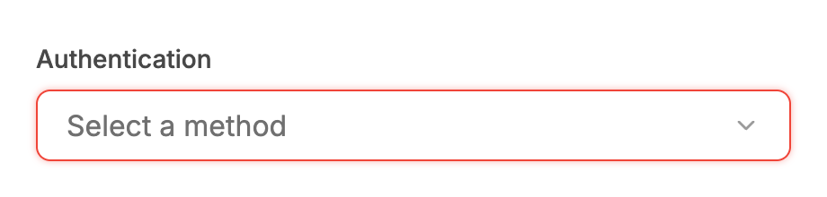 |

### Error, open (stays red)

| Before | After |
| --- | --- |
| 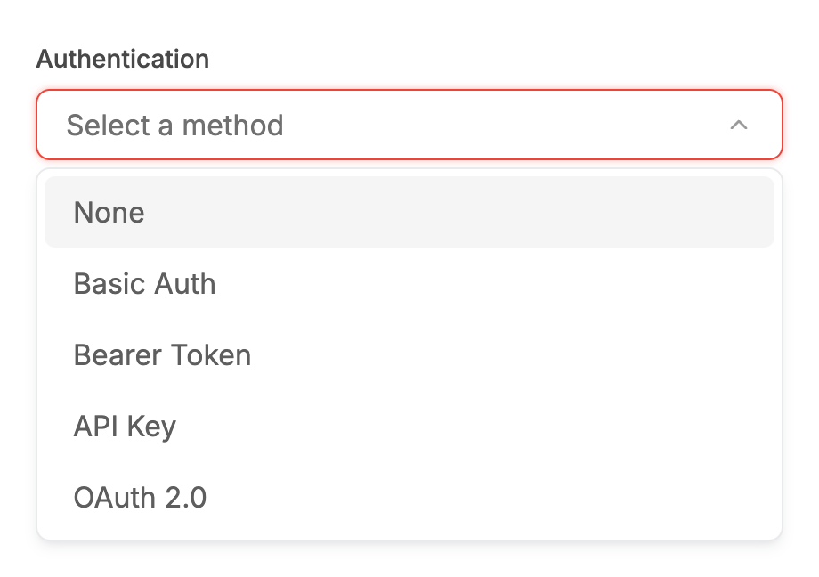 |  |

### Disabled

| Before | After |
| --- | --- |
|  | 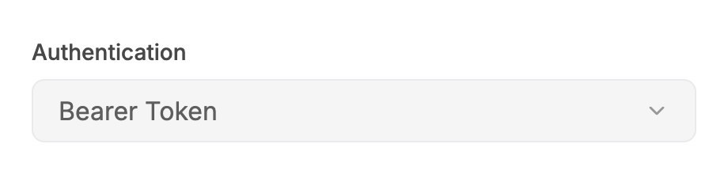 |

### Open, long option labels

| Before | After |
| --- | --- |
|  | 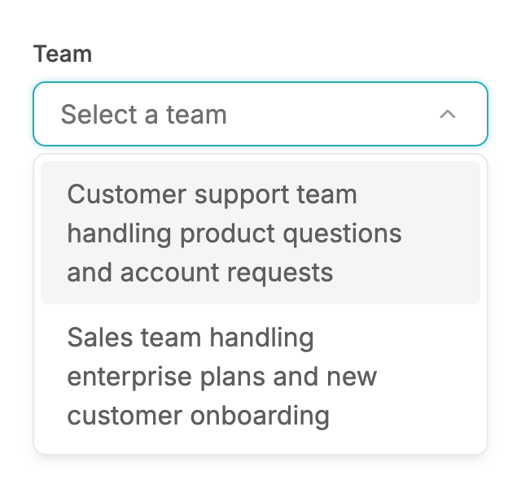 |

### Open, no options

| Before | After |
| --- | --- |
| 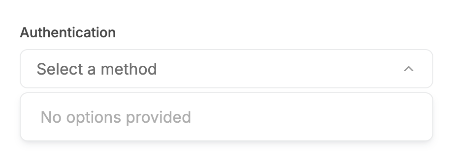 | 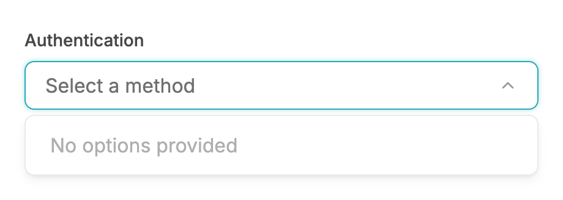 |

### Open, 340px viewport

| Before | After |
| --- | --- |
| 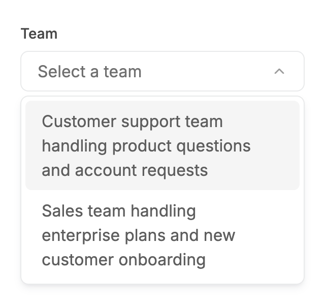 |  |

### Open, grouped options

| Before | After |
| --- | --- |
| 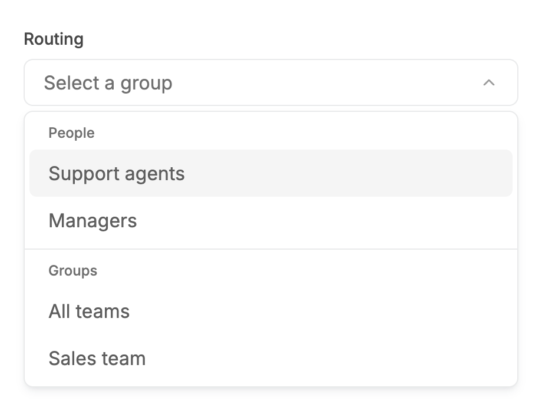 | 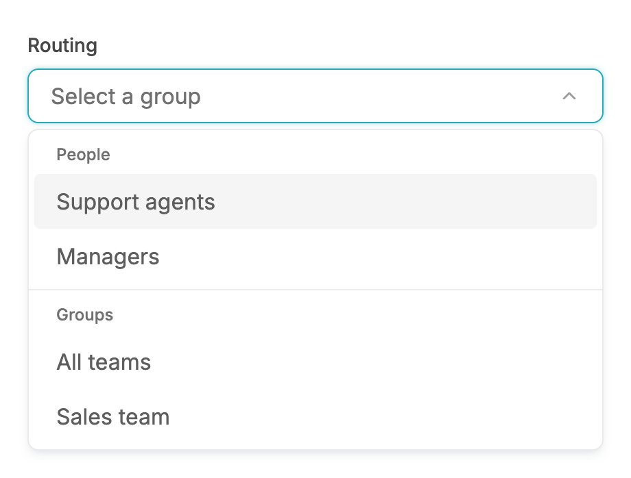 |

## Measured changes (copy these into Figma)

_Source: computed styles of the rendered component; px, hex colours, ms. Only properties that changed are listed._

### Open (trigger holds the focused look)

| Element | Property | Before | After |
| --- | --- | --- | --- |
| Trigger | border-top-color | #E9EAEB | **#27ABB8** |
| Trigger | box-shadow | none | **transparent 0, transparent 0, #27ABB8 @ 40% 0px 0px 4px 0px** |
| Row (first) | border-radius | 6px | **4px** |
| Row (highlighted) | border-radius | 6px | **4px** |

### Open, mouse hover on a row

| Element | Property | Before | After |
| --- | --- | --- | --- |
| Trigger | border-top-color | #E9EAEB | **#27ABB8** |
| Trigger | box-shadow | none | **transparent 0, transparent 0, #27ABB8 @ 40% 0px 0px 4px 0px** |
| Row (first) | border-radius | 6px | **4px** |
| Row (highlighted) | border-radius | 6px | **4px** |

### Open by keyboard, row highlighted with ArrowDown

| Element | Property | Before | After |
| --- | --- | --- | --- |
| Trigger | border-top-color | #E9EAEB | **#27ABB8** |
| Trigger | box-shadow | none | **transparent 0, transparent 0, #27ABB8 @ 40% 0px 0px 4px 0px** |
| Row (first) | border-radius | 6px | **4px** |
| Row (highlighted) | border-radius | 6px | **4px** |

### Keyboard open, then mouse hover

| Element | Property | Before | After |
| --- | --- | --- | --- |
| Trigger | border-top-color | #E9EAEB | **#27ABB8** |
| Trigger | box-shadow | none | **transparent 0, transparent 0, #27ABB8 @ 40% 0px 0px 4px 0px** |
| Row (first) | border-radius | 6px | **4px** |
| Row (highlighted) | border-radius | 6px | **4px** |

### Open with a selected value (check)

| Element | Property | Before | After |
| --- | --- | --- | --- |
| Trigger | border-top-color | #E9EAEB | **#27ABB8** |
| Trigger | box-shadow | none | **transparent 0, transparent 0, #27ABB8 @ 40% 0px 0px 4px 0px** |
| Row (first) | border-radius | 6px | **4px** |
| Row (highlighted) | border-radius | 6px | **4px** |
| Row (selected) | border-radius | 6px | **4px** |
| Check icon (selected row) | animation-name | none | **enter** |
| Check icon (selected row) | animation-duration | 0s | **0.18s** |
| Check icon (selected row) | animation-timing-function | ease | **linear(0 0%, 0.06174 5%, 0.19179 10%, 0.33839 15%, 0.47651 20%, 0.59579 25%, 0.69365 30%, 0.77125 35%, 0.83131 40%, 0.87696 45%, 0.91117 50%, 0.93653 55%, 0.955** |

### Error, open (stays red)

| Element | Property | Before | After |
| --- | --- | --- | --- |
| Row (first) | border-radius | 6px | **4px** |
| Row (highlighted) | border-radius | 6px | **4px** |

### Open, long option labels

| Element | Property | Before | After |
| --- | --- | --- | --- |
| Trigger | border-top-color | #E9EAEB | **#27ABB8** |
| Trigger | box-shadow | none | **transparent 0, transparent 0, #27ABB8 @ 40% 0px 0px 4px 0px** |
| Row (first) | border-radius | 6px | **4px** |
| Row (highlighted) | border-radius | 6px | **4px** |

### Open, no options

| Element | Property | Before | After |
| --- | --- | --- | --- |
| Trigger | border-top-color | #E9EAEB | **#27ABB8** |
| Trigger | box-shadow | none | **transparent 0, transparent 0, #27ABB8 @ 40% 0px 0px 4px 0px** |
| Row (first) | border-radius | 6px | **4px** |

### Open, 340px viewport

| Element | Property | Before | After |
| --- | --- | --- | --- |
| Trigger | border-top-color | #E9EAEB | **#27ABB8** |
| Trigger | box-shadow | none | **transparent 0, transparent 0, #27ABB8 @ 40% 0px 0px 4px 0px** |
| Row (first) | border-radius | 6px | **4px** |
| Row (highlighted) | border-radius | 6px | **4px** |

### Open, grouped options

| Element | Property | Before | After |
| --- | --- | --- | --- |
| Trigger | border-top-color | #E9EAEB | **#27ABB8** |
| Trigger | box-shadow | none | **transparent 0, transparent 0, #27ABB8 @ 40% 0px 0px 4px 0px** |
| Row (first) | border-radius | 6px | **4px** |
| Row (highlighted) | border-radius | 6px | **4px** |

## Motion

| What | Before | After |
| --- | --- | --- |
| Chevron | rotates 180deg, 200ms, spring (already) | **unchanged: 200ms, spring ease (--v2-ease-spring; sampled critically damped curve, fallback cubic-bezier(0.22, 1, 0.36, 1)), no transition under reduced motion** |
| Trigger border/shadow when opening | snaps back to grey as focus leaves the trigger | **stays #27ABB8 + glow; existing 150ms colour/shadow transition** |
| Selected check | appears instantly | **180ms, opacity 0 to 100% and scale 85% to 100%, spring ease (--v2-ease-spring; sampled critically damped curve, fallback cubic-bezier(0.22, 1, 0.36, 1)); none under reduced motion** |
| Panel enter | opacity stayed 100% (the fade was cancelled by a utility-order bug); only the 200ms animation shell ran | **200ms fade 0 to 100%, spring ease (--v2-ease-spring; sampled critically damped curve, fallback cubic-bezier(0.22, 1, 0.36, 1)). Exit 120ms fade. Reduced motion: opacity-only 120ms fade-in / 100ms fade-out** |

## States to update in Figma

- Trigger / default / open: NEW look (focused look while the list is open), also when hovered
- Trigger / error / open: unchanged, stays red
- Trigger / disabled: unchanged (cannot open)
- Option row / default, highlighted (hover or keyboard): corner radius 6 -> 4
- Option row / selected: radius 4 + check icon enters with scale/fade
- Panel: no static change (8px radius, 4px padding)

## How to apply in Figma

1. Trigger component, add (or update) the variant State=Open: fill #FFFFFF, border 1px #27ABB8 (--color-secondary-600) + drop shadow x0 y0 blur 4 spread 0 #27ABB8 @ 40%, corner radius 8, height 40, padding 10 / 16, gap 8. It is identical to State=Focus. Do NOT use the hover border #C0C3CA on Open: Open + hover keeps #27ABB8.
2. Trigger, State=Open + Error: border 1px #F04438 and drop shadow 0 0 4 0 #F04438 @ 40% (unchanged from Error). Error never turns teal.
3. Trigger, State=Disabled: unchanged (fill #F5F5F5, border 1px #E9EAEB, no shadow, label #A2A6B1). A disabled trigger has no Open variant.
4. Chevron layer in State=Open: rotation 180 degrees (16px icon, #707070 at 70% opacity). Prototype: Smart animate, 200ms, custom ease cubic-bezier(0.22, 1, 0.36, 1).
5. Panel (unchanged geometry): fill #FFFFFF, border 1px #E9EAEB, corner radius 8, auto-layout padding 4 on all sides, shadow 0 4 8 -2 rgba(16,24,40,0.10) + 0 2 4 -2 rgba(16,24,40,0.06).
6. Option row: corner radius 4 (was 6). Keep height 40 (padding 8 top/bottom, 16 left, 32 right, gap 8, label 16/400 #5E5E5E). Hover / highlighted fill #F5F5F5 (unchanged). Selected: label 16/500 #484848.
7. Selected check icon: 16 x 16, #2BBCCA, 8px from the right edge, vertically centred. Prototype: on entering the selected variant use Smart animate, 180ms, ease cubic-bezier(0.22, 1, 0.36, 1), from opacity 0% + scale 85% to opacity 100% + scale 100%.
8. Panel open prototype: Smart animate from opacity 0% to 100%, 200ms, same ease; close 120ms opacity to 0%.

## Notes

- Keyboard-only row ring was NOT added. Radix focuses the highlighted row on pointer move as well, so the focus-visible pseudo-class is true for a mouse hover too (verified in Chrome: pointer-opened list + hover still matched). It cannot tell mouse from keyboard here. A reliable version would need an explicit input-modality flag on SelectContent; not done.
- The panel's scale-98% and 4px slide still do not visibly run on Select: the panel carries a static data-[side=bottom]:translate-y-1 offset and Chrome keeps that transform during the enter animation (keyframes are correct, measured). Suspected cause, not proven. Fix would be moving the 4px offset into Radix sideOffset, a layout change I did not make.
- Found while verifying motion: `motion-safe:animate-in` is emitted after bare `fade-in-0`/`zoom-in-*` classes and resets --tw-enter-opacity/--tw-enter-scale to initial, so the panel fade and 98% zoom documented in V2-MOTION.md never ran in normal-motion mode (measured at t=0: opacity 1, no scale). Fixed here by prefixing those classes with `motion-safe:` (as Checkbox/TextField already do). The same bare pattern remains in dialog.tsx, toast.tsx, tabs.tsx, date-range-picker.tsx and date-time-picker.tsx (not in this task's files, not individually verified).
- Observation, not changed: the selected check uses four different colours today: Select/CreatableSelect #2BBCCA (semantic-brand), Dropdown/SearchFilter #27ABB8 (semantic-border-accent), MultiSelect #343E55 (semantic-primary). Worth unifying in Figma.
- Verified: tests, contract, lint and the existing motion probe (select-popper, normal + reduced) pass. See the final report.
