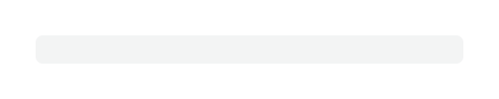
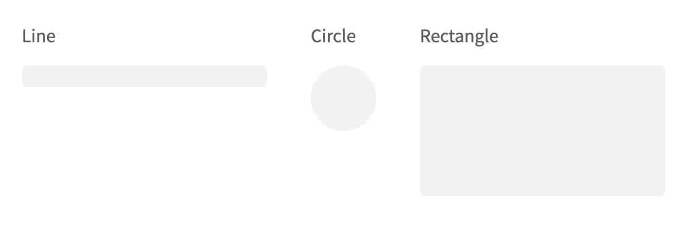
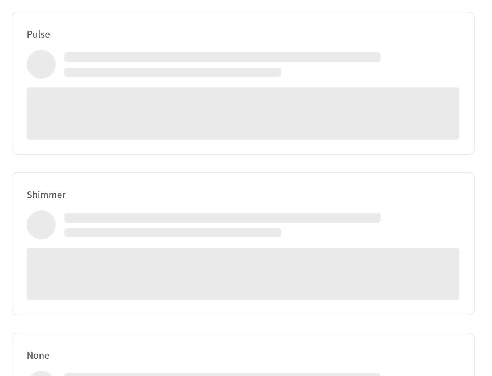
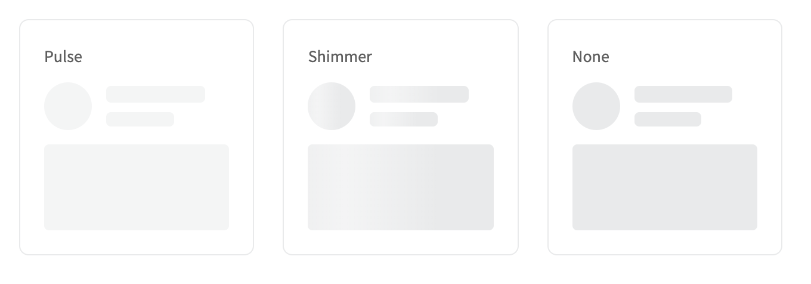
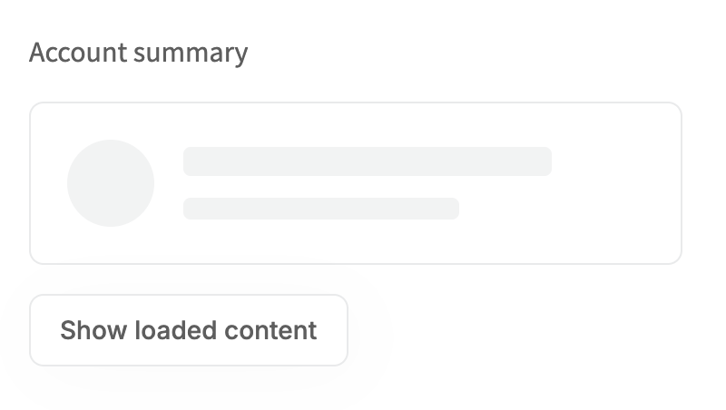
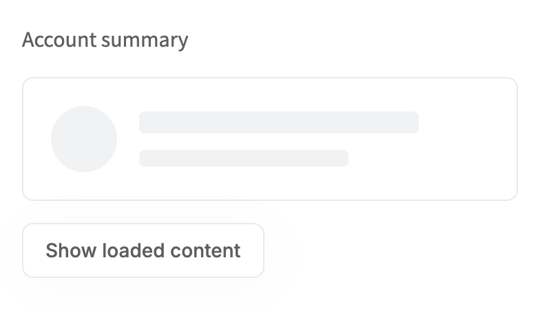

# Skeleton: UI change report for Figma

Figma source: [https://www.figma.com/design/q84boKV4Bly9HKXzdtBj2K/New-Design-System---MyO?node-id=924-12193](https://www.figma.com/design/q84boKV4Bly9HKXzdtBj2K/New-Design-System---MyO?node-id=924-12193)  
Storybook: `V2/Components/Skeleton`  
Date: 2026-10-04

## Summary

Skeleton keeps today's soft pulse by default and gains an optional animation prop: 'shimmer' sweeps a soft white highlight across the placeholder (1.6s, linear, repeating), 'none' is a static fill. Reduced motion shows the plain fill for every option.

### Why (what the research found)

- Mantine, HeroUI and shadcn-based apps use a travelling highlight for skeletons because it reads as 'loading' faster than a pulse and does not dim the whole layout.
- Untitled UI keeps the placeholder fill neutral and puts the highlight on top, so the same two surfaces (#E9EAEB default, #F5F5F5 subtle) keep working.

### API / compatibility

No prop, callback, aria-label or DOM-contract changes. v2 remains a drop-in for v1 (`npm run verify:v1-v2-compat` passes).

## Before and after

### Default (pulse)

| Before | After |
| --- | --- |
|  |  |

### Subtle

| Before | After |
| --- | --- |
|  |  |

### Shapes

| Before | After |
| --- | --- |
|  |  |

### Shimmer line (frame paused 35% through the sweep)

| Before | After |
| --- | --- |
|  |  |

### Pulse / shimmer / none (frames paused: pulse at its 50% dip, shimmer 35% through)

| Before | After |
| --- | --- |
|  |  |

### Usage: loading card

| Before | After |
| --- | --- |
|  |  |

## Measured changes (copy these into Figma)

_Source: computed styles of the rendered component; px, hex colours, ms. Only properties that changed are listed._

### Default (pulse)

| Element | Property | Before | After |
| --- | --- | --- | --- |
| Skeleton line | opacity | 0.529924 | **0.524183** |

### Subtle

| Element | Property | Before | After |
| --- | --- | --- | --- |
| Skeleton line | opacity | 0.524206 | **0.597095** |

### Shapes

| Element | Property | Before | After |
| --- | --- | --- | --- |
| Circle | opacity | 0.619149 | **0.607905** |

### Shimmer line (frame paused 35% through the sweep)

| Element | Property | Before | After |
| --- | --- | --- | --- |
| Skeleton line | opacity | 0.997346 | **1** |
| Skeleton line | overflow | visible | **hidden** |
| Skeleton line | position | static | **relative** |
| Skeleton line | animation-name | pulse | **none** |
| Skeleton line | animation-duration | 2s | **0s** |
| Skeleton line | animation-timing-function | cubic-bezier(0.4, 0, 0.6, 1) | **ease** |
| Skeleton line | animation-iteration-count | infinite | **1** |

### Pulse / shimmer / none (frames paused: pulse at its 50% dip, shimmer 35% through)

| Element | Property | Before | After |
| --- | --- | --- | --- |
| Pulse circle | opacity | 0.975808 | **0.5** |
| Shimmer circle | opacity | 0.975808 | **1** |
| Shimmer circle | overflow | visible | **hidden** |
| Shimmer circle | position | static | **relative** |
| Shimmer circle | animation-name | pulse | **none** |
| Shimmer circle | animation-duration | 2s | **0s** |
| Shimmer circle | animation-timing-function | cubic-bezier(0.4, 0, 0.6, 1) | **ease** |
| Shimmer circle | animation-iteration-count | infinite | **1** |
| None circle | opacity | 0.975808 | **1** |
| None circle | animation-name | pulse | **none** |
| None circle | animation-duration | 2s | **0s** |
| None circle | animation-timing-function | cubic-bezier(0.4, 0, 0.6, 1) | **ease** |
| None circle | animation-iteration-count | infinite | **1** |

### Usage: loading card

| Element | Property | Before | After |
| --- | --- | --- | --- |
| Avatar placeholder | opacity | 0.597016 | **0.64313** |

## Motion

| What | Before | After |
| --- | --- | --- |
| Default skeleton | pulse: opacity 1 -> 0.5 -> 1, 2s, infinite | **unchanged** |
| animation='shimmer' | not available | **highlight band crosses the placeholder once per 1.6s, linear, infinite; 0ms start (optional stagger via --v2-skeleton-delay)** |
| animation='none' | not available | **static fill** |
| Reduced motion | static fill | **static fill (shimmer band stays off the placeholder)** |

## States to update in Figma

- Skeleton / pulse (default): fill #E9EAEB (subtle: #F5F5F5), radius 4 (line, rectangle) or full (circle). Opacity animates 100% -> 50% -> 100%, 2s.
- Skeleton / shimmer: same fill; plus a highlight band the full width of the placeholder moving left to right.
- Skeleton / none: static fill.

## How to apply in Figma

1. Skeleton component: add property 'animation' with values pulse (default), shimmer, none. The static frames of all three are identical (#E9EAEB or #F5F5F5, radius 4 / full).
2. Shimmer highlight layer: a rectangle the SAME size as the placeholder, clipped to it (clip content on, so circles stay round). Fill: linear gradient at 90deg (left to right) with 3 stops: 0% transparent (white 0%), 50% white #FFFFFF at 50% opacity, 100% transparent (white 0%).
3. Prototype the sweep: the highlight layer starts just outside the placeholder on the left (its right edge on the placeholder's left edge, x = -100% of the placeholder width) and ends just outside on the right (its left edge on the placeholder's right edge, x = +100%), 1600ms, linear, repeat forever. Stagger several skeletons with a start delay (table rows use 60ms per row).
4. Pulse prototype: opacity 100% -> 50% -> 100% over 2000ms (unchanged).
5. Reduced motion note for developers: shimmer and pulse are replaced by the static fill.

## Notes

- NEEDS ORCHESTRATOR ACTION: v2-skeleton now uses animate-in (tailwindcss-animate keyframes) for the shimmer, so packages/cli/components.yaml needs 'tailwindcss-animate' in the v2-skeleton dependencies. The pulse default does not need it. The shimmer keyframe is not defined anywhere in src/index.css (not in scope to add), so the tailwindcss-animate 'enter' keyframes are reused: the band rests just right of the placeholder (left: 100%) and starts 200% of its width to the left.
- No transform class is used on the band on purpose: Storybook builds Tailwind with important: true, and an important transform pins the element and freezes the keyframe (first attempt, found by sampling the animation). The shimmer sweep now animates a CSS variable-driven start offset only.
- The highlight colour is color-mix(in srgb, var(--semantic-bg-primary) 50%, transparent): white at 50% from the existing background token, no new hex. color-mix needs Chrome 111+/Safari 16.2+/Firefox 113+; where unsupported the band is invisible and the fill stays static.
- Stagger: the optional CSS variable --v2-skeleton-delay (default 0ms) delays the shimmer start; TableSkeleton uses it for its pulse (60ms per row). Skeleton has no 'delay' prop (not in the brief).
- Screenshots of animated states are paused frames (document.getAnimations()); the before images are free-running frames of the old pulse.
- Verified with reduced motion emulated: zero animations on the Animations story (document.getAnimations() = 0); with motion: 4 pulse, 4 shimmer band animations (1600ms, infinite), none for 'none'.
- Research conclusions in 'why' come from the task brief; I did not re-verify them against each library.
- Opacity differences listed for the pulse scenarios in REPORT.md are sampling noise from a running animation, not a change; the default is unchanged (same classes, asserted by a test).
