# Switch: UI change report for Figma

Figma source: [https://www.figma.com/design/q84boKV4Bly9HKXzdtBj2K/New-Design-System---MyO?node-id=2650-18296](https://www.figma.com/design/q84boKV4Bly9HKXzdtBj2K/New-Design-System---MyO?node-id=2650-18296)  
Storybook: `V2/Components/Switch`  
Date: 2026-10-04

## Summary

The switch track squeezes to 96% when pressed, hover only applies on devices that can hover, and the invisible pointer target is now 44 x 28 for the default size (4px of padding on every side). An optional description can sit under the label. The thumb is deliberately not stretched on press.

### Why (what the research found)

- Press feedback on toggles is standard in HeroUI, Mantine and Apple's switch; the thumb stretch was tried and rejected in design/V2-MOTION.md, so only the track scales.
- A 36 x 20 target is under the 44px touch recommendation in height; the 4px ring brings the default to 44 x 28 without shifting layout.
- HeroUI and Untitled UI toggles support supporting text under the label.

### API / compatibility

No prop, callback, aria-label or DOM-contract changes. v2 remains a drop-in for v1 (`npm run verify:v1-v2-compat` passes).

## Before and after

### Disabled / off

| Before | After |
| --- | --- |
|  | 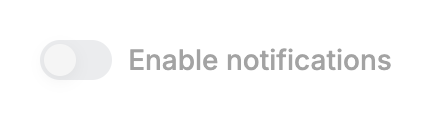 |

### Disabled / on

| Before | After |
| --- | --- |
| 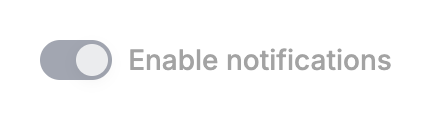 |  |

### All states and sizes (unchanged at rest)

| Before | After |
| --- | --- |
| 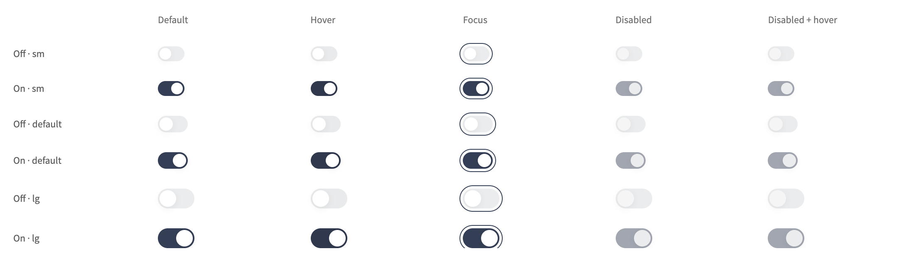 | 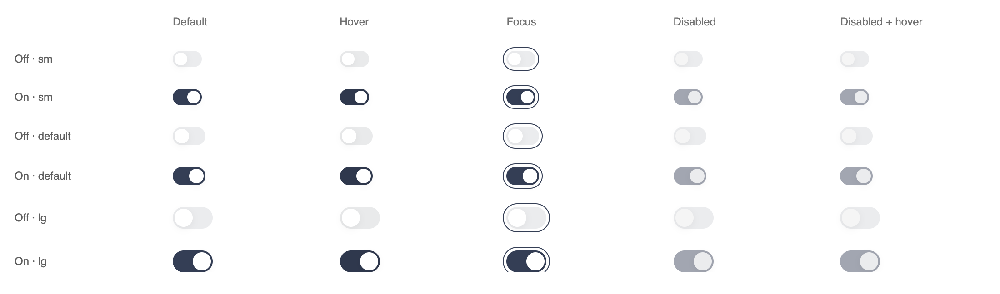 |

### Large (44 x 24)

| Before | After |
| --- | --- |
| 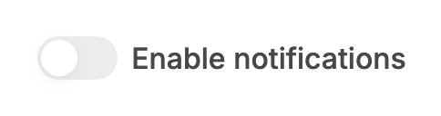 |  |

### Narrow width

| Before | After |
| --- | --- |
| 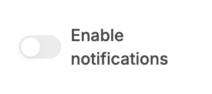 |  |

### Off / default

| Before | After |
| --- | --- |
| 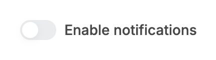 |  |

### Off / focus-visible

| Before | After |
| --- | --- |
| 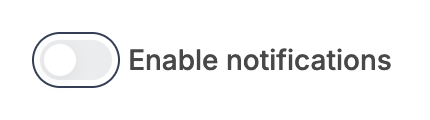 |  |

### Off / hover

| Before | After |
| --- | --- |
| 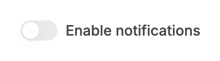 |  |

### On / default

| Before | After |
| --- | --- |
|  |  |

### On / focus-visible

| Before | After |
| --- | --- |
|  | 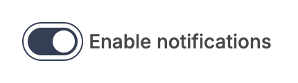 |

### On / hover

| Before | After |
| --- | --- |
| 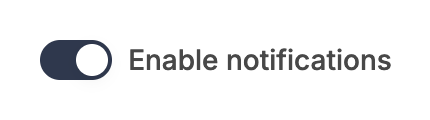 |  |

### Pressed / off

| Before | After |
| --- | --- |
|  | 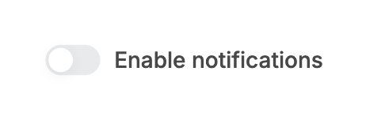 |

### Pressed / on

| Before | After |
| --- | --- |
| 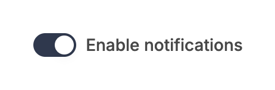 |  |

### Small (32 x 18)

| Before | After |
| --- | --- |
| 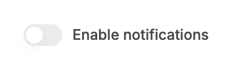 |  |

### Switching on (frame samples: thumb x, track colour)

| Before | After |
| --- | --- |
| 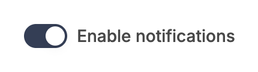 |  |

### New: description under the label

| Before | After |
| --- | --- |
| 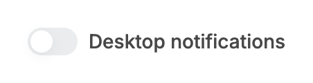 | 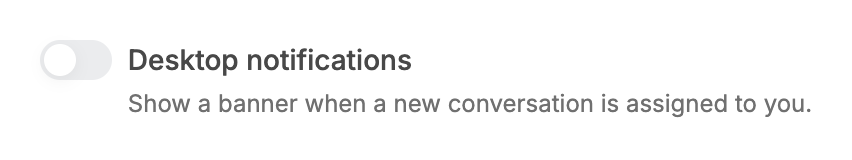 |

### New: description at 220px wide

| Before | After |
| --- | --- |
| 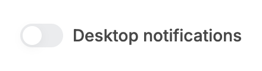 | 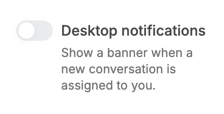 |

## Measured changes (copy these into Figma)

_Source: computed styles of the rendered component; px, hex colours, ms. Only properties that changed are listed._

### Disabled / off

| Element | Property | Before | After |
| --- | --- | --- | --- |
| Track | position | static | **relative** |
| Track | transition-property | color, background-color, border-color, text-decoration-color, fill, stroke | **color, background-color, border-color, transform** |
| Track | transition-duration | 0.24s | **0.24s, 0.24s, 0.24s, 0.2s** |
| Hit area (::before) | position | static | **absolute** |
| Hit area (::before) | top | auto | **-6px** |
| Hit area (::before) | right | auto | **-6px** |
| Hit area (::before) | bottom | auto | **-6px** |
| Hit area (::before) | left | auto | **-6px** |
| Hit area (::before) | width | auto | **44px** |
| Hit area (::before) | height | auto | **28px** |
| Hit area (::before) | content | none | **""** |

### Disabled / on

| Element | Property | Before | After |
| --- | --- | --- | --- |
| Track | position | static | **relative** |
| Track | transition-property | color, background-color, border-color, text-decoration-color, fill, stroke | **color, background-color, border-color, transform** |
| Track | transition-duration | 0.24s | **0.24s, 0.24s, 0.24s, 0.2s** |
| Hit area (::before) | position | static | **absolute** |
| Hit area (::before) | top | auto | **-6px** |
| Hit area (::before) | right | auto | **-6px** |
| Hit area (::before) | bottom | auto | **-6px** |
| Hit area (::before) | left | auto | **-6px** |
| Hit area (::before) | width | auto | **44px** |
| Hit area (::before) | height | auto | **28px** |
| Hit area (::before) | content | none | **""** |

### Large (44 x 24)

| Element | Property | Before | After |
| --- | --- | --- | --- |
| Track | position | static | **relative** |
| Track | transition-property | color, background-color, border-color, text-decoration-color, fill, stroke | **color, background-color, border-color, transform** |
| Track | transition-duration | 0.24s | **0.24s, 0.24s, 0.24s, 0.2s** |
| Hit area (::before) | position | static | **absolute** |
| Hit area (::before) | top | auto | **-6px** |
| Hit area (::before) | right | auto | **-6px** |
| Hit area (::before) | bottom | auto | **-6px** |
| Hit area (::before) | left | auto | **-6px** |
| Hit area (::before) | width | auto | **52px** |
| Hit area (::before) | height | auto | **32px** |
| Hit area (::before) | content | none | **""** |

### Narrow width

| Element | Property | Before | After |
| --- | --- | --- | --- |
| Track | position | static | **relative** |
| Track | transition-property | color, background-color, border-color, text-decoration-color, fill, stroke | **color, background-color, border-color, transform** |
| Track | transition-duration | 0.24s | **0.24s, 0.24s, 0.24s, 0.2s** |
| Hit area (::before) | position | static | **absolute** |
| Hit area (::before) | top | auto | **-6px** |
| Hit area (::before) | right | auto | **-6px** |
| Hit area (::before) | bottom | auto | **-6px** |
| Hit area (::before) | left | auto | **-6px** |
| Hit area (::before) | width | auto | **44px** |
| Hit area (::before) | height | auto | **28px** |
| Hit area (::before) | content | none | **""** |

### Off / default

| Element | Property | Before | After |
| --- | --- | --- | --- |
| Track | position | static | **relative** |
| Track | transition-property | color, background-color, border-color, text-decoration-color, fill, stroke | **color, background-color, border-color, transform** |
| Track | transition-duration | 0.24s | **0.24s, 0.24s, 0.24s, 0.2s** |
| Hit area (::before) | position | static | **absolute** |
| Hit area (::before) | top | auto | **-6px** |
| Hit area (::before) | right | auto | **-6px** |
| Hit area (::before) | bottom | auto | **-6px** |
| Hit area (::before) | left | auto | **-6px** |
| Hit area (::before) | width | auto | **44px** |
| Hit area (::before) | height | auto | **28px** |
| Hit area (::before) | content | none | **""** |

### Off / focus-visible

| Element | Property | Before | After |
| --- | --- | --- | --- |
| Track | position | static | **relative** |
| Track | transition-property | color, background-color, border-color, text-decoration-color, fill, stroke | **color, background-color, border-color, transform** |
| Track | transition-duration | 0.24s | **0.24s, 0.24s, 0.24s, 0.2s** |
| Hit area (::before) | position | static | **absolute** |
| Hit area (::before) | top | auto | **-6px** |
| Hit area (::before) | right | auto | **-6px** |
| Hit area (::before) | bottom | auto | **-6px** |
| Hit area (::before) | left | auto | **-6px** |
| Hit area (::before) | width | auto | **44px** |
| Hit area (::before) | height | auto | **28px** |
| Hit area (::before) | content | none | **""** |

### Off / hover

| Element | Property | Before | After |
| --- | --- | --- | --- |
| Track | position | static | **relative** |
| Track | transition-property | color, background-color, border-color, text-decoration-color, fill, stroke | **color, background-color, border-color, transform** |
| Track | transition-duration | 0.24s | **0.24s, 0.24s, 0.24s, 0.2s** |
| Hit area (::before) | position | static | **absolute** |
| Hit area (::before) | top | auto | **-6px** |
| Hit area (::before) | right | auto | **-6px** |
| Hit area (::before) | bottom | auto | **-6px** |
| Hit area (::before) | left | auto | **-6px** |
| Hit area (::before) | width | auto | **44px** |
| Hit area (::before) | height | auto | **28px** |
| Hit area (::before) | content | none | **""** |

### On / default

| Element | Property | Before | After |
| --- | --- | --- | --- |
| Track | position | static | **relative** |
| Track | transition-property | color, background-color, border-color, text-decoration-color, fill, stroke | **color, background-color, border-color, transform** |
| Track | transition-duration | 0.24s | **0.24s, 0.24s, 0.24s, 0.2s** |
| Hit area (::before) | position | static | **absolute** |
| Hit area (::before) | top | auto | **-6px** |
| Hit area (::before) | right | auto | **-6px** |
| Hit area (::before) | bottom | auto | **-6px** |
| Hit area (::before) | left | auto | **-6px** |
| Hit area (::before) | width | auto | **44px** |
| Hit area (::before) | height | auto | **28px** |
| Hit area (::before) | content | none | **""** |

### On / focus-visible

| Element | Property | Before | After |
| --- | --- | --- | --- |
| Track | position | static | **relative** |
| Track | transition-property | color, background-color, border-color, text-decoration-color, fill, stroke | **color, background-color, border-color, transform** |
| Track | transition-duration | 0.24s | **0.24s, 0.24s, 0.24s, 0.2s** |
| Hit area (::before) | position | static | **absolute** |
| Hit area (::before) | top | auto | **-6px** |
| Hit area (::before) | right | auto | **-6px** |
| Hit area (::before) | bottom | auto | **-6px** |
| Hit area (::before) | left | auto | **-6px** |
| Hit area (::before) | width | auto | **44px** |
| Hit area (::before) | height | auto | **28px** |
| Hit area (::before) | content | none | **""** |

### On / hover

| Element | Property | Before | After |
| --- | --- | --- | --- |
| Track | position | static | **relative** |
| Track | transition-property | color, background-color, border-color, text-decoration-color, fill, stroke | **color, background-color, border-color, transform** |
| Track | transition-duration | 0.24s | **0.24s, 0.24s, 0.24s, 0.2s** |
| Hit area (::before) | position | static | **absolute** |
| Hit area (::before) | top | auto | **-6px** |
| Hit area (::before) | right | auto | **-6px** |
| Hit area (::before) | bottom | auto | **-6px** |
| Hit area (::before) | left | auto | **-6px** |
| Hit area (::before) | width | auto | **44px** |
| Hit area (::before) | height | auto | **28px** |
| Hit area (::before) | content | none | **""** |

### Pressed / off

| Element | Property | Before | After |
| --- | --- | --- | --- |
| Track (pressed) | width | 36 | **34.56** |
| Track (pressed) | height | 20 | **19.2** |
| Track (pressed) | transform | none | **matrix(0.96, 0, 0, 0.96, 0, 0)** |
| Track (pressed) | transition-duration | 0.24s | **0.24s, 0.24s, 0.24s, 0.08s** |

### Pressed / on

| Element | Property | Before | After |
| --- | --- | --- | --- |
| Track (pressed) | width | 36 | **34.56** |
| Track (pressed) | height | 20 | **19.2** |
| Track (pressed) | transform | none | **matrix(0.96, 0, 0, 0.96, 0, 0)** |
| Track (pressed) | transition-duration | 0.24s | **0.24s, 0.24s, 0.24s, 0.08s** |

### Small (32 x 18)

| Element | Property | Before | After |
| --- | --- | --- | --- |
| Track | position | static | **relative** |
| Track | transition-property | color, background-color, border-color, text-decoration-color, fill, stroke | **color, background-color, border-color, transform** |
| Track | transition-duration | 0.24s | **0.24s, 0.24s, 0.24s, 0.2s** |
| Hit area (::before) | position | static | **absolute** |
| Hit area (::before) | top | auto | **-6px** |
| Hit area (::before) | right | auto | **-6px** |
| Hit area (::before) | bottom | auto | **-6px** |
| Hit area (::before) | left | auto | **-6px** |
| Hit area (::before) | width | auto | **40px** |
| Hit area (::before) | height | auto | **26px** |
| Hit area (::before) | content | none | **""** |

### Switching on (frame samples: thumb x, track colour)

| Element | Property | Before | After |
| --- | --- | --- | --- |
| Track | position | static | **relative** |
| Track | transition-property | color, background-color, border-color, text-decoration-color, fill, stroke | **color, background-color, border-color, transform** |
| Track | transition-duration | 0.24s | **0.24s, 0.24s, 0.24s, 0.2s** |
| Hit area (::before) | position | static | **absolute** |
| Hit area (::before) | top | auto | **-6px** |
| Hit area (::before) | right | auto | **-6px** |
| Hit area (::before) | bottom | auto | **-6px** |
| Hit area (::before) | left | auto | **-6px** |
| Hit area (::before) | width | auto | **44px** |
| Hit area (::before) | height | auto | **28px** |
| Hit area (::before) | content | none | **""** |

### New: description under the label

| Element | Property | Before | After |
| --- | --- | --- | --- |
| Control | position | static | **relative** |
| Control | transition-property | color, background-color, border-color, text-decoration-color, fill, stroke | **color, background-color, border-color, transform** |
| Control | transition-duration | 0.24s | **0.24s, 0.24s, 0.24s, 0.2s** |
| Hit area (::before) | position | static | **absolute** |
| Hit area (::before) | top | auto | **-6px** |
| Hit area (::before) | right | auto | **-6px** |
| Hit area (::before) | bottom | auto | **-6px** |
| Hit area (::before) | left | auto | **-6px** |
| Hit area (::before) | width | auto | **44px** |
| Hit area (::before) | height | auto | **28px** |
| Hit area (::before) | content | none | **""** |
| Label | width | 186.09 | **342.2** |
| Label | font-size | 16px | **14px** |
| Label | line-height | 24px | **20px** |
| Label | color | #5E5E5E | **#484848** |
| Label | font-weight | 400 | **500** |
| Description | _(new element)_ | — | present |
| Row (wrapper) | width | 186.09 | **386.2** |
| Row (wrapper) | height | 20 | **40** |
| Row (wrapper) | align-items | center | **flex-start** |

### New: description at 220px wide

| Element | Property | Before | After |
| --- | --- | --- | --- |
| Control | position | static | **relative** |
| Control | transition-property | color, background-color, border-color, text-decoration-color, fill, stroke | **color, background-color, border-color, transform** |
| Control | transition-duration | 0.24s | **0.24s, 0.24s, 0.24s, 0.2s** |
| Hit area (::before) | position | static | **absolute** |
| Hit area (::before) | top | auto | **-6px** |
| Hit area (::before) | right | auto | **-6px** |
| Hit area (::before) | bottom | auto | **-6px** |
| Hit area (::before) | left | auto | **-6px** |
| Hit area (::before) | width | auto | **44px** |
| Hit area (::before) | height | auto | **28px** |
| Hit area (::before) | content | none | **""** |
| Label | width | 186.09 | **144** |
| Label | font-size | 16px | **14px** |
| Label | line-height | 24px | **20px** |
| Label | color | #5E5E5E | **#484848** |
| Label | font-weight | 400 | **500** |
| Description | _(new element)_ | — | present |
| Row (wrapper) | width | 186.09 | **188** |
| Row (wrapper) | height | 20 | **72** |
| Row (wrapper) | align-items | center | **flex-start** |

## Motion

| What | Before | After |
| --- | --- | --- |
| Press | none | **Track scale 1 to .96 in 80ms; back in 200ms, spring. The thumb does not stretch. Disabled switches do not press** |
| Thumb glide, track colour | 240ms spring | **Unchanged** |
| Reduced motion | Thumb snaps, colour fades | **Also no press scale** |

## States to update in Figma

- Switch / pressed (track 96%) for on and off, all sizes (new)
- Switch / hit area: sm 40 x 26, default 44 x 28, lg 52 x 32 (annotation)
- Switch with description (new variant)

## How to apply in Figma

1. Wrap each Switch size in a transparent frame 4px larger on every side (sm 40 x 26, default 44 x 28, lg 52 x 32); the visible track stays 32 x 18 / 36 x 20 / 44 x 24 and layout width is unchanged (ignore auto layout or -4px margins).
2. Add 'Pressed' variants (on and off): the TRACK only at scale 96% (thumb scales with it as a child; no width change on the thumb). Smart Animate 80ms ease-out down, 200ms Gentle spring back.
3. Add an optional 'Description' to the labelled Switch: Inter 12px / 16px regular --v2-text-muted #707070, 4px under the label; auto layout horizontal, gap 8px, align top; the label row is as tall as the track (sm 18, default 20, lg 24). Label-left mirrors it. Disabled: text block 50% opacity.
4. Colours are unchanged: on --semantic-primary #343E55 (hover --semantic-primary-hover #2F384D), off --semantic-primary-surface #EBECEE (hover --semantic-border-layout #E9EAEB), thumb #FFFFFF with the existing shadow.

## Notes

- Description spacing is 4px (matches Radio's actual code) rather than the 2px quoted in the task.
- Hover colour changes are now `@media (hover: hover)` only, so they no longer stick after a tap on touch screens.
- Hit area implementation: `before:-inset-[6px]`, not `-inset-1`: the offset is measured from the padding box, which excludes the 2px border. Measured with elementFromPoint in Chrome: the ring is 40 x 26 / 44 x 28 / 52 x 32 for sm / default / lg; 3.9px outside hits the switch, 5px outside does not.
