# Table: UI change report for Figma

Figma source: [https://www.figma.com/design/q84boKV4Bly9HKXzdtBj2K/New-Design-System---MyO?node-id=924-8961](https://www.figma.com/design/q84boKV4Bly9HKXzdtBj2K/New-Design-System---MyO?node-id=924-8961)  
Storybook: `V2/Components/Table`  
Date: 2026-10-04

## Summary

Selected rows now read as selected (light blue #ECF1FB) instead of looking identical to hover (#F5F5F5). Sortable column headers show a small arrow that turns over when the sort flips, or (with the new opt-in `sortable` prop) a faint two-way glyph when the column can be sorted but is not; the header exposes aria-sort. A new optional stickyHeader keeps the column headers in view while rows scroll, and hover fills no longer stick after a tap.

### Why (what the research found)

- Untitled UI, HeroUI and Mantine tables all tint selected rows differently from hover; in v2 both were #F5F5F5, so a selected row vanished under the pointer.
- HeroUI, Mantine and React Aria show a muted two-way sort glyph on sortable-but-unsorted columns that strengthens on hover, and a single arrow for the active column; React Aria and the WAI-ARIA authoring guide put aria-sort on the th.
- Mantine (stickyHeader) and HeroUI (isHeaderSticky) pin the header inside a bounded scroll area with a divider; collapsed table borders do not travel with a stuck cell, so the divider has to be drawn on the cell itself.
- shadcn and Radix Themes gate hover fills behind hover-capable pointers so a tapped row does not stay highlighted on touch screens.

### API / compatibility

No prop, callback, aria-label or DOM-contract changes. v2 remains a drop-in for v1 (`npm run verify:v1-v2-compat` passes).

## Before and after

### Default (Overview)

| Before | After |
| --- | --- |
|  | 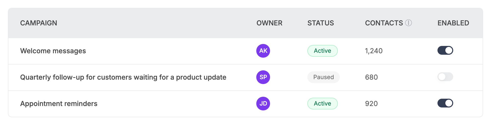 |

### Row hover

| Before | After |
| --- | --- |
|  | 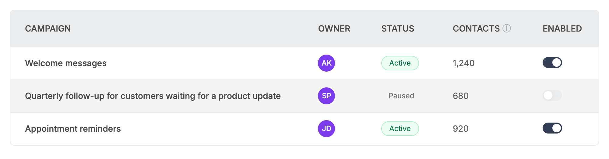 |

### Selected row (pointer elsewhere)

| Before | After |
| --- | --- |
| 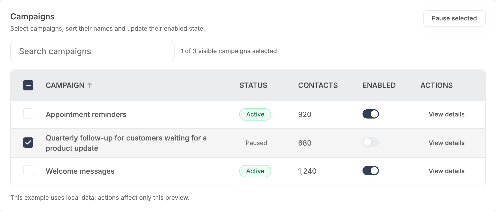 | 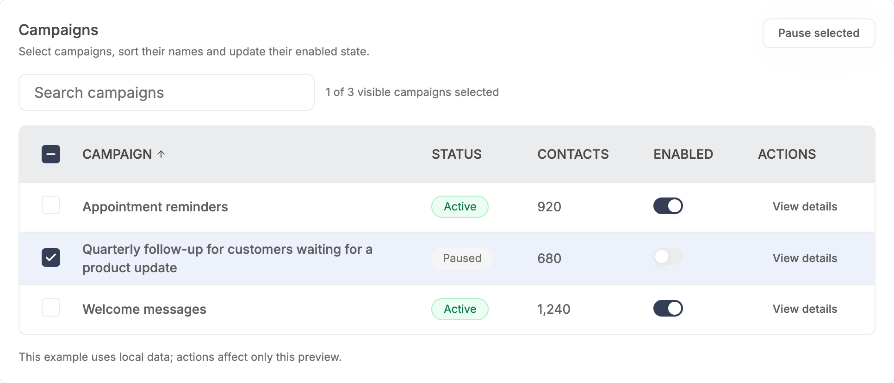 |

### Selected row under the pointer

| Before | After |
| --- | --- |
|  |  |

### Sorted column, ascending

| Before | After |
| --- | --- |
|  | 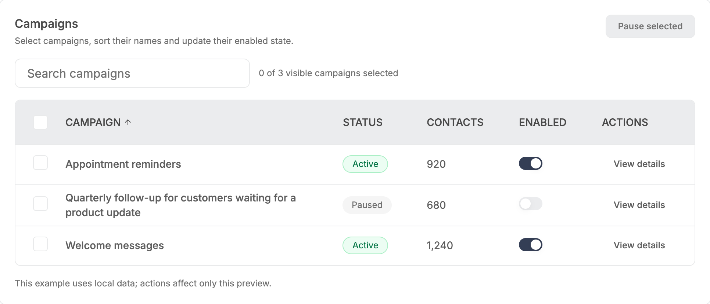 |

### Sorted column, header hovered

| Before | After |
| --- | --- |
|  | 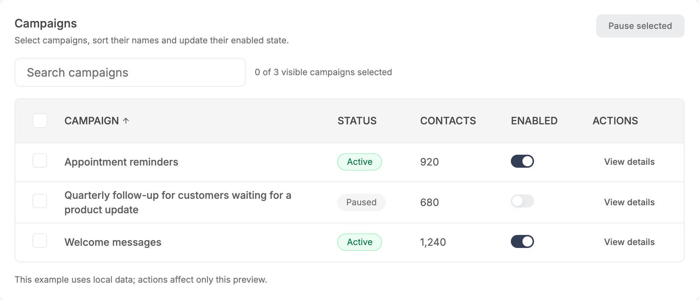 |

### Sorted column after flipping to descending

| Before | After |
| --- | --- |
| 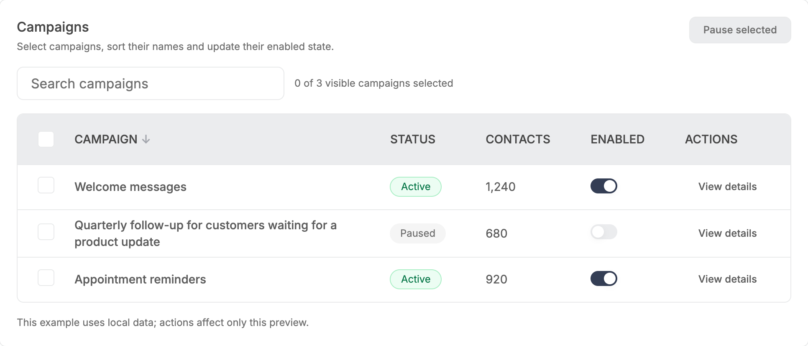 |  |

### Loading skeleton

| Before | After |
| --- | --- |
| 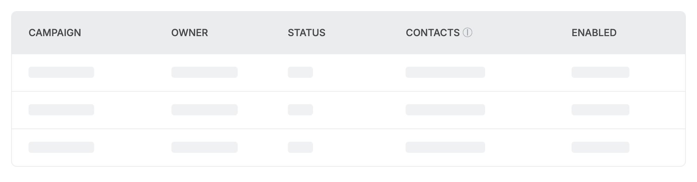 | 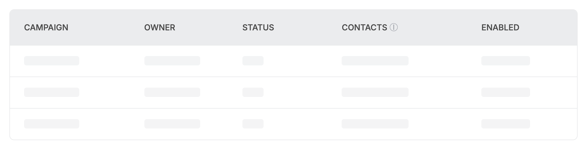 |

### Empty

| Before | After |
| --- | --- |
|  | 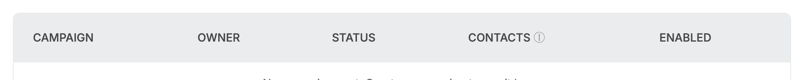 |

### Narrow viewport (360px)

| Before | After |
| --- | --- |
|  | 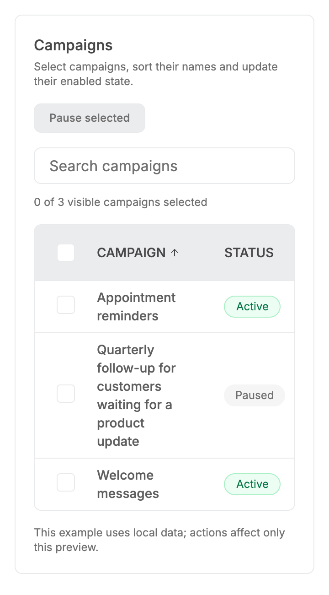 |

### Sortable headers: ascending, plain and unsorted

| Before | After |
| --- | --- |
| 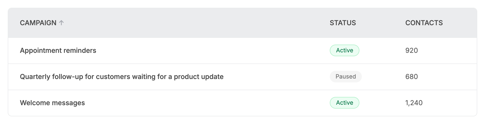 | 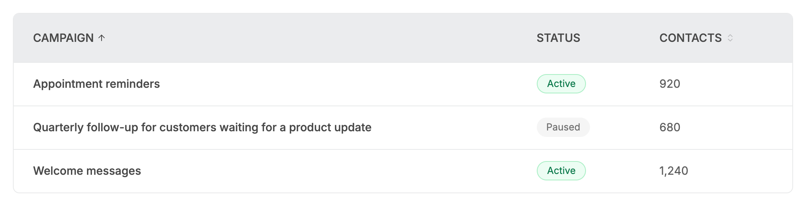 |

### Unsorted sortable header hovered

| Before | After |
| --- | --- |
| 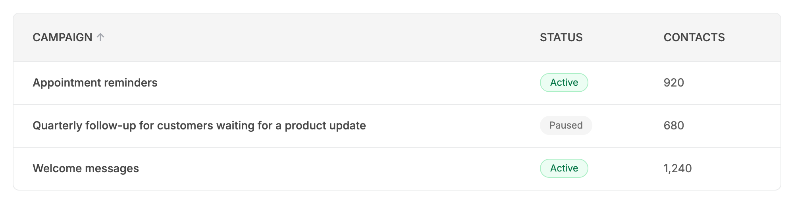 | 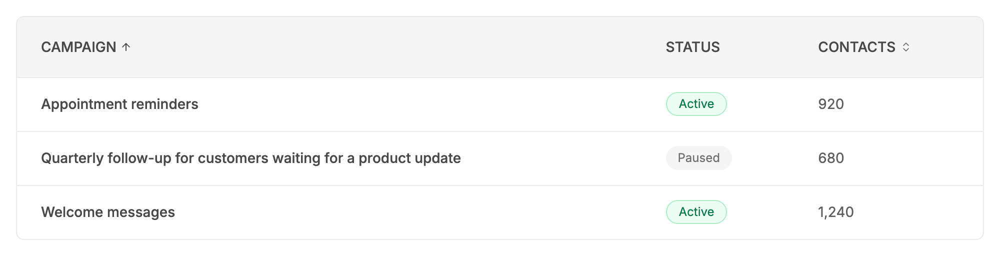 |

### Sortable headers after a click (descending)

| Before | After |
| --- | --- |
| 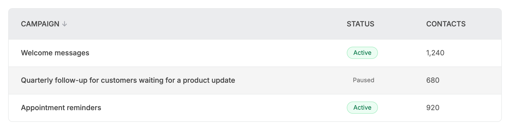 | 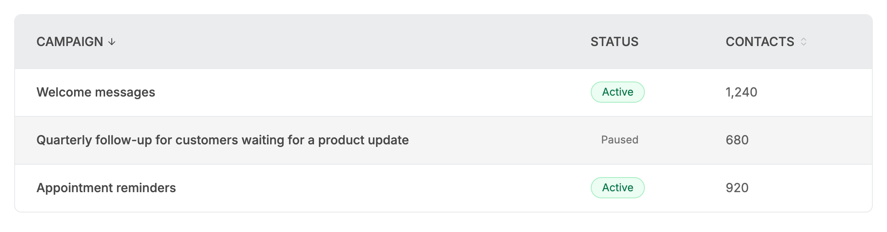 |

### Focusable header cell with keyboard focus

| Before | After |
| --- | --- |
| 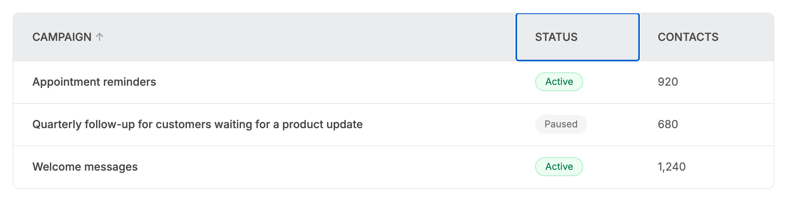 | 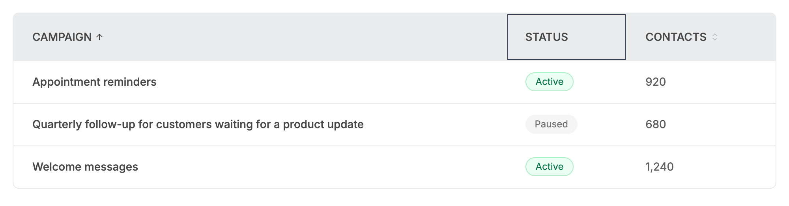 |

### Focusable row with keyboard focus

| Before | After |
| --- | --- |
| 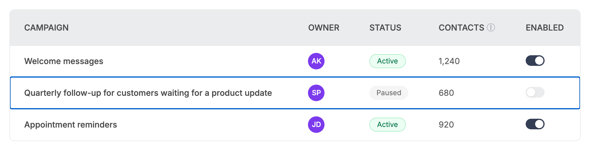 | 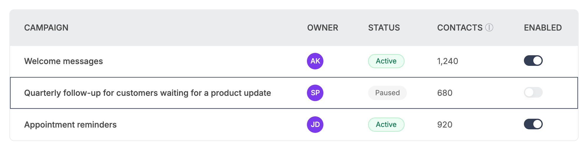 |

### Tall table in a 320px frame (header at the top)

| Before | After |
| --- | --- |
| 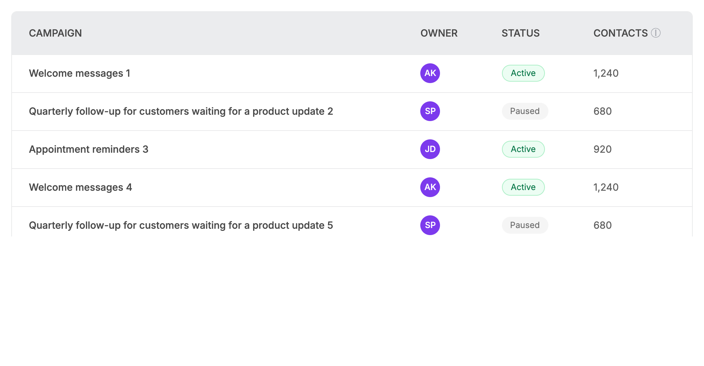 | 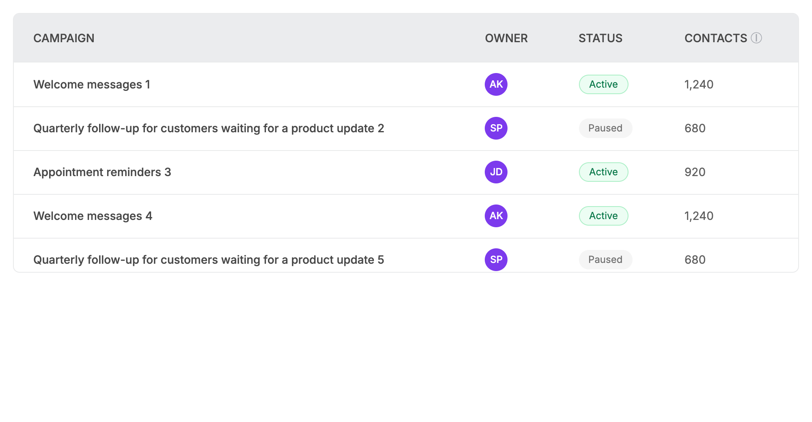 |

### Tall table scrolled 200px (before: header scrolls away; after: header pinned)

| Before | After |
| --- | --- |
| 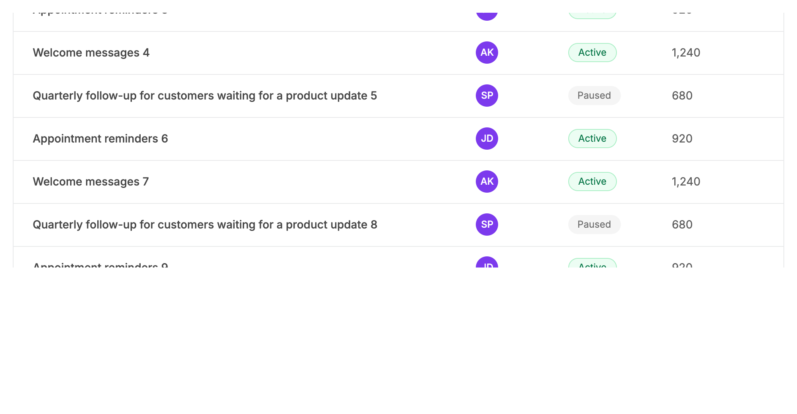 | 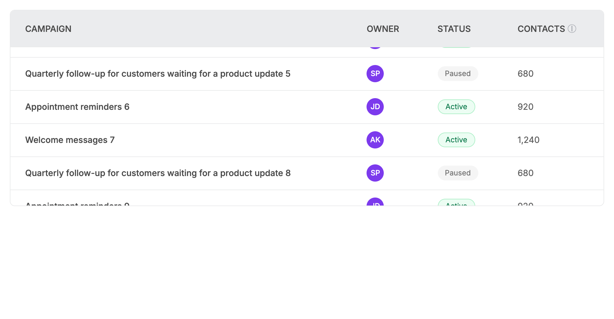 |

### Skeleton rows (stagger)

| Before | After |
| --- | --- |
|  | 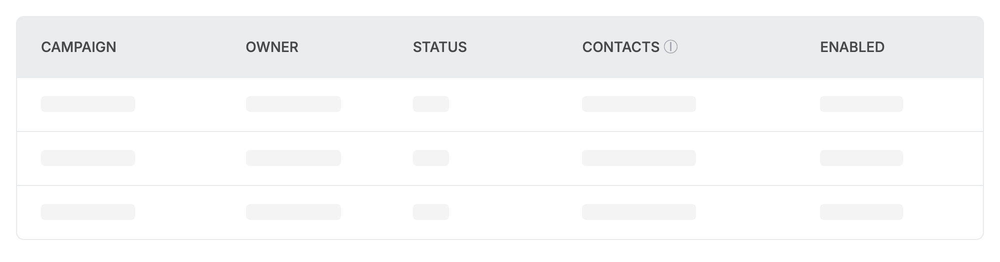 |

## Measured changes (copy these into Figma)

_Source: computed styles of the rendered component; px, hex colours, ms. Only properties that changed are listed._

### Selected row (pointer elsewhere)

| Element | Property | Before | After |
| --- | --- | --- | --- |
| Body row 2 (tr) | background-color | #F5F5F5 | **#ECF1FB** |

### Selected row under the pointer

| Element | Property | Before | After |
| --- | --- | --- | --- |
| Body row 2 (tr) | background-color | #F5F5F5 | **#ECF1FB** |

### Sorted column, ascending

| Element | Property | Before | After |
| --- | --- | --- | --- |
| Sort glyph | width | 12.03px | **12px** |
| Sort glyph | height | 20px | **12px** |
| Sort glyph | color | #A4A7AE | **#484848** |
| Sort arrow icon | _(new element)_ | — | present |

### Sorted column, header hovered

| Element | Property | Before | After |
| --- | --- | --- | --- |
| Sort glyph | width | 12.03px | **12px** |
| Sort glyph | height | 20px | **12px** |
| Sort glyph | color | #A4A7AE | **#484848** |
| Sort arrow icon | _(new element)_ | — | present |

### Sorted column after flipping to descending

| Element | Property | Before | After |
| --- | --- | --- | --- |
| Sort glyph | width | 12.03px | **12px** |
| Sort glyph | height | 20px | **12px** |
| Sort glyph | color | #A4A7AE | **#484848** |
| Sort arrow icon | _(new element)_ | — | present |

### Loading skeleton

| Element | Property | Before | After |
| --- | --- | --- | --- |
| Skeleton bar | animation-delay | 0s | **0.06s** |

### Narrow viewport (360px)

| Element | Property | Before | After |
| --- | --- | --- | --- |
| Header cell (th) | width | 139.52 | **139.48** |
| Body row 2 (tr) | width | 686.08 | **686.05** |
| Body cell (td) | width | 139.52 | **139.48** |

### Sortable headers: ascending, plain and unsorted

| Element | Property | Before | After |
| --- | --- | --- | --- |
| Sorted header (th) | width | 638.88 | **624.77** |
| Sorted glyph | width | 12.03px | **12px** |
| Sorted glyph | height | 20px | **12px** |
| Sorted glyph | color | #A4A7AE | **#484848** |
| Unsorted sortable header (th) | width | 171.28 | **188.84** |
| Unsorted sortable header (th) | cursor | auto | **pointer** |
| Unsorted sortable glyph | _(new element)_ | — | present |
| Plain header (th) | width | 155.84 | **152.39** |
| Sorted arrow icon | _(new element)_ | — | present |

### Unsorted sortable header hovered

| Element | Property | Before | After |
| --- | --- | --- | --- |
| Unsorted sortable header (th) | width | 171.28 | **188.84** |
| Unsorted sortable header (th) | cursor | auto | **pointer** |
| Unsorted sortable glyph | _(new element)_ | — | present |

### Sortable headers after a click (descending)

| Element | Property | Before | After |
| --- | --- | --- | --- |
| Sorted glyph | width | 12.03px | **12px** |
| Sorted glyph | height | 20px | **12px** |
| Sorted glyph | color | #A4A7AE | **#484848** |
| Sorted arrow icon | _(new element)_ | — | present |

### Focusable header cell with keyboard focus

| Element | Property | Before | After |
| --- | --- | --- | --- |
| Focused header cell (th) | width | 155.84 | **152.39** |
| Focused header cell (th) | outline-style | auto | **solid** |

### Focusable row with keyboard focus

| Element | Property | Before | After |
| --- | --- | --- | --- |
| Body row 2 (tr) | outline-style | auto | **solid** |
| Body row 2 (tr) | outline-offset | 0px | **-1px** |

### Tall table in a 320px frame (header at the top)

| Element | Property | Before | After |
| --- | --- | --- | --- |
| Header cell (th) | background-color | transparent | **#EBECEE** |
| Header cell (th) | position | static | **sticky** |
| Header cell (th) | top | auto | **0px** |
| Header cell (th) | z-index | auto | **20** |
| Header cell (th) | box-shadow | none | **transparent 0, transparent 0, #E9EAEB 0px -1px 0px 0px inset** |

### Tall table scrolled 200px (before: header scrolls away; after: header pinned)

| Element | Property | Before | After |
| --- | --- | --- | --- |
| Header cell (th) | background-color | transparent | **#EBECEE** |
| Header cell (th) | position | static | **sticky** |
| Header cell (th) | top | auto | **0px** |
| Header cell (th) | z-index | auto | **20** |
| Header cell (th) | box-shadow | none | **transparent 0, transparent 0, #E9EAEB 0px -1px 0px 0px inset** |
| Header cell (th) | inset-block-start | auto | **0px** |

### Skeleton rows (stagger)

| Element | Property | Before | After |
| --- | --- | --- | --- |
| Skeleton bar row 3 | animation-delay | 0s | **0.12s** |

## Motion

| What | Before | After |
| --- | --- | --- |
| Sorted arrow when direction flips | none (the glyph text swaps) | **12px arrow rotates 180deg, 150ms, ease-out cubic-bezier(0.16,1,0.3,1); no rotation under reduced motion** |
| Unsorted sort glyph on header hover | none (no glyph) | **opacity 40% -> 100%, 150ms (hover-capable pointers only)** |
| Row hover / selection fill | 150ms colour fade | **unchanged 150ms colour fade; hover fill now only on hover-capable pointers** |
| Loading skeleton rows | all rows pulse together (2s) | **each row starts 60ms after the one above (row 1 0ms, row 2 60ms, row 3 120ms); reduced motion: no pulse** |

## States to update in Figma

- Table row / default: fill none (white), 1px bottom divider #E9EAEB.
- Table row / hover: fill #F5F5F5 (--semantic-bg-ui). Unchanged value; only applies on hover-capable pointers.
- Table row / selected: fill #ECF1FB (--semantic-info-surface) instead of #F5F5F5. NEW distinct state.
- Table row / selected + hover: stays #ECF1FB (no darker step).
- Table row / highlighted (existing prop): unchanged, #ECF1FB.
- Table row / focus-visible (only when the host makes a row focusable): 1px outline #343E55 (--semantic-primary) drawn inside the row (offset -1px).
- Header cell / sortable-unsorted: NEW 12px chevrons-up-down glyph, #707070 at 40% opacity, 4px gap after the label.
- Header cell / sortable-unsorted + hover: glyph at 100% opacity.
- Header cell / sorted ascending: 12px arrow-up, #484848, 4px gap after the label (was a 14px text arrow, #A4A7AE).
- Header cell / sorted descending: same arrow rotated 180deg (arrow-down).
- Header cell / focus-visible (only when the host makes the th focusable): 1px outline #343E55 inside the cell (offset -2px).
- Header / sticky (NEW variant): header cells fill #EBECEE, 1px bottom divider #E9EAEB drawn inside the cell, layered above the rows.
- Info icon (ⓘ) in headers: unchanged.

## How to apply in Figma

1. Row fills: on the Table Row component add a variant 'selected'. Fill #ECF1FB (token semantic/info-surface). Keep 'hover' at #F5F5F5 (semantic/bg-ui). Selected+hover uses the same #ECF1FB. Row heights are unchanged: sm 48, md 54, lg 60; header row stays 60; cell padding 24px horizontal.
2. Sortable header, sorted: after the label add an icon 'arrow-up' 12x12 (stroke 2, rounded caps), colour #484848 (v2/text-primary), gap 4px (auto-layout, centre aligned). For descending use the same icon rotated 180deg (variants: asc / desc). Delete the old 14px text glyph '↑ / ↓' (#A4A7AE).
3. Sortable header, unsorted: add variant 'sortable' (opt-in, matches the `sortable` prop) with icon 'chevrons-up-down' 12x12 (stroke 2), colour #707070 (v2/text-muted), layer opacity 40%. In the hover variant of that header set the icon opacity to 100%. Non-sortable headers get no icon.
4. Prototype: sorted icon rotation 180deg, smart-animate, ease-out (custom bezier 0.16, 1, 0.3, 1), 150ms. Idle icon hover: dissolve 150ms.
5. Sticky header variant: header cells keep fill #EBECEE; replace the 1px row border under the header with an INSIDE bottom stroke 1px #E9EAEB on each header cell (the border does not travel with a pinned cell). The header sits above scrolled rows (z-index 20, above sticky first-column cells at 10).
6. Scroll frame: for the sticky header the table frame is the scroll area with a max height (for example 320). Mark the frame 'clip content' and 'vertical scroll'.
7. Focus: any cell/row a product makes focusable shows a 1px #343E55 outline inside the box (row: offset -1, header and body cells: offset -2).
8. Skeleton rows: each skeleton bar is 16px high, radius 4px, fill #E9EAEB, widths 60% / 80% / 30% / 60% (unchanged). Pulse stays 2s; in a prototype delay row N by N x 60ms (0, 60, 120, 180, 240).
9. Touch: hover fills (row #F5F5F5, idle sort glyph at 100%) exist only for mouse/trackpad; there is no hover variant to design for touch.

## Notes

- DECIDED (compat): `sortDirection={null}` keeps v1's meaning (not sorted; nothing shown, no pointer cursor, no aria-sort). The faint 'sortable but unsorted' glyph, pointer cursor and aria-sort="none" are opt-in through the new additive `sortable` prop on TableHead. In Figma, build the 'sortable' variant as an option, not as the default state of an unsorted header.
- stickyHeader is on Table (not TableHeader): the Table frame is the vertical scroll area, so it needs a height limit. Set the custom property --v2-table-max-height on any ancestor (for example the Tailwind class [--v2-table-max-height:320px]) or a max-height on the direct parent (the frame inherits it). Without a limit the frame never scrolls and the header just does not stick (same as today). This was not in the brief: the brief assumed a bare prop would work, but the frame (overflow-auto) is the nearest scroller, so a limit has to reach it somehow.
- Sticky header cells use z-20 (brief said z-10): sticky first-column body cells are z-10 and come later in the DOM, so z-10 would paint them over the header while scrolling.
- The v1 text arrow ('↑' / '↓') is kept in the DOM as a visually hidden, aria-hidden span so v1 tests and stories that query the text still pass; the visible arrow is an inline SVG (no new icon dependency).
- Skeleton rows in the table keep animate-pulse (the v1 test table.test.tsx asserts the class); they stagger 60ms per row through the --v2-skeleton-delay custom property. A shimmer table skeleton would need a new prop and was not done; use Skeleton animation='shimmer' for custom layouts.
- Focus rings on cells/rows only appear if the host makes them focusable (tabIndex). The sort control itself should be a button inside the th (as in the stories), which keeps its own ring.
- Not verified: the selected-row tint on touch devices, Safari sticky thead behaviour (sticky is applied to th cells, which Safari supports).
- Research conclusions in 'why' come from the task brief; I did not re-verify them against each library.
