# Tabs: UI change report for Figma

Figma source: [https://www.figma.com/design/q84boKV4Bly9HKXzdtBj2K/New-Design-System---MyO?node-id=924-12601](https://www.figma.com/design/q84boKV4Bly9HKXzdtBj2K/New-Design-System---MyO?node-id=924-12601)  
Storybook: `V2/Components/Tabs`  
Date: 2026-10-04

## Summary

TabsList gains an optional variant. "underline" (default) renders exactly what it did before. The new "pill" is a segmented control: a grey 4px-padded track with a white cursor that glides to the selected tab using the existing spring. Hover colour is now gated to hover-capable pointers, so a tap on a touch screen no longer leaves a tab in its hover colour.

### Why (what the research found)

- HeroUI and shadcn/ui ship a segmented "solid/pill" Tabs style next to the underline style; a moving cursor on a grey track reads as one control and works for 2-4 mutually exclusive views (filters, status switches) where an underline rail is too light.
- HeroUI's Tabs CSS and Mantine's FloatingIndicator both measure the selected target and animate position and size; we already do this for the underline rail (design/V2-MOTION.md), so the pill reuses the same measured spring instead of adding motion code.
- React Aria's hover handling ignores hover emulated by touch; `@media (hover: hover)` gives the same behaviour in CSS and removes the sticky-hover look on phones.
- Research references (HeroUI, Mantine, shadcn/ui, Untitled UI, React Aria) come from the task brief's research conclusions; they were not re-verified source by source while implementing.

### API / compatibility

Additive only: optional TabsList `variant` ("underline" | "pill", default "underline"). Tabs, TabsTrigger, TabsContent and TabsCount are unchanged. Underline computed styles are identical in all 9 captured underline scenarios (0 differences); the only markup change is the hover class gated with `[@media(hover:hover)]:`, which renders the same on desktop. Keyboard behaviour (Radix roving focus), aria attributes and Tab order are untouched.

## Before and after

### Underline, horizontal (default, unchanged)

| Before | After |
| --- | --- |
| 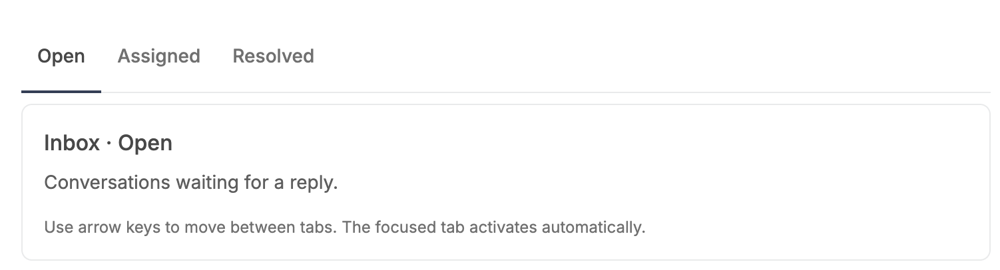 |  |

### Underline with counts (unchanged)

| Before | After |
| --- | --- |
| 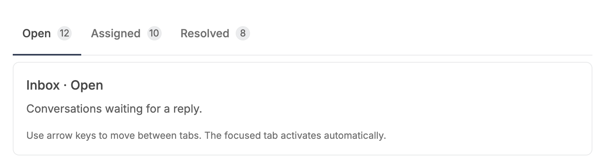 |  |

### Underline with a disabled tab (unchanged)

| Before | After |
| --- | --- |
| 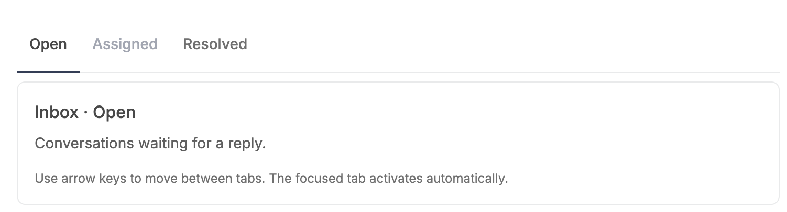 |  |

### Underline, keyboard focus (unchanged)

| Before | After |
| --- | --- |
|  | 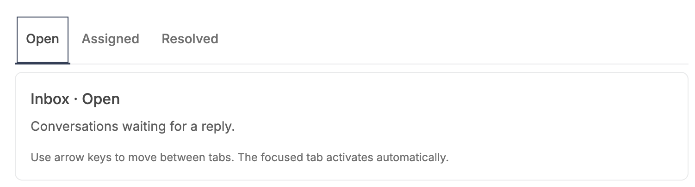 |

### Underline, full width with counts (unchanged)

| Before | After |
| --- | --- |
|  | 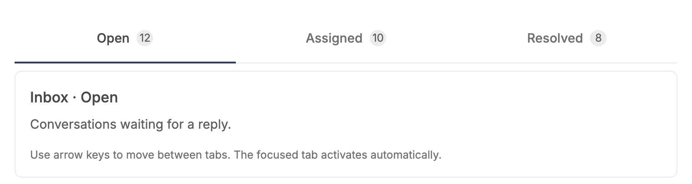 |

### Underline, hover on an inactive tab (unchanged on desktop)

| Before | After |
| --- | --- |
| 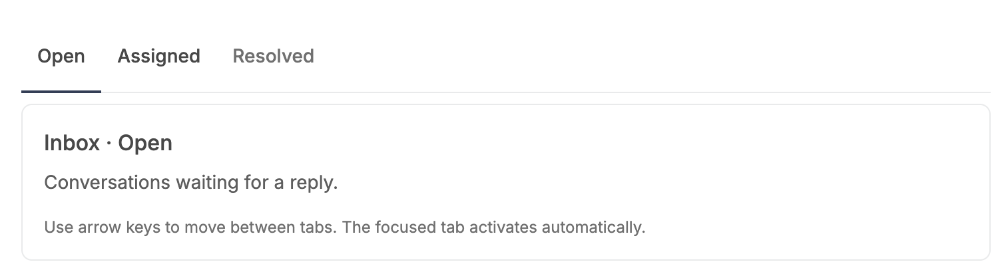 |  |

### NEW Pill, horizontal (before = the underline style, the only style that existed)

| Before | After |
| --- | --- |
|  | 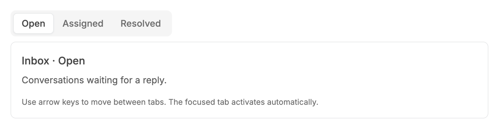 |

### NEW Pill with counts

| Before | After |
| --- | --- |
|  | 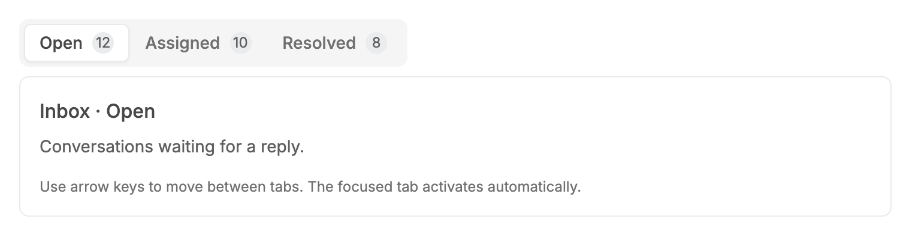 |

### NEW Pill with a disabled tab

| Before | After |
| --- | --- |
|  | 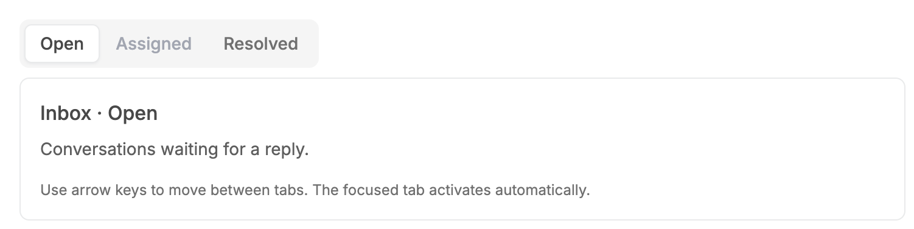 |

### NEW Pill, keyboard focus on the selected tab

| Before | After |
| --- | --- |
|  | 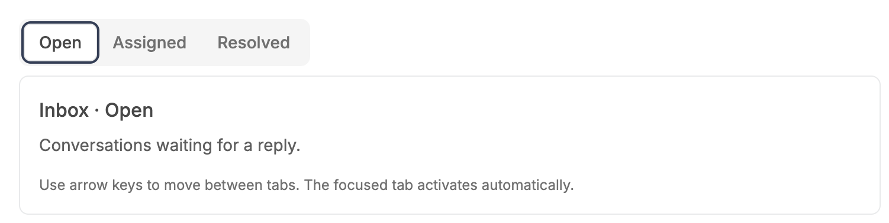 |

### NEW Pill, full width with counts

| Before | After |
| --- | --- |
|  | 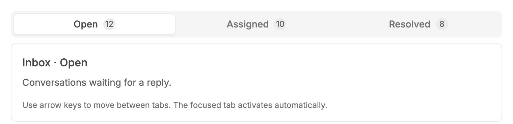 |

### NEW Pill, hover on an inactive tab

| Before | After |
| --- | --- |
|  | 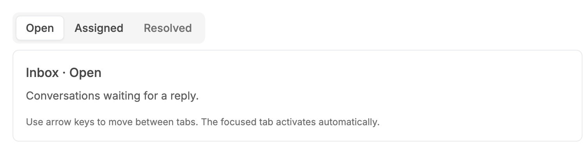 |

### NEW Pill after selecting "Resolved" (cursor settled)

| Before | After |
| --- | --- |
| 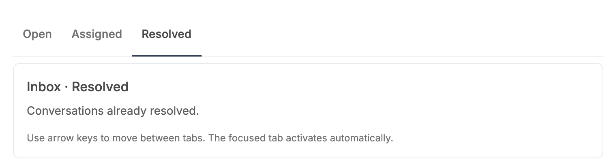 | 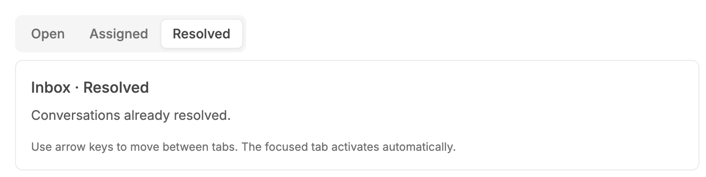 |

### NEW Pill, vertical

| Before | After |
| --- | --- |
|  | 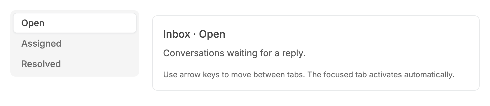 |

### Underline, vertical (unchanged)

| Before | After |
| --- | --- |
|  |  |

### Underline, vertical, keyboard focus (unchanged)

| Before | After |
| --- | --- |
| 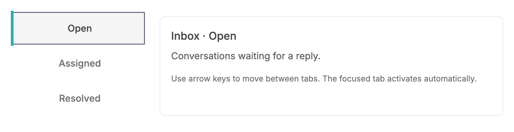 |  |

### Underline, vertical, hover (unchanged)

| Before | After |
| --- | --- |
| 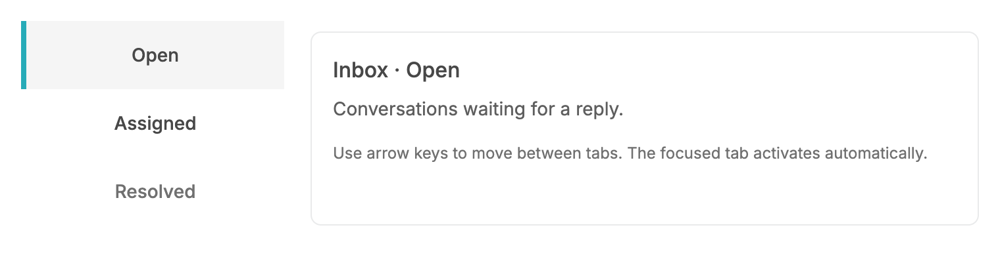 |  |

## Measured changes (copy these into Figma)

_Source: computed styles of the rendered component; px, hex colours, ms. Only properties that changed are listed._

### NEW Pill, horizontal (before = the underline style, the only style that existed)

| Element | Property | Before | After |
| --- | --- | --- | --- |
| Tab list | width | 728 | **246.16** |
| Tab list | height | 54 | **40** |
| Tab list | background-color | transparent | **#F5F5F5** |
| Tab list | border-radius | 0px | **8px** |
| Tab list | border-bottom-width | 1px | **0px** |
| Tab list | border-bottom-color | #E9EAEB | **#E5E7EB** |
| Tab list | padding-top | 0px | **4px** |
| Tab list | padding-left | 0px | **4px** |
| Tab list | isolation | auto | **isolate** |
| Tab (active) | width | 60.09 | **62.09** |
| Tab (active) | height | 54 | **32** |
| Tab (active) | border-radius | 0px | **6px** |
| Tab (active) | border-bottom-width | 2px | **1px** |
| Tab (active) | border-left-width | 0px | **1px** |
| Tab (active) | padding-top | 16px | **0px** |
| Tab (active) | box-shadow | none | **transparent 0, transparent 0, transparent 0** |
| Tab (inactive) | width | 86.56 | **88.56** |
| Tab (inactive) | height | 54 | **32** |
| Tab (inactive) | border-radius | 0px | **6px** |
| Tab (inactive) | border-bottom-width | 2px | **1px** |
| Tab (inactive) | border-left-width | 0px | **1px** |
| Tab (inactive) | padding-top | 16px | **0px** |

### NEW Pill with counts

| Element | Property | Before | After |
| --- | --- | --- | --- |
| Tab list | width | 728 | **324.16** |
| Tab list | height | 54 | **40** |
| Tab list | background-color | transparent | **#F5F5F5** |
| Tab list | border-radius | 0px | **8px** |
| Tab list | border-bottom-width | 1px | **0px** |
| Tab list | border-bottom-color | #E9EAEB | **#E5E7EB** |
| Tab list | padding-top | 0px | **4px** |
| Tab list | padding-left | 0px | **4px** |
| Tab list | isolation | auto | **isolate** |
| Tab (active) | width | 86.09 | **88.09** |
| Tab (active) | height | 54 | **32** |
| Tab (active) | border-radius | 0px | **6px** |
| Tab (active) | border-bottom-width | 2px | **1px** |
| Tab (active) | border-left-width | 0px | **1px** |
| Tab (active) | padding-top | 16px | **0px** |
| Tab (active) | box-shadow | none | **transparent 0, transparent 0, transparent 0** |
| Tab (inactive) | width | 112.56 | **114.56** |
| Tab (inactive) | height | 54 | **32** |
| Tab (inactive) | border-radius | 0px | **6px** |
| Tab (inactive) | border-bottom-width | 2px | **1px** |
| Tab (inactive) | border-left-width | 0px | **1px** |
| Tab (inactive) | padding-top | 16px | **0px** |

### NEW Pill with a disabled tab

| Element | Property | Before | After |
| --- | --- | --- | --- |
| Tab list | width | 728 | **246.16** |
| Tab list | height | 54 | **40** |
| Tab list | background-color | transparent | **#F5F5F5** |
| Tab list | border-radius | 0px | **8px** |
| Tab list | border-bottom-width | 1px | **0px** |
| Tab list | border-bottom-color | #E9EAEB | **#E5E7EB** |
| Tab list | padding-top | 0px | **4px** |
| Tab list | padding-left | 0px | **4px** |
| Tab list | isolation | auto | **isolate** |
| Tab (active) | width | 60.09 | **62.09** |
| Tab (active) | height | 54 | **32** |
| Tab (active) | border-radius | 0px | **6px** |
| Tab (active) | border-bottom-width | 2px | **1px** |
| Tab (active) | border-left-width | 0px | **1px** |
| Tab (active) | padding-top | 16px | **0px** |
| Tab (active) | box-shadow | none | **transparent 0, transparent 0, transparent 0** |
| Tab (inactive) | width | 86.56 | **88.56** |
| Tab (inactive) | height | 54 | **32** |
| Tab (inactive) | border-radius | 0px | **6px** |
| Tab (inactive) | border-bottom-width | 2px | **1px** |
| Tab (inactive) | border-left-width | 0px | **1px** |
| Tab (inactive) | padding-top | 16px | **0px** |
| Tab (disabled) | width | 86.56 | **88.56** |
| Tab (disabled) | height | 54 | **32** |
| Tab (disabled) | border-radius | 0px | **6px** |
| Tab (disabled) | border-bottom-width | 2px | **1px** |
| Tab (disabled) | border-left-width | 0px | **1px** |
| Tab (disabled) | padding-top | 16px | **0px** |

### NEW Pill, keyboard focus on the selected tab

| Element | Property | Before | After |
| --- | --- | --- | --- |
| Tab list | width | 728 | **246.16** |
| Tab list | height | 54 | **40** |
| Tab list | background-color | transparent | **#F5F5F5** |
| Tab list | border-radius | 0px | **8px** |
| Tab list | border-bottom-width | 1px | **0px** |
| Tab list | border-bottom-color | #E9EAEB | **#E5E7EB** |
| Tab list | padding-top | 0px | **4px** |
| Tab list | padding-left | 0px | **4px** |
| Tab list | isolation | auto | **isolate** |
| Tab (active) | width | 60.09 | **62.09** |
| Tab (active) | height | 54 | **32** |
| Tab (active) | border-radius | 0px | **6px** |
| Tab (active) | border-bottom-width | 2px | **1px** |
| Tab (active) | border-left-width | 0px | **1px** |
| Tab (active) | padding-top | 16px | **0px** |
| Tab (active) | box-shadow | none | **transparent 0, transparent 0, transparent 0** |
| Tab (active) | outline-width | 1px | **2px** |
| Tab (active) | outline-offset | -3px | **0px** |
| Tab (inactive) | width | 86.56 | **88.56** |
| Tab (inactive) | height | 54 | **32** |
| Tab (inactive) | border-radius | 0px | **6px** |
| Tab (inactive) | border-bottom-width | 2px | **1px** |
| Tab (inactive) | border-left-width | 0px | **1px** |
| Tab (inactive) | padding-top | 16px | **0px** |

### NEW Pill, full width with counts

| Element | Property | Before | After |
| --- | --- | --- | --- |
| Tab list | height | 54 | **40** |
| Tab list | background-color | transparent | **#F5F5F5** |
| Tab list | border-radius | 0px | **8px** |
| Tab list | border-bottom-width | 1px | **0px** |
| Tab list | border-bottom-color | #E9EAEB | **#E5E7EB** |
| Tab list | padding-top | 0px | **4px** |
| Tab list | padding-left | 0px | **4px** |
| Tab list | isolation | auto | **isolate** |
| Tab (active) | width | 242.66 | **240** |
| Tab (active) | height | 54 | **32** |
| Tab (active) | border-radius | 0px | **6px** |
| Tab (active) | border-bottom-width | 2px | **1px** |
| Tab (active) | border-left-width | 0px | **1px** |
| Tab (active) | padding-top | 16px | **0px** |
| Tab (active) | box-shadow | none | **transparent 0, transparent 0, transparent 0** |
| Tab (inactive) | width | 242.67 | **240** |
| Tab (inactive) | height | 54 | **32** |
| Tab (inactive) | border-radius | 0px | **6px** |
| Tab (inactive) | border-bottom-width | 2px | **1px** |
| Tab (inactive) | border-left-width | 0px | **1px** |
| Tab (inactive) | padding-top | 16px | **0px** |

### NEW Pill, hover on an inactive tab

| Element | Property | Before | After |
| --- | --- | --- | --- |
| Tab list | width | 728 | **246.16** |
| Tab list | height | 54 | **40** |
| Tab list | background-color | transparent | **#F5F5F5** |
| Tab list | border-radius | 0px | **8px** |
| Tab list | border-bottom-width | 1px | **0px** |
| Tab list | border-bottom-color | #E9EAEB | **#E5E7EB** |
| Tab list | padding-top | 0px | **4px** |
| Tab list | padding-left | 0px | **4px** |
| Tab list | isolation | auto | **isolate** |
| Tab (active) | width | 60.09 | **62.09** |
| Tab (active) | height | 54 | **32** |
| Tab (active) | border-radius | 0px | **6px** |
| Tab (active) | border-bottom-width | 2px | **1px** |
| Tab (active) | border-left-width | 0px | **1px** |
| Tab (active) | padding-top | 16px | **0px** |
| Tab (active) | box-shadow | none | **transparent 0, transparent 0, transparent 0** |
| Tab (inactive) | width | 86.56 | **88.56** |
| Tab (inactive) | height | 54 | **32** |
| Tab (inactive) | border-radius | 0px | **6px** |
| Tab (inactive) | border-bottom-width | 2px | **1px** |
| Tab (inactive) | border-left-width | 0px | **1px** |
| Tab (inactive) | padding-top | 16px | **0px** |

### NEW Pill after selecting "Resolved" (cursor settled)

| Element | Property | Before | After |
| --- | --- | --- | --- |
| Tab list | width | 728 | **246.16** |
| Tab list | height | 54 | **40** |
| Tab list | background-color | transparent | **#F5F5F5** |
| Tab list | border-radius | 0px | **8px** |
| Tab list | border-bottom-width | 1px | **0px** |
| Tab list | border-bottom-color | #E9EAEB | **#E5E7EB** |
| Tab list | padding-top | 0px | **4px** |
| Tab list | padding-left | 0px | **4px** |
| Tab list | isolation | auto | **isolate** |
| Tab (active) | width | 85.5 | **87.5** |
| Tab (active) | height | 54 | **32** |
| Tab (active) | border-radius | 0px | **6px** |
| Tab (active) | border-bottom-width | 2px | **1px** |
| Tab (active) | border-left-width | 0px | **1px** |
| Tab (active) | padding-top | 16px | **0px** |
| Tab (active) | box-shadow | none | **transparent 0, transparent 0, transparent 0** |
| Tab (inactive) | width | 60.09 | **62.09** |
| Tab (inactive) | height | 54 | **32** |
| Tab (inactive) | border-radius | 0px | **6px** |
| Tab (inactive) | border-bottom-width | 2px | **1px** |
| Tab (inactive) | border-left-width | 0px | **1px** |
| Tab (inactive) | padding-top | 16px | **0px** |

### NEW Pill, vertical

| Element | Property | Before | After |
| --- | --- | --- | --- |
| Tab list | height | 156 | **104** |
| Tab list | background-color | transparent | **#F5F5F5** |
| Tab list | border-radius | 0px | **8px** |
| Tab list | border-bottom-color | #E9EAEB | **#E5E7EB** |
| Tab list | padding-top | 0px | **4px** |
| Tab list | padding-left | 0px | **4px** |
| Tab list | isolation | auto | **isolate** |
| Tab (active) | width | 200 | **192** |
| Tab (active) | height | 52 | **32** |
| Tab (active) | background-color | #F5F5F5 | **transparent** |
| Tab (active) | border-radius | 0px | **6px** |
| Tab (active) | border-bottom-width | 0px | **1px** |
| Tab (active) | border-left-width | 4px | **1px** |
| Tab (active) | padding-top | 16px | **0px** |
| Tab (active) | padding-left | 24px | **12px** |
| Tab (active) | box-shadow | none | **transparent 0, transparent 0, transparent 0** |
| Tab (inactive) | width | 200 | **192** |
| Tab (inactive) | height | 52 | **32** |
| Tab (inactive) | border-radius | 0px | **6px** |
| Tab (inactive) | border-bottom-width | 0px | **1px** |
| Tab (inactive) | border-left-width | 4px | **1px** |
| Tab (inactive) | padding-top | 16px | **0px** |
| Tab (inactive) | padding-left | 24px | **12px** |

## Motion

| What | Before | After |
| --- | --- | --- |
| Pill cursor between tabs | n/a (new style) | **Same velocity-preserving critically damped spring as the underline rail: mass 1, stiffness 900, damping 60 (omega 30 rad/s), animates x, y, width and height, retargets mid-flight with its current velocity. Snaps on first render, resize, font load and prefers-reduced-motion.** |
| Tab label colour on hover | 150ms ease-out on pointer hover (also stuck after a tap) | **150ms ease-out, only on hover-capable pointers** |
| Underline rail / vertical side indicator | Measured spring | **Unchanged** |

## States to update in Figma

- Tabs / Pill (NEW variant set, mirrors the existing Tabs variants): Orientation = horizontal | vertical, Width = auto | full, Count = off | on
- Tabs / Pill / Tab: Selected, Unselected, Hover (unselected), Focus (keyboard), Disabled
- Tabs / Pill / Cursor: one white rounded rectangle behind the tab labels, sized to the selected tab
- Tabs / Underline (all existing variants): no visual change; hover is only applied on hover-capable pointers (prototype note, no Figma value changes)

## How to apply in Figma

1. Create a new variant property Style = Underline | Pill on the Tabs component set. Keep every existing variant as Style = Underline with no edits.
2. Pill / List frame (name it "Tabs list"): auto layout horizontal, padding 4 on all sides, item spacing 0, align items center, hug contents (width), height hugs to 40. Fill #F5F5F5 (token semantic-bg-ui). No stroke. Corner radius 8. There is no bottom divider line in this style.
3. Pill / Tab frame: auto layout horizontal, fixed height 32, width hugs, padding left/right 12, padding top/bottom 0, align items center, justify center, item spacing 8 (between label and count). Corner radius 6. Fill none. Stroke 1px inside, transparent (it only reserves the pixel so the tab stays 32 high).
4. Pill / Tab label: Inter, 14px / 20px line height, weight 500 (Medium), letter spacing 0.014px. Colour Unselected #707070 (--v2-text-muted); Selected and Hover #484848 (--v2-text-primary). Disabled #A2A6B1 (semantic-disabled-primary). Hover colour change is 150ms ease-out.
5. Pill / Cursor (new layer named "Tab cursor", placed BEHIND the tab labels and ignoring auto layout, absolute position): same width and height as the selected tab (e.g. "Open" = 62.09 x 32 at x 4, y 4 for the 3-tab example), fill #FFFFFF (semantic-bg-primary), stroke 1px inside #E9EAEB (semantic-border-layout), corner radius 6, effect Drop shadow X 0, Y 1, blur 2, spread 0, colour rgba(16,24,40,0.05) (the repo token --shadow-xs, "Shadow/xs"). The selected tab itself has no fill or stroke; only the cursor is drawn.
6. Pill / Tab / Focus (keyboard): add an outside outline 2px #343E55 (semantic-primary), offset 0, corner radius follows the tab (6, so 8 on the outside edge). It sits on the focused tab, including the selected one.
7. Pill / Count: reuse the existing 18 x 18 count circle unchanged (fill #EBECEE, 0.4px #E9EAEB stroke, 12px text #5E5E5E).
8. Pill / Full width: list fills the container (width = fill), each tab flex 1 (fill container), label and count centred. Auto width: list hugs its tabs (the 3-tab example is 246.16 x 40).
9. Pill / Vertical: list auto layout vertical, padding 4, item spacing 0, hugs height (3 tabs = 104), width fixed by the layout (200 in the story). Tabs fill the list width (192), height 32, label left-aligned. The cursor is 192 x 32 and moves on the Y axis. The list does not stretch to the panel height.
10. Prototype: switch the cursor between tab positions with Smart animate and a Spring (mass 1, stiffness 900, damping 60). Selecting must update the label colour immediately; only the cursor glides. Do not animate the first frame.

## Notes

- The shadow uses the existing token --shadow-xs (rgba(16,24,40,0.05), 0 1px 2px) rather than the brief's rgba(12,15,18,0.05): same geometry and alpha, the base colour differs by a few RGB points at 5% opacity (not visible) and the token avoids a new hard-coded colour. Swap one class if the literal value is preferred.
- Pill list width is hug-contents (w-fit) by default, not the underline's 100%; use fullWidth for a full-width control.
- Before first measurement (server render, hidden Docs sample, zero geometry) the selected pill tab paints its own white/bordered pill, so selection is never invisible; once the cursor is measured the tab goes transparent so nothing is drawn twice. A Figma designer does not need to model this.
- The `pill` scenarios use `&args=variant:pill`; Storybook ignores the unknown arg before the change, so their "before" shows the underline render of the same story.
- Underline default: markup differs only by the hover class gated with `[@media(hover:hover)]:` (computed styles identical on desktop). The brief asked for hover gating on Tabs and for the default to stay as it renders; these are reconciled this way. The focus ring of the underline style was left as is (1px, offset -3px, visible in the BEFORE capture).
- Not implemented (not required this pass): scrollable overflow for many tabs; the pill's vertical orientation is a straightforward extension and was included.
- The measured tables cannot read pseudo-elements, so the pill cursor (the list's ::after) is recorded in the `evals` of pill*.after.json. For the 3-tab example: position absolute, 62.0938 x 32, transform translate(4px, 4px), background #FFFFFF, border 1px solid #E9EAEB, radius 6px, box-shadow 0 1px 2px 0 rgba(16,24,40,0.05), z-index -10 (behind the labels), opacity 1. Vertical: 192 x 32 at translate(4px, 4px).
- In the tables, `Tab list border-bottom-color #E5E7EB` is only the browser's default colour on a border that is now 0px wide; the pill list has no bottom border.
- Underline scenarios (horizontal*, vertical*): 0 computed-style differences between before and after, and identical cursor geometry; this is why they list no rows.
- Research references (HeroUI, Mantine, shadcn/ui, Untitled UI, React Aria) come from the task brief's research conclusions; they were not re-verified source by source while implementing.
