# TextField (with the shared Textarea and PhoneInput message reveal): UI change report for Figma

Figma source: [https://www.figma.com/design/q84boKV4Bly9HKXzdtBj2K/New-Design-System---MyO?node-id=924-7628](https://www.figma.com/design/q84boKV4Bly9HKXzdtBj2K/New-Design-System---MyO?node-id=924-7628)  
Storybook: `V2/Components/TextField (also V2/Components/Textarea, V2/Components/PhoneInput)`  
Date: 2026-10-04

## Summary

A validation or helper message that appears after the field is on screen now glides open (height, 240ms spring) instead of popping in and shoving everything below it down; the text fades in with a 2px slide, and under reduced motion the height snaps and only the fade stays. The error message is now announced politely by screen readers (aria-live). The clear (x) button of a clearable TextField fades and scales in and out instead of popping, and its pointer target grows from 16px to 32px. Nothing changes at rest.

### Why (what the research found)

- Mantine, HeroUI and React Aria render field errors in a region that animates its height rather than inserting a line of text; Untitled UI and Radix Themes keep the message in an aria-live region so it is announced when it changes.
- A message that appears and shoves the form below it is the commonest source of layout shift in forms (it also moves the button the user is about to click); gliding it over 240ms with the shared v2 spring removes the jump.
- Clear buttons in HeroUI and Mantine fade in with the first character; a 16px icon is far below the 24px minimum pointer target (WCAG 2.5.8), so the target is enlarged invisibly to 32px.

### API / compatibility

No prop, callback, aria-label or DOM-contract changes. v2 remains a drop-in for v1 (`npm run verify:v1-v2-compat` passes).

## Before and after

### PhoneInput / error: message gap 6px to 4px

| Before | After |
| --- | --- |
| 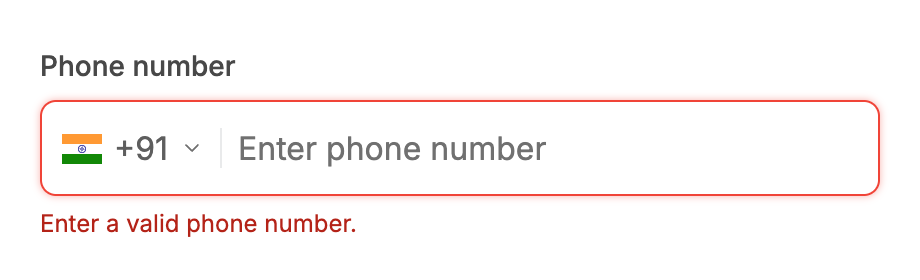 | 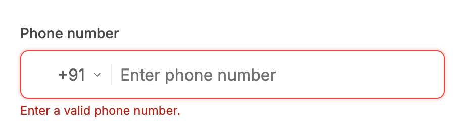 |

### PhoneInput / error appears after Save (frame samples)

| Before | After |
| --- | --- |
| 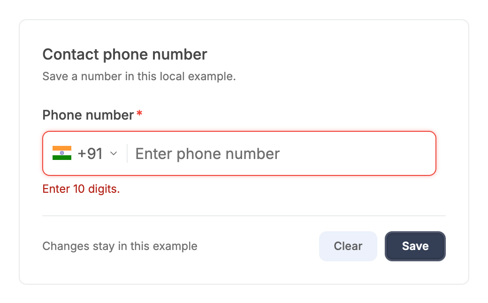 | 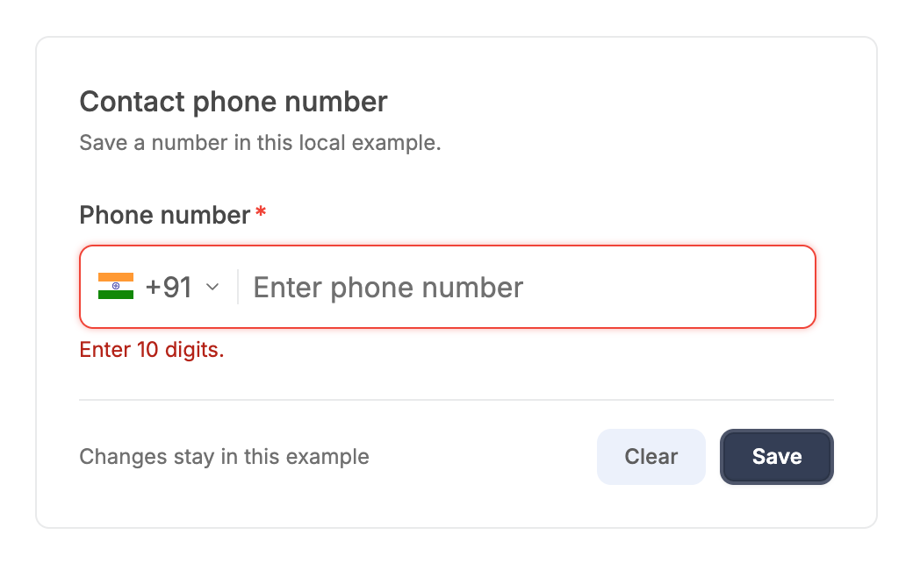 |

### Textarea / error appears after Save (frame samples)

| Before | After |
| --- | --- |
|  | 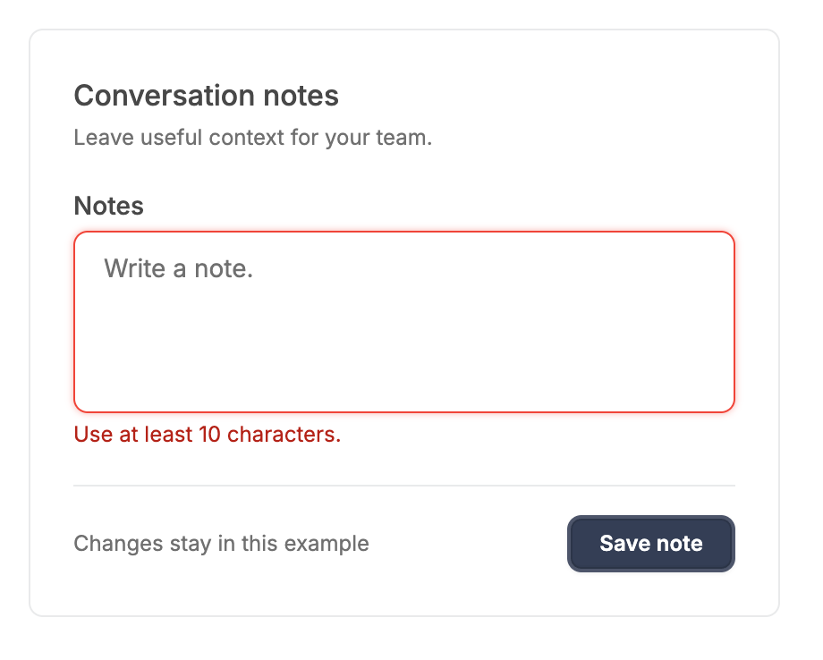 |

### TextField / error appears after Save (frame samples: gap between field and Save row)

| Before | After |
| --- | --- |
|  | 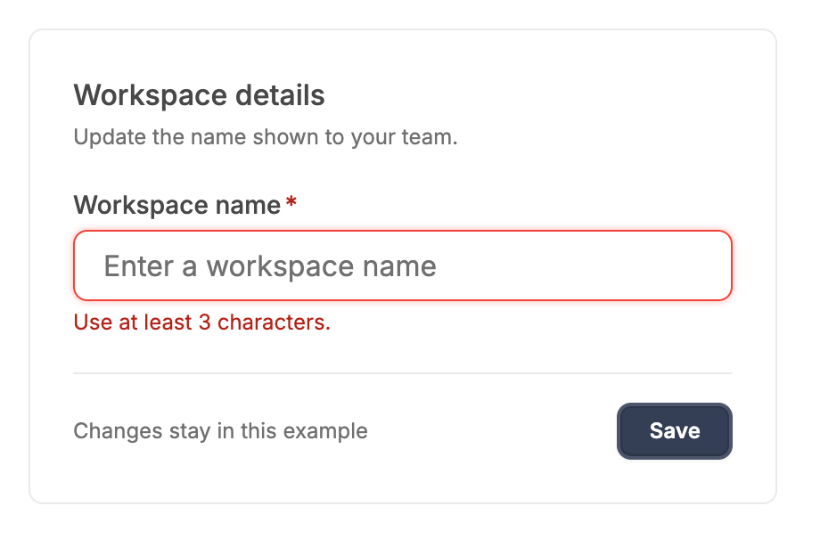 |

### Textarea / error with icon, role=alert (unchanged)

| Before | After |
| --- | --- |
| 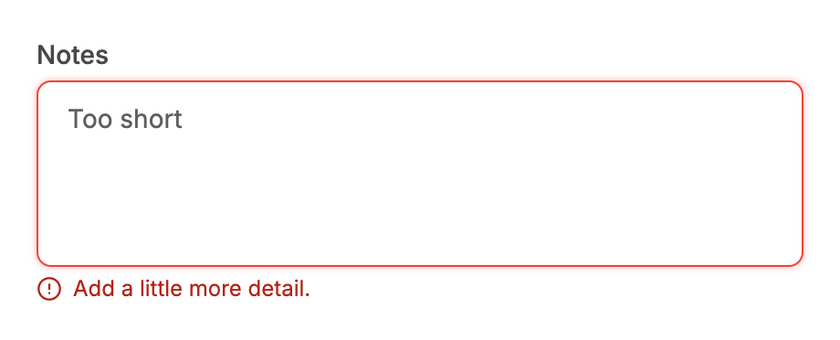 |  |

### Textarea / helper text (unchanged at rest)

| Before | After |
| --- | --- |
| 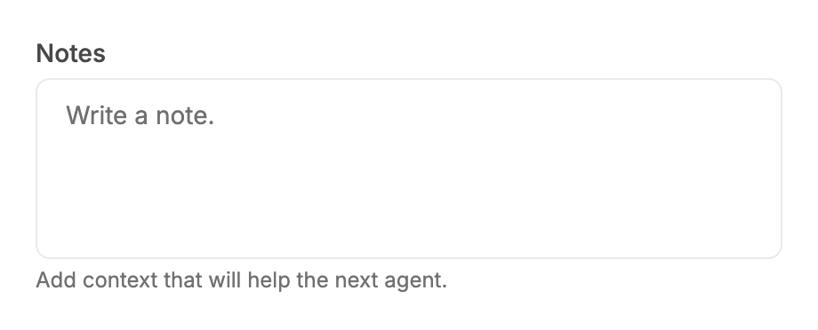 |  |

### Clearable / first character typed: the button fades and scales in (frame samples in the JSON)

| Before | After |
| --- | --- |
| 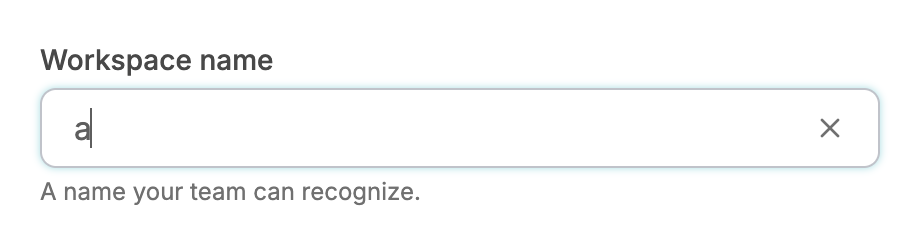 |  |

### Clearable / after clearing: the button stays mounted but invisible

| Before | After |
| --- | --- |
|  |  |

### Clearable / filled: clear button and its 32px hit area

| Before | After |
| --- | --- |
| 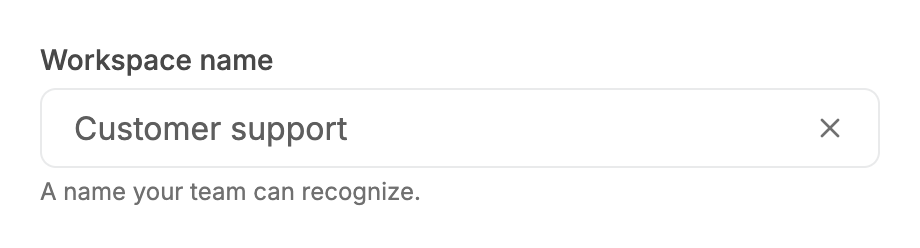 |  |

### Clearable / hover on the clear button

| Before | After |
| --- | --- |
|  |  |

### TextField / default with helper text (unchanged)

| Before | After |
| --- | --- |
|  |  |

### TextField / disabled (unchanged)

| Before | After |
| --- | --- |
| 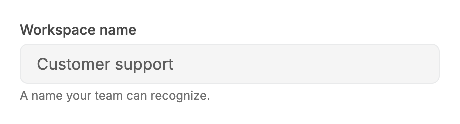 |  |

### TextField / error with message (unchanged at rest)

| Before | After |
| --- | --- |
| 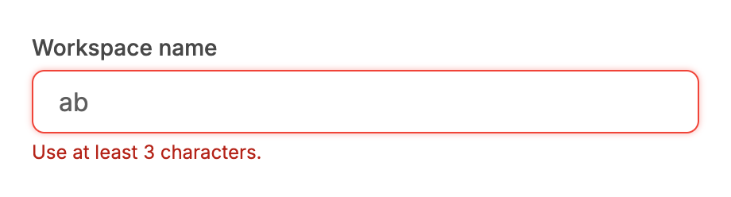 |  |

### TextField / error at 320px wide (unchanged)

| Before | After |
| --- | --- |
| 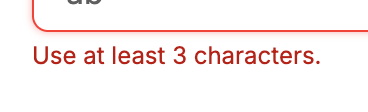 |  |

### TextField / focus via Tab (unchanged)

| Before | After |
| --- | --- |
|  | 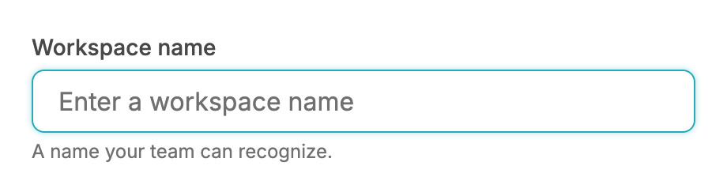 |

### TextField / hover (unchanged)

| Before | After |
| --- | --- |
|  | 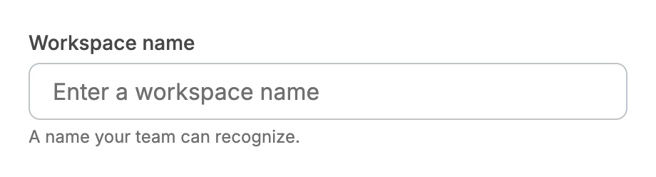 |

## Measured changes (copy these into Figma)

_Source: computed styles of the rendered component; px, hex colours, ms. Only properties that changed are listed._

### PhoneInput / error: message gap 6px to 4px

| Element | Property | Before | After |
| --- | --- | --- | --- |
| Message wrapper | height | 70 | **68** |
| Message wrapper | gap | 6px | **4px** |
| Message wrapper | row-gap | 6px | **4px** |

### PhoneInput / error appears after Save (frame samples)

| Element | Property | Before | After |
| --- | --- | --- | --- |
| Message wrapper | height | 70 | **68** |
| Message wrapper | gap | 6px | **4px** |
| Message wrapper | row-gap | 6px | **4px** |

### Textarea / error appears after Save (frame samples)

| Element | Property | Before | After |
| --- | --- | --- | --- |
| Message row (container) | display | flex | **grid** |
| Message row (container) | grid-template-rows | none | **16px** |
| Message row (container) | transition-property | all | **grid-template-rows, margin-top** |
| Error message | width | 149.81 | **370** |

### TextField / error appears after Save (frame samples: gap between field and Save row)

| Element | Property | Before | After |
| --- | --- | --- | --- |
| Message row (container) | display | flex | **grid** |
| Message row (container) | grid-template-rows | none | **16px** |
| Message row (container) | transition-property | all | **grid-template-rows, margin-top** |
| Message row (container) | transition-duration | 0s | **0.24s** |
| Error message | width | 144.78 | **370** |

### Textarea / error with icon, role=alert (unchanged)

| Element | Property | Before | After |
| --- | --- | --- | --- |
| Error (role=alert) | width | 150.14 | **420** |

### Textarea / helper text (unchanged at rest)

| Element | Property | Before | After |
| --- | --- | --- | --- |
| Message row (container) | display | flex | **grid** |
| Message row (container) | grid-template-rows | none | **16px** |
| Helper text | width | 231.67 | **420** |

### Clearable / first character typed: the button fades and scales in (frame samples in the JSON)

| Element | Property | Before | After |
| --- | --- | --- | --- |
| Clear button | transform | none | **matrix(1, 0, 0, 1, 0, 0)** |
| Clear button | transition-property | color, background-color, border-color, text-decoration-color, fill, stroke | **color, opacity, transform, margin-left, visibility** |

### Clearable / after clearing: the button stays mounted but invisible

| Element | Property | Before | After |
| --- | --- | --- | --- |
| Clear button (hidden state) | _(new element)_ | — | present |

### Clearable / filled: clear button and its 32px hit area

| Element | Property | Before | After |
| --- | --- | --- | --- |
| Clear button | transform | none | **matrix(1, 0, 0, 1, 0, 0)** |
| Clear button | transition-property | color, background-color, border-color, text-decoration-color, fill, stroke | **color, opacity, transform, margin-left, visibility** |
| Clear button hit area (::before) | position | static | **absolute** |
| Clear button hit area (::before) | top | auto | **-8px** |
| Clear button hit area (::before) | right | auto | **-8px** |
| Clear button hit area (::before) | bottom | auto | **-8px** |
| Clear button hit area (::before) | left | auto | **-8px** |
| Clear button hit area (::before) | width | auto | **32px** |
| Clear button hit area (::before) | height | auto | **32px** |
| Clear button hit area (::before) | content | none | **""** |

### Clearable / hover on the clear button

| Element | Property | Before | After |
| --- | --- | --- | --- |
| Clear button | transform | none | **matrix(1, 0, 0, 1, 0, 0)** |
| Clear button | transition-property | color, background-color, border-color, text-decoration-color, fill, stroke | **color, opacity, transform, margin-left, visibility** |

### TextField / default with helper text (unchanged)

| Element | Property | Before | After |
| --- | --- | --- | --- |
| Message row (container) | display | flex | **grid** |
| Message row (container) | grid-template-rows | none | **16px** |
| Helper text | width | 190.41 | **420** |

### TextField / error with message (unchanged at rest)

| Element | Property | Before | After |
| --- | --- | --- | --- |
| Message row (container) | display | flex | **grid** |
| Message row (container) | grid-template-rows | none | **16px** |
| Error message | width | 144.78 | **420** |

### TextField / error at 320px wide (unchanged)

| Element | Property | Before | After |
| --- | --- | --- | --- |
| Message row (container) | display | flex | **grid** |
| Message row (container) | grid-template-rows | none | **16px** |
| Error message | width | 144.78 | **420** |

## Motion

| What | Before | After |
| --- | --- | --- |
| Message appears after the field (TextField, Textarea, PhoneInput) | Row inserted instantly: content below jumps by 20px (22px for PhoneInput) in one frame. The text fade/slide classes were present but never ran (see notes) | **Message row height 0 to auto over 240ms, --v2-ease-spring (a sampled critically damped spring; in Figma use a custom spring or Smart Animate 'Gentle' / bezier 0.22, 1, 0.36, 1); row margin-top -4px to 0 over the same 240ms so the 4px gap grows with it; the text fades 0 to 1 in 150ms ease-out while sliding -2px to 0; the space below grew 0, 2.2, 6.1, 9.9, 13, 15.3 ... 20px, frame by frame (TextField, Textarea and PhoneInput all measured the same ramp)** |
| Same, reduced motion | none | **Height snaps to its final value in one frame; the text still fades in 150ms (no slide)** |
| Message present on first render | n/a | **No reveal (a page of fields with helper text must not unfold on load)** |
| Clear button appears / disappears | Mounted and unmounted: pops in and out, input width jumps 24px | **Stays mounted; opacity 0 to 1 and scale .8 to 1 over 150ms ease-out; its left margin goes -16px to 8px over the same 150ms so the input narrows by 24px smoothly (exactly as wide as before when the button is hidden). Reduced motion: opacity fade only, no scale** |
| Error message announced | Not a live region (the input's aria-describedby is the only link) | **aria-live="polite" on the message element; id, aria-describedby and (absence of) role are unchanged** |

## States to update in Figma

- Field message row / hidden to shown: new transition (no visual state change at rest)
- Error message text: 12px / 16px Inter, --semantic-error-text, 4px below the field (TextField, Textarea) - PhoneInput was 6px, now 4px
- Clear button / visible: 16px icon, 32 x 32 pointer target, margin-left 8px
- Clear button / hidden: opacity 0, scale 80%, no pointer events, no layout footprint (new variant to draw for the animation start)

## How to apply in Figma

1. TextField, Textarea and PhoneInput, error and helper variants: set the vertical gap between the field and its message to 4px (TextField and Textarea already have 4px; PhoneInput changes from 6px to 4px). Message text stays 12px / 16px Inter regular, --semantic-error-text (error) or --v2-text-muted #707070 (helper).
2. Prototype the message reveal: create two variants of the field frame, 'Message hidden' (message layer height 0, opacity 0, y offset -2px, gap 0) and 'Message shown' (final layout). Connect with Smart Animate, 240ms, Gentle spring (or custom bezier 0.22, 1, 0.36, 1). The text layer's opacity transition is 150ms ease-out and its y offset goes -2px to 0.
3. Add the reduced-motion note to the component description: height snaps, the 150ms opacity fade stays, no 2px slide.
4. Clearable TextField: wrap the 16px X icon in a 32 x 32 transparent hit frame (icon centred; the frame overlaps the neighbouring 8px gap on each side, auto layout 'ignore auto layout' so the field width does not change).
5. Clearable TextField: add a 'Clear button / hidden' variant (opacity 0%, scale 80%) and prototype hidden to visible as Smart Animate, 150ms, ease out. When hidden the button must take no space, so the input fills the field.
6. Clearable TextField, hover on the X: colour --v2-text-muted #707070 to --v2-text-primary #484848 (unchanged, now only on devices that can hover).

## Notes

- FOUND WHILE VERIFYING (affects other v2 components): the existing pattern `motion-safe:animate-in fade-in-0 slide-in-from-top-0.5` never actually fades or slides. tailwindcss-animate's `.animate-in` resets --tw-enter-opacity/-scale/-translate to `initial`, and the motion-safe copy of that rule is emitted after the plain `fade-in-0` / `zoom-in-*` / `slide-in-*` utilities, so the values are reset and the keyframe runs with identity values (measured: opacity 1 and an identity transform on every frame). Fix used here: put `motion-safe:` on the value utilities too (`motion-safe:fade-in-0 motion-safe:slide-in-from-top-0.5`). Other v2 components that use `motion-safe:animate-in fade-in-0 zoom-in-[...]` (menus, pickers, dialogs, tooltips) very likely have the same silent no-op; worth a sweep.
- Not implemented: an exit animation for the message (it still disappears instantly when the error clears). It needs the message kept mounted while it collapses, which changes what v1 tests see (queryByText after clearing). Proposed follow-up if wanted.
- Helper text that appears after mount glides open but does not fade (only the error message element carries the fade); helper text is normally static.
- aria-live on a node that is inserted together with its text is announced inconsistently by screen readers; it is reliable when the error replaces helper text in the same node (the common validation flow) and for a message that changes while mounted. A permanently mounted empty live region would be more reliable but adds a DOM node to every field.
- Skipped as instructed this pass: `revealable` password toggle and the browser-autofill tint.
- Observed, not changed (pre-existing): PhoneInput returns a different root element depending on `validation`, so when a validation message appears React remounts the whole control (the <input> element is recreated; an uncontrolled input would lose its value and focus). The reveal works regardless because the message wrapper is keyed. Fixing it needs an always-present wrapper element, which changes default markup, so it is left for a decision.
- The clear button keeps `tabIndex=-1` and no refocus-after-clear (neither existed before). While hidden it drops its aria-label so it is not offered as 'Clear input' and v1 tests that assert absence by label still pass.
- Input (src/components/ui/v2/input.tsx) renders no message and had no state worth changing: no visible change, no report folder.
